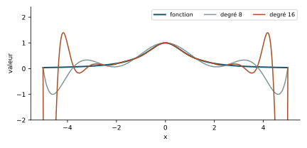

# X FUI-FF, session 2 — Mathématiques 2022 · Corrigé guidé

*Corrigé rédigé par IA, non officiel. Signalez toute erreur.*

**Rédaction** · GPT-6.2 Astra Ultra · vitesse non renseignée · 24 novembre 2026

**Révision** · GPT-6.2 Astra Ultra · vitesse non renseignée · 26 novembre 2026

Le sujet de printemps porte sur l’interpolation de Lagrange. Les polynômes des deux dernières parties utilisent respectivement des nœuds fixes successifs et une nouvelle grille équidistante à chaque degré.

## 1. Interpolation de Lagrange

### Question 1

> [!INDICATION]
> Évaluer une combinaison linéaire en chaque nœud.

#### Solution

Pour tous $P,Q$ et tous scalaires $a,b$, la $i$-ième coordonnée de $E(aP+bQ)$ vaut $aP(x_i)+bQ(x_i)$. Ainsi $E(aP+bQ)=aE(P)+bE(Q)$.

### Question 2

> [!INDICATION]
> Compter les racines puis comparer les dimensions.

#### Solution

Un polynôme du noyau s’annule en $n+1$ points distincts pour un degré au plus $n$. Il est donc nul. L’application injective relie deux espaces de dimension $n+1$ ; elle est bijective. Le vecteur des données a donc un seul antécédent, l’interpolant.

### Question 3a

> [!INDICATION]
> Évaluer les polynômes proposés sur chaque nœud.

#### Solution

$L_j(x_i)=\delta_{ij}$ car chaque facteur du produit vaut $1$ au nœud $j$, tandis qu’un facteur s’annule aux autres nœuds. Les $E(L_j)$ forment la base canonique, donc les $L_j$ forment une base par la bijection 2.

### Question 3b

> [!INDICATION]
> Remonter le vecteur des valeurs dans la base précédente.

#### Solution

Le polynôme $\sum_{j=0}^n y_jL_j$ a pour valeur $y_i$ au nœud $i$, et il est de degré au plus $n$. Par unicité c’est l’interpolant demandé.

### Question 4a

> [!INDICATION]
> Interpréter la matrice dans les bases canoniques.

#### Solution

Pour un polynôme de colonne de coefficients $c$ dans la base $1,X,\ldots,X^n$, la colonne des valeurs est $V(x)c$. La matrice représente l’isomorphisme $E$ et son déterminant est donc non nul.

### Question 4b

> [!INDICATION]
> Les colonnes de l’inverse sont les coefficients des antécédents des vecteurs canoniques.

#### Solution

La colonne $j$ est la colonne des coefficients de $L_j$, par $\ V(x)\operatorname{coef}(L_j)=e_j$. Pour $n=2$, posons $w_0=x_2-x_1$, $w_1=x_0-x_2$, $w_2=x_1-x_0$ et $D=(x_1-x_0)(x_2-x_0)(x_2-x_1)$. Le développement des trois produits donne
$$V(x)^{-1}=\frac1D\begin{pmatrix}
w_0x_1x_2&w_1x_0x_2&w_2x_0x_1\\
-w_0(x_1+x_2)&-w_1(x_0+x_2)&-w_2(x_0+x_1)\\
w_0&w_1&w_2
\end{pmatrix}.$$
Par exemple, la première colonne vient de $w_0(X-x_1)(X-x_2)/D$.

## 2. Convergence des polynômes interpolateurs

### Question 5

> [!INDICATION]
> Itérer le théorème de Rolle sur les intervalles disjoints.

#### Solution

Entre chaque paire de zéros successifs de $g$, Rolle donne un zéro de $g^\prime$ dans l’intervalle ouvert. Il y en a donc $p$ distincts entre $c_0$ et $c_p$. En recommençant sur les dérivées, l’ordre $j$ conserve au moins $p+1-j$ zéros distincts. À l’ordre $p$ il en reste un, strictement entre $c_0$ et $c_p$ (pour $p\ge1$).

### Question 6

> [!INDICATION]
> Ajouter un zéro en ajustant un multiple du polynôme nodal.

#### Solution

Si $x$ est un nœud, les deux membres sont nuls pour tout $\xi_x$. Sinon posons $A=(f(x)-P_n(x))/\Pi_{n+1}(x)$. La fonction $g=f-P_n-A\Pi_{n+1}$ s’annule aux $n+1$ nœuds et en $x$. Par 5, sa dérivée d’ordre $n+1$ s’annule en $\xi_x\in[a,b]$. Comme $\Pi_{n+1}$ est unitaire et $\deg P_n\le n$, on a $f^{(n+1)}(\xi_x)=(n+1)!A$.

### Question 7a

> [!INDICATION]
> Évaluer la série au rayon intérieur choisi.

#### Solution

Puisque $R<R^\prime$, la série $\sum a_n R^n$ converge absolument. Ses termes sont bornés en module, disons par $C$. Cela donne $|a_n|\le CR^{-n}$.

### Question 7b

> [!INDICATION]
> Écrire la fraction sous la forme d’une puissance de R moins la variable.

#### Solution

On a $(1-x/R)^{-1}=R/(R-x)$. Par récurrence sa dérivée d’ordre $k$ est $Rk!/(R-x)^{k+1}$, y compris pour $k=0$.

### Question 7c

> [!INDICATION]
> Dériver la série terme à terme et utiliser la série géométrique majorante.

#### Solution

Pour $|x|\le r$, la dérivation terme à terme à l’intérieur du rayon et 7a donnent $|g^{(k)}(x)|\le C\sum_{n\ge k}n!r^{n-k}/[(n-k)!R^n]$. La somme est la dérivée d’ordre $k$ de $(1-s/R)^{-1}$ évaluée en $s=r$. Par 7b, on obtient $\|g^{(k)}\|_{[-r,r]}\le CR k!/(R-r)^{k+1}$.

### Question 8

> [!INDICATION]
> Centrer le segment et choisir le rayon de comparaison de façon que le quotient géométrique soit inférieur à un.

#### Solution

Posons $r=(b-a)/2$, $m=(a+b)/2$ et choisissons $3r<R<R^\prime$. Pour $g(t)=f(m+t)$, 7 donne la borne des dérivées et $|\Pi_{n+1}(x)|\le(2r)^{n+1}$ sur le segment. Par 6, $\|f-P_n\|\le[CR/(R-r)](2r/(R-r))^{n+1}$. Comme $R-r>2r$, la borne tend vers zéro.

### Question 9

> [!INDICATION]
> Sur un segment fixé les nœuds et les points d’évaluation restent bornés.

#### Solution

Pour un segment $K=[c,d]$ fixé, prenons $r>0$ assez grand pour contenir dans $[-r,r]$ à la fois $K$ et les nœuds, supposés dans le segment fixe $[a,b]$ de la partie. Le rayon de la série de $f$ centrée en zéro est infini, donc on peut choisir $R>3r$. Pour $x\in K$, la preuve de 6 s’applique sur $[-r,r]$ et $|\Pi_{n+1}(x)|\le(2r)^{n+1}$. La majoration géométrique de 8 vaut donc uniformément sur $K$.

## 3. Phénomène de Runge

### Question 10

> [!INDICATION]
> Utiliser l’unicité avec le jeu symétrique de nœuds.

#### Solution

Pour chaque $k$, $p_n(-x_k)=p_n(x_{-k})=f(x_{-k})=f(x_k)$ car $f$ est paire. Les deux polynômes $p_n(-X)$ et $p_n(X)$ de degré au plus $2n$ ont les mêmes $2n+1$ valeurs ; ils sont égaux.

### Question 11

> [!INDICATION]
> Diviser par le produit des facteurs associés aux nœuds et regarder la parité.

#### Solution

$H=(X^2+1)p_n-1$ s’annule à tous les nœuds, donc $H=q\pi_n$ pour $\deg q\le1$. Le polynôme $H$ est pair et $\pi_n=X\prod_{k=1}^n(X^2-a^2k^2/n^2)$ est impair. Le quotient est donc impair, soit $q=cX$. Il ne peut être nul : $H(i)=-1$. Ainsi le degré du quotient est bien un.

### Question 12

> [!INDICATION]
> Évaluer au point imaginaire où le facteur quadratique s’annule.

#### Solution

En $i$, $-1=c\,i^2\prod_{k=1}^n(-1-a^2k^2/n^2)$, d’où $c=(-1)^n/\prod_{k=1}^n(1+a^2k^2/n^2)$. Pour $x$ réel, prenons les modules dans $p_n(x)-f(x)=c\,x^2\prod_{k=1}^n(x^2-a^2k^2/n^2)/(1+x^2)$. Hors des nœuds, remplacer les produits par l’exponentielle des deux sommes logarithmiques donne (1). Aux nœuds, l’erreur vaut zéro ; l’écriture exponentielle s’y lit par continuité ou avec $\log0=-\infty$.

En dehors des nœuds, la formule (1) s’écrit explicitement
$$
\left|p_n(x)-\frac{1}{1+x^2}\right|=
\frac{x^2}{1+x^2}\exp\!\left[
\sum_{k=1}^n\log\left|x^2-\frac{a^2 k^2}{n^2}\right|
-\sum_{k=1}^n\log\left(1+\frac{a^2 k^2}{n^2}\right)\right].
$$

### Question 13

> [!INDICATION]
> Reconnaître une somme de Riemann puis intégrer par parties.

#### Solution

La limite est $\int_0^a\log(1+t^2)\,dt$. Une intégration par parties donne $a\log(1+a^2)-\int_0^a 2t^2/(1+t^2)\,dt=a\log(1+a^2)-2a+2\arctan a$.

### Question 14

> [!INDICATION]
> Chercher deux multiples dont la différence reste loin de tout entier.

#### Solution

Posons $\beta=\operatorname{dist}(y,\mathbb Z)\in]0,1/2]$. Si $\beta\ge1/4$, prenons $m=1$. Sinon $m=\lceil1/(4\beta)\rceil$ donne $1/4\le m\beta<1/2$. Dans les deux cas $\operatorname{dist}(my,\mathbb Z)\ge1/4$. Pour tout $n$, l’inégalité triangulaire sur $\mathbb R/\mathbb Z$ impose que l’un des deux nombres $ny,(n+m)y$ soit à distance au moins $1/8$ des entiers. Ainsi il y a des indices arbitrairement grands, et $1/8>y/10$.

### Question 15a

> [!INDICATION]
> Scinder au point singulier et changer de variable de part et d’autre.

#### Solution

Comme $a$ est entier et $x$ irrationnel, $0<x<a$. La primitive $u\log u-u$ a pour limite zéro en $0^+$. En intégrant à gauche et à droite de $x$, on obtient $\int_0^a\log|x-t|\,dt=x\log x+(a-x)\log(a-x)-a$. Les deux intégrales impropres convergent.

### Question 15b

> [!INDICATION]
> Encadrer l’intégrale par les rectangles à droite et à gauche.

#### Solution

Écrivons $h=a/n$, $m=k_x$. Sur $[0,mh]$, $F(t)=\log(x-t)$ décroît. L’intégrale est donc entre $h\sum_{k=1}^m F(kh)$ et $h\sum_{k=0}^{m-1}F(kh)$. En retirant la somme intérieure $h\sum_{k=1}^{m-1}F(kh)$, les deux extrémités sont $hF(mh)$ et $hF(0)$. Le maximum des deux modules fournit la borne imprimée. Si $m=0$, l’intervalle et la somme intérieure sont vides et la borne est immédiate.

On peut contrôler directement la partie droite utilisée en 15c. Si $h=a/n$, $m=k_x$ et $F(t)=\log(t-x)$ pour $t>x$, la croissance de $F$ donne
$$
0\le \int_{(m+1)h}^{a}F(t)\,dt-h\sum_{k=m+1}^{n-1}F(kh)
\le h\bigl[\log(a-x)-\log((m+1)h-x)\bigr].
$$
Les deux termes de la borne viennent des extrémités de cet intervalle. Elle reste valable si $m+1=n$, auquel cas l’intégrale et la somme sont vides.

### Question 15c

> [!INDICATION]
> Choisir le sous-ensemble des maillages qui évitent de trop près la singularité.

#### Solution

Appliquons 14 à $y=x/a$, irrationnel. Sur la sous-suite choisie, les distances de $x$ aux deux nœuds voisins sont entre $(y/10)h$ et $h$. Les logarithmes correspondants ont donc module $O_x(1+|\log h|)$. Les erreurs des rectangles de 15b et de la borne admise à droite sont $O_x(h(1+|\log h|))$, ainsi que les contributions des deux nœuds omis et du nœud final (où le logarithme est fixe). Sur le petit intervalle entre les voisins, l’intégrale de $|\log|x-t||$ est majorée pour $h<1$ par $2\int_0^h|\log u|\,du=2h(1-\log h)$. Toutes ces quantités tendent vers zéro : la somme complète converge vers l’intégrale sur cette sous-suite.

### Question 16

> [!INDICATION]
> Choisir un point irrationnel strictement à l’intérieur, près de l’extrémité.

#### Solution

Posons $J(x)=\int_0^5\log|x-t|\,dt+\int_0^5\log(x+t)\,dt-\int_0^5\log(1+t^2)\,dt$. La formule de 15a, prolongée avec $u\log u\to0$, donne la continuité du premier terme jusqu’à $x=5$. Le deuxième y est continu par continuité uniforme de l’intégrande près de $5$. Par la positivité admise de $J(5)$ il existe donc un irrationnel $x\in]0,5[$ tel que $J(x)>0$. Pour la sous-suite de 15c, décomposons $\log|x^2-t^2|=\log|x-t|+\log(x+t)$. Les deux autres sommes sont des sommes de Riemann ordinaires. L’exposant dans (1), multiplié par $5/n_j$, tend donc vers $J(x)>0$. L’exposant tend vers $+\infty$ et $x^2/(1+x^2)>0$ ; l’erreur diverge sur cette sous-suite. Ainsi la convergence simple sur tout le segment est impossible. À l’extrémité $x=5$ elle-même, l’erreur est toujours nulle.

