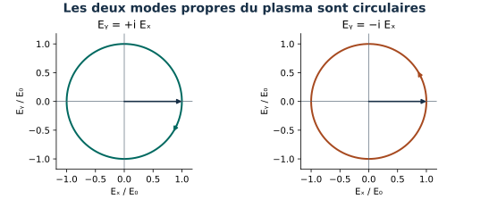
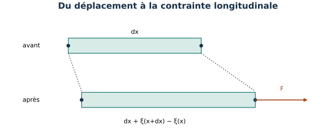
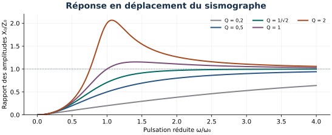
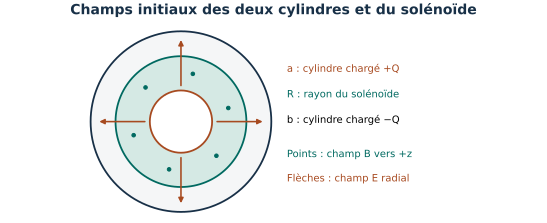

# École polytechnique, FUI-FF session 2 — Physique 2022 · Corrigé guidé

*Corrigé rédigé par IA, non officiel. Signalez toute erreur.*

**Rédaction** · modèle exact non renseigné (famille GPT-6) · effort non renseigné · vitesse non renseignée

**Révision** · modèle exact non renseigné (famille GPT-6) · effort non renseigné · vitesse non renseignée

**Révision (tour 2)** · GPT-6.2 Astra Ultra · vitesse non renseignée

**Révision (tour 3)** · GPT-6.2 Astra Ultra · vitesse non renseignée · 26 novembre 2026

Formation francophone, session 2 (printemps), trois heures sans calculatrice.

## Présentation du sujet

Trois exemples relient champs et matière. La polarisation détermine la vitesse de propagation dans le plasma. Le mouvement relatif de la masse filtre les vibrations enregistrées par le sismographe. La variation du champ dans le solénoïde transfère un moment cinétique aux cylindres chargés.

## Exercice 1 — Onde électromagnétique et plasma

### Question 1

> [!INDICATION]
> Une polarisation rectiligne fixe une direction constante dans le plan transverse.

#### Solution

Avec la convention temporelle $e^{i\omega t}$ et une propagation vers $+z$, le champ incident réel peut s’écrire
$$\mathbf E_i(z,t)=E_0(\cos\theta\,\mathbf e_x+\sin\theta\,\mathbf e_y)\cos(\omega t-k_0z+\phi),\quad \omega=2\pi f,\quad k_0=\omega/c.$$
L’angle $\theta$ fixe l’orientation transverse tracée sur la figure et $\phi$ l’origine des phases. Pour $f=300\,\mathrm{MHz}$, la longueur d’onde incidente dans le vide vaut environ $1\,\mathrm m$.

### Question 2

> [!INDICATION]
> Comparez l’ordre en amplitude de la vitesse et des deux termes magnétiques de Lorentz.

#### Solution

L’électron de masse $m$ et charge $-e$ obéit à $m\dot{\mathbf v}=-e[\mathbf E+\mathbf v\times(\mathbf B_0+\mathbf B_{\rm onde})]$. Dans la réponse linéaire, $\mathbf v$ et $\mathbf B_{\rm onde}$ sont tous deux du premier ordre en amplitude. Leur produit est du second ordre. On conserve $-e\mathbf E$ et $-e\mathbf v\times\mathbf B_0$ avec $\mathbf B_0=B_0\mathbf e_z$. On suppose le plasma non collisionnel, les ions fixes et le mouvement non relativiste ; le poids est négligeable.

### Question 3

> [!INDICATION]
> En régime forcé linéaire, choisissez pour la vitesse la pulsation du champ.

#### Solution

Pour le régime harmonique forcé et hors résonance cyclotron, écrivons $\mathbf v=\Re[\widetilde{\mathbf v}e^{i(\omega t-kz)}]$. Les oscillations libres éventuelles dépendent de la préparation. Comme $\mathbf v\times B_0\mathbf e_z=B_0(v_y\mathbf e_x-v_x\mathbf e_y)$, les amplitudes vérifient
$$im\omega v_x=-eE_x-eB_0v_y,\qquad im\omega v_y=-eE_y+eB_0v_x.$$
Le champ incident transverse ne force pas la composante parallèle $v_z$.

### Question 4

> [!INDICATION]
> Multipliez la charge de chaque porteur par sa vitesse et sa densité numérique.

#### Solution

Les ions restant au repos, la densité volumique de courant est $\mathbf j=-ne\mathbf v$ en $\mathrm{A\,m^{-2}}$, avec $n$ en $\mathrm{m^{-3}}$.

### Question 5

> [!INDICATION]
> Éliminez le champ magnétique entre Faraday et Ampère-Maxwell, en conservant le courant du plasma.

#### Solution

On a $\nabla\times\mathbf E=-\partial_t\mathbf B$ et $\nabla\times\mathbf B=\mu_0\mathbf j+c^{-2}\partial_t\mathbf E$. Dans les ondes transverses planes considérées, $\nabla\cdot\mathbf E=0$. En prenant le rotationnel de la première équation, puis en remplaçant dans la seconde, on obtient
$$\Delta\mathbf E-c^{-2}\partial_t^2\mathbf E=\mu_0\partial_t\mathbf j.$$
En représentation $e^{i(\omega t-kz)}$, ceci donne $(k^2-\omega^2/c^2)\mathbf E=-i\mu_0\omega\mathbf j$.

### Question 6

> [!INDICATION]
> Inversez le système de la vitesse, puis insérez la densité de courant dans l’équation de propagation.

#### Solution

Posons $D=m^2\omega^2-e^2B_0^2$. Pour $D\ne0$,
$$v_x=\frac{im\omega e E_x-e^2B_0 E_y}{D},\qquad v_y=\frac{e^2B_0 E_x+im\omega e E_y}{D}.$$
Dans l’équation de propagation de la question 5 avec $\mathbf j=-ne\mathbf v$, on regroupe les termes et il vient
$$\alpha E_x+i\beta E_y=0,\qquad \alpha E_y-i\beta E_x=0,$$
où $\alpha=k^2-\omega^2/c^2+\mu_0ne^2m\omega^2/D$ et $\beta=\mu_0ne^3\omega B_0/D$.

### Question 7

> [!INDICATION]
> Le déterminant doit s’annuler. Examinez ensuite le rapport de phase des deux composantes.

#### Solution

Le déterminant vaut $\alpha^2-\beta^2$. Pour $B_0\ne0$, ses deux annulations donnent $\alpha=\sigma\beta$ pour $\sigma=+1$ ou $-1$, et $E_y=i\sigma E_x$. Les deux champs propres ont des composantes orthogonales de même amplitude en quadrature, donc des polarisations circulaires de sens opposés. Si $B_0=0$, les deux modes deviennent dégénérés et toute polarisation transverse est possible pour $\alpha=0$.

### Question 8

> [!INDICATION]
> Factorisez le dénominateur commun au moyen de la pulsation cyclotron positive.

#### Solution

Avec $\omega_p^2=ne^2/(m\varepsilon_0)$ et $\omega_c=eB_0/m>0$, $\alpha=\sigma\beta$ entraîne
$$k_\sigma^2=\frac{\omega^2}{c^2}\left[1-\frac{\omega_p^2}{\omega(\omega+\sigma\omega_c)}\right],\qquad E_y=i\sigma E_x.$$
Par exemple pour $\sigma=+1$, le numérateur en $\omega(\omega-\omega_c)$ se simplifie avec $(\omega-\omega_c)(\omega+\omega_c)$. La dissymétrie des deux indices explique qu’une polarisation rectiligne, somme des deux modes, puisse tourner pendant la traversée.

## Exercice 2 — Ondes sismiques et sismographe

### Question 1

> [!INDICATION]
> Comparez le déplacement local du milieu à la direction de propagation.

#### Solution

Dans une onde longitudinale, le déplacement est parallèle à la propagation, comme pour le son dans l’air ou une onde sismique P. Dans une onde transverse, il lui est perpendiculaire, comme pour une onde sur une corde ou une onde sismique S dans un solide.

### Question 2

> [!INDICATION]
> Soustrayez les positions déformées des deux faces, puis la longueur initiale.

#### Solution

Les extrémités d’un élément initialement compris entre $x$ et $x+dx$ sont à $x+\xi(x,t)$ et $x+dx+\xi(x+dx,t)$. Son allongement vaut $d\ell-dx=\xi(x+dx,t)-\xi(x,t)\simeq(\partial_x\xi)dx$. Sa déformation longitudinale est donc $\partial_x\xi$.

### Question 3

> [!INDICATION]
> Appliquez la loi de Hooke à l’élément puis fixez le sens de la force.

#### Solution

La partie de droite exerce vers $+x$ une traction positive si l’élément est allongé. La force signée vaut donc $F(x,t)=ES\,\partial_x\xi(x,t)$. Une déformation négative donne une compression et inverse le signe.

### Question 4

> [!INDICATION]
> Appliquez la deuxième loi de Newton à une tranche de longueur $dx$.

#### Solution

La résultante est $F(x+dx,t)-F(x,t)\simeq ES\,\partial_x^2\xi\,dx$, car l’action au bord gauche est opposée à celle étudiée à la question précédente. La masse est $\rho Sdx$. Ainsi
$$\partial_t^2\xi=\frac E\rho\partial_x^2\xi.$$
Le modèle unidimensionnel donne une célérité $\sqrt{E/\rho}$.

### Question 5

> [!INDICATION]
> Écrivez l’accélération absolue du solide et soustrayez le bilan statique.

#### Solution

La position absolue du solide est $Z_s+z_1+x$. Le bilan à l’équilibre donne $k(L_1-L_0)=mg$. Une élévation relative $x$ raccourcit le ressort de $x$ ; la variation de sa force est $-kx$ et l’amortisseur exerce $-\lambda\dot x$. Donc $m(\ddot Z_s+\ddot x)=-kx-\lambda\dot x$, d’où
$$\ddot x+\frac{\omega_0}{Q}\dot x+\omega_0^2x=-\ddot Z_s=\omega^2Z_0\cos(\omega t).$$
$\omega_0=\sqrt{k/m}$ est la pulsation propre non amortie, en $\mathrm{rad\,s^{-1}}$. $Q=m\omega_0/\lambda=\sqrt{km}/\lambda$ est le facteur de qualité, sans dimension. Il augmente quand l’amortissement diminue.

### Question 6

> [!INDICATION]
> Calculez la réponse harmonique complexe puis son module.

#### Solution

En régime forcé, avec $u=\omega/\omega_0$,
$$\frac{\underline X}{Z_0}=\frac{u^2}{1-u^2+iu/Q},\qquad \frac{X_0}{Z_0}=\frac{u^2}{\sqrt{(1-u^2)^2+u^2/Q^2}}.$$
L’argument de la première expression fixe la phase $\phi$.

### Question 7

> [!INDICATION]
> Examinez les limites, puis la valeur à $u=1$.

#### Solution

Le module varie comme $u^2$ pour $u\ll1$ et tend vers 1 pour $u\gg1$. À $u=1$, il vaut $Q$, ce qui permet de repérer les différentes courbes. Les deux pics peuvent se contrôler avec la formule de la question 8. Pour $Q=2$, le maximum vaut $8/\sqrt{15}\simeq2,07$ à $u=\sqrt{8/7}\simeq1,07$. Pour $Q=1$, il vaut $2/\sqrt3\simeq1,15$ à $u=\sqrt2$. Les trois autres courbes croissent jusqu’au plateau. Le dispositif est un filtre **passe-haut du second ordre** pour le déplacement relatif mesuré.

### Question 8

> [!INDICATION]
> Exprimez le carré du gain comme l’inverse d’un polynôme en $\xi^2$.

#### Solution

Avec $\xi=1/u$, le carré du gain vaut $Y=(X_0/Z_0)^2=[(1-\xi^2)^2+\xi^2/Q^2]^{-1}$. Le dénominateur est $1+(Q^{-2}-2)\xi^2+\xi^4$. Il a un minimum pour une valeur strictement positive de $\xi^2$ seulement si $Q^{-2}<2$. Ainsi **$Q_0=1/\sqrt2$**. Pour $Q>Q_0$, le maximum est à $u=(1-1/(2Q^2))^{-1/2}$. Pour $Q\le Q_0$, le gain rejoint le plateau sans pic.

### Question 9

> [!INDICATION]
> Un bon sismographe maintient sa masse presque immobile dans le référentiel galiléen.

#### Solution

Pour $\omega\gg\omega_0$, $\underline X/Z_0\simeq-1$. La masse suspendue reste alors presque immobile dans le référentiel galiléen, car son déplacement absolu a pour amplitude complexe $Z_0+\underline X\simeq0$. L’enregistrement relatif reproduit donc le déplacement du sol en amplitude, avec un signe connu à inverser. Il faut placer la pulsation propre suffisamment en dessous de la bande sismique visée. Pour un compromis entre bande passante plate, absence de pic et amortissement du transitoire, le choix usuel est $Q=1/\sqrt2$. Un critère différent, celui du retour libre le plus rapide **sans oscillation**, privilégie l’amortissement critique $Q=1/2$. Le choix numérique optimal dépend du critère retenu ; un grand $Q$ allonge le transitoire.

Le choix de l’amortissement se vérifie en chiffrant la fidélité près du plateau. Pour $Q=1/\sqrt2$, le module se réduit à $[1+(\omega_0/\omega)^4]^{-1/2}$. À $\omega=2\omega_0$, le gain est $4/\sqrt{17}\simeq0{,}970$. Pour l’amortissement critique $Q=1/2$, il vaut $u^2/(1+u^2)=0{,}800$ à la même pulsation. La réponse libre du premier choix décroît comme $e^{-\omega_0 t/\sqrt2}$ avec oscillation, celle du second comme $(A+Bt)e^{-\omega_0t}$, ce qui explicite le compromis évoqué.

## Exercice 3 — Moment cinétique du champ électromagnétique

### Question 1

> [!INDICATION]
> Une variation de flux magnétique met en jeu la loi de Faraday.

#### Solution

Quand le courant décroît, le flux axial à travers les contours circulaires diminue. Le champ électrique induit est azimutal et exerce des couples sur les cylindres chargés. Au départ, le moment cinétique est porté par le champ électromagnétique, dont la densité de quantité de mouvement est $\varepsilon_0\mathbf E\times\mathbf B$.

### Question 2

> [!INDICATION]
> Utilisez le champ d’un solénoïde long et le sens de l’axe sur la figure.

#### Solution

Dans l’approximation du solénoïde infiniment long, $\mathbf B=\mu_0 nI\,\mathbf e_z$ dans les régions $r<a$ et $a<r<R$. Il est nul dans les régions $R<r<b$ et $r>b$. Le sens adopté est celui de la figure et du courant positif du sujet.

### Question 3

> [!INDICATION]
> Combien de charge est enfermée dans un cylindre de Gauss de rayon $r$ ?

#### Solution

En négligeant les effets d’extrémité des cylindres de longueur $l$, la charge linéique du premier est $Q/l$. La loi de Gauss donne
$$\mathbf E=\frac{Q}{2\pi\varepsilon_0lr}\mathbf e_r\quad(a<r<b).$$
Ce résultat vaut des deux côtés de $r=R$. Le champ est nul pour $r<a$ (aucune charge enfermée) et $r>b$ (charge totale nulle).

### Question 4

> [!INDICATION]
> Les champs électrique et magnétique doivent être tous les deux présents.

#### Solution

Seule la région $a<r<R$ présente un produit non nul. Comme $\mathbf e_r\times\mathbf e_z=-\mathbf e_\phi$, on obtient $\varepsilon_0\mathbf E\times\mathbf B=-\mu_0nIQ\mathbf e_\phi/(2\pi lr)$. Le moment cinétique axial par unité de volume est donc
$$\ell_z=r(\varepsilon_0\mathbf E\times\mathbf B)_\phi=-\frac{\mu_0nIQ}{2\pi l}.$$
Le vecteur de moment par rapport à l’axe est $\ell_z\mathbf e_z$. Si l’on forme le moment local par rapport à un point avec le vecteur position complet $r\mathbf e_r+z\mathbf e_z$, le terme transverse s’annule à l’intégration azimutale.

### Question 5

> [!INDICATION]
> L’intégrande axial est constant dans une couronne cylindrique.

#### Solution

Le volume où les champs se recouvrent vaut $\pi(R^2-a^2)l$. L’intégration donne
$$\mathbf L_{\rm champ}=-\tfrac12\mu_0 n I Q(R^2-a^2)\,\mathbf e_z.$$

### Question 6

> [!INDICATION]
> Choisissez un contour fixe circulaire centré sur l’axe.

#### Solution

La loi de Faraday donne $\oint\mathbf E_{\rm ind}\cdot d\boldsymbol\ell=-d\Phi_B/dt$. Le flux est proportionnel à $I(t)$, donc le champ induit est proportionnel à $\dot I$. Par symétrie, la circulation correspond à la composante azimutale uniforme $2\pi r E_\phi$. Le champ électrostatique radial des cylindres peut subsister simultanément.

### Question 7

> [!INDICATION]
> Le rayon du disque traversé par le champ est limité par le solénoïde.

#### Solution

Pour $r<R$, $\Phi_B=\mu_0nI\pi r^2$ et $E_\phi=-\mu_0nr\dot I/2$. Pour $r>R$, $\Phi_B=\mu_0nI\pi R^2$ et $E_\phi=-\mu_0 n R^2\dot I/(2r)$. Le champ induit exerce un couple axial $QrE_\phi$ sur un cylindre portant la charge signée $Q$. Pendant la coupure ($\dot I<0$), le cylindre interne positif et le cylindre externe négatif reçoivent donc des couples opposés.

### Question 8

> [!INDICATION]
> Intégrez le couple entre les valeurs initiale et finale du courant.

#### Solution

Sur le cylindre intérieur, $dL_{a,z}/dt=QaE_\phi(a)=-\mu_0nQa^2\dot I/2$. Sur l’extérieur, $dL_{b,z}/dt=-QbE_\phi(b)=+\mu_0nQR^2\dot I/2$. Pour une coupure de $I$ à zéro,
$$\mathbf L_a=\tfrac12\mu_0nIQa^2\mathbf e_z,\qquad \mathbf L_b=-\tfrac12\mu_0nIQR^2\mathbf e_z.$$
La somme est $-\mu_0nIQ(R^2-a^2)\mathbf e_z/2$, égale au moment du champ initial. Le moment cinétique total est conservé dans le modèle quasi statique.

La conservation peut se vérifier à tout instant de la coupure. Les deux couples ont pour somme $\mu_0 nQ(R^2-a^2)\dot I/2$, tandis que $dL_{\mathrm{champ},z}/dt=-\mu_0 nQ(R^2-a^2)\dot I/2$. Les variations s’annulent instantanément dans l’approximation quasi statique, même pour une rampe de courant non linéaire.

## Bilan

Le plasma distingue deux polarisations circulaires. Le sismographe suit fidèlement les vibrations bien au-dessus de sa fréquence propre. Dans le système à cylindres, la disparition du moment du champ initial est compensée par les moments mécaniques opposés des deux charges.
