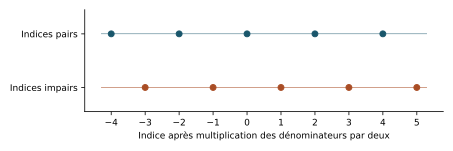
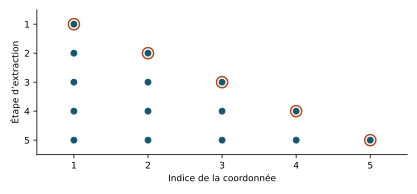
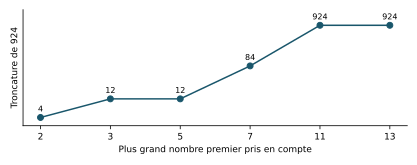
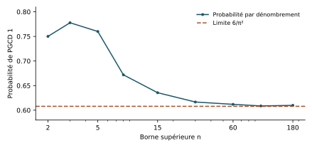

# École polytechnique MP — Mathématiques B 2022 · Corrigé brut

*Corrigé rédigé par IA, non officiel. Signalez toute erreur.*

**Rédaction** · GPT-6.2 Astra Ultra · vitesse non renseignée · 24 novembre 2026

**Révision** · GPT-6.2 Astra Ultra · vitesse non renseignée · 26 novembre 2026

L’épreuve du 26 avril 2022, en quatre heures, relie deux calculs. La cotangente donne les valeurs de la fonction zêta aux premiers entiers pairs. Les lois des PGCD de tirages uniformes font ensuite apparaître les inverses de ces mêmes valeurs. Les 41 questions et sous-questions sont traitées dans l’ordre du sujet. [Sujet officiel](https://www.polytechnique.edu/admission-cycle-ingenieur/sites/admission/files/content/2022%20MP%20SUJET%20ECRIT%20DE%20MATHS%20B%20%28X%29.pdf) · [Rapport du jury](https://www.polytechnique.edu/admission-cycle-ingenieur/sites/admission/files/content/2022%20MP%20RAPPORT%20ECRIT%20MATHS%20B%20%28X%29.pdf)

## I. De la cotangente aux valeurs paires de la fonction zêta

### Question 1a

Pour $x\notin\mathbb Z$, posons $u_n(x)=1/(x+n)+1/(x-n)=2x/(x^2-n^2)$. Pour ce $x$ fixé, $u_n(x)=O_x(n^{-2})$. La série des termes appariés converge absolument. Notons $g_N(x)=\sum_{j=-N}^N(x+j)^{-1}$ sa somme partielle, terme $1/x$ inclus.

### Question 1b

Le terme $1/x$ et chaque $u_n$ sont impairs. En passant à la limite dans $g_N(-x)=-g_N(x)$, on obtient l’imparité de $g$. Celle de $f(x)=\pi\cos(\pi x)/\sin(\pi x)$ donne celle de $D=f-g$.

### Question 1c

Le changement $j\mapsto j+1$ donne $g_N(x+1)-g_N(x)=(x+N+1)^{-1}-(x-N)^{-1}$. Les deux termes tendent vers zéro. Ainsi $g(x+1)=g(x)$. Le sinus et le cosinus changent simultanément de signe quand on ajoute $\pi$ à leur argument, donc $f$, puis $D$, sont aussi de période un.

### Question 1d

Soit $K\subset\mathbb R\setminus\mathbb Z$ compact, et $A=\max_{x\in K}|x|$. Dès que $n>2A$, on a $n^2-x^2\ge3n^2/4$ et $|u_n(x)|\le 8A/(3n^2)$ sur $K$. La queue converge normalement et chaque terme est continu sur $K$. Ainsi $g$ est continue localement sur son domaine. Le dénominateur de $f$ y est non nul, donc $D$ est continue.

### Question 2a

Écrivons $t=\pi x/2$. Pour $x$ non entier, $\sin t$ et $\cos t$ sont non nuls. Comme $\cot(t+\pi/2)=-\tan t$, la somme des deux cotangentes est $(\cos^2 t-\sin^2 t)/(\sin t\cos t)=2\cot(2t)$. En multipliant par $\pi$ on obtient l’égalité demandée.

### Question 2b

On a $g_N(x/2)=2\sum_{j=-N}^{N}(x+2j)^{-1}$ et $g_N((1+x)/2)=2\sum_{j=-N}^{N}(x+2j+1)^{-1}$. Les deux plages couvrent une fois chaque entier de $-2N$ à $2N+1$. Leur somme vaut donc $2g_{2N}(x)+2/(x+2N+1)$. Le passage à la limite donne $2g(x)$.

### Question 3a

Le développement du sinus et du cosinus en zéro donne $f(x)=1/x-\pi^2x/3+O(x^3)$. Pour $0<|x|\le1/2$, $|u_n(x)|\le8|x|/(3n^2)$, donc $g(x)=1/x+O(x)$. Ainsi $D(x)\to0$ en zéro. Par périodicité la limite est nulle en chaque entier. En y donnant la valeur zéro, on obtient une fonction $\widetilde D$ continue, impaire et de période un. Par continuité, l’identité des questions 2 se prolonge aussi à tout réel.

### Question 3b

Par continuité sur $[0,1]$, il existe $\alpha$ où le maximum $M$ est atteint. Par périodicité $M$ est un maximum sur $\mathbb R$. L’identité donne $2M=\widetilde D(\alpha/2)+\widetilde D((1+\alpha)/2)$, et chacun des deux termes est au plus $M$. Ils valent donc tous deux $M$. En recommençant avec $\alpha/2$ et par récurrence, $\widetilde D(\alpha/2^n)=M$ pour tout $n\ge0$.

### Question 4

Par continuité en zéro, $M=\lim_n\widetilde D(\alpha/2^n)=0$. Pour tout $x$, $\widetilde D(x)\le0$ et $-\widetilde D(x)=\widetilde D(-x)\le0$, d’où la nullité. L’égalité $f=g$, multipliée par $x$, fournit
$$\pi x\cot(\pi x)=1+2\sum_{n\ge1}\frac{x^2}{x^2-n^2}\qquad (x\notin\mathbb Z).$$

### Question 5a

Posons $t=x/(2\pi)$, avec $0<|t|<1$. Pour chaque $n\ge1$, $t^2/(t^2-n^2)=-\sum_{k\ge1}(t/n)^{2k}$. La somme des valeurs absolues sur $n,k$ est majorée par $\sum_{n\ge1}t^2/[n^2(1-t^2)]<\infty$. On peut donc permuter les deux sommations dans la formule de 4. Il vient
$$\frac{x}{2}\cot\frac{x}{2}=1-2\sum_{k\ge1}\zeta(2k)\left(\frac{x}{2\pi}\right)^{2k}
=1-\sum_{k\ge1}\frac{\zeta(2k)}{2^{2k-1}\pi^{2k}}x^{2k}.$$

### Question 5b

L’identité $e^{ix}-1=2ie^{ix/2}\sin(x/2)$ donne $ix/(e^{ix}-1)=(x/2)(\cot(x/2)-i)$. La question 5a donne aussitôt, sur $0<|x|<2\pi$,
$$\frac{ix}{e^{ix}-1}=1-\frac{ix}{2}-\sum_{k\ge1}\frac{\zeta(2k)x^{2k}}{2^{2k-1}\pi^{2k}}.$$

### Question 6

Posons $c_k=\zeta(2k)/(2^{2k-1}\pi^{2k})$ et $H(z)=1-z/2+\sum_{k\ge1}(-1)^{k-1}c_kz^{2k}$. Comme $\zeta(2k)\le\zeta(2)$, le rayon de convergence est au moins $2\pi$. Le produit $F(z)=(e^z-1)H(z)-z$ est également une série entière sur ce disque. Or 5b donne $F(ix)=0$ sur $|x|<2\pi$, y compris zéro par continuité. En écrivant $F(z)=\sum a_jz^j$, l’unicité des coefficients de la série entière en la variable réelle $x$ donne $i^ja_j=0$ pour chaque $j$. Ainsi $F$ est identiquement nulle sur le disque, ce qui donne l’identité, sans division en zéro.

### Question 7a

Sur les réels tels que $0<|x|<2\pi$, la question 6 donne $h(x)=H(x)$, et $h(0)=H(0)=1$. Ainsi $h$ est analytique près de zéro. Hors de zéro, son dénominateur $e^x-1$ ne s’annule pas, donc $h$ est de classe $C^\infty$ sur tout $\mathbb R$. Pour $n\ge1$,
$$h^{(2n)}(0)=(2n)!(-1)^{n-1}c_n=\frac{(-1)^{n-1}(2n)!\,\zeta(2n)}{2^{2n-1}\pi^{2n}}.$$

### Question 7b

Les nombres définis sont les dérivées $b_k=h^{(k)}(0)$, puisque les seuls termes impairs de $H$ sont linéaires. Dans $(e^z-1)H(z)=z$, le coefficient de $z^{n+1}$ est le produit de Cauchy $\sum_{k=0}^n b_k/[k!(n+1-k)!]$. Le membre de droite donne $1$ si $n=0$ et $0$ sinon.

### Question 7c

Pour $n\ge1$, la relation devient $\sum_{k=0}^n\binom{n+1}{k}b_k=0$. Aux rangs $2,4,6$, sachant $b_1=-1/2$ et $b_3=b_5=0$, elle donne successivement
$$1-3/2+3b_2=0,\quad 1-5/2+10b_2+5b_4=0,$$
$$1-7/2+21b_2+35b_4+7b_6=0.$$
Ainsi $b_2=1/6$, $b_4=-1/30$ et $b_6=1/42$. La formule de 7a se renverse en
$$\zeta(2)=\pi^2/6,\qquad\zeta(4)=\pi^4/90,\qquad\zeta(6)=\pi^6/945.$$

## II. Convergence et tension des probabilités discrètes

### Question 8a

Pour toute probabilité $\mu$ sur $E$ et toute partie $A$ de $E$, $0\le\mu(A)\le\mu(E)=1$. Ainsi $\mu$ est une fonction réelle bornée sur $\mathcal P(E)$, de norme exactement un car $A=E$ atteint la borne.

### Question 8b

Pour toute fonction bornée $u$, le supremum $\|u\|$ est fini et positif ou nul. S’il vaut zéro, $|u(A)|\le0$ pour chaque $A$, donc $u=0$. La réciproque est immédiate. Pour tout réel $a$, $\|au\|=|a|\|u\|$. Enfin $|u(A)+v(A)|\le\|u\|+\|v\|$ pour tout $A$, d’où l’inégalité triangulaire après passage au supremum. Ceci définit une norme.

### Question 9

Pour tout $x\in E$, $|\mu_n(x)-\mu(x)|\le\|\mu_n-\mu\|$. La convergence en norme vers $\mu$ entraîne donc la convergence demandée sur chaque singleton.

### Question 10a

Puisque $\sum_{i\ge1}\mu(x_i)=1$, une somme partielle dépasse $1-\varepsilon$. Prenons $F_\varepsilon$ formé des $K$ premiers points correspondants. La somme finie $\sum_{i=1}^K|\mu_n(x_i)-\mu(x_i)|$ tend vers zéro par l’hypothèse ponctuelle. Elle est donc strictement inférieure à $\varepsilon$ pour tout $n$ assez grand.

### Question 10b

Avec $F=F_\varepsilon$, l’additivité sur $A=(A\cap F)\sqcup(A\setminus F)$ et l’inégalité triangulaire donnent
$$|\mu_n(A)-\mu(A)|\le |\mu_n(A\cap F)-\mu(A\cap F)|+\mu(E\setminus F)+\mu_n(E\setminus F).$$
Dès le rang de 10a, le premier terme est majoré par la somme des écarts sur $F$, strictement inférieure à $\varepsilon$. Le second est inférieur à $\varepsilon$. Enfin $\mu_n(E\setminus F)=1-\mu_n(F)\le1-\mu(F)+|\mu_n(F)-\mu(F)|<2\varepsilon$. D’où une borne $4\varepsilon$ uniforme en $A$.

### Question 10c

La question 9 donne la nécessité. Si $\mu$ est une probabilité et si les masses ponctuelles convergent vers les siennes, 10b donne $\|\mu_n-\mu\|\le4\varepsilon$ pour $n\ge N_\varepsilon$. Puisque $\varepsilon>0$ est arbitraire, la norme tend vers zéro.

On peut identifier exactement cette norme sur les probabilités du sujet. Pour $d(x)=\mu_n(\{x\})-\mu(\{x\})$, la somme des $d(x)$ est nulle et la somme de leurs modules est au plus deux. La partie $A_+=\{x:d(x)>0\}$ recueille toute la masse positive ; son complément recueille l’opposée. Il vient
$$
\sup_{A\subset E}|\mu_n(A)-\mu(A)|
=\tfrac12\sum_{x\in E}|d(x)|.
$$
Le facteur $1/2$ correspond à la convention de norme choisie dans l’énoncé.

### Question 11

Pour $k\ne\ell$, $\delta_k(\{x_k\})=1$ et $\delta_\ell(\{x_k\})=0$. La distance vaut donc exactement un car les deux mesures sont à valeurs dans $[0,1]$. La suite n’est pas de Cauchy et ne converge pas dans l’espace des fonctions bornées. Sur chaque singleton fixé les valeurs tendent pourtant vers zéro. Toute la masse se déplace vers des indices de plus en plus grands.

### Question 12a

Les valeurs de chaque masse sont dans le compact $[0,1]$. Bolzano–Weierstrass fournit une extraction strictement croissante $\varphi_1$ pour laquelle $\mu_{\varphi_1(n)}(x_1)$ converge. Supposons construites les $k$ premières extractions et posons $\Phi_k=\varphi_1\circ\cdots\circ\varphi_k$. Extrayons de $(\mu_{\Phi_k(n)}(x_{k+1}))_n$ une sous-suite convergente, d’extraction $\varphi_{k+1}$. Les premiers indices gardent leurs limites car une sous-suite d’une suite convergente converge vers la même limite. La récurrence fournit la suite demandée.

### Question 12b

Pour $k\ge i$, $\Phi_k$ se factorise en $\Phi_i$ suivie à droite des extractions $\varphi_{i+1},\ldots,\varphi_k$. La suite des masses en $x_i$ est donc extraite de celle déjà convergente au rang $i$. Sa limite $\mu_\infty(x_i)$ est indépendante de $k$.

### Question 12c

Toute extraction $\varphi$ de $\mathbb N^*$ vérifie $\varphi(j)\ge j$. Ainsi $\psi(k+1)=\Phi_k(\varphi_{k+1}(k+1))\ge\Phi_k(k+1)>\Phi_k(k)=\psi(k)$. Fixons $i$. Pour $k\ge i$, $\psi(k)=\Phi_i(t_k)$ avec $t_i=i$ et $t_k=(\varphi_{i+1}\circ\cdots\circ\varphi_k)(k)\ge k$ pour $k>i$. Comme $t_k\to\infty$, $\mu_{\psi(k)}(x_i)\to\mu_\infty(x_i)$.

### Question 12d

Chaque limite $\mu_\infty(x_i)$ est non négative. Pour tout $m$ fixé,
$$\sum_{i=1}^m\mu_\infty(x_i)=\lim_{k\to\infty}\sum_{i=1}^m\mu_{\psi(k)}(x_i)\le1.$$
Les sommes partielles positives croissent en $m$ et sont majorées par un. La série a donc une somme au plus égale à un.

### Question 12e

Fixons $\varepsilon>0$. La tension donne un ensemble fini $F_\varepsilon$ de masse au moins $1-\varepsilon$ pour toutes les mesures et en particulier pour la sous-suite diagonale. En passant à la limite sur cet ensemble fini, $\sum_{x\in F_\varepsilon}\mu_\infty(x)\ge1-\varepsilon$. Par 12d, la somme totale est ainsi égale à un. Définissons $\mu_\infty(A)=\sum_{x\in A}\mu_\infty(x)$, probabilité par sommation de termes positifs sur les parties disjointes. La question 10c convertit alors la convergence sur les singletons en convergence en norme de la sous-suite. Cette loi est une valeur d’adhérence.

## III. Lois de variables aléatoires et troncatures premières

### Question 13

Pour $A\subset E$, l’événement $\{X\in A\}$ est mesurable comme réunion au plus dénombrable des $\{X=x\}$. La valeur $\mu_X(A)$ est positive ou nulle, et $\mu_X(E)=1$. Pour des $A_j$ deux à deux disjoints, les événements $\{X\in A_j\}$ le sont aussi et leur réunion est $\{X\in\bigcup_j A_j\}$. La $\sigma$-additivité de $\mathbb P$ donne celle de $\mu_X$. On a notamment $\mu_X(\varnothing)=0$.

### Question 14

On a $|\mu_X(A)-\mu_Y(A)|=|\mathbb E(\mathbf1_{X\in A}-\mathbf1_{Y\in A})|\le\mathbb E|\mathbf1_{X\in A}-\mathbf1_{Y\in A}|$. La différence absolue vaut zéro si $X=Y$ et au plus un sinon. L’espérance est au plus $\mathbb P(X\ne Y)$, indépendamment de $A$. Prendre le supremum donne l’inégalité en norme.

### Question 15a

Pour chaque issue, la suite devient égale à sa limite $X(\omega)$ à partir d’un certain rang. L’ensemble des désaccords est donc fini. Il possède un plus grand indice s’il est non vide, et le sujet donne la valeur zéro dans le cas vide. La limite ponctuelle $X$ est mesurable. Pour $j\ge1$, $\{L\ge j\}=\bigcup_{n\ge j}\{X_n\ne X\}$ est mesurable, ce qui, avec $L\ge0$, prouve que $L$ est une variable aléatoire entière.

### Question 15b

Si $X_n(\omega)\ne X(\omega)$, l’indice $n$ appartient à l’ensemble dont $L(\omega)$ est le maximum. On a donc $L(\omega)\ge n$. L’inclusion des événements implique $\mathbb P(X_n\ne X)\le\mathbb P(L\ge n)$, y compris pour $n=0$.

### Question 15c

Les événements $\{L\ge n\}$ décroissent vers l’ensemble vide puisque $L$ est fini pour chaque issue. Par continuité décroissante de la probabilité, $\mathbb P(L\ge n)\to0$. Les questions 14 et 15b donnent $0\le\|\mu_{X_n}-\mu_X\|\le\mathbb P(L\ge n)$, d’où la conclusion.

### Question 16

Chaque entier $m\ge1$ a un nombre fini de facteurs premiers. Dès que tous figurent parmi $p_1,\ldots,p_n$, $\psi_n(m)=m$, aussi pour $m=1$ par produit vide. Pour chaque issue, la suite $\psi_n(X)$ est donc stationnaire de limite $X$, le rang pouvant dépendre de l’issue. La question 15c donne la convergence des lois en norme et la question 9 donne la convergence en chaque singleton $\{x\}$ demandée.

## IV. Divisibilité et loi limite du PGCD

### Question 17a

Notons $M(a)=a\mathbb N^*$ et $B_n(r)=\bigcup_{i=1}^n M(rp_i)$. Pour $i\le n$, $M(rp_i)\cap M(rp_{n+1})=M(rp_ip_{n+1})$. En effet, après division par $r$, un entier divisible par les deux nombres premiers distincts est divisible par leur produit, et la réciproque est immédiate. Ainsi $B_n(r)\cap M(rp_{n+1})=\bigcup_{i=1}^n M(rp_{n+1}p_i)$. Un élément de $B_{n+1}(r)$ est soit déjà dans $B_n(r)$, soit dans $M(rp_{n+1})$ privé de cette intersection. Réciproquement les deux ensembles sont inclus dans $B_{n+1}(r)$. Leur réunion est disjointe, ce qui démontre précisément l’égalité demandée.

### Question 17b

Posons $T_n(r)=M(r)\setminus B_n(r)$ et $T_0(r)=M(r)$. Par hypothèse les deux lois coïncident sur $T_0(r)$ pour tout $r$. D’après 17a, les éléments éliminés de $T_n(r)$ lorsqu’on ajoute le premier $p_{n+1}$ sont exactement ceux de $T_n(rp_{n+1})$. Ainsi $T_n(r)=T_{n+1}(r)\sqcup T_n(rp_{n+1})$. Si les deux probabilités coïncident sur tous les $T_n(a)$, l’égalité
$$\mu(T_{n+1}(r))=\mu(T_n(r))-\mu(T_n(rp_{n+1}))$$
donne leur égalité sur tous les $T_{n+1}(r)$. La récurrence conclut.

### Question 17c

La suite $T_n(r)$ décroît. Elle contient toujours $r$. Tout autre multiple $ra$, avec $a>1$, disparaît dès qu’un facteur premier de $a$ est rencontré. Ainsi $\bigcap_n T_n(r)=\{r\}$. Par continuité décroissante et 17b, les deux lois ont la même masse en $r$. Toute partie de $\mathbb N^*$ étant réunion dénombrable de ses singletons, les probabilités sont égales.

### Question 18

Si la convergence en norme échouait, une sous-suite resterait à distance au moins $\varepsilon>0$ de $\mu_X$. Elle hérite de la tension et possède par 12e une sous-suite convergeant en norme vers une probabilité $\nu$. Pour tout $r$, la convergence en norme sur le test $M(r)$ donne $\nu(M(r))=\lim\mathbb P(r\mid X_{n_j})=\mathbb P(r\mid X)$. La question 17c impose $\nu=\mu_X$. Ceci contredit la borne inférieure sur la distance, d’où la convergence de la suite entière.

### Question 19

Pour $n\ge1$, les multiples de $r$ parmi $1,\ldots,n$ sont au nombre de $\lfloor n/r\rfloor$. Par uniformité, $\mathbb P(r\mid X_n^{(i)})=\lfloor n/r\rfloor/n\le1/r$, et cette quantité tend vers $1/r$. Pour que $r$ divise le PGCD $Z_n^{(s)}$, il faut et il suffit qu’il divise chacun des $s$ entiers. Les variables sont indépendantes, donc
$$\mathbb P(r\mid Z_n^{(s)})=\left(\frac{\lfloor n/r\rfloor}{n}\right)^s\longrightarrow r^{-s}.$$

### Question 20a

Pour $s>1$, $\zeta(s)$ est finie et normalise les masses positives. On obtient
$$\mathbb P(k\mid Z)=\sum_{j\ge1}\frac1{\zeta(s)(kj)^s}=k^{-s}.$$

### Question 20b

Pour $s\ge2$ et tout $r$, $\mathbb P(Z_n^{(s)}=r)\le\mathbb P(r\mid Z_n^{(s)})\le r^{-s}$ par 19. Donc, uniformément en $n$,
$$\mathbb P(Z_n^{(s)}>K)\le\sum_{r>K}r^{-s}\xrightarrow[K\to\infty]{}0.$$
Les ensembles finis $\{1,\ldots,K\}$ établissent la tension. Par 19 et 20a, la probabilité de chaque ensemble de multiples tend vers celle de la loi $\mu_s$. La question 18 s’applique et donne la convergence en norme vers $\mu_s$.

### Question 21

Pour les tirages indépendants du sujet, être premiers entre eux signifie que le PGCD commun vaut un. La convergence en norme de 20b donne
$$P_n(s)\longrightarrow\mu_s(\{1\})=\frac1{\zeta(s)}.$$
Si « tirer $s$ nombres » se comprend sans remise, la conclusion reste la même pour $s$ fixé. La loi ordonnée sans remise est celle des tirages indépendants conditionnellement à l’événement $C$ que leurs valeurs sont toutes distinctes. Pour tout événement $A$, la formule des probabilités totales donne $|\mathbb P(A)-\mathbb P(A\mid C)|\le\mathbb P(C^c)$. Chaque paire de tirages coïncide avec probabilité $1/n$, donc $\mathbb P(C^c)\le\binom{s}{2}/n\to0$. Un choix uniforme d’un sous-ensemble donne le même PGCD que le tirage ordonné sans remise.

Par 7c, les limites demandées pour $s=2,4,6$ sont respectivement $6/\pi^2$, $90/\pi^4$ et $945/\pi^6$.

Les points de la figure peuvent se retrouver par un calcul entier. Pour deux tirages, notons $C(k)$ le nombre de couples ordonnés d’entiers entre 1 et $k$ dont le PGCD vaut un. Le partage suivant le PGCD donne $n^2=\sum_{d=1}^n C(\lfloor n/d\rfloor)$. Ainsi $C(1)=1$ et
$$
C(n)=n^2-\sum_{d=2}^n C(\lfloor n/d\rfloor),\qquad P_n(2)=C(n)/n^2.
$$
Par exemple $C(2)=3$, $C(3)=7$ et $C(5)=19$. Les ordonnées correspondantes sont $3/4$, $7/9$ et $19/25$. La convergence établie n’impose pas une suite monotone.

