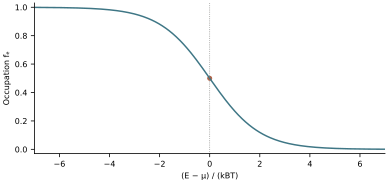
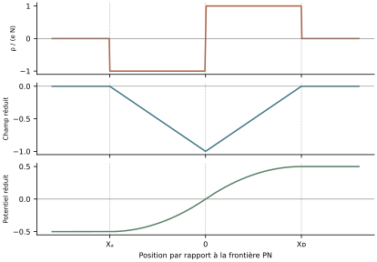
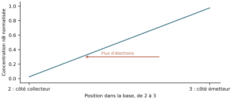
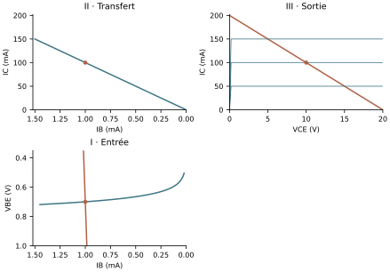
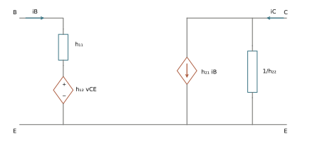
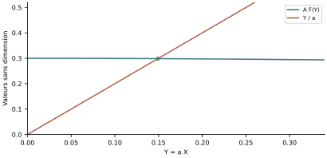

# Physique et SI — X MP 2022 · Corrigé brut

*Corrigé rédigé par IA, non officiel.*

**Rédaction** · GPT-6.2 Astra Ultra · vitesse non renseignée

## I — Propriétés électriques du semi-conducteur

### Question 1 — Bande interdite et énergie thermique

À $300\ \mathrm K$, $k_BT_a/e=1/K\simeq0{,}025\ \mathrm V$, donc $E_G\simeq40k_BT_a$. La faible population de la bande de conduction rend le semi-conducteur intrinsèque peu conducteur. Chauffer le matériau augmente fortement le nombre de paires électron-trou et, dans ce régime, sa conductivité. Pour un métal ordinaire près de la température ambiante, la densité de porteurs change peu et la diffusion plus forte par le réseau réduit la conductivité.

### Question 2 — Fraction de dopants

Pour une distance interatomique de quelques dixièmes de nanomètre, par exemple $0{,}3\ \mathrm{nm}=3\times10^{-8}\ \mathrm{cm}$, on estime $N_{\rm at}\sim(3\times10^{-8})^{-3}\sim4\times10^{22}\ \mathrm{cm^{-3}}$. Le rapport à $10^{16}\ \mathrm{cm^{-3}}$ est de quelques millions, soit un dopant pour quelques millions d’atomes. Une très petite fraction d’impuretés suffit à modifier le nombre de porteurs mobiles.

### Question 3 — Gel des donneurs, plateau et régime intrinsèque

L’abscisse $\beta=1/(k_BT)$ croît vers les basses températures. Dans le domaine 1 (à droite), les donneurs gèlent progressivement et peu d’électrons atteignent la bande de conduction. Dans le domaine 2, les donneurs sont pratiquement tous ionisés et fournissent $n\simeq N_D$ tandis que les excitations intrinsèques restent minoritaires. Comme l’ordonnée du plateau est zéro, $n^*\sim N_D\sim10^{16}\ \mathrm{cm^{-3}}$. Dans le domaine 3 (à gauche), les excitations à travers le gap dominent et les deux courbes se rejoignent. Les donneurs restent ionisés dans les domaines 2 et 3. La température ambiante est sur le plateau.
Les énergies du sujet donnent les échelles $\delta E_D/k_B\sim10^2\ \mathrm K$ et $E_G/k_B\sim10^4\ \mathrm K$. Les températures de transition ne sont pas universellement égales à ces échelles. La véritable entrée au régime intrinsèque est définie par $n_i(T_i)\sim N_D$. Avec $n_i(300\ \mathrm K)\sim10^{11}\ \mathrm{cm^{-3}}$ fourni plus loin et $n_i\propto e^{-E_G/(2k_BT)}$, on obtient $T_i\sim7\times10^2\ \mathrm K$ en négligeant les préfacteurs, donc de l’ordre de $10^3\ \mathrm K$. Le gel des donneurs commence à une température de l’ordre de quelques dizaines à une centaine de kelvins selon les préfacteurs d’occupation. Le tracé qualitatif ne fixe pas des températures précises.

### Question 4 — Utilisation en thermométrie

Pour un échantillon intrinsèque de géométrie connue, la résistance diminue fortement quand la température augmente. En mesurant la résistance sous faible courant, après étalonnage de $R(T)$, on réalise un thermomètre à semi-conducteur. Un faible courant limite l’auto-échauffement.

### Question 5 — Occupation de Fermi

$f_e(E)=1/[1+e^{(E-\mu)/(k_BT)}]$ décroît de 1 à 0 et vaut $1/2$ en $E=\mu$, son point d’inflexion. Sa pente en ce point vaut $-1/(4k_BT)$. La transition a une largeur de quelques $k_BT$. Par exemple de 90 % à 10 % l’intervalle vaut $2\ln9\, k_BT\simeq4{,}4k_BT$. La largeur définie par les intersections de la tangente avec 0 et 1 vaut $4k_BT$.

### Question 6 — Nombre d’états occupés

La concentration électronique vaut $n=\int_{E_C}^\infty g_C(E)f_e(E)\,\mathrm dE$. Le facteur $g_C\mathrm dE$ compte les états disponibles par unité de volume et le facteur $f_e$ leur occupation moyenne.

### Question 7 — Limite non dégénérée

Si $e^{\beta(E_C-\mu)}\gg1$, $f_e(E)\simeq e^{-\beta(E-\mu)}$ dans toute la bande. Posons $u=(E-E_C)/(k_BT)$. À partir de la densité d’états du sujet,
$$n=\frac{8\sqrt2\pi m_C^{3/2}}{h^3}(k_BT)^{3/2}e^{-\beta(E_C-\mu)}\int_0^\infty u^{1/2}e^{-u}\,\mathrm du=N_Ce^{-\beta(E_C-\mu)},$$
avec $N_C=2(2\pi m_Ck_BT/h^2)^{3/2}$. Ce préfacteur est une concentration.

### Question 8 — Produit des concentrations et potentiel chimique

La multiplication des deux lois donne $np=N_CN_Ve^{-\beta E_G}$. Leur quotient donne $n/p=(N_C/N_V)e^{\beta(2\mu-E_C-E_V)}$, d’où
$$\mu=\frac{E_C+E_V}{2}+\frac{k_BT}{2}\ln\frac{nN_V}{pN_C}.$$
Ces formules concernent les porteurs non dégénérés à l’équilibre.

### Question 9 — Concentration intrinsèque

Chaque excitation à travers la bande interdite crée un électron et un trou. D’où $n=p=n_i$, avec $n_i=\sqrt{N_CN_V}\,e^{-E_G/(2k_BT)}$. En négligeant la variation des préfacteurs, $\ln n_i$ est une droite de pente $-E_G/2$ en fonction de $\beta$. À haute température cette contribution dépasse la concentration des donneurs et rejoint le domaine commun aux deux courbes.

### Question 10 — Position du niveau de Fermi intrinsèque

Pour $n=p$, $\mu_i=(E_C+E_V)/2+(k_BT/2)\ln(N_V/N_C)$. Pour $m_C\simeq m_V$ les deux densités effectives sont voisines et le niveau est proche du milieu du gap. À $T_a$, $\beta(E_C-\mu_i)\simeq\beta(\mu_i-E_V)\simeq20$, donc les deux exponentielles invoquées pour les électrons et les trous sont très grandes devant un.

### Question 11 — Comparaison au gaz parfait

À $10^5\ \mathrm{Pa}$ et $300\ \mathrm K$, $n_{GP}=P/(k_BT)\simeq2{,}4\times10^{25}\ \mathrm{m^{-3}}=2{,}4\times10^{19}\ \mathrm{cm^{-3}}$. La densité intrinsèque donnée, $10^{11}\ \mathrm{cm^{-3}}$, est environ $2\times10^8$ fois plus faible. Les porteurs électroniques libres sont extrêmement dilués dans le cristal intrinsèque.

### Question 12 — Porteurs minoritaires sur le plateau

Dans le matériau N, $n\simeq N_D$ et $p=n_i^2/n$. Ainsi $p/n\simeq(n_i/N_D)^2\sim10^{-10}$. Les électrons sont très largement majoritaires à la température considérée.

## II — Équilibre de la diode PN

### Question 13 — Champ dans la jonction

La loi de Gauss donne $E'=\rho/\epsilon$. Le champ extérieur est nul. Pour $X_A<X<0$, $E=-eN_A(X-X_A)/\epsilon$. Pour $0<X<X_D$, $E=eN_D(X-X_D)/\epsilon$. Au-delà de ces deux intervalles, $E=0$. La continuité du champ en zéro impose $N_A(-X_A)=N_DX_D$. Les deux charges intégrées, par unité de surface de jonction, sont égales en valeur absolue. La zone de charge d’espace est globalement neutre.

### Question 14 — Potentiel électrostatique et barrière

Avec $\psi(0)=0$ et $\psi'=-E$, le potentiel vaut $eN_A(X^2/2-X_AX)/\epsilon$ entre $X_A$ et 0, et $eN_D(X_DX-X^2/2)/\epsilon$ entre 0 et $X_D$. Il est constant à gauche, $\psi_A=-eN_AX_A^2/(2\epsilon)$, et à droite, $\psi_D=eN_DX_D^2/(2\epsilon)$. D’où $V_d=e(N_AX_A^2+N_DX_D^2)/(2\epsilon)>0$. Le champ des dopants fixes entraîne un courant de dérive opposé au courant de diffusion initial des porteurs. À l’équilibre leurs contributions se compensent.

### Question 15 — Profils de charge, de champ et de potentiel

La densité de charge présente deux créneaux de signes opposés, négatif côté P puis positif côté N. Le champ est un triangle négatif, continu au milieu et nul aux deux bords. Le potentiel croît entre deux paliers, avec pente maximale au milieu et courbure positive côté P et négative côté N. Les trois tracés ont la même abscisse. La figure représente le cas $N_A=N_D$ des valeurs numériques.

### Question 16 — Fermeture du problème électrostatique

Les inconnues $X_A,X_D,V_d$ obéissent à la neutralité intégrée et à la formule du potentiel de diffusion. Ce sont deux relations pour trois inconnues. Il faut une relation supplémentaire issue de l’équilibre des porteurs, qui fournira $V_d$ à partir des concentrations.

### Question 17 — Échange entre deux cellules

Pendant $\tau$, en moyenne $pF(na,q\tau)$ particules vont vers le voisin droit et $pF((n+1)a,q\tau)$ reviennent. Le débit net vers la droite est $f_{n,q}=p[F(na,q\tau)-F((n+1)a,q\tau)]/\tau$.

### Question 18 — Limite continue du débit

Le développement $F(x+a,t)=F(x,t)+a\partial_xF+O(a^2)$ donne $f\simeq-(pa/\tau)\partial_xF$. La diffusion spontanée se fait vers les cellules les moins peuplées.

### Question 19 — Loi de Fick

En remplaçant $F$ par $a^3C$ puis en divisant le débit par l’aire $a^2$, on obtient $\varphi=-D\partial_xC$, $D=pa^2/\tau$. La dimension de $D$ est $L^2/T$, son unité SI $\mathrm{m^2\,s^{-1}}$.

### Question 20 — Équilibre dérive–diffusion

Le courant de charge total est $q(C\mu_qE-D_q\partial_X C)$. Son annulation et $E=-\partial_X\psi$ donnent $\mathrm d\ln C=-(\mu_q/D_q)\mathrm d\psi$. D’où $C_D/C_A=\exp[-(\mu_q/D_q)V_d]$. La mobilité algébrique change de signe selon le porteur.

### Question 21 — Barrière et dopages

Pour les trous, Einstein donne $\mu_p/D_p=K$. Les concentrations en bord sont $p_A=N_A$, $p_D=n_i^2/N_D$. Ainsi $n_i^2/(N_AN_D)=e^{-KV_d}$, soit
$$V_d=\frac1K\ln\frac{N_AN_D}{n_i^2}.$$
Pour les électrons la mobilité est négative et le rapport des concentrations est inversé, donnant le même résultat.

### Question 22 — Application numérique de la barrière

Le rapport de concentrations vaut $10^{10}$. Avec $K=40\ \mathrm{V^{-1}}$, $V_d=10\ln10/40\simeq0{,}58\ \mathrm V$, ou $0{,}5\ \mathrm V$ en appliquant l’arrondi $\ln10\simeq2$ fourni pour le concours.

### Question 23 — Échelle de la zone de charge d’espace

$W\sim0{,}4\ \mu\mathrm m$ correspond à environ un millier de distances interatomiques. Avec $N_{D,A}=10^{22}\ \mathrm{m^{-3}}$, l’écart moyen entre dopants est de l’ordre de $N_D^{-1/3}\sim46\ \mathrm{nm}$. Un cube de largeur $W$ contient plusieurs centaines de dopants. Le profil continu est raisonnable pour des moyennes sur une section de jonction macroscopique, tout en laissant subsister les fluctuations à l’échelle des impuretés individuelles.

### Question 24 — Jonction à l’équilibre en circuit extérieur

Une jonction et une résistance à une seule température, sans source de travail ni autre réservoir, ne peuvent fournir de puissance électrique permanente à l’équilibre. Un courant entretenu dissiperait continuellement de la chaleur aux dépens d’un système en équilibre. La barrière électrostatique interne est compensée dans le bilan des potentiels électrochimiques du circuit.

## Diode sous polarisation

### Question 25 — Polarisation directe

Une tension directe $V>0$ réduit la barrière de $V_d$ à $V_d-V$. L’injection des porteurs majoritaires et leur diffusion à travers la jonction l’emportent sur le courant de dérive de sens opposé. Le courant conventionnel net circule de P vers N.

### Question 26 — Excès de trous au bord N

L’hypothèse de quasi-équilibre aux bords donne $p_N(X_D)=N_A e^{-K(V_d-V)}=(n_i^2/N_D)e^{KV}$. À l’équilibre, cette concentration vaut $n_i^2/N_D$. Ainsi $\delta p_N(X_D)=(n_i^2/N_D)(e^{KV}-1)$. L’excès est positif en polarisation directe.

### Question 27 — Bilan dans une tranche neutre

Par unité de surface, le nombre de trous qui s’ajoute à une tranche pendant $\mathrm dt$ vaut $[\varphi(x)-\varphi(x+\mathrm dx)-\delta p_N\mathrm dx/\tau_P]\mathrm dt$. D’où $\partial_t\delta p_N=D_P\partial_x^2\delta p_N-\delta p_N/\tau_P$. En régime permanent $\delta p_N''=\delta p_N/L_P^2$, avec $L_P=\sqrt{D_P\tau_P}$.

### Question 28 — Retour à l’équilibre loin de la jonction

Dans la région N longue devant $L_P$, on écarte l’exponentielle croissante et l’on impose l’excès au bord $x=0$. Ainsi $\delta p_N(x)=(n_i^2/N_D)(e^{KV}-1)e^{-x/L_P}$.

### Question 29 — Courant de trous

La densité de courant de trous au bord N est $J_P=-eD_P\delta p_N'(0)=eD_Pn_i^2(e^{KV}-1)/(N_DL_P)$. Elle a la même valeur à travers la zone de charge d’espace par H4. Elle est positive dans le sens P vers N en polarisation directe.

### Question 30 — Courant total idéal

Les électrons minoritaires injectés dans P donnent, par échange des régions et des porteurs, $J_N=eD_N n_i^2(e^{KV}-1)/(N_AL_N)$ dans le même sens de courant conventionnel. Il en résulte
$$J=J_{\rm inv}(e^{KV}-1),\qquad J_{\rm inv}=e n_i^2\left(\frac{D_P}{N_DL_P}+\frac{D_N}{N_AL_N}\right).$$
Pour une polarisation inverse avec $e^{KV}\ll1$, le courant tend vers $-J_{\rm inv}$ dans ce modèle, avant tout claquage. $J_{\rm inv}$ est la valeur absolue de cette densité de saturation inverse.

### Question 31 — Caractéristique de la diode 1N4148

Le graphe logarithmique s’annule vers $V\simeq0{,}71\ \mathrm V$. Au même point le graphe linéaire donne $I\simeq10\ \mathrm{mA}$, donc $I_0\simeq10\ \mathrm{mA}$. Le courant direct augmente vite et la zone médiane est presque droite en semi-logarithmique. Entre environ $0{,}40$ et $0{,}70\ \mathrm V$, on lit une variation de logarithme proche de 6, d’où $K_{\rm exp}\sim20$ à $22\ \mathrm{V^{-1}}$, contre $40\ \mathrm{V^{-1}}$ dans le modèle de diffusion idéal. Une pente proche de $K/2$ est compatible avec une contribution de recombinaison dans la zone de charge d’espace, négligée par H4. Aux courants élevés, la résistance série peut violer H3 et réduire la pente. Les tensions du tracé deviennent en outre comparables à $V_d$, à la limite de H1.

## III — Transistor bipolaire

### Question 32 — Transport des électrons dans la base

La jonction BE en direct injecte des électrons de l’émetteur N vers la base P. Comme $W_B\ll L_N$, le temps de traversée par diffusion, de l’ordre de $W_B^2/D_N$, est petit devant le temps de recombinaison $L_N^2/D_N$. La plupart des électrons arrivent donc à la frontière 2. La jonction BC polarisée en inverse possède un champ qui entraîne les électrons minoritaires de la base vers le collecteur. La collecte de ces porteurs arrivant de la base relève du courant de dérive.

### Question 33 — Profil dans la base et courant du collecteur

La concentration est presque nulle au bord 2 ($e^{KV_{BC}}\ll1$) et vaut environ $(n_i^2/N_{AB})e^{KV_{BE}}$ au bord 3. En négligeant la recombinaison, le profil est pratiquement rectiligne. Avec $X$ orienté du collecteur vers l’émetteur, sa pente est positive, donc le flux particulaire $J_D=-D_N\partial_Xn_B$ est vers la gauche, de 3 à 2. Le courant conventionnel associé est positif vers la droite et vaut
$$J_C\simeq\frac{eD_N n_i^2}{W_BN_{AB}}e^{KV_{BE}}.$$
La figure adopte des axes normalisés pour éviter d’attribuer une valeur au potentiel de polarisation.

### Question 34 — Gain en courant du transistor idéal

En divisant l’expression précédente par (17), on trouve $\gamma=(D_N/D_P)(L_P/W_B)(N_{DE}/N_{AB})$. Le facteur exponentiel commun disparaît. Une base mince et un émetteur plus dopé que la base augmentent le rapport entre courant collecté et courant de base. Avec $N_{DE}/N_{AB}=10^4$, $L_P/W_B\simeq10$ et $D_P\simeq D_N$, on obtient $\gamma\sim10^5$ dans ce modèle. La recombinaison réelle dans la base accroît $J_B$ et explique les gains beaucoup plus faibles cités dans le sujet.

### Question 35 — Construction du point de polarisation

En position S1, $I_B=(E-V_{BE})/R_B$ et $I_C=(E-V_{CE})/R_C$. Dans le quadrant I, la droite de polarisation de base coupe la caractéristique d’entrée au couple $(I_B^0,V_{BE}^0)$. Reporter $I_B^0$ dans le quadrant II pour lire $I_C^0$. Dans le quadrant III, la droite de charge relie $(V_{CE}=E,I_C=0)$ à $(V_{CE}=0,I_C=E/R_C)$ et coupe la caractéristique de ce $I_B^0$ en $(V_{CE}^0,I_C^0)$. La figure montre la construction dans les trois quadrants avec les sens d’axe du sujet.

### Question 36 — Dimensionnement au repos

$V_{CE}^0=10\ \mathrm V$ et $P_M\simeq V_{CE}^0 I_C^0=1\ \mathrm W$, donc $I_C^0=0{,}10\ \mathrm A$ et $R_C=(20-10)/0{,}10=100\ \Omega$. Avec $\gamma=100$, $I_B^0=1\ \mathrm{mA}$, d’où $R_B=(E-V_{BE}^0)/I_B^0\simeq20\ \mathrm{k\Omega}$. Prendre $V_{BE}^0\sim0{,}7\ \mathrm V$ donnerait $19{,}3\ \mathrm{k\Omega}$. La puissance de base est négligeable devant celle du collecteur.

## Amplification autour du point de repos

### Question 37 — Quadripôle hybride

L’entrée est une résistance $h_{11}$ en série avec une source de tension commandée $h_{12}v_{CE}$, positive côté base. La branche de sortie est une source de courant $h_{21}i_B$ orientée du collecteur vers l’émetteur, en parallèle avec la conductance $h_{22}$. Les émetteurs sont communs. Dans le réseau idéalisé, la caractéristique d’entrée est indépendante de $V_{CE}$, donc $h_{12}=(\partial V_{BE}/\partial V_{CE})_{I_B}=0$. Les caractéristiques de sortie du quadrant III sont horizontales à $I_B$ fixé en régime actif, donc $h_{22}=(\partial I_C/\partial V_{CE})_{I_B}=0$ dans cette idéalisation (résistance de sortie infinie).

### Question 38 — Lois des nœuds pour les variations

Pour les petits signaux, la source continue idéale est à la masse. Les sens de la figure 13 orientent $i_e$ et $i_s$ vers le quadripôle. Au nœud de base $i_e=i_B+v_{BE}/R_B$, et au collecteur $i_s=i_C+v_{CE}/R_C$. En particulier, à vide $v_{CE}=-R_C i_C$.

### Question 39 — Structure amplificatrice complète

Mettre l’alimentation continue à zéro revient à la court-circuiter en petit signal. $R_B$ et $R_C$ relient donc la base et le collecteur à l’émetteur commun. $C_B$ est en série entre générateur et base, $C_C$ entre collecteur et sortie. Au centre, $v_{BE}=r_B i_B$, $i_C=\gamma i_B+v_{CE}/r_C$ sont les deux lois du quadripôle. Avec les nœuds de la question 38, on retrouve les deux résistances en dérivation et les deux condensateurs de liaison de la figure 13.

### Question 40 — Résistances dominantes

$r_B=\gamma/(K I_C^0)=100/(40\times0{,}10)=25\ \Omega$, très inférieur à $R_B\simeq20\ \mathrm{k\Omega}$. En sortie $r_C\sim100\ \mathrm{k\Omega}$ est environ mille fois plus grand que $R_C=100\ \Omega$. Les associations parallèles se simplifient donc en $r_B$ à l’entrée et $R_C$ à la sortie.

### Question 41 — Gain à vide et signe du montage

À fréquence assez élevée et à vide, $e\simeq v_{BE}=r_Bi_B$ et $s=v_{CE}\simeq-\gamma R_C i_B$. Par conséquent $G_0=s/e\simeq-\gamma R_C/r_B=-K I_C^0R_C=-KE/2=-400$. L’équation (22) du sujet donne le module $|G_0|=KE/2=400$. Avec les deux tensions orientées vers le haut sur la figure 13, l’émetteur commun inverse le signal. Le point $V_{CE}^0=E/2$ laisse des marges voisines pour les deux sens d’excursion avant blocage ou saturation.

### Question 42 — Fréquence de coupure basse

À vide, le condensateur de sortie n’a aucune chute variable puisque $i_s=0$. Le condensateur d’entrée $C_B$ est en série avec $R_{\rm in}=R_B\parallel r_B\simeq25\ \Omega$. En posant $G_{\infty}\simeq-400$,
$$G_0(i\omega)=G_{\infty}\frac{i\omega R_{\rm in}C_B}{1+i\omega R_{\rm in}C_B},\qquad f_c^{BF}=\frac1{2\pi R_{\rm in}C_B}\simeq6{,}4\ \mathrm{kHz}.$$
Le circuit rejette les très basses fréquences, y compris le continu, et atténue une part importante de la bande audio avec la valeur de $1\ \mu\mathrm F$.

### Question 43 — Sortie chargée

Pour des condensateurs de liaison assimilables à des courts-circuits, la résistance de charge vue au collecteur est $R_C\parallel R_u\simeq R_C/2$ si $R_u=R_C$. Le gain chargé vaut alors $G\simeq-200$, de module deux fois moindre qu’à vide. La charge prélève une part du courant de signal.

### Question 44 — Résistance du générateur

En prenant la force électromotrice $e_G$ pour entrée, il faut appliquer le diviseur $e/e_G=R_{\rm in}/(R_G+R_{\rm in})\simeq25/(50+25)=1/3$. Ainsi, avec la charge $R_u=R_C$ du montage précédent, $G'=s/e_G\simeq-200/3\simeq-67$. À sortie ouverte, la même correction appliquée au gain à vide donnerait $-400/3\simeq-133$. La faible résistance d’entrée produit une atténuation sensible.

## Dérive thermique

### Question 45 — Sensibilité de la polarisation directe

En S1, avec $V_{BE}^0\ll E$, $I_B^0\simeq E/R_B$ et $\alpha_0=V_{CE}^0/E\simeq1-\gamma q$, $q=R_C/R_B$. Ainsi $\chi_{\gamma,1}=-q$. À $\alpha_0=1/2$, $q=1/(2\gamma)$ et $\chi_{\gamma,1}\simeq-0{,}005$ pour $\gamma=100$. Si le gain croît, le point de repos monte vers la gauche dans le quadrant III sur la droite de charge, vers un courant plus élevé et une tension plus basse.

### Question 46 — Polarisation avec retour du collecteur

En S2, $I_B^0\simeq V_{CE}^0/R_B$ et $E-V_{CE}^0=R_C(I_C^0+I_B^0)\simeq R_C\gamma I_B^0$. D’où $\alpha_0\simeq1/(1+q\gamma)$ et $\chi_{\gamma,2}\simeq-q/(1+q\gamma)^2$. Au point médian $q\gamma=1$, soit $\chi_{\gamma,2}=-1/(4\gamma)\simeq-0{,}0025$. À point initial comparable, la sensibilité est divisée par deux grâce à la contre-réaction.

### Question 47 — Réaction à une hausse de température

$T$ croissant fait croître $\gamma$, donc tend à augmenter $I_C^0$. La chute dans $R_C$ augmente, $V_{CE}^0$ diminue et le retour en S2 réduit $I_B^0$. L’action compensatrice atténue l’augmentation de $I_C^0$, conformément au signe et à la valeur de $\chi_{\gamma,2}$. Ce bilan statique n’indique ni constante de temps ni évolution transitoire. L’inertie thermique intervient dans le bilan dynamique suivant.

### Question 48 — Puissance dissipée en fonction de la température

À $T=T_a$, $\alpha_0=1/2$ donne $q=1/\gamma_a$. Comme $\gamma q=1+aX$, on a $V_{CE}=E/(2+aX)$ et $I_C\simeq(E/R_C)(1+aX)/(2+aX)$. En négligeant la petite puissance d’entrée de base,
$$P_{\rm élec}\simeq V_{CE}I_C=\frac{E^2}{R_C}\frac{1+aX}{(2+aX)^2}.$$
À température ambiante, cela redonne $E^2/(4R_C)=1\ \mathrm W$.

### Question 49 — Équation de la température

Le premier principe donne $C\dot T=P_{\rm élec}-H(T-T_a)$. Posons $X=(T-T_a)/T_a$. Alors
$$\tau\dot X=A\frac{1+aX}{(2+aX)^2}-X,\qquad \tau=C/H,\qquad A=\frac{E^2}{R_C H T_a}.$$
Avec les valeurs indiquées, $A=400/[100\times(1/90)\times300]=1{,}2$. $\tau$ est en secondes et $A$ sans dimension.

### Question 50 — Équilibre thermique

À l’équilibre $X=A F(aX)$ où $F(Y)=(1+Y)/(2+Y)^2$. Avec $a=0{,}5$, l’intersection peut aussi se construire entre $A F(Y)$ et $Y/a=2Y$. La courbe imprimée démarre près de $0{,}30$, valeur de $A F(0)$, tandis que $F(0)=1/4$. On trouve $Y\simeq0{,}149$, donc $X\simeq0{,}299$, $\Delta T_{\rm éq}\simeq90\ \mathrm K$ et $V_{CE}^{\rm éq}=20/(2+Y)\simeq9{,}3\ \mathrm V$. La figure ci-dessous explicite les deux axes de la construction.

### Question 51 — Pourquoi la puissance diminue

À courant de base négligeable, la droite de charge impose $P_{\rm élec}=V_{CE}(E-V_{CE})/R_C$. C’est une parabole de maximum en $V_{CE}=E/2$, précisément le point choisi à $T_a$. Une hausse de température déplace le point vers un $V_{CE}$ plus petit et un $I_C$ plus grand, mais leur produit décroît après ce maximum. C’est le sens de $F'(Y)=-Y/(2+Y)^3\le0$ pour $Y\ge0$. Cet effet électrique et l’augmentation de la chaleur évacuée concourent à la stabilité thermique.

[Sujet officiel](https://www.polytechnique.edu/admission-cycle-ingenieur/sites/admission/files/content/2022%20MP%20SUJET%20ECRIT%20DE%20PHYSIQUE%20ET%20S.I.%20(X).pdf) · [Rapport du jury](https://www.polytechnique.edu/admission-cycle-ingenieur/sites/admission/files/content/2022%20MP%20RAPPORT%20ECRIT%20PHYSIQUE%20ET%20SCIENCES%20DE%20L'INGENIEUR%20(X).pdf)
