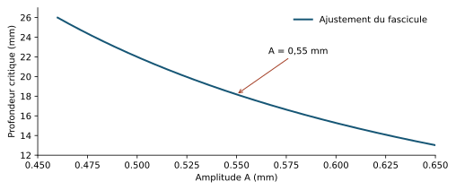
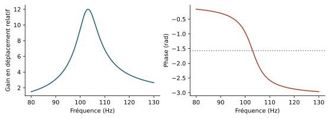
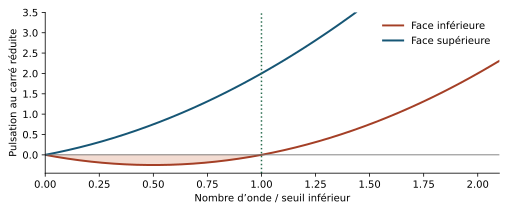
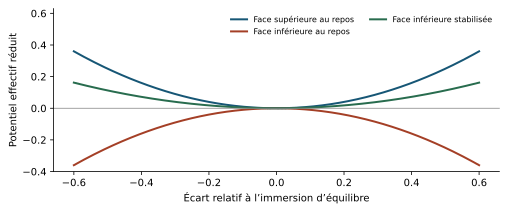

# X PC 2022 — Physique A · Corrigé brut

*Corrigé rédigé par IA, non officiel. Signalez toute erreur.*

**Lecture du rapport du jury** · GPT-6.2 Astra Ultra · vitesse non renseignée

**Rédaction** · GPT-6.2 Astra Ultra · vitesse non renseignée

## Flotter sous un liquide en lévitation

## I — Bulle dans un bain en vibration

### Question 1 — Pression à profondeur fixée

Choisissons $\mathbf e_z$ vertical ascendant. L’équilibre $\partial_zP=-\rho_l g$ et la condition $P=P_0$ à la surface donnent $P_1=P_0+\rho_l gD$. La pression augmente vers le fond.

### Question 2 — Échelle hydrostatique du liquide

On peut écrire $P_1=P_0(1+D/H)$, avec $H=P_0/(\rho_lg)\simeq10^5/(10^3\times10)\simeq10\,\mathrm m$. Cette hauteur d’eau correspond à une surpression d’environ une atmosphère.

### Question 3 — Poussée sur la bulle

La poussée est l’opposée du poids du liquide déplacé, $\mathbf F_A=\rho_lVg\,\mathbf e_z$. Le poids de l’air contenu est une autre force.

### Question 4 — Force d’entraînement

Le repère du récipient est en translation verticale d’accélération $\ddot Z\mathbf e_z$. La force d’inertie est $\mathbf F_i=-m\ddot Z\mathbf e_z=mA\omega^2\cos(\omega t)\mathbf e_z$.

### Question 5 — Hydrostatique instantanée

La pesanteur apparente dans le repère vaut $-(g+\ddot Z)\mathbf e_z$. On obtient $P(t)=P_1+\rho_l D\ddot Z$ et $\mathbf F_A(t)=\rho_lV(t)(g+\ddot Z)\mathbf e_z$. Au cours d’une période, le facteur $g+\ddot Z$ peut changer de signe.

### Question 6 — Compression isotherme

À nombre de moles fixé, $P(t)V(t)=P_1V_1$. En posant $b=\rho_lD/P_1$, on a $V(t)=V_1/(1+b\ddot Z)\simeq V_1(1-b\ddot Z)$ pour $|b\ddot Z|\ll1$. Le volume diminue aux phases de forte pression.

### Question 7 — Poussée moyenne

Avec l’approximation précédente, $\langle\ddot Z\rangle=0$ et $\langle\ddot Z^2\rangle=A^2\omega^4/2$ donnent
$$\langle\mathbf F_A\rangle\simeq\rho_lV_1\left(g-\frac{\rho_lD}{P_1}\frac{A^2\omega^4}{2}\right)\mathbf e_z.$$
La correction est négative car le volume est plus petit aux phases de plus grande pesanteur apparente. En poussant le volume à l’ordre suivant, on ajoute dans la parenthèse $+g b^2\langle\ddot Z^2\rangle$ à cet ordre de moyenne. Ce terme est plus petit que la correction retenue d’un facteur $gb=\rho_l gD/P_1$, très petit dans l’expérience.

### Question 8 — Profondeur de renversement

La masse d’air est négligeable devant la masse de liquide déplacée. Le signe de la poussée moyenne décide alors du sens de la dérive. En posant $P_1\simeq P_0$, $\gamma=A\omega^2/g$, son annulation donne $D^*=2H/\gamma^2$. Pour $D>D^*$ le terme corrélé l’emporte et la bulle descend, dans le domaine de validité des approximations.

### Question 9 — Taille relative des oscillations de pression

À la profondeur critique, l’amplitude relative vaut $\rho_l D^*A\omega^2/P_0=(D^*/H)\gamma=2/\gamma$. Il faut $\gamma\gg2$, soit une accélération de crête très supérieure à $g$. Cela est compatible avec une petite variation de pression car $D^*/H$ est alors très faible.

### Question 10 — Deux approximations confrontées aux mesures

La figure 1 donne approximativement $D^*=14$ à $25\,\mathrm{mm}$ pour les points mesurés. Ainsi $(P_1-P_0)/P_0=D^*/H\simeq0{,}0014$ à $0{,}0025$. La correction hydrostatique à la pression moyenne est inférieure à 0,3 %. Séparément, on en tire $\gamma=\sqrt{2H/D^*}\simeq28$ à 38. La variation instantanée maximale $|P-P_1|/P_1\simeq2/\gamma$ est donc de 5 à 7 %. Les deux hypothèses sont compatibles avec la précision du modèle, mais la seconde est quantitativement moins forte.

### Question 11 — Fréquence déduite de la courbe

En identifiant $D^*=c/A^2$ et $2Hg^2/(A^2\omega^4)$, il vient $\omega=(2Hg^2/c)^{1/4}$. Avec $c=5{,}5\,\mathrm{mm^3}=5{,}5\times10^{-9}\,\mathrm{m^3}$, on trouve $\omega\simeq7{,}7\times10^2\,\mathrm{rad/s}$ et $f=\omega/(2\pi)\simeq1{,}2\times10^2\,\mathrm{Hz}$. C’est un ordre de grandeur d’une centaine de hertz.

## II — Le coussin d’air comme ressort

### Question 12 — Raideur du coussin d’air

À section $S$ fixe, $P(h_a+z)=P_a h_a$. La variation de pression est $\delta P=P_a h_a/(h_a+z)-P_a\simeq-P_a z/h_a$. Par rapport à l’équilibre, la force sur le liquide est $\delta\mathbf F=-(P_aS/h_a)z\mathbf e_z$. Le signe indique le rappel lorsque l’épaisseur d’air augmente.

### Question 13 — Pulsation propre de la couche

Pour un ressort, $\omega_0=\sqrt{k/m}$. Ici $k=P_aS/h_a$ et $m=\rho_lSh_l$, d’où $\omega_0=\sqrt{P_a/(\rho_l h_lh_a)}$. La surface de la colonne se simplifie.

### Question 14 — Oscillateur forcé dans le repère du support

L’équation pour le déplacement relatif est $\ddot z+(\omega_0/Q)\dot z+\omega_0^2z=-\ddot Z=A\omega^2\cos\omega t$. Avec $z=\mathrm{Re}(\underline A_l e^{i\omega t})$ et $x=\omega/\omega_0$, elle donne
$$\frac{\underline A_l}{A}=\frac{x^2}{1-x^2+ix/Q}.$$
L’amplitude est $A_l=|\underline A_l|$. Le $x^2$ au numérateur provient de l’excitation en accélération. Si l’on exprime le déplacement absolu du liquide, il faut ajouter le déplacement $Z$ au déplacement relatif demandé.

### Question 15 — Lecture du gain et de la phase

La figure 3 situe le passage voisin de $-\pi/2$ et le maximum du gain vers 102 à 105 Hz, d’où $\omega_0\simeq6{,}5\times10^2\,\mathrm{rad/s}$. À $x=1$ le gain de 14 vaut $Q$ ; la valeur au sommet en est très proche ici. On lit environ 12 à 13, soit $Q\sim10$ à un chiffre significatif. L’axe du gain est linéaire. Il ne porte pas des décibels.

## III A — Ondes de surface dans un liquide immobile

### Question 16 — Approximation de faible pente

Pour $h=\zeta(t)\cos kx$, la pente maximale en valeur absolue est $k|\zeta|$. Il faut $k|\zeta(t)|\ll1$ à tout instant. La condition compare une amplitude verticale à une longueur horizontale.

### Question 17 — Champ de vitesses de l’onde de surface

Le champ donné est $v_x=-\dot\zeta e^{kz}\sin kx$, $v_z=\dot\zeta e^{kz}\cos kx$. Sa divergence est la somme $-k\dot\zeta e^{kz}\cos kx+k\dot\zeta e^{kz}\cos kx=0$. Son rotationnel est nul car $\partial_z v_x=\partial_x v_z=-k\dot\zeta e^{kz}\sin kx$. À l’interface, la condition cinématique exacte est $v_z=\partial_t h+v_x\partial_x h$. Linéarisée en $z=0$, elle donne bien $v_z=\dot\zeta\cos kx$. Au fond profond, $v_z\to0$ lorsque $z\to-\infty$. À profondeur finie le champ est une approximation dont l’erreur au fond est en $e^{-kh_l}$.

### Question 18 — Conditions sur les parois latérales

Les parois verticales imposent la nullité de la vitesse normale $v_x$ à $x=0$ et $L_x$. La seconde condition impose $k=n\pi/L_x$, $n=1,2,\ldots$. La première est automatique et $v_y=0$ sur les parois perpendiculaires à $Oy$. Le mode uniforme $n=0$ est exclu par la conservation du volume de liquide dans cette déformation.

### Question 19 — Énergie cinétique des ondes lentes

On a $v^2=\dot\zeta^2 e^{2kz}$, car les carrés trigonométriques se complètent. En intégrant $\rho_l v^2/2$ sur la surface de base et de $-\infty$ à 0, on obtient $E_c=\rho_l S\dot\zeta^2/(4k)$. À profondeur finie l’intégrale serait multipliée par $1-e^{-2kh_l}$.

### Question 20 — Énergie potentielle de pesanteur

La colonne en $x,y$ gagne $\rho_lg\int_0^{h}z\,dz\,dx\,dy=\rho_lgh^2dx\,dy/2$. Le résultat est positif pour un creux aussi, car celui-ci retire de la matière située sous le zéro de potentiel choisi. La moyenne spatiale de $\cos^2 kx$ vaut $1/2$ pour les modes admis et $E_p=\rho_lgS\zeta^2/4$.

### Question 21 — Accroissement d’aire

L’élément d’aire vaut $\sqrt{1+(\partial_x h)^2}\,dx\,dy$. Son excédent est $\tfrac12 k^2\zeta^2\sin^2(kx)dx\,dy$ au second ordre. La tension superficielle $\gamma_s$ donne $E_s=\gamma_s S k^2\zeta^2/4$. La dépendance quadratique respecte la symétrie entre crête et creux.

### Question 22 — Relation de dispersion gravito-capillaire

L’énergie totale $E=\rho_lS\dot\zeta^2/(4k)+(S/4)(\rho_lg+\gamma_s k^2)\zeta^2$ se conserve. La dérivée temporelle donne par continuité $\ddot\zeta+\Omega^2\zeta=0$, avec $\Omega^2=gk+(\gamma_s/\rho_l)k^3$. Les oscillations sont sinusoïdales et les deux contributions sont stabilisantes.

## III B — Surface supérieure en vibration

### Question 23 — Dominance de l’excitation rapide

L’amplitude de l’accélération d’entraînement est $A\omega^2=\gamma g$. Les valeurs proches de 30 trouvées en 10 donnent un forçage rapide beaucoup plus intense que la pesanteur. L’accélération oscille et s’annule momentanément, mais son amplitude fixe l’ordre de grandeur des termes de la dynamique rapide. La pesanteur doit être réintroduite pour l’évolution lente et la stabilité moyenne.

### Question 24 — Projection tangentielle de l’équation d’Euler

À surface libre en négligeant la tension superficielle, $p(x,h(x),t)=P_0$. Sa dérivée le long de la surface est $\partial_xp+h'\partial_zp=0$. La force d’inertie volumique est verticale. En projetant Euler sur la tangente non normalisée $(1,h')$, on élimine donc la pression et l’on trouve $\partial_t v_x+h'\partial_t v_z=-\ddot Z h'$, le terme convectif étant négligé. Or la vitesse perturbée est d’ordre un en $\zeta$, de sorte que $h'\partial_t v_z$ est d’ordre deux dans la linéarisation. En $z=0$, il reste $\partial_t v_x=-\ddot Z\,dh/dx$.

### Question 25 — Écoulement de vibration

À la surface, $h'=-k\zeta\sin kx$, si bien que l’intégration temporelle de 24 donne $v_x=\dot Zk\zeta\sin kx$ pour la composante oscillante de moyenne nulle. Le potentiel de vitesse $\phi=-\dot Z\zeta e^{kz}\cos kx$ est harmonique et évanescent en profondeur. Son gradient fournit
$$v_x=\dot Zk\zeta e^{kz}\sin kx,\qquad v_z=-\dot Zk\zeta e^{kz}\cos kx.$$
Le champ est donc incompressible et irrotationnel. Il vérifie la condition tangentielle vérifiée en $z=0$, l’imperméabilité latérale aux $k$ admis et la décroissance au fond. Le mouvement vertical rapide associé peut rester petit en déplacement sur une période, conformément à l’approximation de forme presque figée.

### Question 26 — Énergie de la vibration rapide

La norme carrée vaut $\dot Z^2k^2\zeta^2e^{2kz}$. L’intégration en profondeur donne $1/(2k)$ et $\langle\dot Z^2\rangle=A^2\omega^2/2$. On obtient $E_v=\rho_lS A^2\omega^2 k\zeta^2/8$.

### Question 27 — Rigidité lente supplémentaire

Le terme $E_v$ est quadratique en $\zeta$ et positif. En l’ajoutant au potentiel lent de 22 on trouve
$$\Omega^2=gk+\frac{\gamma_s}{\rho_l}k^3+\frac12 A^2\omega^2 k^2.$$
La vibration augmente la fréquence lente, même si sa propre force instantanée a une moyenne nulle.

## III C — Stabilité de l’interface inférieure

### Question 28 — Pourquoi la même énergie s’applique sous le liquide

À la face inférieure, le liquide occupe l’autre demi-espace. Le mouvement rapide de la couche est entraîné à l’amplitude $A_l$. Le profil de vitesse décroît maintenant en s’éloignant vers le haut dans le liquide. Par réflexion, la norme carrée et son intégrale sur l’épaisseur pénétrée ont la même forme. Le sens de la pesanteur n’intervient pas dans cette énergie rapide. On remplace donc $A$ par $A_l$ dans 26, pour les mêmes hypothèses de profondeur, de faibles pentes et de séparation temporelle.

### Question 29 — Dispersion à la face inférieure

En creusant une perturbation de la face inférieure le liquide peut abaisser son centre de gravité. Le terme gravitaire en $\zeta^2$ change donc de signe, tandis qu’augmenter l’aire coûte toujours de l’énergie. Ainsi
$$\Omega_-^2=-gk+\frac{\gamma_s}{\rho_l}k^3+\frac12 A_l^2\omega^2 k^2.$$
Un $\Omega_-^2<0$ donne une perturbation qui croît au lieu d’osciller.

### Question 30 — Largeur critique

Sans capillarité, une composante $k>0$ est stable si $k>2g/(A_l^2\omega^2)$. Le plus petit nombre d’onde non nul selon $x$ vaut $\pi/L_x$. La condition demandée est donc $L_x<L^*=\pi A_l^2\omega^2/(2g)$. À l’égalité le mode fondamental est marginal. Pour tester aussi des perturbations suivant $y$, il faut examiner la dimension $L_y$ de la même manière.

### Question 31 — Réglage près de la résonance

Dans la plage expérimentale de la figure 3, la grandeur utile est $A_l^2\omega^2$. Le facteur $A_l/A$ présente un pic important vers $f\simeq103\,\mathrm{Hz}$. À amplitude de support fixée, on a intérêt à travailler près de ce pic, soit $\omega\sim6{,}5\times10^2\,\mathrm{rad/s}$, plutôt qu’au pied de la résonance. Le maximum exact du produit n’est pas nécessairement à la fréquence exacte du sommet de gain.

## IV A — Cylindre à la surface supérieure

### Question 32 — Immersion du flotteur immobile

Le poids du cylindre de masse $m=\rho_fsh_0$ est compensé par $\rho_l gsD_0$. On en tire $D_0=(\rho_f/\rho_l)h_0<h_0$. La fraction immergée est le rapport des masses volumiques.

### Question 33 — Travail lors d’une élévation

Lors d’une élévation $u$ de 0 à $\delta$, la poussée ascendante vaut $\rho_lgs(D_0-u)$. Ses travaux et celui du poids sont respectivement $W_A=\rho_lgs(D_0\delta-\delta^2/2)$ et $W_g=-mg\delta$. Les termes linéaires se compensent car $m=\rho_l sD_0$. La variation d’énergie potentielle vaut $-W_A-W_g=\tfrac12 B\delta^2$, avec $B=\rho_l gs$.

### Question 34 — Pulsation du flotteur

Le rappel linéaire est de raideur $B$. D’où $\omega_f^2=B/m=g/D_0$ et $\omega_f=\sqrt{g/D_0}$. On néglige la masse ajoutée du fluide dans ce modèle.

## IV B — Oscillations du flotteur et équilibre sous la couche

### Question 35 — Poussée instantanée en vibration

Dans le référentiel du récipient, la poussée vaut $\mathbf F_A=\rho_l sD(t)[g+\ddot Z(t)]\mathbf e_z$. Seule la partie du cylindre effectivement immergée déplace le liquide.

### Question 36 — Équation de mouvement pour la profondeur

L’accélération verticale du cylindre par rapport au récipient est $-\ddot D$. Le poids apparent est $-m(g+\ddot Z)\mathbf e_z$. Par conséquent $-m\ddot D=(\rho_l sD-m)(g+\ddot Z)$, soit
$$\ddot D=(1-D/D_0)(g+\ddot Z).$$
Pour $Z=0$, la linéarisation redonne $\omega_f^2=g/D_0$.

### Question 37 — Partie rapide du déplacement

Écrivons $D=\overline D-z$ avec $z$ orienté vers le haut. Pendant une période, omettons $g$ et le petit $z$ dans le coefficient de $\ddot Z$. Il vient $\ddot z=(\overline D/D_0-1)\ddot Z$. La solution oscillante de moyenne nulle, sans dérive, est $z=\alpha Z$ avec $\alpha=\overline D/D_0-1$.
À $\overline D=D_0$, l’inertie du liquide déplacé et celle du flotteur se compensent, donc aucun mouvement relatif rapide. À la limite formelle $\overline D=0$, on trouve $z=-Z$ : en l’absence de poussée, le flotteur reste immobile à l’échelle rapide dans le référentiel du laboratoire. La condition $|z|\ll\overline D$ n’est plus satisfaite au bord exact de cette seconde limite.

### Question 38 — Énergie cinétique moyenne

Pour le mouvement rapide relatif employé dans la séparation des échelles, $\dot z=(\overline D/D_0-1)\dot Z$. On a donc
$$\langle E_{c,\mathrm{rap}}\rangle=\frac{m A^2\omega^2}{4}\left(\frac{\overline D-D_0}{D_0}\right)^2.$$
Il s’agit du terme d’énergie à ajouter au mouvement lent dans le modèle proposé.

### Question 39 — Fréquence lente modifiée

Les termes de 33 et de 38 sont tous deux quadratiques en $\overline D-D_0$. Le minimum reste à $D_0$. On obtient
$$\omega_{f,+}^2=\frac g{D_0}+\frac{A^2\omega^2}{2D_0^2}.$$
La vibration raidit le rappel. Lorsque $A\to0$, on retrouve 34.

### Question 40 — Stabilité du flotteur sous la couche

Notons $d$ la hauteur de cylindre immergée dans le liquide au-dessus de l’interface inférieure. Le bilan vertical sans déplacement donne encore $d=D_0=\rho_f h_0/\rho_l$. Le cylindre traverse la face inférieure, avec une hauteur $h_0-D_0$ dans l’air situé dessous. Une élévation augmente cette fois la hauteur immergée et la poussée, donc le terme lent gravitaire est déstabilisant. Le terme quadratique dû aux vibrations reste stabilisant avec l’amplitude $A_l$ pertinente pour cette face. Ainsi
$$\omega_{f,-}^2=-\frac g{D_0}+\frac{A_l^2\omega^2}{2D_0^2}>0\quad\Longleftrightarrow\quad h_0<\frac{\rho_l}{\rho_f}\frac{A_l^2\omega^2}{2g}.$$
Si $A$ désigne directement dans la partie IV l’amplitude imposée au bain, on emploie $A$ dans cette formule. L’interface doit également être stable au sens de 30. La photographie illustre que des flotteurs peuvent simultanément tenir sur les deux faces. Le calcul du cylindre à axe maintenu vertical garantit sa stabilité en translation verticale dans ce modèle. L’orientation d’une coque réelle dépend en plus des moments et de la forme de sa partie immergée.

