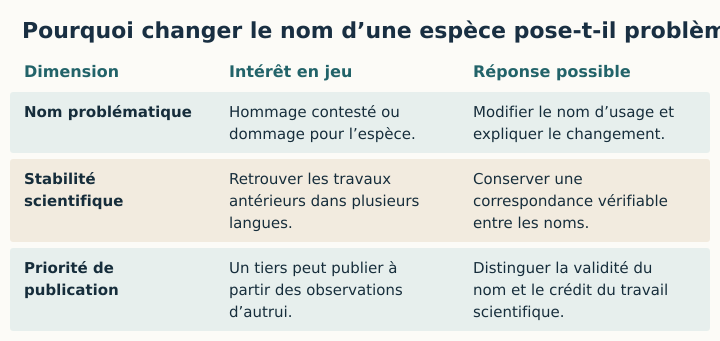

# Agro-Véto · BCPST · Anglais 2023 — Corrigé guidé

*Corrigé rédigé par IA, non officiel. Signalez toute erreur.*

**Rédaction** · GPT-6.2 Astra Ultra · vitesse non renseignée

Écrit de deux heures. Trois parties obligatoires. La compréhension demande 100 mots et l’essai 200 mots, avec une tolérance de 10 %.

## I · Thème · 6 points

Abandoned in favour of mobile phones, Britain's famous phone boxes are now being offered for adoption for a token pound and put to new uses by communities across the country. Libraries, cafés, even nightclubs: their new owners are vying with one another to find ways of bringing them back to life.

One morning in 2006, the residents of Soho, a fashionable district in central London, woke up to a curious murder scene. Beneath their windows lay a telephone box bent double, a pickaxe savagely embedded in its door, which was dripping with red paint. The work, *Death of a Phone Box*, was by Banksy and seemed to symbolise the end of a particular way of communicating.

Indeed, now that nine out of ten adults in the UK own a mobile phone, the future looks uncertain for these endearing little booths. Only 21,000 are left in the country today, down from more than 70,000 in the 1980s. If technology has its way, they will gradually be replaced by Wi-Fi hotspots, smart benches and the like.

## II · Compréhension · 6 points

The Economist describes a conflict between scientific continuity and the consequences of honouring particular people. A beetle named after Hitler attracts collectors who endanger it, while names associated with colonial rule can perpetuate an unwanted tribute. Some researchers therefore propose replacements, including indigenous names. Yet zoologists rely on internationally recognisable labels that connect observations across centuries, and their commission upholds the earliest valid name. Changing an everyday name offers a compromise. The priority rule also creates a problem of credit. Since a publication need not undergo peer review, somebody can use another researcher's findings to claim the naming rights first.

*100 words.*

## III · Expression · 8 points

A name on a museum label has two functions. It helps people find the object again and tells them whose contribution deserves attention. These functions need not always be performed by the same words.

In science, removing every occurrence of an offensive name would make older evidence difficult to use. A researcher following a species through a century of surveys needs to know what earlier observers called it. Yet this need does not oblige a museum to use a hurtful common name on its main display. It can introduce a different one, explain the change and maintain a searchable record of both. Readers then gain information about the organism and about the people who classified it.

The same distinction matters outside science. After the statue of the slave trader Edward Colston was pulled down in Bristol in 2020, showing it in a museum gave visitors a question that its pedestal had scarcely invited. Why had the city chosen to honour him? The object could still bear witness even after losing its place of honour.

I would therefore change a public tribute when its message can no longer be defended. Keeping evidence of the earlier choice, and explaining who challenged it, makes that decision more accountable to the next generation.

*209 words.*

## Construire les réponses

**Thème.** Le texte passe du devenir collectif des cabines à une scène datée, puis revient à la situation actuelle. Le présent narratif français peut devenir un prétérit anglais dans le récit de 2006. *A token pound* conserve le prix symbolique, *a pickaxe* désigne la pioche et *dripping with red paint* rend à la porte sa fonction dans la scène. Le passage donne le nombre de cabines restantes et celui des années 1980. Garder les deux repères évite de confondre stock et diminution.

**Compréhension.** Relier les faits par le problème qu'ils illustrent. La persistance de certains noms peut heurter ou nuire aux animaux, pourtant la priorité et la stabilité servent la recherche. Changer le nom usuel sans perdre la trace du nom scientifique est une solution limitée. L'appropriation du travail d'autrui est un second problème qui tient au mode de publication. Le rapport pointe précisément cette dernière difficulté, souvent oubliée.

**Expression.** Le nom d'une espèce et un monument rendent tous deux des choix du passé visibles, mais l'usage scientifique ajoute l'exigence de retrouver les observations anciennes. Le sort de la statue de Colston permet de distinguer trois opérations concrètes, déplacer, conserver, expliquer. L'essai traite ainsi la science et la vie publique dans un même raisonnement.

[Sujet officiel](https://www.concours-agro-veto.fr/sites/default/files/media/2025-10/abcpst_sp_0923_anglais.pdf) · [Rapport du jury](https://www.concours-agro-veto.fr/sites/default/files/media/2025-10/rapport_anglais_bcpst_2023_le.pdf) · [Bilan du concours et rattachement à l’X, p. 4](https://www.concours-agro-veto.fr/sites/default/files/media/2025-10/bilan-concours-a-bcpst-session-2023.pdf#page=4)
