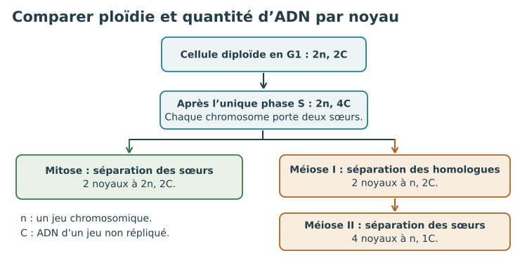
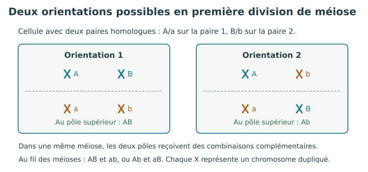
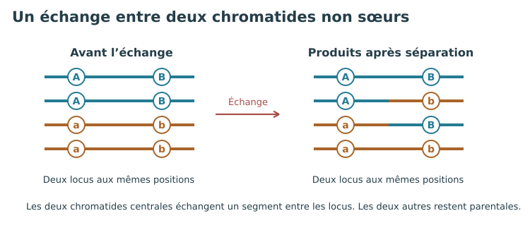
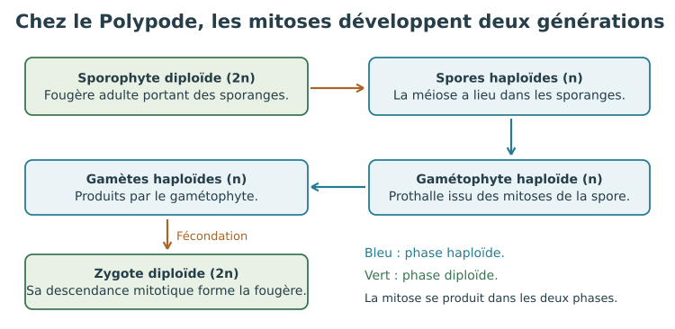

# Agro-Véto — BCPST, Biologie 2023 · Corrigé brut

*Corrigé rédigé par IA, non officiel.*

**Rédaction (tour 1)** · GPT-6.2 Astra Ultra · vitesse non renseignée

# Les divisions cellulaires chez les Eucaryotes

## Introduction

À l’extrémité d’une racine d’oignon, une coupe du méristème révèle des cellules contenant un seul noyau, d’autres où des chromosomes sont alignés et d’autres encore où deux lots s’éloignent. Dans une anthère, certaines cellules réalisent au contraire deux partages nucléaires successifs pour former des spores. Chez les Eucaryotes, les chromosomes nucléaires sont enfermés dans un noyau pendant l’interphase. La division cellulaire associe habituellement le partage de l’information nucléaire et la partition du cytoplasme. La mitose maintient le nombre de jeux chromosomiques. La méiose fait passer d’un état diploïde à un état haploïde et redistribue les combinaisons d’allèles.

Comment des mécanismes en partie communs produisent-ils à la fois des lignées génétiquement stables et des descendants variés, et comment ces deux résultats servent-ils le développement, l’entretien et la reproduction des Eucaryotes ? Il faut d’abord comparer ce qui est partagé et ce qui est séparé à chaque division, puis relier les conséquences génétiques des séparations à leur contrôle, avant de les replacer dans les tissus et les cycles de vie.

## I. Une préparation commune rend possibles des ségrégations différentes

### La réplication prépare le partage sans changer la ploïdie

Au cours d’un cycle mitotique, la phase G1 précède la synthèse d’ADN en phase S, puis G2 précède l’entrée en mitose. Une cellule diploïde possède deux exemplaires homologues de chaque type chromosomique. Après réplication, chaque chromosome porte deux chromatides sœurs liées par des cohésines. Le nombre de chromosomes, comptés par leur centromère avant séparation, et la ploïdie restent inchangés. La quantité d’ADN double. En notant $C$ la quantité d’ADN d’un jeu haploïde non répliqué, une cellule diploïde passe ainsi de $2n,2C$ à $2n,4C$. L’observation de cellules de racine au microscope permet de reconnaître les chromosomes condensés seulement pendant une partie du cycle. En complément, les mesures de contenu en ADN par noyau montrent des populations à $2C$, à $4C$ et entre ces deux valeurs, ce qui rend compte de la réplication progressive en S.

Le début de méiose suit également une réplication. En revanche, aucune nouvelle phase S ne sépare les deux divisions méiotiques. Cette différence simple permet de comprendre pourquoi quatre produits haploïdes peuvent résulter d’une seule cellule diploïde.

### Le fuseau mitotique répartit les chromatides sœurs

Au cours de la prophase, les chromosomes dupliqués se condensent et un fuseau bipolaire se constitue. Lors d’une mitose ouverte, comme celle des cellules animales étudiées classiquement, la désorganisation de l’enveloppe nucléaire permet aux microtubules d’atteindre les kinétochores, assemblages protéiques associés aux centromères. Les kinétochores des deux sœurs s’attachent à des pôles opposés. Dans une cellule animale, des microtubules astraux établissent des contacts avec le cortex, tandis que des microtubules interpolaires se recouvrent entre les deux pôles. En métaphase, les chromosomes biorientés occupent la plaque équatoriale. Tant qu’un kinétochore est mal attaché, un contrôle retarde l’entrée en anaphase.

Lorsque la transition est permise, l’activation de la séparase provoque le clivage de cohésines. Chaque ancienne chromatide devient un chromosome indépendant. Le raccourcissement des microtubules kinétochoriens et l’éloignement des pôles contribuent à la séparation des deux lots. En télophase, l’enveloppe nucléaire se reforme autour de chacun et la chromatine se décondense. La cytocinèse sépare les cytoplasmes. Dans une cellule animale, un anneau contractile d’actine et de myosine resserre un sillon à l’équateur. Dans une cellule végétale à paroi, le phragmoplaste guide l’apport de vésicules au centre. Une plaque cellulaire se forme de l’intérieur vers la périphérie et rejoint la paroi parentale. Pour une cellule diploïde initiale, le résultat usuel est deux cellules à $2n,2C$.

### La méiose distribue d’abord les homologues, puis les chromatides

En prophase I, les chromosomes homologues répliqués s’apparient. Un bivalent contient deux homologues, donc quatre chromatides. Les chiasmas, associés aux échanges entre homologues, contribuent avec la cohésion à maintenir ce dispositif jusqu’à la première division. En métaphase I, les deux kinétochores sœurs d’un même homologue fonctionnent vers le même pôle, ceux de l’autre homologue vers l’autre pôle. En anaphase I, la séparation des bras des homologues est rendue possible tandis que la cohésion centromérique des sœurs est protégée. Chaque noyau reçoit un homologue par paire. C’est la division réductionnelle, de $2n,4C$ vers $n,2C$ par noyau.

Sans réplication intermédiaire, les chromosomes s’alignent de nouveau. En méiose II, les kinétochores sœurs se biorientent et la cohésion centromérique est levée. La division équationnelle sépare les chromatides et donne des noyaux à $n,1C$. Les termes « réductionnelle » et « équationnelle » décrivent ainsi le nombre de jeux chromosomiques. Dans de nombreuses lignées, quatre cellules haploïdes sont produites. Chez les Mammifères femelles, le partage très asymétrique du cytoplasme favorise un grand gamète et de petits globules polaires. Le nombre de produits génétiquement attendus ne préjuge donc pas du nombre de gamètes fonctionnels.

## II. La séparation contrôlée des chromosomes conserve ou remanie l’information

### La mitose entretient une lignée et son contrôle préserve la qualité du partage

Les deux chromatides issues d’un chromosome portent normalement les mêmes allèles. Leur distribution opposée produit deux noyaux ayant le même génome nucléaire que celui de la cellule mère, aux mutations près. Une mutation survenue pendant la réplication peut être héritée par une branche du clone. Une erreur de ségrégation peut produire des cellules aneuploïdes. La stabilité s’explique donc à la fois par la fidélité de la copie et par la précision du partage. Elle ne signifie pas que les deux cellules filles aient nécessairement la même taille, le même assortiment d’organites ou le même état d’expression des gènes.

Des complexes cycline–CDK rythment le cycle. L’activation de cycline B–CDK1 participe à l’entrée en division. L’APC/C permet notamment la dégradation de la sécurine, ce qui libère la séparase, et contribue ensuite à la chute d’activité cycline B–CDK1. Le contrôle de l’attachement des kinétochores retarde cette transition tant qu’une séparation correcte n’est pas assurée. En amont, des lésions de l’ADN peuvent retarder l’entrée dans une nouvelle phase. Des signaux extracellulaires modulent aussi la décision proliférative des cellules compétentes d’un tissu. En combinant ces niveaux, la division dépend à la fois de l’état de la cellule et des besoins du tissu.

### La méiose redistribue des allèles existants de deux manières

Considérons une cellule hétérozygote $A/a$ et $B/b$, où les locus A et B appartiennent à deux paires de chromosomes distinctes. En métaphase I, chaque bivalent s’oriente indépendamment de l’autre. Deux dispositions relatives possibles envoient ensemble vers un pôle soit $A$ et $B$, soit $A$ et $b$. Sur de nombreuses méioses, les haplotypes $AB$, $Ab$, $aB$ et $ab$ peuvent ainsi apparaître, en proportions idéales égales en l’absence de biais. Une cellule isolée ne réalise qu’une orientation à la première division. Pour $n$ paires hétérozygotes distinctes, l’assortiment interchromosomique peut contribuer à $2^n$ combinaisons d’homologues, avant même les échanges intrachromosomiques.

Sur une même paire, supposons à présent deux locus liés, avec les associations parentales $AB$ sur un homologue et $ab$ sur l’autre. En prophase I, un échange réciproque entre deux chromatides non sœurs, entre les locus A et B, produit les combinaisons $Ab$ et $aB$. Les deux chromatides qui n’ont pas participé restent parentales. Après les deux divisions, une tétrade résultant de ce crossing-over simple contient deux produits parentaux et deux recombinés. Sans crossing-over dans cet intervalle, les produits restent ici de type parental. Un échange recombine des allèles déjà présents, tandis qu’une mutation peut créer un nouvel allèle. Un croisement-test d’un double hétérozygote permet d’inférer ses combinaisons gamétiques à partir des descendants. Un excès des deux classes parentales sur les deux classes recombinées est compatible avec une liaison génétique.

### Lignée cellulaire et génération n’ont pas la même échelle

La mitose conserve un génome dans une lignée de noyaux, qu’elle soit haploïde ou diploïde. La méiose produit des noyaux haploïdes distincts à partir d’un état diploïde. La rencontre entre deux gamètes ajoute une nouvelle combinaison de génomes et rétablit la diploïdie du zygote. Ce brassage par fécondation se distingue des deux mécanismes qui se sont déroulés dans la cellule en méiose. Au fil des générations, l’alternance méiose–fécondation maintient le nombre de jeux chromosomiques caractéristique d’un cycle sexué, en remaniant les associations d’allèles.

## III. Les divisions construisent, renouvellent et reproduisent les organismes

### Le rythme et l’orientation des mitoses organisent un corps

Au début du développement d’un Mammifère, les segmentations du zygote multiplient les blastomères sans augmentation proportionnelle du volume total. À mesure que les cellules échangent des signaux et changent de position, leurs descendances peuvent acquérir des destins distincts malgré la conservation du génome. Chez les Angiospermes, le méristème racinaire produit des cellules en files. L’orientation de la plaque cellulaire détermine la place relative des filles, durablement fixées par la paroi. Les mitoses produisent de nouvelles cellules, puis l’élongation augmente leur taille et participe fortement à la croissance en longueur. Une division asymétrique d’un précurseur de l’épiderme foliaire peut donner une petite cellule de la lignée stomatique et une grande cellule sœur d’un autre devenir. L’orientation et l’asymétrie du partage relient donc organisation cellulaire et forme du tissu.

Dans les cryptes de l’intestin d’un Mammifère, des cellules souches et leurs descendantes prolifèrent. Certaines filles entretiennent le compartiment prolifératif, d’autres se différencient, migrent vers les villosités et remplacent des cellules éliminées. Un suivi de descendance par un marquage stable permet d’observer des groupes de cellules marquées s’étendant de la crypte vers la villosité. Une insuffisance de renouvellement fragilise l’épithélium. À l’inverse, une prolifération persistante qui échappe aux mécanismes de contrôle peut contribuer à une tumeur. La division a donc un effet qui dépend de son lieu, de sa fréquence et du devenir des filles.

### Les modes de reproduction attribuent des rôles différents aux divisions

Chez une levure bourgeonnante, la mitose distribue un noyau à la cellule mère et un au bourgeon, puis la cytocinèse individualise un nouvel organisme. Une succession de mitoses suffit ainsi à une reproduction asexuée. Chez le fraisier, la croissance mitotique d’un stolon et l’enracinement d’un nouveau pied permettent une multiplication végétative clonale à l’échelle d’un organisme pluricellulaire.

Chez les Mammifères, la méiose a lieu dans la lignée germinale de l’organisme diploïde et conduit à des gamètes ou à leurs précurseurs haploïdes immédiats. Les mitoses du zygote construisent la génération diploïde. Chez une Angiosperme, en revanche, la méiose du sporophyte diploïde dans l’anthère donne des microspores haploïdes. Chaque microspore réalise une mitose asymétrique qui forme une cellule végétative et une cellule génératrice. Cette dernière donne par mitose deux gamètes mâles. Du côté femelle, une mégaspore fonctionnelle issue de méiose forme par mitoses le gamétophyte femelle. La fécondation de l’oosphère produit un zygote diploïde. Il importe donc de distinguer la spore issue de méiose du gamète produit dans le gamétophyte.

Chez le Polypode, la fougère feuillée diploïde forme des spores par méiose dans ses sporanges. Une spore donne, par mitoses, un prothalle haploïde, autonome et pluricellulaire. Celui-ci produit les gamètes par différenciation dans des structures issues de mitoses. Après fécondation, les mitoses du zygote produisent une nouvelle fougère. La même opération conservatrice, la mitose, développe ici chacune des deux générations ; la méiose marque le passage entre elles.

## Conclusion

Le fuseau partage du matériel chromosomique préalablement répliqué, mais la cible de la première séparation détermine son résultat. La mitose distribue les sœurs en conservant la ploïdie. La méiose sépare d’abord les homologues puis les chromatides, et les orientations indépendantes et crossing-over y recombinent les allèles. Les programmes de développement, les contrôles du cycle et l’alternance des générations donnent à ces mécanismes leur portée biologique. Selon la lignée, une mitose peut renouveler un entérocyte, former un prothalle ou individualiser une levure, tandis que la méiose fournit des cellules haploïdes dont le devenir varie avec le cycle de vie.
