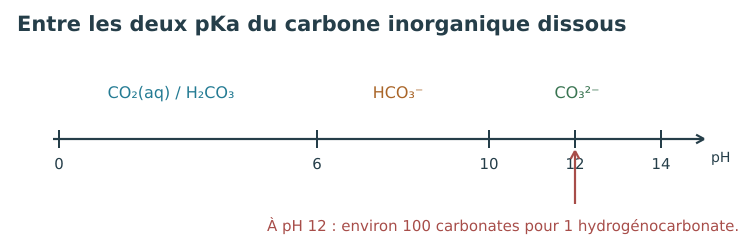
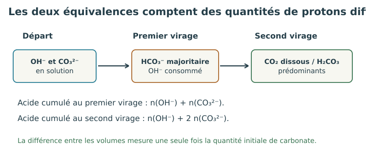
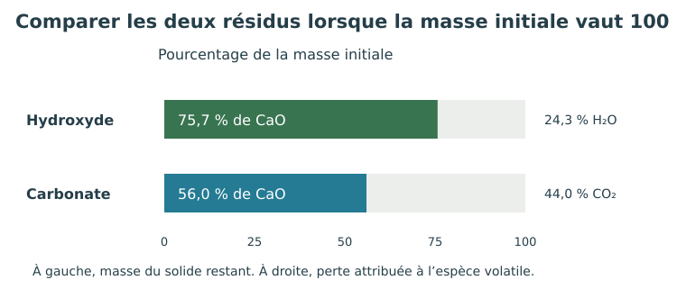
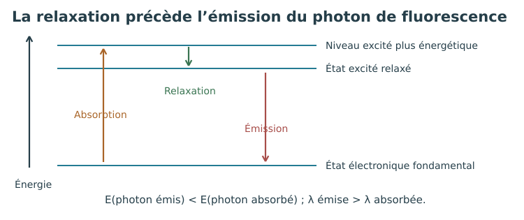
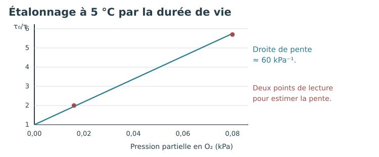

# Agro-Véto — BCPST, Chimie 2023 · Corrigé brut

*Corrigé rédigé par IA, non officiel.*

**Rédaction (tour 1)** · GPT-6.2 Astra Ultra · vitesse non renseignée

Les questions 1 à 27 sur les carbonates, les analyses de la chaux et la mesure optique du dioxygène sont traitées. La seconde partie, questions 28 à 45, consacrée à une synthèse de toxine, est hors de la couverture de ces deux éditions.

## Carbonatation et thermodynamique

### Question 1 — Valence du calcium

Le calcium est dans la quatrième période et la deuxième colonne du bloc $s$. Sa configuration de valence est $4s^2$, et sa configuration complète abrégée $[\mathrm{Ar}]4s^2$. La perte des deux électrons externes donne l’ion usuel $\mathrm{Ca^{2+}}$, de configuration $[\mathrm{Ar}]$.

### Question 2 — Dissolution du gaz

La première étape est $\mathrm{CO_2(g)\rightleftharpoons CO_2(aq)}$. Il s’agit d’un équilibre de dissolution. Une partie du CO₂ dissous s’hydrate en acide carbonique, $\mathrm{CO_2(aq)+H_2O(l)\rightleftharpoons H_2CO_3(aq)}$. On peut regrouper ces deux formes neutres pour décrire les équilibres acido-basiques usuels.

### Question 3 — Du carbone dissous au carbonate

Avec la convention du CO₂ dissous, les réactions avec les ions hydroxyde sont $\mathrm{CO_2(aq)+OH^-\rightleftharpoons HCO_3^-}$ puis $\mathrm{HCO_3^-+OH^-\rightleftharpoons CO_3^{2-}+H_2O}$. La forme hydratée du CO₂ joue le rôle d’acide dans le premier couple, l’hydrogénocarbonate dans le second. Le milieu basique déplace les équilibres vers le carbonate. Ce dernier peut précipiter avec $\mathrm{Ca^{2+}}$ lorsque le produit de solubilité est dépassé.

### Question 4 — Enthalpie standard de carbonatation

Par la loi de Hess, pour la réaction de carbonatation écrite dans le sens de formation du carbonate, $\Delta_rH^\circ=\Delta_fH^\circ(\mathrm{CaCO_3,s})+\Delta_fH^\circ(\mathrm{H_2O,l})-\Delta_fH^\circ(\mathrm{CO_2,g})-\Delta_fH^\circ(\mathrm{Ca(OH)_2,s})$. À 298 K, $\Delta_rH^\circ=-1206,9-285,8+395,5+986,2=-111,0\ \mathrm{kJ\,mol^{-1}}$. La réaction est exothermique.

### Question 5 — Enthalpie libre standard

$\Delta_rS^\circ=S_m^\circ(\mathrm{CaCO_3,s})+S_m^\circ(\mathrm{H_2O,l})-S_m^\circ(\mathrm{CO_2,g})-S_m^\circ(\mathrm{Ca(OH)_2,s})=92,9+69,9-213-83,4=-133,6\ \mathrm{J\,mol^{-1}\,K^{-1}}$. La consommation d’un gaz est cohérente avec la diminution d’entropie. À la même température, $\Delta_rG^\circ=\Delta_rH^\circ-T\Delta_rS^\circ=-111,0+298\times0,1336=-71,2\ \mathrm{kJ\,mol^{-1}}$.

### Question 6 — Constante de la réaction

La relation $\Delta_rG^\circ=-RT\ln K^\circ$ donne $K^\circ=\exp[71187/(8,314\times298)]\simeq3,0\times10^{12}$. Cette constante sans dimension dépasse très largement $10^4$. La carbonatation est donc très fortement favorisée dans les conditions ordinaires du modèle, tant que réactifs et produits peuvent être en contact. Cette valeur thermodynamique ne fixe pas la vitesse de réaction.

### Question 7 — Chaleur et humidité

La réaction libère environ 111 kJ par mole de CO₂ fixée et peut réchauffer le gaz au contact du solide. Elle produit une mole d’eau par mole de CO₂ captée ; le matériau contient aussi de l’eau au départ. Une fraction de cette eau peut passer en phase vapeur, d’où l’humidification du gaz sortant.

### Question 8 — Capacité stœchiométrique du modèle

Les 2,5 kg de granulats contiennent théoriquement $0,80\times2,5=2,0$ kg de $\mathrm{Ca(OH)_2}$. Cela représente $2000/74,1=27,0$ mol, capables selon l’équation de fixer 27,0 mol de CO₂. Avec $P=10^5$ Pa et $\dot V=1,6\times10^{-3}\ \mathrm{m^3\,min^{-1}}$, le débit molaire idéal vaut $P\dot V/(RT)=0,0646\ \mathrm{mol\,min^{-1}}$. Le quotient donne $t_{\rm idéal}\simeq4,2\times10^2$ min, soit environ 7,0 h. C’est la durée d’épuisement stœchiométrique dans le modèle où tout le solide réagit et tout le gaz est fixé. Elle ne donne pas une durée de plongée.

### Question 9 — Origine d’un écart à l’idéal

Le gaz a un temps de séjour fini. Sa diffusion dans les pores, sa dissolution, puis la réaction avec l’hydroxyde peuvent être trop lentes pour permettre une capture intégrale à chaque passage. De plus, une couche de carbonate peut limiter l’accès aux grains non transformés. Il peut donc rester de l’hydroxyde dans le matériau alors que du CO₂ sort déjà du filtre.

## Alcalinité et titrage

### Question 10 — Composition molaire de la poudre

La conversion d’une mole d’hydroxyde donne une mole de carbonate. À demi-conversion, $n_{\mathrm{Ca(OH)_2}}=n_{\mathrm{CaCO_3}}=n$. La masse mesurée satisfait $1,0=n(74,1+100,1)$, soit $n=5,74\times10^{-3}$ mol pour chaque espèce. Dans 1,0 L et sous l’hypothèse d’une dissolution totale, $[\mathrm{Ca^{2+}}]=2n/V=1,15\times10^{-2}\ \mathrm{mol\,L^{-1}}$ et $[\mathrm{CO_3^{2-}}]=n/V=5,74\times10^{-3}\ \mathrm{mol\,L^{-1}}$.

### Question 11 — Prédominance à pH 12

Pour $\mathrm{HCO_3^-/CO_3^{2-}}$, $[\mathrm{CO_3^{2-}}]/[\mathrm{HCO_3^-}]=10^{12-10}=100$ en assimilant activités et concentrations réduites. Le carbonate représente ainsi environ 99 % de ces deux formes. La fraction neutre, dont le premier pKa vaut 6, est encore moindre. Cette simplification convient au test de solubilité.

### Question 12 — Quels solides subsistent à l’équilibre ?

Posons $c^\circ=1\ \mathrm{mol\,L^{-1}}$ et $a_i\simeq[i]/c^\circ$. À pH 12, $[\mathrm{OH^-}]\simeq10^{-2}\ \mathrm{mol\,L^{-1}}$. Même avec tout le calcium dissous, $Q_{\rm hyd}=a_{\rm Ca^{2+}}a_{\rm OH^-}^2\leq1,15\times10^{-6}<10^{-5,3}\simeq5,0\times10^{-6}$. La solution ne peut donc être saturée vis-à-vis de l’hydroxyde. Pour le carbonate, la dissolution totale donnerait au contraire $Q_{\rm carb}\simeq0,0115\times0,00574=6,6\times10^{-5}$, très supérieur à $10^{-8,4}\simeq4,0\times10^{-9}$. Une fraction de $\mathrm{CaCO_3}$ subsiste à l’état solide, ce qui abaisse le calcium dissous et conforte encore la première conclusion.

### Question 13 — Inventaire ionique initial

Les ions introduits en quantités appréciables dans le modèle homogène sont $\mathrm{Ca^{2+}}$, $\mathrm{OH^-}$ et $\mathrm{CO_3^{2-}}$. Les équilibres avec l’eau entraînent une faible quantité de $\mathrm{HCO_3^-}$ et des traces de $\mathrm{H_3O^+}$. Le chlorure ne sera apporté que par le titrant. La présence de sodium est négligée par l’énoncé pour cette poudre simplifiée.

### Question 14 — Deux indicateurs pour deux sauts

La première chute est centrée vers 8,5–9 mL. La zone de virage 8,2–10 de la phénolphtaléine croise son domaine raide : en titrant avec l’acide, le rose disparaît. La seconde chute est vers 11,5 mL. La zone 3,1–4,4 de l’orange de méthyle permet de la repérer par le passage du jaune à l’orangé puis au rouge. Un indicateur convenable vire dans la portion de forte pente, afin qu’un changement de couleur localise bien un volume.

### Question 15 — Équations et espèces aux deux virages

Au premier virage, l’ion hydroxyde a été neutralisé et la plupart du carbonate transformée en $\mathrm{HCO_3^-}$. On a $\mathrm{OH^-+H_3O^+\rightarrow2H_2O}$ et $\mathrm{CO_3^{2-}+H_3O^+\rightarrow HCO_3^-+H_2O}$. En plus de l’ion calcium et du chlorure apporté, l’hydrogénocarbonate est la forme carbonée principale. Au second virage, on a ajouté un second proton au carbone : $\mathrm{HCO_3^-+H_3O^+\rightarrow CO_2(aq)+2H_2O}$. Le carbone est majoritairement sous forme neutre dissoute, susceptible de dégazer, avec toujours calcium et chlorure en solution.

### Question 16 — Concentrations initiales à partir des deux volumes

Soient $V_0$ le volume initial, $C_B=[\mathrm{OH^-}]_0$, $C_C=[\mathrm{CO_3^{2-}}]_0$, et $V_P,V_M$ les volumes cumulés de titrant de concentration $c_a$. Au premier virage, $c_aV_P=(C_B+C_C)V_0$. Au second, $c_aV_M=(C_B+2C_C)V_0$. Par soustraction puis substitution,

$$C_C=\frac{c_a(V_M-V_P)}{V_0},\qquad C_B=\frac{c_a(2V_P-V_M)}{V_0}.$$

On emploie les mêmes unités de volume partout. La condition $V_P\le V_M\le2V_P$ assure des concentrations non négatives.

## Analyse thermogravimétrique

### Question 17 — Décomposition des deux solides

Les deux équations de décomposition sont $\mathrm{Ca(OH)_2(s)\rightarrow CaO(s)+H_2O(g)}$ et $\mathrm{CaCO_3(s)\rightarrow CaO(s)+CO_2(g)}$. Les molécules libérées sont l’eau et le dioxyde de carbone, respectivement. Seul le solide restant est pesé.

### Question 18 — Vérification gravimétrique

Une mole de carbonate (100,1 g) donne une mole d’oxyde (56,1 g). Le résidu représente $100\times56,1/100,1=56,0\,\%$ de la masse initiale, et la perte correspond à 44,0 % de CO₂. Le plateau du carbonate au-delà de 750 °C est bien proche de 56 %. Pour l’hydroxyde, le même rapport vaut $100\times56,1/74,1=75,7\,\%$, proche de l’autre plateau de la figure 3.

### Question 19 — Comparer les thermogrammes de la chaux

Les courbes diminuent d’abord légèrement, ce qui est compatible avec une perte d’humidité. Vers 300–420 °C, la chute importante de l’échantillon frais correspond à la déshydratation de l’hydroxyde en oxyde. Son amplitude diminue avec la durée d’utilisation, signe d’un appauvrissement en hydroxyde. Vers 600–710 °C apparaît au contraire, pour la chaux usagée, une seconde perte de masse de plus en plus forte, attribuée à la libération de CO₂ par le carbonate. Le plateau final passe d’environ 76 % pour la fraîche à près de 68, 64 et 62 % aux durées croissantes de la figure 4. On observe donc la progression de la carbonatation.

## Cinétique de luminescence et capteur optique

### Question 20 — Cinétique de disparition sans extinction collisionnelle

Après l’impulsion, les deux voies consomment la même espèce excitée. Pour ces actes élémentaires, $v_r=k_r[\mathrm A^*]$ et $v_{nr}=k_{nr}[\mathrm A^*]$. Le bilan donne $-\mathrm d[\mathrm A^*]/\mathrm dt=v_r+v_{nr}=(k_r+k_{nr})[\mathrm A^*]$. Les deux constantes ont la dimension d’un temps inverse.

### Question 21 — Durée de vie sans inhibiteur

En intégrant $\mathrm d[\mathrm A^*]/[\mathrm A^*]=-(k_r+k_{nr})\mathrm dt$ de 0 à $t$, il vient $[\mathrm A^*](t)=[\mathrm A^*]_0\exp(-t/\tau_0)$, avec $\tau_0=(k_r+k_{nr})^{-1}$. À $t=\tau_0$ la concentration est divisée par $e$.

### Question 22 — Durée de vie en présence de Q

L’équation devient $-\mathrm d[\mathrm A^*]/\mathrm dt=(k_r+k_{nr}+k_q[\mathrm Q])[\mathrm A^*]$. La solution est $[\mathrm A^*]_Q(t)=[\mathrm A^*]_{Q,0}e^{-t/\tau}$, où $\tau=(k_r+k_{nr}+k_q[\mathrm Q])^{-1}$. Pour une même excitation initiale, la concentration décroît plus vite lorsque Q est présent, car $\tau<\tau_0$.

### Question 23 — Retrouver la loi de Stern–Volmer

$\tau_0/\tau=(k_r+k_{nr}+k_q[\mathrm Q])/(k_r+k_{nr})=1+k_q\tau_0[\mathrm Q]$. La constante $K=k_q\tau_0=k_q/(k_r+k_{nr})$ a pour unité $\mathrm{L\,mol^{-1}}$ lorsque $[\mathrm Q]$ est exprimée en $\mathrm{mol\,L^{-1}}$.

### Question 24 — Origine du décalage spectral

L’absorption porte le fluorophore dans un état électronique excité, éventuellement à un niveau vibrationnel élevé. Une partie de l’énergie est transférée au milieu pendant des relaxations non radiatives. Le photon émis au retour radiatif possède alors typiquement une énergie $hc/\lambda_{em}$ plus faible que celle du photon absorbé. Le maximum d’émission est décalé vers les grandes longueurs d’onde (décalage de Stokes).

### Question 25 — Choisir la longueur d’onde d’excitation

Le maximum principal d’absorbance se situe légèrement au-dessus de 400 nm, vers 420 nm. C’est la longueur d’onde optimale d’excitation si l’on recherche une absorption maximale à flux incident comparable. Le fort pic du spectre de droite, vers 665 nm, correspond à la lumière émise après excitation.

### Question 26 — Déterminer la pente du capteur

À 5 °C, les mesures suivent, à leurs incertitudes près, une droite qui extrapole à $\tau_0/\tau\simeq1$ pour $p=0$. Entre les points d’environ $(0,016\ \mathrm{kPa},2,0)$ et $(0,080\ \mathrm{kPa},5,7)$, la pente vaut $(5,7-2,0)/(0,080-0,016)\simeq58\ \mathrm{kPa^{-1}}$. Une lecture sur toute la droite donne de l’ordre de $6,0\times10^1\ \mathrm{kPa^{-1}}$, soit environ $6,0\times10^{-2}\ \mathrm{Pa^{-1}}$. L’ordonnée est sans dimension.

### Question 27 — Exploiter la calibration

Dans le domaine étalonné et à la température de calibration, la loi est affine de pente positive. Avec la référence $\tau_0$ et la pente connues, la mesure de $\tau$ donne $p(\mathrm O_2)=(\tau_0/\tau-1)/K_{SV}$. Chaque temps de vie du domaine correspond donc à une pression partielle unique. C’est cette calibration univoque qui fait du dispositif un capteur quantitatif.
