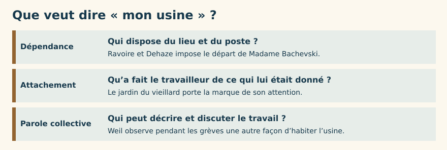

# Agro-Véto · BCPST — Humanités 2023 · Corrigé brut

*Corrigé rédigé par IA, non officiel. Signalez toute erreur.*

**Lecture du rapport du jury** · GPT-6.2 Astra Ultra · vitesse non renseignée

**Rédaction** · GPT-6.2 Astra Ultra · vitesse non renseignée

**Autocontrôle** · GPT-6.2 Astra Ultra · vitesse non renseignée

**Révision (tour 1)** · GPT-6.2 Astra Ultra · vitesse non renseignée

La dissertation de trois heures porte sur cinq vers de Joseph Ponthus dans À la ligne et les trois œuvres du programme sur le travail.

## Sujet

« La servitude est volontaire  
Presque heureuse  
L’usine m’a eu  
Je n’en parle plus qu’en disant  
Mon usine »

Joseph Ponthus, *À la ligne*, Paris, 2019.

Dans quelle mesure ces vers vous conduisent-ils à approfondir votre réflexion sur l’expérience du travail, telle que les trois œuvres au programme, Les Géorgiques de Virgile, La Condition ouvrière de Simone Weil et Par-dessus bord de Michel Vinaver, permettent de la penser ?

## Dissertation

Quand Madame Bachevski remercie ses collègues de Ravoire et Dehaze, elle vient de perdre la place à laquelle elle a donné des années de travail. Son merci est-il la formule attendue d’une employée que l’on écarte ou la vérité d’un attachement ? Des vers de Joseph Ponthus dans *À la ligne* (2019) donnent à cette difficulté sa forme la plus brève. D’abord une affirmation, la servitude serait volontaire. Puis une réserve, « presque heureuse ». Puis le renversement de « l’usine m’a eu » à « mon usine ». Le lieu qui s’est emparé du travailleur devient, dans sa bouche, quelque chose qui lui appartient. Or le possessif peut aussi bien marquer la capture de sa parole que la reprise d’une expérience sur laquelle il a quelque chose à dire. Comment faire la différence entre ces deux formes d’appropriation quand la même personne les éprouve ensemble ? Les *Géorgiques* de Virgile, *La Condition ouvrière* de Simone Weil et *Par-dessus bord* de Michel Vinaver permettent de reconnaître pourquoi la volonté peut s’investir dans une nécessité, de découvrir ce que cet investissement laisse aux mains d’autrui et de chercher les conditions d’une parole du travailleur sur son travail.

La volonté se déploie d’abord dans des tâches dont elle n’a choisi ni le principe ni le terme. Dans le premier livre des *Géorgiques*, le cultivateur rencontre un sol, des saisons et des intempéries qu’il n’a pas commandés. Or savoir reconnaître l’heure de travailler et les différences entre terres requiert un jugement. Le poème fait de ce savoir l’objet d’une adresse. Un autre peut apprendre à discerner ce qu’il a lui-même à faire. Une obligation de travailler est ainsi compatible avec la fierté de bien faire. Weil, dans son expérience d’usine, opère une distinction voisine lorsqu’elle différencie un rythme susceptible d’être compris et habité d’une cadence dont seule importe la vitesse prescrite. La fatigue n’interdit pas tout contentement dans l’effort. Encore faut-il que l’attention compte dans l’agencement du geste et que le travailleur puisse éprouver le sens de sa participation.

Ce qui devient « mien » peut aussi être le travail commun. Dans le quatrième livre des *Géorgiques*, l’organisation de la ruche s’offre au regard du lecteur sous les traits d’une cité. Les tâches multiples font un ouvrage qu’aucune abeille n’accomplirait seule. Il serait hasardeux d’attribuer aux insectes une décision politique. Ce qui importe est le langage que le poème emploie pour rendre sensible la puissance d’une coopération. Dans la pièce de Vinaver, les employés échangent des idées, connaissent le produit et partagent la satisfaction que peut donner une trouvaille collective. Les discours de l’entreprise parlent donc une langue crédible lorsqu’ils font appel à la fierté d’en être. Sans le désir réel d’apporter quelque chose, la possibilité de mobiliser ainsi les salariés resterait incompréhensible. Le « presque » de Ponthus interdit de balayer cette joie comme une pure fiction.

Mais où passe l’initiative quand le travailleur ne possède ni les conditions de sa tâche ni le droit de les discuter ? La formule familière par laquelle l’usine a « eu » le locuteur fait entendre la réussite d’un piège autant que la soumission à une règle. Dans ses lettres à Albertine Thévenon, Weil analyse la surprise d’avoir pu se croire faite pour recevoir des ordres. La succession des consignes, la peur de manquer le rendement et le besoin de garder son salaire finissent par peser sur la représentation de soi. Que l’ouvrière trouve en elle la disposition à obéir ne prouve donc pas qu’elle ait librement institué son obéissance. L’organisation a travaillé jusque dans la volonté au moyen de laquelle elle est servie. Le pronom « mon » peut alors désigner un lieu devenu familier simplement parce qu’on y a laissé l’essentiel de son temps et de ses forces.

Dans une lettre à Victor Bernard, Weil évoque des ouvrières qui attendent sous la pluie devant le grand portail, tandis que des chefs entrent par une autre porte. Cet intervalle avant le travail appartient déjà à leur expérience de l’usine. On ne peut même pas y entrer au moment où on le souhaite. Si une ouvrière dit alors « mon usine », le possessif désigne une appartenance dont le pouvoir de franchir le seuil révèle immédiatement les limites. Quand les occupations de 1936 changeront qui peut demeurer dans les locaux et dans quelles conditions, ce même petit mot pourra recevoir une force nouvelle.

Le théâtre permet de saisir le trouble de ce possessif sans décider à la place du personnage. Au départ imposé de Madame Bachevski, les mots de gratitude se mêlent, dans le mouvement de sa réplique, à la sensation d’un vide. Ses années de service sont bien à elle, mais la direction peut décider de leur terme. Dans le projet commercial de Ravoire et Dehaze, l’enthousiasme de personnes qui connaissent l’ancien produit n’est pas davantage un titre à décider de l’avenir de l’entreprise. Cette différence entre appartenance vécue et propriété effective empêche de conclure à la liberté des salariés parce qu’ils disent « nous ». La terre de Virgile elle-même échappe parfois à celui qui la cultive. La fin du premier livre montre la guerre vider les campagnes de leurs travailleurs et interrompre le travail agricole. Le savoir et l’attachement du paysan ne lui donnent aucun pouvoir souverain sur les usages politiques du territoire. Le plaisir local d’un geste ne justifie donc pas toutes les dépendances dans lesquelles il s’inscrit.

Il demeure que les mots du sujet ne sont pas une phrase recueillie par la direction de l’usine. Un écrivain en a choisi les coupures. En isolant le possessif, Ponthus rend problématique ce qui, dans la conversation quotidienne, pourrait passer inaperçu. Une première reprise consiste à pouvoir décrire ce que le travail fait à celui qui l’exerce. Ainsi Weil, dans ses lettres et son journal, consigne non seulement les tâches mais les ordres, les attentes et leurs effets sur la pensée. Lorsqu’elle relate les grèves avec occupations de 1936, un changement de relation devient visible. On se rencontre dans les mêmes locaux, mais on peut y parler autrement, bousculer pour un temps les différences habituelles de statut, éprouver la joie d’être reconnu par les autres. Les machines sont là. La possibilité de dire ce qu’on y vit s’est transformée. Cette expérience collective fournit un critère pour distinguer l’attachement au lieu de l’assentiment à son régime ordinaire.

Un second critère est la capacité de modifier ou de transmettre une manière de faire. L’épisode du vieillard de Corycos au livre IV des *Géorgiques* présente un lopin négligé et réfractaire aux grands usages agricoles. Le soin des fleurs, des légumes, des arbres et des abeilles y produit un calendrier et une abondance inattendus. La joie n’abolit aucune des contraintes du terrain. Elle naît du rapport intelligible entre les choix du jardinier, les saisons et ce qui parvient à croître. Le poète offre à cette réussite modeste, qui aurait pu passer sans trace, une place dans son propre ouvrage. Chez Vinaver, le montage juxtapose des voix que la hiérarchie n’entend pas de la même façon, celles qui décident et celles qui commentent, imaginent, remercient ou s’inquiètent. Le spectateur peut entendre ensemble ce que le langage officiel de l’entreprise réunit trop commodément sous un même possessif.

Il faut donc prendre la réserve de Ponthus au sérieux jusque dans la réponse. La volonté peut s’attacher aux gestes, aux personnes et aux fruits d’un travail dont elle ne choisit pas les conditions. Cet attachement rend la servitude plus habitable et parfois plus difficile à apercevoir. Sa valeur ne se décide ni par la seule présence de plaisir ni par l’emploi d’un possessif. Elle se mesure aussi à ce que les travailleurs peuvent comprendre, dire, partager et changer de leur activité. À cette condition, dire « mon usine » peut commencer à faire entendre la voix de celui qui y travaille, y compris lorsqu’elle vient contester les prétentions de ceux qui la possèdent.

[Énoncé de la banque Agro-Véto](https://www.concours-agro-veto.fr/sites/default/files/media/2025-10/sujet-a-bcpst-humanites-session-2023.pdf) · [Rapport du jury 2023](https://www.concours-agro-veto.fr/sites/default/files/media/2025-10/rapport-a-bcpst-humanites-2023.pdf)
