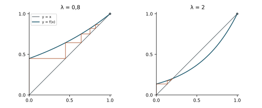
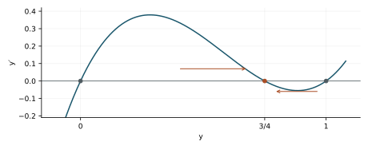

# Agro-Véto BCPST 2023 · Mathématiques, méthodes de calcul et raisonnement · Corrigé guidé

*Corrigé rédigé par IA, non officiel. Signalez toute erreur.*

**Rédaction** · GPT-6.2 Astra Ultra · vitesse non renseignée

Le premier modèle suit les générations successives d’une population abstraite. Les deux exemples continus reposent ensuite sur des équations différentielles et une diagonalisation complexe. La rédaction conserve la numérotation des cinq pages du sujet.

## I. Quelques résultats utiles

### Question 1

> [!INDICATION]
> Reconnaître la série exponentielle en λx.

#### Solution

Pour tout $x\in\mathbb R$, la série exponentielle $\sum_{k\ge0}(\lambda x)^k/k!$ converge absolument et vaut $e^{\lambda x}$. Le facteur $e^{-\lambda}$ est constant en $k$. Ainsi $S(x)=e^{\lambda(x-1)}$.

### Question 2

> [!INDICATION]
> Rechercher le maximum de x exp(−x) sur les réels positifs.

#### Solution

On a $g'(x)=(1-x)e^{-x}$. La fonction $g$ croît sur $[0,1]$ et décroît sur $[1,+\infty[$. Son maximum vaut $g(1)=e^{-1}-1<0$. Ainsi $g(x)<0$ sur $\mathbb R_+$.

### Question 3

> [!INDICATION]
> Comparer la dérivée de φ à sa valeur en 1 et traiter aussi le cas λ = 1.

#### Solution

Pour $\phi(x)=e^{\lambda(x-1)}-x$, on a $\phi'(x)=\lambda e^{\lambda(x-1)}-1$ et $\phi''(x)=\lambda^2e^{\lambda(x-1)}>0$. La dérivée est strictement croissante. Si $\lambda\le1$, alors $\phi'(1)=\lambda-1\le0$, donc $\phi'(x)<0$ sur $[0,1[$, même lorsque $\lambda=1$. La fonction décroît strictement sur $[0,1]$ et $\phi(1)=0$. L’unique point fixe est $1$.

### Question 4

> [!INDICATION]
> Établir le signe aux deux bornes pour la dérivée, puis pour la fonction de part et d’autre de son minimum.

#### Solution

Si $\lambda>1$, alors $\phi'(0)=\lambda e^{-\lambda}-1=g(\lambda)<0$ et $\phi'(1)>0$. La dérivée, continue et strictement croissante, s’annule en un unique $\alpha\in]0,1[$. La fonction $\phi$ décroît strictement jusqu’à $\alpha$, puis croît strictement. Puisque $\alpha<1$ et $\phi(1)=0$, on a $\phi(\alpha)<0$. Comme $\phi(0)=e^{-\lambda}>0$, le théorème des valeurs intermédiaires et la stricte décroissance donnent exactement un zéro $x_\lambda\in]0,\alpha[$. Sur $[\alpha,1]$ le seul zéro est $1$.

### Question 5

> [!INDICATION]
> La moyenne et la variance d’une loi de Poisson ont la même valeur.

#### Solution

On a $\mathbb E(T_1)=t_1$ et $\operatorname{Var}(T_1)=t_1$.

### Question 6

> [!INDICATION]
> Conditionner par les événements T₁ = j et utiliser l’indépendance.

#### Solution

Les événements $(T_1=j)$, $j\in\mathbb N$, forment un système complet. La somme $T_1+T_2$ est à valeurs dans $\mathbb N$. Pour $m\ge0$, les indices $j>m$ ne contribuent pas puisque $T_2\ge0$. Par indépendance et par le binôme de Newton,
$$\mathbb P(T_1+T_2=m)=\sum_{j=0}^{m}e^{-t_1}\frac{t_1^j}{j!}e^{-t_2}\frac{t_2^{m-j}}{(m-j)!}=\frac{e^{-(t_1+t_2)}}{m!}(t_1+t_2)^m.$$
Il s’agit de la loi de Poisson de paramètre $t_1+t_2$.

### Question 7

> [!INDICATION]
> Justifier l’indépendance entre la somme déjà formée et la variable suivante.

#### Solution

Pour $n=1$, le résultat est l’hypothèse sur $T_1$. Supposons $U_n=\sum_{k=1}^nT_k$ de loi de Poisson de paramètre $s_n=\sum_{k=1}^nt_k$. La famille initiale étant indépendante, $U_n$, qui ne dépend que du premier groupe $(T_1,\ldots,T_n)$, est indépendante de $T_{n+1}$ par le lemme des coalitions. La question 6 donne à $U_n+T_{n+1}$ la loi de Poisson de paramètre $s_n+t_{n+1}$. La récurrence conclut pour tout $n\ge1$.

### Question 8

> [!INDICATION]
> Choisir une primitive du coefficient continu sur l’intervalle.

#### Solution

La continuité de $a$ sur l’intervalle $I$ y assure l’existence d’une primitive $A$. Les solutions sont les fonctions $t\mapsto K e^{A(t)}$ avec $K\in\mathbb R$.

### Question 9

> [!INDICATION]
> Une exponentielle peut-elle s’annuler ?

#### Solution

Si $f(t_0)=0$ pour un $t_0\in I$, la question 8 donne $Ke^{A(t_0)}=0$. Or $e^{A(t_0)}>0$. Donc $K=0$ et $f$ est nulle sur tout $I$.

### Question 10

> [!INDICATION]
> Dériver g−C et utiliser exactement l’équation satisfaite par g.

#### Solution

Soit $v=g-C$. Pour tout $t\in I$, $v'(t)=g'(t)=b(g(t))(g(t)-C)=b(g(t))v(t)$. Ainsi $v$ est solution de $(E_3)$ sur $I$.

### Question 11

> [!INDICATION]
> Vérifier que le coefficient de l’équation linéaire obtenue est continu.

#### Solution

La fonction $g$ est dérivable donc continue, et $b$ est continue. Par composition $t\mapsto b(g(t))$ est continue sur $I$. Si $g(t_0)=C$, la solution $g-C$ de l’équation linéaire de la question 10 s’annule en $t_0$. La question 9 la rend identiquement nulle, donc $g=C$ sur $I$.

## II. Probabilité d’extinction d’une stratégie

### Question 12

> [!INDICATION]
> Pour la deuxième génération, sommer sur le nombre de descendants de la première.

#### Solution

Comme $Z_0=1$, on a $p_0=0$. La loi de $Z_1$ donne $p_1=e^{-\lambda}$. Conditionnellement à $Z_1=k$, la génération suivante est nulle si les $k$ nombres de descendants sont tous nuls, événement de probabilité $e^{-k\lambda}$ par indépendance. Cette valeur vaut aussi $1$ pour $k=0$. Par les probabilités totales sur le système complet $(Z_1=k)_{k\ge0}$,
$$p_2=\sum_{k=0}^\infty e^{-\lambda}\frac{\lambda^k}{k!}e^{-k\lambda}=\exp\big(\lambda(e^{-\lambda}-1)\big).$$

### Question 13

> [!INDICATION]
> Une génération vide peut-elle avoir des descendants ?

#### Solution

Si $Z_n=0$, la somme définissant $Z_{n+1}$ est vide, donc $Z_{n+1}=0$. Ainsi $A_n\subset A_{n+1}$ et $p_n\le p_{n+1}$. Cette suite de probabilités est croissante et majorée par 1. Elle converge vers un réel $p\in[0,1]$.

### Question 14

> [!INDICATION]
> Conditionner sur la première génération en employant la propriété admise.

#### Solution

Le système complet $(Z_1=k)_{k\ge0}$ et la propriété admise donnent
$$p_{n+1}=\sum_{k=0}^\infty\mathbb P(Z_1=k)\,\mathbb P(Z_{n+1}=0\mid Z_1=k)=\sum_{k=0}^\infty e^{-\lambda}\frac{\lambda^k}{k!}p_n^k=S(p_n).$$
Pour $k=0$, le facteur vaut $1$, conformément à la somme vide de descendants.

### Question 15

> [!INDICATION]
> Prouver que la limite est un point fixe puis montrer qu’on ne dépasse jamais le petit point fixe.

#### Solution

Par continuité de $S(x)=e^{\lambda(x-1)}$, la limite vérifie $p=S(p)$. Si $\lambda\le1$, la question 3 impose $p=1$. Pour $\lambda>1$, les possibilités sont $x_\lambda$ et $1$. Comme $p_0=0\le x_\lambda$ et $S$ est croissante, $p_n\le x_\lambda$ entraîne $p_{n+1}=S(p_n)\le S(x_\lambda)=x_\lambda$. Par récurrence puis passage à la limite, $p\le x_\lambda<1$. Il reste donc $p=x_\lambda$.

### Question 16

> [!INDICATION]
> Relier la limite des probabilités à l’événement « disparition à une génération finie ».

#### Solution

L’extinction est l’événement $\bigcup_{n\ge0}A_n$. Comme ces événements sont croissants, sa probabilité est $\lim p_n$. Le paramètre $\lambda$ est le nombre moyen de descendants d’un individu dans le modèle. Si $\lambda\le1$, l’extinction finit par se produire avec probabilité 1, y compris au seuil $\lambda=1$. Si $\lambda>1$, elle garde une probabilité $x_\lambda>0$, tandis que la probabilité de subsister à toutes les générations vaut $1-x_\lambda>0$.

## III. Deux exemples en temps continu

### Question 17

> [!INDICATION]
> Étudier séparément les cas où une coordonnée est nulle et où les trois sont non nulles.

#### Solution

Les constantes doivent satisfaire $C_1(C_2-C_3)=C_2(C_3-C_1)=C_3(C_1-C_2)=0$ et $C_1+C_2+C_3=1$. Si toutes sont non nulles, elles sont égales et valent $1/3$. Si, par exemple, $C_1=0$, la seconde équation impose $C_2C_3=0$ et la somme impose que la coordonnée restante vaille 1. Par permutation cyclique, on obtient $(1,0,0),(0,1,0),(0,0,1)$. Ces trois triplets et $(1/3,1/3,1/3)$ satisfont réciproquement les quatre conditions, ce qui achève la détermination.

### Question 18

> [!INDICATION]
> Exploiter les décalages cycliques des lignes avec les racines cubiques de l’unité.

#### Solution

Posons $j=e^{2i\pi/3}=(-1+i\sqrt3)/2$. On a $j^3=1$, $j^2=\overline j$ et $j-j^2=i\sqrt3$. Pour $z\in\{1,j,j^2\}$, prenons $v_z=(1,z,z^2)^T$. Le produit donne
$$Mv_z=(z-z^2,z^2-1,1-z)^T=(z-z^2)v_z,$$
car $z^3=1$. Les trois valeurs propres obtenues sont donc $0,i\sqrt3,-i\sqrt3$. Elles sont distinctes et les vecteurs associés indépendants. En dimension 3 ils forment une base et il n’y a aucune autre valeur propre. Les espaces propres sont respectivement $\mathbb C v_1,\mathbb C v_j,\mathbb C v_{j^2}$.

### Question 19

> [!INDICATION]
> Ranger les vecteurs propres en colonnes dans le même ordre que les valeurs de la diagonale.

#### Solution

Choisissons
$$P=\begin{pmatrix}1&1&1\\1&j&j^2\\1&j^2&j\end{pmatrix},\qquad D=\operatorname{diag}(0,i\sqrt3,-i\sqrt3).$$
Les colonnes de $P$ forment la base propre de la question 18, donc $P$ est inversible. Le produit colonne à colonne donne $MP=PD$, d’où $M=PDP^{-1}$. La première ligne de $P$ est celle requise.

### Question 20

> [!INDICATION]
> Multiplier par le dénominateur puis identifier le polynôme quadratique obtenu.

#### Solution

La décomposition cherchée équivaut à l’identité polynomiale
$$1=A(x-1)(4x-3)+Bx(4x-3)+Cx(x-1).$$
En évaluant en $0,1,3/4$, on trouve respectivement $A=1/3$, $B=1$, $C=-16/3$. Avec ces valeurs, la différence des deux membres est un polynôme de degré au plus 2 qui s’annule en trois points distincts. Elle est donc nulle identiquement, ce qui vérifie la réciproque.

### Question 21

> [!INDICATION]
> Intégrer chaque fraction en tenant compte des signes sur l’intervalle.

#### Solution

Sur $]0,3/4[$, on a $x>0$, $1-x>0$ et $3-4x>0$. Les primitives sont
$$H(x)=\tfrac13\ln x+\ln(1-x)-\tfrac43\ln(3-4x)+K,\quad K\in\mathbb R.$$
En effet, une primitive de $1/(4x-3)$ est $\tfrac14\ln|4x-3|$. La constante représente toutes les primitives sur cet intervalle.

### Question 22

> [!INDICATION]
> Pour chaque borne C, factoriser le second membre sous la forme de la question 11.

#### Solution

Pour $C=0$, écrivons $y'=b_0(y)(y-0)$ avec $b_0(s)=(s-1)(4s-3)$. Pour $C=3/4$, écrivons $y'=b_1(y)(y-3/4)$ avec $b_1(s)=4s(s-1)$. Les deux coefficients sont continus sur $\mathbb R$. Si la solution touche l’une de ces bornes, la question 11 la rend constante sur tout $\mathbb R_+$, ce qui contredit la valeur initiale strictement intérieure. Par continuité, sortir de $]0,3/4[$ obligerait à toucher une borne. La solution y reste donc pour tout $t\ge0$.

### Question 23

> [!INDICATION]
> Composer une primitive de la question 21 avec la solution, dont on connaît désormais le domaine.

#### Solution

Pour $0<x<3/4$, choisissons la primitive
$$H(x)=\tfrac13\ln\!\left(\frac{x(1-x)^3}{(x-3/4)^4}\right).$$
Le facteur $4$ dans $3-4x=4(3/4-x)$ ne modifie que la constante de la primitive précédente. Les facteurs du dénominateur de $h$ ne s’annulent jamais sur la trajectoire, par la question 22. Ainsi $(H\circ x_1)'(t)=h(x_1(t))x_1'(t)=1$. Par intégration $H(x_1(t))=t+D$, avec $D=H(x_1(0))$. C’est l’identité voulue.

### Question 24

> [!INDICATION]
> Montrer que la solution a une limite puis utiliser l’identité de la question 23.

#### Solution

Sur $]0,3/4[$, les facteurs $x$, $x-1$, $4x-3$ ont les signes $+,-,-$. Ainsi $x_1$ est strictement croissante et majorée par $3/4$. Sa limite $L$ existe et $0<x_1(0)\le L\le3/4$. Si $L<3/4$, la continuité de $H$ en $L$ donnerait $H(x_1(t))\to H(L)$ fini, ce qui contredit $H(x_1(t))=t+D\to+\infty$. Donc $L=3/4$.

