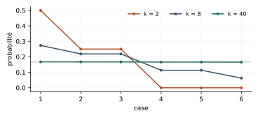
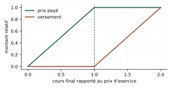
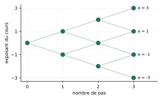
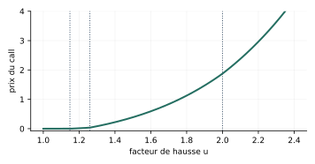

# Agro-Véto · BCPST · Modélisation mathématique et informatique 2023 — corrigé brut

*Corrigé rédigé par IA, non officiel. Signalez toute erreur.*

**Rédaction** · GPT-6.2 Astra Ultra · vitesse non renseignée · 25 novembre 2026

**Révision** · GPT-6.2 Astra Ultra · vitesse non renseignée · 26 novembre 2026

**Marches aléatoires et applications.** La numérotation reprend les sections du sujet. Les questions 13 à 15 sur le contrat précèdent la reprise du numéro 1 de la partie 2. Le cours du blé et les règles du contrat sont ceux de cet exercice.

## I. Marche additive libre

### Question I.1 · Trois sauts

Les positions $-3h,-h,h,3h$ ont respectivement pour probabilités $1/8,3/8,3/8,1/8$. Chaque chemin a probabilité $1/8$. Pour arriver en $h$, par exemple, il faut deux sauts vers la droite et un vers la gauche, ce qui donne trois ordres possibles.

### Question I.2 · Espérance de la position

Chaque incrément vaut $-h$ ou $h$ avec probabilités égales, donc a une espérance nulle. $X_0=0$ et la linéarité de l’espérance donnent $\mathbb E X_k=0$.

### Question I.3 · Compter les sauts à droite

Les $k$ directions sont indépendantes et la probabilité de droite est $1/2$ à chaque fois. Ainsi $Y_k\sim\mathcal B(k,1/2)$.

### Question I.4 · Relier déplacement et nombre de succès

Il y a $Y_k$ déplacements de $+h$ et $k-Y_k$ de $-h$. Leur somme vaut $X_k=h(2Y_k-k)$.

### Question I.5a · Loi de la position

Pour $j=0,\ldots,k$, la position $(2j-k)h$ a pour probabilité $2^{-k}\binom{k}{j}$. Cela donne toutes les positions, espacées de $2h$ de $-kh$ à $kh$.

### Question I.5b · Variance des positions

$\operatorname{Var}(X_k)=4h^2\operatorname{Var}(Y_k)=4h^2 k/4=kh^2$. Le déplacement quadratique moyen est donc proportionnel au nombre de pas.

## I. Marche additive en boîte

### Question I.6 · Évolution dans la boîte

Par les probabilités totales, $p^{(k+1)}_i=\sum_j \Pr(X_{k+1}=i\mid X_k=j)p^{(k)}_j$. Les colonnes de $M$ sont les lois des destinations depuis une case donnée, avec la moitié de la masse conservée aux deux bords. Donc $p^{(k+1)}=Mp^{(k)}$. Par récurrence, $p^{(k)}=M^kp^{(0)}$, y compris pour $k=0$.

### Question I.7 · Diagonalisation orthogonale

$M$ est réelle symétrique. Le théorème spectral fournit une base orthonormale de vecteurs propres. En les prenant pour colonnes de $P$, on obtient $M=PDP^{T}$ avec $P^{-1}=P^{T}$ et $D$ diagonale réelle.

### Question I.8 · Espace propre pour trois cases

Si $v=(x,y,z)^T$ vérifie $Mv=v$, alors $(x+y)/2=x$ et $(y+z)/2=z$, d’où $x=y=z$. L’équation centrale est alors satisfaite. Ainsi 1 est valeur propre, son espace propre de dimension 1 est dirigé par $(1,1,1)^T$.

### Question I.9a · Orthogonalité

Pour $i\ge2$, la symétrie donne $v_1^TMv_i=(Mv_1)^Tv_i$, soit $(\lambda_i-1)v_1^Tv_i=0$. Comme 1 est valeur propre simple, $\lambda_i\ne1$, et $v_1^Tv_i=0$.

### Question I.9b · Action de la matrice déflatée

Le terme retranché est $\lambda_1$ fois le projecteur $v_1v_1^T/\|v_1\|_2^2$. Pour $i\ge2$ ce projecteur annule $v_i$, donc $Nv_i=\lambda_i v_i$. Pour $i=1$, il renvoie $v_1$ et $Nv_1=0$. L’affirmation imprimée « pour tout $i$ » a donc une exception en 1, où la valeur propre de $N$ est 0 au lieu de 1.

### Question I.9c · Module des autres valeurs propres

Pour $i\ge2$, $\|Nv_i\|_1=|\lambda_i|\|v_i\|_1<\|v_i\|_1$ par l’inégalité admise. Comme $v_i\ne0$, la division donne $|\lambda_i|<1$.

### Question I.10a · Puissances de la diagonale

$D^k$ contient sur sa diagonale $1,\lambda_2^k,\ldots,\lambda_n^k$. À partir de la deuxième place, tous ces termes tendent vers zéro. La limite est $\operatorname{diag}(1,0,\ldots,0)$.

### Question I.10b · Puissances de la matrice initiale

Comme $P^TP=I$, la récurrence sur $k$ donne $M^k=PD^kP^T$, dès $k=0$.

### Question I.10c · Projecteur limite

Par continuité du produit en dimension finie, la limite est $v_1v_1^T$. Les coordonnées de $v_1$ étant toutes égales à $1/\sqrt n$, chaque coefficient du projecteur vaut $1/n$.

### Question I.11 · Loi limite

Chaque composante de $M^kp^{(0)}$ tend vers $n^{-1}\sum_j p_j^{(0)}=1/n$. Le vecteur limite est la loi uniforme sur les $n$ cases.



### Question I.12 · Interprétation physique

À temps long, chaque case possède la même probabilité de présence, quelle que soit la loi initiale. Une particule particulière continue de se déplacer. C’est sa distribution qui se stabilise.

## II. Contrat à terme · numéros 13 à 15 du sujet

### Question II.13 · Durée du contrat

Le versement terminal dépend du cours à la date $T$. Lorsque l’échéance change, la loi de ce cours et donc la probabilité et l’ampleur d’un dépassement du prix d’exercice peuvent changer. La valeur du contrat en dépend.

### Question II.14 · Prix payé pour le blé

Hors prime initiale, l’entreprise paie $P_{\rm ent}(s)=\min(s,s^*)$. La courbe suit la droite $y=s$ jusqu’à $s=s^*$, puis la demi-droite horizontale $y=s^*$.

### Question II.15 · Versement de la banque

La banque verse $P_{\rm ban}(s)=(s-s^*)_+=\max(s-s^*,0)$. Le graphe est horizontal et nul jusqu’au prix d’exercice, puis c’est la droite de pente 1 passant par $(s^*,0)$. On a $P_{\rm ent}(s)+P_{\rm ban}(s)=s$.



## II. Arbre binomial recombinant

### Question II.1a · Arbre des cours à trois pas

Aux temps 0, 1, 2, 3, les exposants de $u$ dans le cours $s_0u^e$ sont respectivement $\{0\}$, $\{-1,1\}$, $\{-2,0,2\}$ et $\{-3,-1,1,3\}$. Chaque nœud d’exposant $e$ donne deux enfants $e-1,e+1$. Après trois pas l’ensemble demandé est donc $\{s_0/u^3,s_0/u,s_0u,s_0u^3\}$. Le modèle est recombinant car monter puis descendre donne le même cours que descendre puis monter.



### Question II.1b · Deux probabilités de cours

Trois montées ont pour probabilité $p^3$. Le cours $us_0$ requiert deux montées et une descente, dans trois ordres différents, d’où $3p^2(1-p)$.

### Question II.1c · Feuilles à l’échéance n

Pour $k$ montées et $n-k$ descentes, le facteur cumulé est $u^{2k-n}$. Toutes ces suites ont une probabilité positive. Ainsi $\mathcal D_n=\{s_0u^{2k-n}:0\le k\le n\}$.

### Question II.2a · Valeurs possibles du versement

$G_n=(S_n-s^*)_+$. Le gain est positif si $k>n/2+\ln(s^*/s_0)/(2\ln u)$. Le premier entier strictement supérieur est le $a$ donné dans l’énoncé. Sous l’hypothèse $a>0$, la valeur zéro existe et les autres valeurs sont $s_0u^{2k-n}-s^*$ pour $a\le k\le n$. L’ensemble des termes positifs est vide si $a>n$.

### Question II.2b · Sens du seuil entier

$a$ est le nombre minimal de montées nécessaires à un versement strictement positif. Un cours final égal au prix d’exercice donne encore zéro.

### Question II.2c · Lois numériques

Pour $n=3$, $u=2$, $s_0=1$, $s^*=4$ et $p=1/3$, on a

| Montées $k$ | 0 | 1 | 2 | 3 |
|---|---:|---:|---:|---:|
| $S_3$ | $1/8$ | $1/2$ | $2$ | $8$ |
| Probabilité | $8/27$ | $12/27$ | $6/27$ | $1/27$ |
| $G_3$ | 0 | 0 | 0 | 4 |

La loi de $G_3$ est donc $\Pr(G_3=0)=26/27$, $\Pr(G_3=4)=1/27$.

### Question II.3a · Convention du prix juste

Dans la convention de l’énoncé, $c_n=\mathbb E G_n$. La banque reçoit la prime et verse $G_n$ à terme. Son gain moyen $c_n-\mathbb E G_n$ est nul. Le modèle emploie ici directement la loi donnée et néglige l’actualisation.

### Question II.3b · Prime pour l’exemple

La prime est $c_3=4\times1/27=4/27$.

### Question II.3c · Somme binomiale

Le nombre de montées est binomial de paramètres $(n,p)$. Dans la somme des gains pondérés, les termes pour $k<a$ sont nuls. On obtient

$$
c_n=\sum_{k=a}^n(s_0u^{2k-n}-s^*)\binom{n}{k}p^k(1-p)^{n-k}.
$$

Si $a>n$, la somme vide est nulle.

## II. Programmation du prix

### Question II.4a · Calcul factoriel et coût

Pour $0\le k\le n$, les produits obtenus sont $n!$, $k!$ et $(n-k)!$. Le quotient est donc $\binom nk$. Le nombre de multiplications est $\max(0,n-1)+\max(0,k-1)+\max(0,n-k-1)$, soit $2n-3$ si $0<k<n$, auquel s’ajoute une division. Le temps est $O(n)$ en nombre d’opérations arithmétiques. Les factorielles intermédiaires peuvent être énormes. Les entiers Python sont de précision arbitraire, mais la division `/` convertit en flottant et peut arrondir ou dépasser l’étendue représentable.

### Question II.4b · Réduire les produits

Posons $j=\min(k,n-k)$. Seuls les $j$ facteurs de $n-j+1$ à $n$ sont nécessaires au numérateur. Le dénominateur est $j!$. L’écriture suivante conserve une sortie entière exacte.

```python
def Copt(n, k):
    j = min(k, n-k)
    Num = 1
    for i in range(n-j+1, n+1):
        Num *= i
    Den = 1
    for i in range(2, j+1):
        Den *= i
    return Num // Den
```

Les boucles sont vides pour $j=0$. Le calcul demande $O(j+1)$ opérations.

### Question II.5 · Interpréter Feuilles

La liste de longueur $n+1$ contient à l’indice $k$ le versement $\max(s_0u^{2k-n}-s^*,0)$ du scénario à $k$ montées. Les zéros répétés sont conservés. La liste décrit les montants avant prise en compte des probabilités.

```python
def Feuilles(n, u, s0, setoile):
    return [max(s0 * u**(2*k - n) - setoile, 0) for k in range(n+1)]
```

### Question II.6 · Prix par somme pondérée

Notons $w_k=\binom nk p^k(1-p)^{n-k}$. La formule (15) pondère la feuille d’indice $k$ par $w_k$. Le quotient $w_{k+1}/w_k=(n-k)p/((k+1)(1-p))$ dépasse 1 avant le mode et devient inférieur ou égal à 1 après. On peut donc partir d’un mode $j=\lfloor(n+1)p\rfloor$, calculer les poids relatifs $w_k/w_j$ vers les deux bords, puis les normaliser. Leur somme vaut $1/w_j$.

```python
def call(n, u, s0, setoile, p):
    gains = Feuilles(n, u, s0, setoile)
    j = min(n, int((n + 1) * p))
    poids = [0.0] * (n + 1)
    poids[j] = 1.0
    for k in range(j, n):
        poids[k+1] = poids[k] * ((n-k)*p / ((k+1)*(1-p)))
    for k in range(j, 0, -1):
        poids[k-1] = poids[k] * (k*(1-p) / ((n-k+1)*p))
    total = sum(poids)
    return sum((w / total) * g for w, g in zip(poids, gains))
```

Les deux boucles effectuent $n$ passages en tout. Pour $n=1100$ et $p=1/2$, le coefficient central dépasse la capacité d’un flottant, alors que la probabilité correspondante est voisine de $0{,}024$. Les poids relatifs utilisés ici sont au plus égaux à 1. Le calcul reste soumis à la précision flottante des cours calculés par `Feuilles`.

## III. Volatilité historique

### Question III.7a · Loi des rendements logarithmiques

Les multiplicateurs successifs valent $u$ ou $1/u$ avec probabilités $1/2,1/2$. Les probabilités conditionnelles des directions étant constantes quel que soit le passé, les directions, donc leurs logarithmes, sont indépendantes. Les $Z_i$ prennent les valeurs $\ln u$ et $-\ln u$ avec la même probabilité.

### Question III.7b · Moments d’un rendement

$\mathbb E Z_1=0$ et $\operatorname{Var}(Z_1)=\mathbb E Z_1^2=(\ln u)^2$.

### Question III.8a · Théorème central limite

Les $Z_i$ sont indépendants, identiquement distribués et de variance finie positive $\sigma^2=(\ln u)^2$. Avec $u>1$, la volatilité vaut $\sigma=\ln u$. Le théorème central limite donne $\sqrt n\,\bar Z_n/\sigma\Rightarrow\mathcal N(0,1)$.

### Question III.8b · Signification d’une forte volatilité

Une volatilité plus élevée correspond à des logarithmes de rendement de plus grande amplitude dans les deux directions. Les fluctuations relatives de prix entre dates successives sont plus fortes.

### Question III.9a · Correction de la variance empirique

$\operatorname{Var}(Z_n)=\sigma^2$ et $\operatorname{Var}(\bar Z_n)=\sigma^2/n$ par indépendance. Pour $n\ge2$, l’identité $\sum_i(Z_i-\bar Z_n)^2=\sum_i Z_i^2-n\bar Z_n^2$ donne

$$
\mathbb E V_n=\frac{n\sigma^2-n(\sigma^2/n)}{n-1}=\sigma^2.
$$

Le diviseur $n-1$ impose $n\ge2$, même si la question annonce plus généralement $n\in\mathbb N$.

### Question III.9b · Interprétation de V

$V_n$ est la variance empirique corrigée des rendements. Elle estime sans biais la variance commune $\sigma^2$.

### Question III.9c · Retour au facteur de hausse

Comme $u=\exp(\sigma)$, $U_n=\exp(\sqrt{V_n})$ estime le facteur multiplicatif de hausse à partir des rendements historiques. L’absence de biais de $V_n$ ne se transmet pas automatiquement à une transformation non linéaire.

## III. Volatilité implicite

### Question III.10a · Méthode de Newton

Sur le domaine où la dérivée ne s’annule pas avant convergence, on peut écrire

```python
def Newton(u0, epsilon, F, Fprime):
    u = u0
    for k in range(nmax):
        valeur = F(u)
        if valeur == 0:
            return u
        suivant = u - valeur / Fprime(u)
        if abs(suivant-u) < epsilon:
            return suivant
        u = suivant
    raise RuntimeError("Newton : limite d'itérations atteinte")
```

Le premier test traite une racine exacte. Une sortie par dépassement ne certifie aucune précision.

### Question III.10b · Choisir une tolérance

Pour un facteur de hausse de l’ordre de l’unité, $\varepsilon=10^{-6}$ est un exemple raisonnable de seuil sur le dernier changement. Il est très supérieur à l’erreur d’arrondi usuelle des doubles. La taille du pas sert de critère d’arrêt et ne fournit pas en général une garantie absolue sur l’erreur à la racine.

### Question III.10c · Dérivée nulle

Si $F(u)\ne0$ et $F'(u)=0$, le pas de Newton n’est pas défini. Avec des flottants Python ordinaires, la division déclenche `ZeroDivisionError`. Pour produire un message explicite, remplacer la ligne qui forme `suivant` par

```python
pente = Fprime(u)
if pente == 0:
    raise ValueError("Newton : dérivée nulle")
suivant = u - valeur / pente
```

Si $F(u)=0$ dès l’entrée, le test de 10a a déjà renvoyé la racine.

### Question III.11 · Premier cours permettant un versement

La plus haute feuille est $s_0u^n$. Le prix du call est strictement positif si et seulement si $s_0u^n>s^*$, cette feuille ayant un poids positif. Avec $R=s^*/s_0>1$, le seuil est $u_{\min}=R^{1/n}$. À l’égalité le prix vaut encore zéro. Il s’agit de la borne inférieure de l’ensemble ouvert des $u$ donnant un prix strictement positif.

### Question III.12 · Contrat sans versement

Pour $1<u<u_{\min}$, même si tous les pas sont des hausses, le blé reste moins cher que le prix d’exercice. La banque ne verse rien dans aucun scénario. Dans la convention de l’épreuve, l’espérance de son versement et donc le prix du call sont nuls.

### Question III.13 · Intervalles de régularité

Posons $k_0=\lfloor n/2\rfloor+1$, $R=s^*/s_0$ et $b_k=R^{1/(2k-n)}$ pour $k_0\le k\le n$. Ajoutons la convention $b_{k_0-1}=+\infty$. Alors $a=k$ exactement lorsque

$$
b_k<u\le b_{k-1},\qquad k_0\le k\le n,
$$

avec un dernier intervalle ouvert sur $+\infty$. En effet $a=k$ équivaut à $k-1\le n/2+\ln R/(2\ln u)<k$. Si $k=k_0$, l’inégalité de gauche est automatique, pour $n$ pair comme impair.

Sur chacun de ces intervalles, les mêmes feuilles contribuent, donc le prix s’écrit à l’intérieur comme une somme dérivable. Il est continu aux jonctions, croît strictement au-dessus de $b_n$ et tend vers l’infini. Pour une prime cible positive, encadrer l’unique racine par deux bornes successives où $f=c_n-c^*$ change de signe. Pour le dernier intervalle, on peut doubler la borne droite jusqu’au changement de signe. Une racine à une borne est acceptée directement. Sinon partir à l’intérieur et maintenir un encadrement, en prenant le milieu si le pas de Newton sort de l’intervalle. Cela évite d’employer une dérivée non définie à une jonction.



### Question III.14 · Dérivée entre deux jonctions

Avec $p=1/2$, pour $u$ à l’intérieur d’un intervalle de 13,

$$
f'(u)=\frac{s_0}{2^n}\sum_{k=a}^{n}\binom nk(2k-n)u^{2k-n-1}.
$$

Le prix d’exercice et la prime observée sont constants. Tous les exposants $2k-n$ des feuilles actives sont positifs car $s^*>s_0$ et $u>1$. La dérivée est donc strictement positive sur chaque intervalle actif. Au seuil d’activation d’une feuille les deux dérivées unilatérales diffèrent en général.

### Question III.15a · Lire et contrôler mystere

Le code évalue successivement $F$ aux seuils $b_n,b_{n-1},\ldots$. Lorsqu’il rencontre un premier seuil où $F\ge0$ après un seuil où $F<0$, les lignes 7 et 8 reviennent à la borne gauche de l’intervalle repéré. La ligne 9 tente alors de renvoyer, par Newton, une valeur implicite de $u$ vérifiant $c_n(u)=c^*$.

Ce résultat dépend de conditions que le programme imprimé ne garantit pas. Il part exactement d’une jonction, où une dérivée ordinaire peut manquer. En outre, si $F(b_{k_0})<0$, la garde autorise encore la décrémentation. Pour $n$ pair, $2a-n$ devient zéro et la ligne 6 divise par zéro. Pour $n$ impair il devient négatif, donnant un faux seuil inférieur à 1. Par exemple $n=2$, $s_0=1$, $s^*=4$ et $c^*=1$ conduisent à ce dépassement au premier tour. La démarche avec le dernier intervalle infini et le départ intérieur décrite en 13 traite également ces cas.

### Question III.15b · Extraire la volatilité implicite

Pour $u>1$, la volatilité est $\sigma=\ln u$. Quand la fonction imprimée `mystere` aboutit, l’instruction `m.log(mystere(F, Fprime, s0, setoile, epsilon))` donne donc l’estimation demandée. Pour traiter également une solution à une jonction ou dans la dernière tranche, on peut inverser directement le prix continu par dichotomie. Le programme prend le terme $n$ et la prime observée en arguments.

```python
import math as m

def Volatilite(n, s0, setoile, prime, epsilon):
    if prime < 0 or epsilon <= 0:
        raise ValueError("Prime négative ou tolérance non positive")
    if prime == 0:
        raise ValueError("Une prime nulle donne plusieurs volatilités")
    gauche = (setoile / s0)**(1 / n)
    droite = gauche + max(gauche - 1, 1 / n)
    while call(n, droite, s0, setoile, 0.5) < prime:
        droite += droite - gauche
    while droite - gauche > epsilon:
        milieu = gauche + (droite - gauche) / 2
        if milieu == gauche or milieu == droite:
            raise ArithmeticError("Tolérance inférieure à la précision disponible")
        if call(n, milieu, s0, setoile, 0.5) < prime:
            gauche = milieu
        else:
            droite = milieu
    return m.log(gauche + (droite - gauche) / 2)
```

Pour $c^*>0$, la stricte croissance au-delà de $u_{\min}$ assure l’unicité. Le premier parcours termine puisque le prix tend vers l’infini. En arithmétique exacte, le dernier milieu est à $\varepsilon/2$ près du facteur recherché. Sur $u\ge1$, la dérivée de $\ln u$ vaut au plus 1, d’où la même borne sur l’erreur de volatilité. Quand $c^*=0$, l’ensemble des solutions est $0<\sigma\le\ln(s^*/s_0)/n$. Une prime nulle ne fixe donc aucune volatilité unique.
