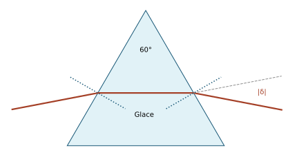
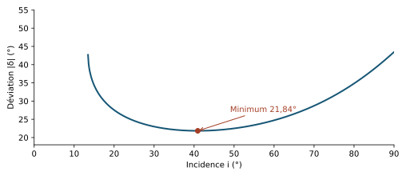
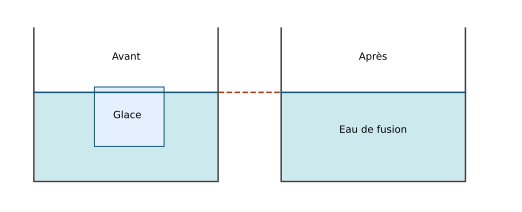
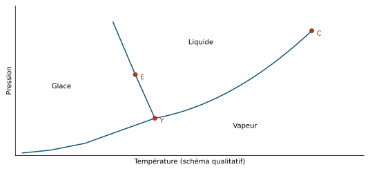
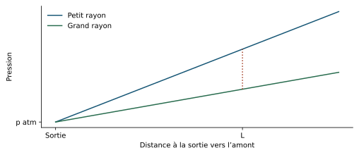

# Agro-Véto BCPST 2023 — Physique · Corrigé guidé

*Corrigé rédigé par IA, non officiel. Signalez toute erreur.*

**Lecture du rapport du jury** · GPT-6.2 Astra Ultra · vitesse non renseignée

**Rédaction** · GPT-6.2 Astra Ultra · vitesse non renseignée

## La glace dans la nature

## I.A — Réfraction

### Question 1 — Indice de réfraction

**Indication.** L'indice vaut un dans le vide. Dans le verre ou la glace, la lumière se propage plus lentement.

La célérité de phase $v$ dans le milieu définit son indice sans dimension $n=c/v$, pour une fréquence donnée. Dans la glace à l'indice indiqué, $v$ est inférieur à $c$.

### Question 2 — Réflexion et réfraction

**Indication.** Écrire aussi la condition géométrique et vérifier le signe de l'angle réfléchi sur la figure.

Le rayon incident et la normale au dioptre au point d'incidence déterminent le plan d'incidence. Les rayons réfléchi et réfracté appartiennent à ce plan. Avec les angles orientés de la figure 1, $\theta'_1=-\theta_1$ et $n_1\sin\theta_1=n_2\sin\theta_2$. La lumière réfléchie reste dans le milieu 1, la lumière transmise passe dans le milieu 2.

### Question 3 — Réflexion totale interne

**Indication.** Examiner la valeur que devrait prendre le sinus de l'angle réfracté.

Pour obtenir un rayon réfracté propagatif, il faut $|\sin\theta_2|=(n_1/n_2)|\sin\theta_1|\leq1$. Si $n_1>n_2$, cette condition cesse d'être remplie au-delà d'une incidence critique. La lumière incidente est alors entièrement réfléchie dans ces milieux transparents. C'est la réflexion totale interne.

### Question 4 — Angle limite

**Indication.** Partir de la réfraction rasante.

À la limite de transmission, le rayon réfracté rase le dioptre, soit $|\theta_2|=90^\circ$. L'angle critique positif vaut $\theta_\ell=\arcsin(n_2/n_1)$. Pour l'incidence opposée, la condition de réflexion totale porte sur $|\theta_1|$.

### Question 5 — Interface glace–air

**Indication.** Identifier le milieu d'où vient la lumière.

De la glace vers l'air, $\theta_\ell=\arcsin(1{,}00/1{,}31)=49{,}76^\circ$, soit environ $50^\circ$ par rapport à la normale.

## I.B — Halo solaire

### Question 6 — La face supérieure de l'hexagone

**Indication.** Comparer les deux normales. Un rayon intérieur qui descend ne rencontre pas directement la face du haut.

Plaçons $EF$ à l'horizontale. La normale à $AF$ dirigée vers la glace pointe à $30^\circ$ sous l'horizontale. L'angle du rayon transmis avec cette normale vérifie $|r|\leq\theta_\ell$ par la loi de la réfraction à l'entrée. Pour rejoindre directement $EF$, le rayon doit monter. Il fait alors avec l'horizontale un angle $\alpha=r-30^\circ$ compris entre zéro et $19{,}76^\circ$. L'incidence sur la normale verticale de $EF$ est au moins $90^\circ-19{,}76^\circ=70{,}24^\circ$. Elle dépasse l'angle critique. Cette rencontre donne donc une réflexion totale.

### Question 7 — Faces parallèles

**Indication.** Remplacer les deux faces par une lame à faces parallèles.

$AF$ et $CD$ sont deux faces opposées parallèles. Un rayon allant de l'une à l'autre y rencontre des normales parallèles et garde le même angle intérieur en valeur absolue. Les deux réfractions successives donnent $n_a\sin i=n_g\sin r=n_a\sin i_{\rm sortie}$ avec la même orientation de référence. Le rayon émergent est parallèle à l'incident. Un déplacement transversal demeure possible.

### Question 8 — Réfraction aux faces du prisme

**Indication.** Écrire une fois la loi de Snell-Descartes dans chaque sens de traversée.

En prenant les angles de la figure 4, $\sin i=n_g\sin r$ et $n_g\sin r'=\sin i'$, car $n_a=1$. À la seconde face, $r'$ et $i'$ sont tous deux négatifs.

### Question 9 — Une ambiguïté de signe sur la déviation

**Indication.** Suivre successivement le rayon incident, le rayon interne puis l'émergent. Une réfraction vers le bas donne ici une rotation négative.

Les normales orientées dans le sens de traversée tournent de $+\beta$ entre l'entrée et la sortie. La direction du rayon intérieur est la même aux deux faces, d'où $r-r'=\beta$. Sa direction à l'entrée change de $r-i$, puis sa direction à la sortie change de $i'-r'$. Avec la rotation trigonométrique positive annoncée et la flèche horaire de la figure 4, la déviation est donc $\delta=r-i+i'-r'=\beta-i+i'<0$. L'expression $i-r+r'-i'$ imprimée à la question 9 donne $|\delta|$ dans cette figure. Les questions suivantes portent précisément sur ce module.

### Question 10 — Passage symétrique

**Indication.** Repartir de la loi des sinus aux deux faces, en conservant les signes.

Au minimum admis, $i'=-i$. Les deux réfractions et l'injectivité de $\sin$ entre $-90^\circ$ et $90^\circ$ imposent $r'=-r$. La géométrie fournit alors $\beta=2r$ et, à l'entrée, $\sin i=n_g\sin(\beta/2)$.

### Question 11 — Rayon angulaire

**Indication.** Calculer d'abord l'incidence symétrique, voisine de 41°.

Au minimum, $|\delta_{\min}|=i-i'-\beta=2i-\beta$. Avec $\beta=60^\circ$ et $n_g=1{,}31$, on obtient $2\arcsin(1{,}31\sin30^\circ)-60^\circ=21{,}84^\circ$. La figure 5 porte l'indication $n=1{,}301$ qui donnerait environ $21{,}2^\circ$. Les deux évaluations situent le halo près de $22^\circ$.

### Question 12 — Accumulation dans un anneau

**Indication.** Relier le nombre d'orientations possibles à la largeur de la bande de déviations qu'elles produisent.

La courbe de la déviation est très plate près du minimum. De nombreuses orientations de cristaux, donc un intervalle appréciable d'incidences, envoient des rayons dans une même petite bande d'angles autour de $22^\circ$. Les cristaux pouvant avoir tout azimut autour de la direction solaire, la bande lumineuse dessine un anneau centré sur le Soleil. L'angle est le rayon apparent de l'anneau.

### Question 13 — Ordre des couleurs

**Indication.** Relier successivement la longueur d'onde, l'indice puis la déviation minimale.

La longueur d'onde du bleu est plus petite que celle du rouge, donc $n_{\rm bleu}>n_{\rm rouge}$. La fonction $2\arcsin[n\sin(\beta/2)]-\beta$ est croissante en $n$ dans le domaine de transmission. Le bord rouge apparaît du côté intérieur et le bleu à plus grand rayon, conformément à l'observation.

## II.A — Glace flottante

### Question 14 — Poussée de l'eau

**Indication.** La masse volumique est celle du fluide déplacé.

La poussée d'Archimède due à l'eau vaut $\vec\Pi_\ell=-\rho_\ell V_i\vec g$. Elle est dirigée vers le haut et sa norme est le poids d'un volume $V_i$ d'eau.

### Question 15 — Origine de la poussée

**Indication.** Comparer les pressions à deux profondeurs, puis envisager l'ensemble de la surface.

Les actions de pression sont perpendiculaires à la surface du glaçon. En équilibre hydrostatique, la pression croît avec la profondeur. Leur résultante, une fois prise en compte la pression atmosphérique commune à l'interface, pousse le glaçon vers le haut.

### Question 16 — Poussée de l'air

**Indication.** L'air est lui aussi un fluide soumis à la pesanteur.

L'air exerce aussi une poussée dirigée vers le haut. Dans l'approximation d'une masse volumique de l'air constante, sa contribution est $-\rho_aV_e\vec g$. Elle est faible devant celle de l'eau.

### Question 17 — Part émergée

**Indication.** Distinguer le volume total qui fixe le poids et le volume immergé qui fixe la poussée de l'eau.

L'équilibre vertical impose $\rho_g(V_i+V_e)g=\rho_\ell V_i g$, d'où $V_e=(\rho_\ell/\rho_g-1)V_i$. En eau douce, environ $8{,}3\,\%$ du volume total, ou $9{,}1\,\%$ du volume immergé, émerge.

### Question 18 — Niveau après fusion en eau douce

**Indication.** Traduire l'équilibre avant la fusion et la conservation de la masse après celle-ci.

Soit $m$ la masse du glaçon. Avant la fusion, le volume d'eau déplacé vaut $V_i=m/\rho_\ell$. Après, la même masse forme un volume d'eau liquide $V_f=m/\rho_\ell$. Le volume nouveau occupe exactement la place que le glaçon soustrayait à l'eau. À même température et en l'absence de débordement, le niveau retrouve sa valeur initiale avec le glaçon flottant.

### Question 19 — Eau salée

**Indication.** Le liquide déplacé et l'eau produite par fusion ont ici deux masses volumiques différentes.

Dans l'eau salée de masse volumique $\rho_s>\rho_\ell$, le glaçon d'eau pure déplace initialement $m/\rho_s$. Fondu, il apporte $m/\rho_\ell$. Dans l'approximation des volumes additifs, le gain de volume $m(1/\rho_\ell-1/\rho_s)$ est positif. Le niveau monte légèrement.

### Question 20 — Icebergs et niveau marin

**Indication.** Comparer l'évolution d'une masse de glace déjà flottante et celle d'une masse initialement continentale.

Un iceberg déjà flottant contribue donc faiblement à la hausse du niveau marin lors de sa fusion. Par exemple, avec $\rho_s=1025\ {\rm kg\,m^{-3}}$, le volume supplémentaire représente environ $2{,}4\,\%$ du volume d'eau de fusion. En revanche, lorsque de la glace initialement posée sur la terre ferme rejoint l'océan, celui-ci reçoit sa masse entière.

## II.B — Masse des inlandsis

### Question 21 — Oscillations des relevés

**Indication.** Compter les cycles entre deux graduations séparées de deux ans.

Au Groenland en particulier, deux creux successifs de la figure 7 sont espacés d'environ un an. La neige s'accumule davantage en saison froide, tandis que la fonte et le ruissellement sont renforcés en saison chaude. Ce cycle annuel se superpose à une perte nette sur vingt ans.

### Question 22 — Hausse océanique entre 2002 et 2022

**Indication.** Passer des gigatonnes au volume d'eau, puis répartir celui-ci sur la surface des océans.

Les ordonnées sont des variations de masse par rapport au début du relevé. On lit en fin de courbe, suivant le mois retenu, environ $2{,}4$ à $2{,}6$ milliers de Gt perdues en Antarctique et $5{,}1$ milliers de Gt au Groenland. Avec $1\ {\rm Gt}=10^{12}\ {\rm kg}$, cela représente environ $7{,}6\,10^{15}$ kg, soit $7{,}6\,10^{12}\ {\rm m^3}$ d'eau. En prenant les océans à $70\,\%$ de la surface terrestre, $S=0{,}70\times4\pi(6{,}4\,10^6)^2=3{,}60\,10^{14}\ {\rm m^2}$. Leur hausse moyenne correspondante vaut donc $\Delta h\simeq0{,}021$ m, soit **environ 2,1 cm en vingt ans**, pour ces deux inlandsis. La lecture de la figure ne justifie pas une précision au millimètre.

## II.C — Calorimétrie

### Question 23 — Enthalpie massique de fusion

**Indication.** Préciser le changement d'état, les conditions et la grandeur massique.

À une pression donnée et à sa température de fusion, $\ell_f=h_\ell-h_g$ est l'augmentation d'enthalpie par unité de masse entre la glace et l'eau liquide en équilibre. Elle est positive et s'exprime en joules par kilogramme. Une fusion isobare sans autre travail qu'un travail de pression requiert la chaleur $m\ell_f$.

### Question 24 — Bilan calorimétrique

**Indication.** Donner deux étapes à la transformation des glaçons. Une différence de températures a la même valeur numérique en kelvins et en degrés Celsius.

Prenons le système fermé eau et glaçons, à pression atmosphérique constante. Dans l'hypothèse adiabatique, avec seul travail de pression et capacité thermique du récipient négligée, le premier principe donne $\Delta H=0$. L'eau initiale cède $m_1c_\ell(\theta_1-\theta_f)$. La glace initialement à sa température de fusion absorbe $m_2\ell_f$ puis $m_2c_\ell(\theta_f-\theta_2)$ pour réchauffer l'eau formée. Par conséquent $\ell_f=(m_1/m_2)c_\ell(\theta_1-\theta_f)-c_\ell(\theta_f-\theta_2)$. Les mesures donnent $4{,}18[(250/32)\times9{,}0-9{,}7]=253{,}36\ {\rm kJ\,kg^{-1}}$.

### Question 25 — Propagation des incertitudes

**Indication.** Vérifier, pour chacun des cinq affichages, si sa valeur change réellement à l'intérieur de la boucle.

La boucle tire de nouvelles masses mais utilise trois températures fixes. La largeur de $0{,}1$ K n'intervient donc jamais, alors que le document 1 l'attribue à chaque lecture. À chaque simulation, il faut tirer indépendamment $T_e^*,T_g^*,T_f^*$ dans les intervalles centrés sur les trois affichages, de demi-largeur $0{,}05$ K, puis appeler la fonction avec ces trois tirages et les deux masses simulées. Le même $T_f^*$ sert dans les deux différences de température. L'écart-type des résultats estime alors l'incertitude-type. Pour recopier le programme, il faut également enlever le caractère dollar visible après le dernier argument numérique de la ligne 35. Ce détail de transcription est distinct du défaut de propagation.

### Question 26 — Écart normalisé

**Indication.** Comparer la différence à l'incertitude-type expérimentale dans la même unité.

En tenant l'incertitude de la référence pour négligeable, l'écart normalisé en valeur absolue vaut $|253{,}38-333{,}5|/3{,}03=26{,}4$. La différence dépasse largement deux incertitudes-types. La mesure est incompatible avec la référence au niveau d'incertitude annoncé. Le nombre 26,4 est sans dimension.

### Question 27 — Biais du protocole

**Indication.** Rechercher une cause de biais capable d'expliquer le signe de l'écart observé.

La pesée précède l'attente au cours de laquelle les glaçons commencent à fondre. Une partie de $m_2$ peut donc être de l'eau liquide à l'introduction. Attribuer une fusion à toute cette masse sous-estime $\ell_f$. On peut sécher rapidement la glace juste avant pesée et transfert. Le calorimètre, initialement aussi chaud que l'eau, cède lui aussi de l'énergie pendant son refroidissement. Omettre sa capacité thermique sous-estime encore la chaleur reçue par la glace. Une mesure préalable de cette capacité améliorerait le bilan.

## III.A — Écoulement de Poiseuille

### Question 28 — Bilan sur un cylindre matériel

**Indication.** Préciser comment les mêmes particules se déplacent, puis distinguer les pressions aux extrémités et le cisaillement sur le flanc.

À l'instant $t$, choisissons les particules de fluide qui occupent un cylindre coaxial de rayon $r$ et longueur $L$. Ce système est fermé. Chaque particule conserve son rayon et sa vitesse $v(r)\vec e_x$ dans l'écoulement établi, uniforme selon $x$. La quantité de mouvement de l'ensemble est donc constante bien que ses extrémités matérielles se déforment. Les pressions sur les bases fournissent, à cet instant, la force axiale $\pi r^2[p(x)-p(x+L)]=-\pi r^2 L p'$, où $p'=dp/dx$ est constant. La pression latérale et le poids n'ont pas de composante axiale. Le cisaillement apporte $2\pi rL\eta\,dv/dr$. Le bilan donne $dv/dr=rp'/(2\eta)$. En intégrant entre $R$ et $r$ et en utilisant l'adhérence $v(R)=0$, on trouve $\vec v=(r^2-R^2)p'\vec e_x/(4\eta)$. Cette vitesse est positive pour $r<R$ car $p'<0$.

### Question 29 — Débit volumique

**Indication.** La vitesse varie sur la section. Additionner d'abord les contributions des anneaux.

L'anneau entre $r$ et $r+dr$ offre l'aire $2\pi r\,dr$. Son débit est $v(r)2\pi r\,dr$, d'où $Q=(\pi p'/2\eta)\int_0^R(r^3-R^2r)\,dr=-\pi R^4p'/(8\eta)$. Ainsi la vitesse moyenne est $Q/(\pi R^2)=v(0)/2$.

### Question 30 — Dimension de la viscosité

**Indication.** Une pression est une force par unité d'aire, et son gradient introduit une longueur supplémentaire au dénominateur.

Dans la formule du débit, $[Q]=L^3T^{-1}$ et $[p']=ML^{-2}T^{-2}$. On en tire $[\eta]=L^4[p']/[Q]=ML^{-1}T^{-1}$. L'unité SI correspondante est le pascal-seconde.

## III.B — Le glacier du Tacul

### Question 31 — Confrontation au profil du Tacul

**Indication.** Citer un trait du champ de vitesse et une condition géométrique ou mécanique observable.

La vitesse maximale observée est proche du centre de la surface et décroît vers les rives et le lit. Plusieurs isovitesses sont des arcs emboîtés, comme dans la demi-conduite. En revanche, le profil du lit réel est irrégulier et le document signale un glissement de quelques mètres par an près des rives, là où la condition d'adhérence donnerait zéro. Ces limites rendent l'accord essentiellement qualitatif.

### Question 32 — Viscosité apparente de la glace

**Indication.** Associer le rayon et la vitesse au même profil. La vitesse centrale correspond ici à un point de la surface libre.

Près du centre, la surface de la figure 9 se situe vers 2200 m et le lit vers 1780 m. En assimilant cette profondeur au rayon de la demi-conduite, $R\simeq420$ m. La vitesse de surface en C, proche de l'axe, vaut $107\ {\rm m\,an^{-1}}\simeq3{,}39\,10^{-6}\ {\rm m\,s^{-1}}$. Avec le moteur gravitaire du modèle, $v(0)=\rho_g g\sin(11^\circ)R^2/(4\eta)$. On obtient $\eta\simeq2{,}2\,10^{13}\ {\rm Pa\,s}$, du même ordre que $10^{13}\ {\rm Pa\,s}$. Un rayon lu sur le lit et une pente moyenne limitent la précision. L'irrégularité de la section et le glissement empêchent d'interpréter la valeur comme une mesure fine.

## III.C — Les canaux de Röthlisberger

### Question 33 — Enthalpie de la couronne fondue

**Indication.** Multiplier l'aire latérale par l'épaisseur de glace qui fond.

Une tranche de longueur $dx$ perd une couronne de volume $\pi[(R+dR)^2-R^2]dx\simeq2\pi R\,dR\,dx$. Sa masse est $\rho_g$ fois ce volume. La fusion à l'équilibre accroît donc l'enthalpie de la masse considérée de $dH_g=2\pi R\rho_g\ell_f\,dR\,dx$.

### Question 34 — Diagramme des phases de l'eau

**Indication.** Suivre un chauffage isobare à pression atmosphérique pour repérer les trois régions. La droite de fusion de la glace ordinaire penche vers les basses températures.

Dans le plan $(T,p)$, les courbes de sublimation, de fusion et de vaporisation se rejoignent au point triple $Y$. La courbe de vaporisation se termine en $C$, point critique, au-delà duquel liquide et gaz se raccordent continûment. Pour la glace ordinaire, augmenter la pression favorise l'eau liquide plus dense. La courbe de fusion a donc une pente $dp/dT$ négative. Le point $E$ se place sur cette courbe. À pression atmosphérique, on peut par exemple le situer à environ 273,15 K.

### Question 35 — Enthalpie transportée par l'écoulement

**Indication.** Comparer le contenu du même volume aux deux instants et isoler l'enthalpie que portent les masses entrante et sortante.

À $t$, le système fermé contient l'eau du volume entre $x$ et $x+dx$ ainsi que la masse qui va y entrer pendant $dt$. À $t+dt$, il contient l'eau alors dans ce même volume et la masse qui vient d'en sortir. En régime stationnaire, l'enthalpie contenue dans le volume fixe est la même aux deux instants, même si ses particules ont changé. Les masses entrante et sortante valent chacune $dm=\rho_\ell Q\,dt$. Par différence, $dH_\ell=dm[h_\ell(x+dx)-h_\ell(x)]$. Dans l'approximation calorique de la relation (2), on conserve $dh_\ell\simeq c_\ell dT$ et on néglige la contribution explicite de la pression à l'enthalpie massique. Le développement au premier ordre donne alors $dH_\ell=\rho_\ell Q c_\ell (dT/dx)\,dx\,dt$.

### Question 36 — Vitesse d'érosion

**Indication.** Le facteur deux du volume annulaire se simplifie avec la fraction d'enthalpie fixée par le modèle.

La relation admise donne $dH_\ell=c_\ell Q(T/\ell_f)[(\rho_g-\rho_\ell)/\rho_g]\,p'\,dx\,dt$. Or $dH_\ell=dH_g/2=\pi R\rho_g\ell_f\,dR\,dx$. Après simplification,
$$\left(\frac{dR}{dt}\right)_{\rm érosion}=\frac{c_\ell Q T(\rho_g-\rho_\ell)}{\pi R\rho_g^2\ell_f^2}\frac{dp}{dx}.$$
La température $T$ est absolue.

### Question 37 — Signe de la vitesse

**Indication.** Vérifier séparément le signe du gradient de pression et celui du contraste de masses volumiques.

Dans le sens positif de l'écoulement $dp/dx<0$, et $\rho_g-\rho_\ell<0$ pour la glace ordinaire. Tous les autres facteurs sont positifs. Le produit est donc positif. La fusion agrandit le rayon du conduit.

### Question 38 — Pressions en amont d'une sortie commune

**Indication.** Partir de la pression connue en aval puis remonter la conduite.

Dans chaque conduit homogène du modèle, $dp/dx=-k/R$ avec $k>0$ commun. À une distance $L$ en amont de la sortie atmosphérique, $p=p_{\rm atm}+kL/R$. La pression est donc plus élevée dans le petit canal que dans le grand à même distance de la sortie.

### Question 39 — Formation d'un réseau

**Indication.** Relier la différence de pression transversale à la répartition des débits, puis à l'entretien des parois.

Une connexion permet à l'eau de passer du petit canal, à plus haute pression, vers le grand. Ce transfert augmente le débit dans le grand canal et le réduit dans le petit. À gradient et rayon donnés, le terme de fonte croît avec le débit. Le grand canal entretient mieux son ouverture tandis que la pression de la glace tend à refermer le canal délaissé. La répétition de ce mécanisme fait converger des branches affluentes vers des collecteurs plus importants.
