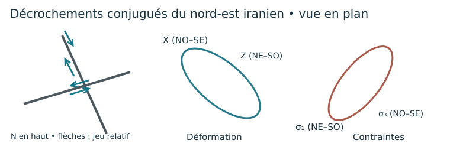
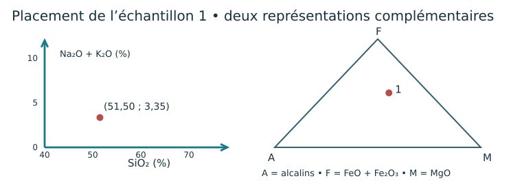
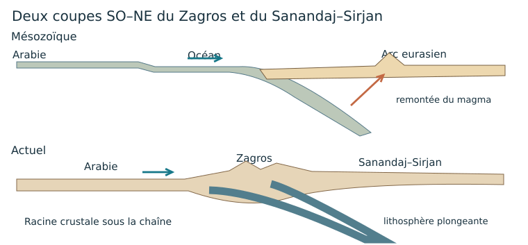
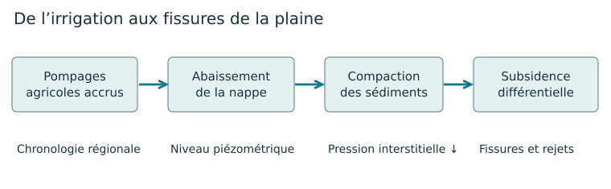
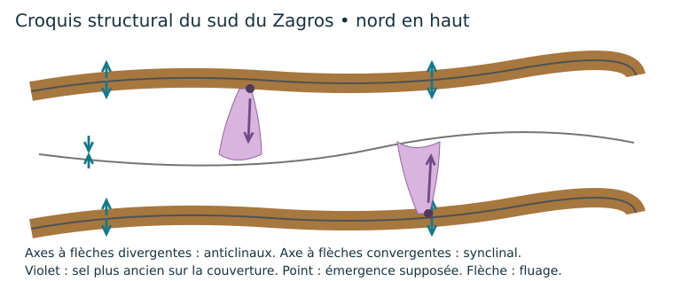
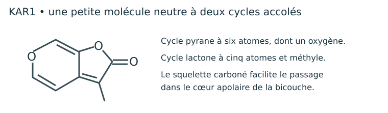
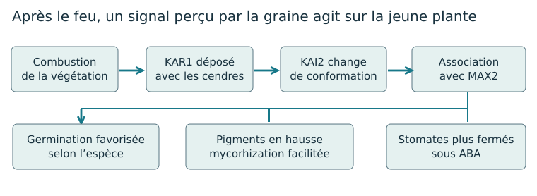

# Agro-Véto — BCPST, SVT 2023 · Corrigé guidé

*Corrigé rédigé par IA, non officiel.*

**Rédaction (tour 1)** · GPT-6.2 Astra Ultra · vitesse non renseignée

Les 14 questions du cahier de géologie (G) et les 15 du cahier de biologie (B) sont traitées avec leurs sous-questions. Les dessins donnent les constructions à reporter sur l’annexe.

## Géologie • du mouvement des plaques aux roches du Zagros

### Question G1 — Une plaque entre Afrique et Eurasie

> [!INDICATION]
> Suivre les ceintures d’épicentres, puis examiner le relief de la mer Rouge.

#### Solution

Les séismes ceinturent l’Arabie alors que son intérieur est relativement peu sismique. Cela délimite un bloc dont la déformation interne est faible à cette échelle. Entre Arabie et Afrique, la mer Rouge et le golfe d’Aden présentent une dépression axiale et un relief sous-marin organisé de façon approximativement symétrique, segmenté par des décalages transverses. L’ensemble correspond à une limite divergente, avec rift et, dans les secteurs océanisés, accrétion à la dorsale.

### Question G2 — Anomalie de Bouguer et racine crustale

> [!INDICATION]
> Superposer la bande sombre de la carte gravimétrique aux hauts reliefs.

#### Solution

Le Zagros et le Sanandaj–Sirjan constituent une bande élevée NO–SE. Une anomalie de Bouguer négative, de l’ordre de −180 à −250 mGal dans les zones les plus sombres, lui est associée. La pesanteur, une fois corrigée notamment de l’altitude et de l’effet des reliefs, est inférieure à la référence. Un excès d’épaisseur de croûte continentale relativement légère remplaçant du manteau plus dense en profondeur explique le déficit de masse. Le Moho s’enfonce sous la chaîne.

### Question G3 — Raccourcissement actuel

> [!INDICATION]
> La référence BES appartient à l’Iran central. Comparer les flèches à l’étalon de 10 mm/an.

#### Solution

Au sud-ouest de la grande faille MZRF, les stations se déplacent globalement vers le nord à nord-est relativement à BES. Les flèches proches du golfe atteignent l’ordre de 10 mm/an, et deviennent petites à proximité de BES. Les ellipses d’incertitude limitent la précision de l’azimut lorsque les déplacements sont faibles. La différence de vitesse entre les stations éloignées et proches de la suture traduit un raccourcissement du Zagros dans la convergence Arabie–Eurasie.

### Question G4 — Séismes du sud du Zagros

> [!INDICATION]
> Séparer direction des traces en surface et direction de compression.

#### Solution

Les traces majeures sont NO–SE. Les mécanismes au foyer avec une zone centrale compressive correspondent à des failles inverses. Leur jeu élève le compartiment chevauchant et raccourcit horizontalement la région. Le rapprochement de l’Arabie et de l’Eurasie explique les mécanismes compressifs à l’échelle du Zagros. La seule distribution des foyers sur cette carte ne donne pas de plan incliné profond.

### Question G5 — Deux décrochements conjugués

> [!INDICATION]
> Restituer le sens apparent du bloc opposé pour un observateur placé sur l’un des compartiments.

#### Solution

Dans l’encart du NE iranien, les mécanismes à quatre quadrants indiquent des décrochements. La trace ENE–OSO est sénestre et la trace NNO–SSE dextre. Les plans sécants à jeux compatibles peuvent appartenir à un même système conjugué. La déformation associe un raccourcissement NE–SO (Z) et un allongement NO–SE (X). En régime décrochant, la contrainte maximale est horizontale NE–SO, la minimale horizontale NO–SE et l’intermédiaire verticale. La convergence inférée du GPS peut donc expliquer ce champ de contraintes.

### Question G6 — Une anomalie rapide inclinée

> [!INDICATION]
> Raisonner sur les temps de parcours mesurés par de nombreuses stations.

#### Solution

À source et récepteur connus, un temps d’arrivée inférieur à celui prévu par un modèle moyen suggère un trajet plus rapide. L’inversion d’un ensemble de rais traversant la région localise des écarts relatifs de vitesse. Sur la coupe, la bande d’anomalie positive plonge du SO vers le NE. Un matériau lithosphérique plus froid et rigide que son environnement transmet plus vite les ondes P. On interprète la bande comme un panneau plongeant, héritage de la subduction sous l’Eurasie. Sa flottabilité négative a pu exercer une traction sur la plaque plongeante et participer au déplacement de l’Arabie vers le NE.

### Question G7 — Positions dans les diagrammes TAS et AFM

> [!INDICATION]
> Lire les conventions du sommet F sur cette planche, puis normaliser les trois sommes.

#### Solution

TAS donne 51,50 % de silice et 2,74 + 0,61 = 3,35 % d’alcalins. Le point est subalcalin. Dans la convention massique de la figure, A vaut 3,35, F vaut 5,88 + 2,80 = 8,68 et M vaut 5,22. Sur une somme de 17,25, les proportions sont respectivement 19,4 %, 50,3 % et 30,3 %. L’évolution de l’ensemble des échantillons, sans fort enrichissement initial en fer, est principalement calco-alcaline. Cette association est caractéristique d’un arc de subduction, océanique ou continental. La carte régionale situe ici l’arc sur la marge eurasienne.

### Question G8 — Localiser l’ancien arc

> [!INDICATION]
> Rapprocher l’orientation des affleurements et le sens du plongement déterminé en G6.

#### Solution

Dans le Sanandaj–Sirjan, les corps magmatiques méso-cénozoïques dessinent une ceinture NO–SE parallèle à la MZRF, sur son flanc nord-est. Un panneau océanique s’enfonçant vers le NE se déshydrate. L’eau abaisse la température de début de fusion du manteau sus-jacent. Les liquides produits peuvent remonter, évoluer et cristalliser en profondeur. La collision actuelle a rapproché cet ancien arc continental de la suture du Zagros.

### Question G9 — Deux états successifs de la chaîne

> [!INDICATION]
> Conserver le nord-est à droite sur les deux coupes. Situer l’arc du côté chevauchant.

#### Solution

Au Mésozoïque, un domaine océanique sépare les marges continentales. Sa lithosphère plonge vers le NE sous la marge eurasienne, sous l’arc magmatique du futur Sanandaj–Sirjan. Aujourd’hui, l’océan a disparu en surface. La convergence continentale raccourcit et épaissit la croûte du Zagros, avec des chevauchements et une racine crustale. La suture est au voisinage de la MZRF. La tomographie suggère la persistance d’un matériau plongeant en profondeur.

## Géologie • aquifère de Rafsanjan et sel du Sud-Zagros

### Question G10 — Construire la chaîne causale

> [!INDICATION]
> Distinguer débit pompé, apport météorique, pression de l’eau et mouvement du sol.

#### Solution

Les puits sont nombreux dans la plaine cultivée. Les pompages moyens augmentent entre 1971–1985 et 1986–2009, alors que les précipitations moyennes sont proches de 100 mm/an dans les deux périodes. Le niveau de la nappe baisse d’environ 17 m entre 1985 et 2009. La diminution de la pression interstitielle reporte davantage de contrainte sur le squelette sédimentaire, qui se compacte. Les zones les plus touchées s’affaissent de plusieurs dizaines de cm/an, localement jusqu’à environ 30 cm/an. Des différences de tassement entre parcelles voisines produisent déplacements horizontaux, fissures et rejets superficiels, sources de dommages aux constructions. La présence de ruptures n’impose pas une origine tectonique régionale.

### Question G11 — Lire quatre cuvettes locales

> [!INDICATION]
> Compter les cycles colorés de l’extérieur vers le centre pour chacun des quatre puits.

#### Solution

Autour des puits 1, 2, 3 et 4, les franges dessinent des motifs fermés de taille hectométrique à kilométrique. En suivant la succession des couleurs vers les centres on lit, dans les quatre cas, un éloignement du satellite, de l’ordre de quelques centimètres entre les acquisitions (environ 5 cm vers certains centres). Le radar mesure la projection du déplacement sur sa ligne de visée. Avec la composante verticale régionale mesurée indépendamment, ces cuvettes centrées sur les puits étayent une subsidence locale liée au prélèvement.

### Question G12 — Identifier une évaporite

> [!INDICATION]
> Comparer le sulfate hydraté de l’analyse avec le chlorure de sodium.

#### Solution

La halite est NaCl. Le minéral de la figure 14 est du gypse, de composition CaSO₄·2H₂O, de dureté 2 et de masse volumique voisine de 2,3 g/cm³. Une roche principalement gypseuse est une évaporite. Dans un bassin confiné alimenté en eau chargée en ions, une évaporation supérieure au renouvellement concentre les solutés jusqu’à la saturation et la précipitation des sels.

### Question G13 — Le sel ancien recouvre des couches jeunes

> [!INDICATION]
> Identifier l’âge du matériau, puis l’âge de sa dernière mise en place.

#### Solution

Le sel protérozoïque recoupe la couverture plissée et s’étale sur des terrains paléogènes, néogènes ou quaternaires. Un dépôt en couches restées en place placerait au contraire le sel ancien à la base. La faible densité et la ductilité du niveau salifère favorisent une remontée diapirique sous la charge de la couverture, éventuellement aidée par les contrastes de pression de la compression. Après percement, le sel s’écoule en surface vers les points bas. Le bord de la langue recouvre en discordance les formations plus jeunes.

### Question G14 — Reporter les structures et les ordonner

> [!INDICATION]
> Repérer les cœurs crétacés, puis suivre les langues de sel depuis un relief vers la dépression.

#### Solution

Les deux crêtes grossièrement E–O ont un cœur crétacé entouré d’affleurements paléogènes puis néogènes, ce qui définit deux anticlinaux. Entre les crêtes, une dépression à terrains plus jeunes correspond à un synclinal recouvert par des dépôts quaternaires. La langue occidentale émerge près du flanc de la crête nord et s’étale vers le sud. La langue orientale s’avance vers le nord depuis la crête méridionale. Un petit affleurement supplémentaire de sel est visible vers l’extrémité orientale de la crête nord. Dépôt des évaporites au Protérozoïque, puis dépôt de la couverture crétacée à néogène, plissement et érosion, accumulation quaternaire dans les creux, enfin recouvrement local des terrains récents par le sel. Le début du diapirisme a pu précéder son affleurement actuel.

## Biologie • écologie des végétaux après un incendie

### Question B1 — Du diamètre à la survie des chênes-lièges

> [!INDICATION]
> Lire séparément probabilité de mort et pourcentage de hauteur retrouvée.

#### Solution

Un an après le feu, la probabilité de mort d’une tige est voisine de 1 pour les très faibles diamètres et devient proche de zéro vers 12–15 cm. À épaisseur d’écorce donnée, une tige de plus grand diamètre retrouve généralement une plus grande fraction de sa hauteur initiale. À diamètre égal, la récupération est meilleure avec un liège épais. Vers 10 cm de diamètre, les courbes extrêmes indiquent approximativement 40–50 % contre plus de 90 % de la hauteur initiale. Diamètre et épaisseur sont donc deux variables à distinguer.

### Question B2 — La température du cambium

> [!INDICATION]
> Relier l’observation après le feu à la protection du tissu qui produit bois et liber.

#### Solution

**a.** Pour une écorce inférieure à 1 cm, plusieurs températures maximales du cambium dépassent 90 °C. Vers 2 à 3 cm, elles sont proches de 40–60 °C. Une couche épaisse limite donc l’échauffement du cambium vasculaire. La survie de ce méristème secondaire permet la poursuite de la formation de tissus conducteurs et favorise la reprise de croissance. **b.** Distinguer graphiquement les onze espèces par des symboles permettrait de vérifier si la relation existe aussi au sein d’une espèce. Chaque point représente un individu.

### Question B3 — Le liège en climat méditerranéen

> [!INDICATION]
> Comparer les conductivités et préciser le tissu vivant protégé.

#### Solution

Le suber forme plusieurs assises compactes de cellules mortes, à parois subérifiées, dont les cavités retiennent de l’air. La conductivité thermique de l’air, 0,03 W/(m·K), est environ vingt fois plus faible que celle de l’eau. Un liège épais ralentit donc la propagation de la chaleur du feu vers les tissus vivants, dont le cambium. Cette protection rend compte d’une meilleure survie après des feux fréquents dans la région méditerranéenne sèche en été.

### Question B4 — Ouverture des cônes du pin

> [!INDICATION]
> Comparer une ligne du tableau, puis une colonne.

#### Solution

Dans l’échantillon de dix cônes par condition, aucun ne s’ouvre après deux minutes. À 200 °C, on passe de 0 % après cinq minutes à 100 % après dix minutes. Pour dix minutes, on passe de 0 % à 120 °C à 100 % à 200 °C. Température et durée de l’échauffement conditionnent donc conjointement l’ouverture.

### Question B5 — Protection et libération des graines

> [!INDICATION]
> Le graphe A concerne une exposition en cône, même si le cône est ensuite ouvert à la main pour le comptage.

#### Solution

**a.** À durée identique, les graines chauffées à 200 °C dans leur cône gardent une capacité de germination importante, alors que celle des graines libres devient très faible ou nulle. À 400 °C, la protection du cône demeure limitée et dépend de la durée. **b.** Lors d’un feu, les écailles protègent transitoirement les graines. Un échauffement suffisant provoque l’ouverture des cônes. Les graines viables sont libérées, se déposent au sol et peuvent alors germer lorsque les conditions sont favorables.

### Question B6 — Deux voies de persistance après le feu

> [!INDICATION]
> Comparer pour chaque peuplement le site brûlé et son témoin. Interroger ensuite la portée des unités arbitraires.

#### Solution

**a.** La mortalité augmente dans les deux types de peuplements après incendie. L’augmentation est d’environ un facteur deux pour les chênaies et dix pour les pinèdes. La survie des adultes paraît donc mieux préservée dans les chênaies. **b.** L’effectif des sites, leur dispersion et les intensités des incendies ne sont pas fournis. La composition des peuplements n’est pas détaillée. Cela limite la comparaison et sa généralisation aux deux espèces étudiées. **c.** Le renouvellement après perturbation par germination chez le pin rappelle le pôle r. Chez le chêne, l’investissement dans une écorce épaisse maintenant les adultes en place rappelle le pôle K. Le recrutement effectif, le nombre de descendants et l’investissement par graine restent à mesurer pour caractériser ces stratégies.

## Biologie • germination, mycorhizes et stress hydrique

### Question B7 — La karrikine stimule la germination

> [!INDICATION]
> Repérer la réponse sans KAR1 et comparer les concentrations donnant un plateau.

#### Solution

La germination existe sans KAR1, surtout chez la laitue. Avec KAR1, la laitue atteint près de 100 % à 1 µg/L, contre environ la moitié en son absence. Chez Emmenanthe penduliflora, la réponse augmente plus progressivement et plafonne vers 60 % à partir d’environ 10 µg/L. Le composé des cendres stimule la germination avec une sensibilité et une amplitude propres à chaque espèce.

### Question B8 — Une plantule plus verte

> [!INDICATION]
> Analyser séparément la longueur de l’axe et les pigments des cotylédons.

#### Solution

Chez Arabidopsis, les plantules traitées ont un axe aérien plus court, des cotylédons environ deux fois plus verts sur l’indicateur du document et environ 20 % de chlorophylle a supplémentaire. KAR1 freine l’élongation et favorise l’accumulation des pigments qui captent la lumière. La quantité de pigments suggère une capacité photosynthétique accrue. Le flux réel de fixation du carbone demanderait une mesure distincte.

### Question B9 — Observer une mycorhize

> [!INDICATION]
> Légender les structures fongiques à l’intérieur de la racine sauvage, puis chercher leurs homologues dans le second panneau.

#### Solution

Les racines du riz sauvage présentent des structures bleues intraracinaires, dont des arbuscules ramifiés et des vésicules du champignon. Ces structures sont absentes ou très rares dans l’image de la lignée végétale déficiente pour la transmission du signal. Dans les conditions comparées, une voie fonctionnelle chez le riz favorise l’installation de la symbiose. Le cliché seul ne mesure ni les flux minéraux ni le stade exact auquel la colonisation est limitée.

### Question B10 — Signalisation et fermeture stomatique

> [!INDICATION]
> Comparer les génotypes à même concentration en acide abscissique.

#### Solution

Après quatorze jours sans arrosage, les sauvages gardent une meilleure vigueur que les mutants kai2. L’acide abscissique (ABA) réduit l’ouverture stomatique chez les deux génotypes, mais à concentration égale elle reste environ 10 à 30 % supérieure chez le mutant selon la condition. Une voie KAI2 fonctionnelle renforce donc la réponse de fermeture à l’ABA. Au cours d’un déficit hydrique, la fermeture accrue limite la transpiration et contribue à conserver l’eau. Ces observations établissent un lien entre réponses hormonales, sans identifier une interaction moléculaire directe entre les deux signaux.

## Biologie • perception des karrikines

### Question B11 — Traversée de la membrane

> [!INDICATION]
> Faire apparaître les deux cycles, le méthyle et les trois oxygènes dans la représentation.

#### Solution

KAR1 est une petite molécule organique sans charge formelle. Les trois oxygènes portent des liaisons polaires, mais les deux cycles accolés et le groupement méthyle présentent une part apolaire appréciable. La forme neutre peut se partager dans le cœur hydrophobe de la bicouche puis rejoindre le cytosol par diffusion simple selon son gradient de concentration.

### Question B12 — Une liaison saturable et sélective

> [!INDICATION]
> Lire le maximum de fixation et l’abscisse pour la moitié de ce maximum. Comparer ensuite les deux ligands.

#### Solution

**a.** La fixation de KAR1 augmente puis se rapproche d’un plateau de l’ordre de 350 unités arbitraires vers 0,5 mmol/L. La concentration de demi-saturation est comprise entre 0,05 et 0,1 mmol/L. L’allure hyperbolique est compatible avec une seule classe de sites indépendants. Une courbe en unités arbitraires ne prouve pas à elle seule une stœchiométrie absolue. GR24 donne un signal proche du bruit de fond, malgré sa parenté structurale. **b.** Les deux structures contiennent un cycle lactone à cinq atomes. Le cycle pyrane à six atomes de KAR1 (partie gauche du dessin de B11) est un candidat pour la reconnaissance différentielle. La comparaison ne localise pas tous les contacts du récepteur.

### Question B13 — La position 219 contrôle l’accès au ligand

> [!INDICATION]
> Comparer l’effet de KAR1 au sein de chaque génotype avant de comparer les formes du site.

#### Solution

KAR1 réduit l’élongation des plantules sauvages. Chez ply2, la croissance varie peu entre les deux traitements, alors que la voie devrait répondre au ligand. Au voisinage de l’entrée de la poche, la valine a une chaîne latérale plus encombrante que l’alanine présente chez le sauvage. Elle peut gêner l’accès du ligand. Le rapprochement du phénotype et du modèle structural attribue à l’alanine 219 un rôle dans la réception du signal, sans faire de ce résidu l’unique point de contact.

### Question B14 — Du changement de forme à un partenaire

> [!INDICATION]
> Comparer les deux positions de Phe134 et Phe194, puis les conditions donnant le signal d’interaction.

#### Solution

La fixation de KAR1 déplace les chaînes latérales de deux phénylalanines du récepteur, montrant un changement de conformation. Le signal bleu du document 15 apparaît lorsque KAI2 et MAX2 sont tous deux présents avec KAR1. Il est absent avec l’eau ou avec une protéine seule. La conformation liée du récepteur permet donc une interaction avec MAX2 que la conformation libre ne permet pas dans ce test. Comme MAX2 intervient dans l’adressage au protéasome, cette interaction suggère un adressage suivi d’une dégradation de la cible. La coloration mesure l’interaction, pas directement la dégradation.

### Question B15 — De la parcelle incendiée à la plantule

> [!INDICATION]
> Relier dans le même schéma la source du signal, sa perception, puis les observations aux différents stades.

#### Solution

La combustion des parois végétales produit des karrikines qui se retrouvent dans les cendres. KAR1 peut atteindre les graines puis leur cytosol. Sa liaison à KAI2 permet la reconnaissance du récepteur par MAX2, associée à la réponse au signal et à l’adressage protéasomal. La présence du signal favorise la germination. Chez les jeunes végétaux étudiés, la voie influence la pigmentation, la colonisation mycorhizienne et la fermeture stomatique en condition de stress hydrique. Ces résultats proviennent de plusieurs espèces et le schéma propose leur articulation fonctionnelle.

