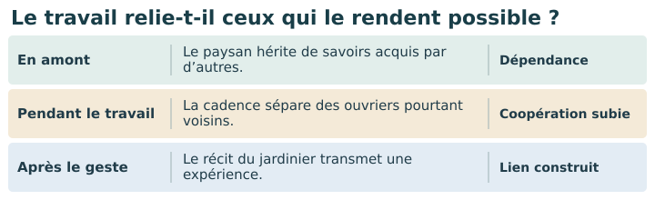

# Banque PT — Français B 2023 · Corrigé brut

*Corrigé rédigé par IA, non officiel. Signalez toute erreur.*

**Rédaction** · GPT-6.2 Astra Ultra · vitesse non renseignée

[Énoncé officiel](https://www.banquept.fr/documents/2023/fr_b_2023_pt.pdf) · [Rapport du jury](https://www.banquept.fr/documents/ecrit/rapport/2023/rapport_fra_b_ecrit_2023.pdf) · [Programme officiel](https://www.education.gouv.fr/bo/22/Hebdo20/ESRS2213517A.htm)

Épreuve de quatre heures sur « Le travail ». Virgile, Géorgiques (traduction de Maurice Rat) · Simone Weil, La Condition ouvrière (extraits prescrits, hors Journal d’usine) · Michel Vinaver, Par-dessus bord (version hyper-brève).

Nicolas Grimaldi, Les Idées en place, Mon Abécédaire philosophique, article « Travail » (PUF, 2014). Le passage va de la comparaison du vivant avec sa lignée (p. 2) à l’appropriation libre de sa vie (p. 4). Les deux questions suivent p. 4.

Texte de 1431 mots selon le sujet. Résumé de 200 mots à 10 % près (180 à 220), 8 points. Dissertation, 12 points.

## Résumé

Le travail fait circuler les ressources entre les membres de la société comme entre les organes du corps. Même solitaire, chacun dépend de ceux qui lui fournissent ses moyens et de ceux auxquels son ouvrage est destiné. Quelle souffrance alors de voir juger inutile le fruit de sa vie !

Les injustices du salariat masquent la valeur vitale que Marx reconnaissait au travail. La mesure horaire efface les différences entre activités et les écarts arbitraires de rémunération découragent de travailler. Dès lors, travailler pour vivre signifie gagner sa subsistance et perdre autant de vie que dure cet effort. Pourtant une famille peut travailler sans que chacun occupe un emploi, tandis que certaines places dispensent de toute activité.

Produire suppose surtout de développer ses aptitudes. Tandis que le produit se détache définitivement de moi, mon apprentissage demeure en moi et chaque réalisation poursuit cette transformation. Le travail prolonge ainsi le mouvement de la vie en lui donnant une direction voulue. Là où le vivant réalise spontanément sa fin, je conçois consciemment la mienne et rassemble les moyens nécessaires pour la réaliser. Par ce pouvoir de choisir une destination, je fais librement mienne une existence que le hasard avait mise en ma possession.

*200 mots.*

## Dissertation

Les œuvres illustrent-elles la double affirmation de Grimaldi sur l’impossibilité de travailler seul et sur la fonction sociale de tout travail ?

Dans les *Géorgiques*, le vieillard de Corycos cultive un coin de terre qu’un autre aurait négligé. C’est bien lui qui choisit ses plantations. Pourtant, si nous pouvons encore voir son jardin, c’est qu’un visiteur en a fait un poème. L’exemple invite à préciser les deux affirmations de Nicolas Grimaldi. Dépendre d’autrui pour travailler signifie-t-il que tout travail rende un service commun ? Entre les appuis que l’activité reçoit et les relations qu’elle crée, les œuvres font voir des écarts considérables.

Même l’ouvrage qu’une seule paire de mains mène à terme a une histoire collective. Le poète des *Géorgiques* apprend à son lecteur comment reconnaître une terre et à quel moment la retourner. Ses préceptes transmettent l’expérience des générations, mais ils demandent aussi des observations locales. Ainsi le paysan qui examine seul sa parcelle se sert de distinctions que d’autres ont éprouvées et qu’il pourra à son tour enrichir. Chez Vinaver, le lancement d’un papier hygiénique suppose que fabrication, vente et publicité s’accordent sur ce que souhaite le client. Un commercial peut partir seul en tournée. Il emporte l’échantillon de l’usine et rapporte une information sur les acheteurs. La solitude de la scène ne dit rien du nombre d’acteurs que suppose la tâche.

Reste une difficulté. Participer à un système de production ne procure à chacun ni la conscience de sa destination ni la compagnie effective d’autrui. Simone Weil décrit l’attention que la cadence exige à l’usine. Ceux qui travaillent côte à côte n’ont parfois même plus la liberté de s’adresser un mot. Leur isolement est produit par une organisation qui les rend pourtant plus étroitement dépendants que jamais. Dans *Par-dessus bord*, la concurrence appelle elle aussi une coopération intense au sein de l’entreprise. Cette énergie collective a notamment pour fonction de soustraire des clients au concurrent. Le gain des uns peut donc être la perte des autres. Dire qu’un travail a des effets sur la société laisse entièrement ouverte la question de savoir à qui ces effets profitent.

Il existe pourtant des travaux qui transforment cette dépendance en relation choisie. Les grèves racontées par Weil en donnent une preuve paradoxale. Il faut suspendre la production pour que les ouvriers, réunis dans l’usine, puissent enfin la parcourir à leur rythme et se voir comme des compagnons. L’interruption révèle une possibilité contenue dans la coopération quotidienne et habituellement étouffée par elle. Le poème de Virgile l’éprouve par d’autres moyens. Lorsque le poète s’attarde sur ses souvenirs du jardinier, une expérience locale et singulière devient un savoir et un plaisir qu’il offre à des lecteurs inconnus. Il faut ici que quelqu’un assume en personne le choix de raconter. L’initiative individuelle rend possible un lien que la division des tâches ne garantissait pas.

Grimaldi a donc raison de refuser au travail l’indépendance absolue. On reçoit des instruments, une langue, des procédés et souvent la destination même de son effort. La fonction sociale ainsi comprise appartient jusque dans la solitude au travail humain. Si l’on entend par là la capacité de faire vivre une communauté solidaire, les œuvres y reconnaissent une possibilité à construire, parfois en changeant ensemble les conditions du travail.
