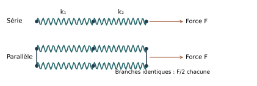
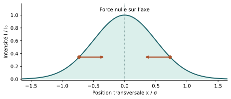
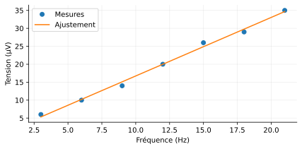
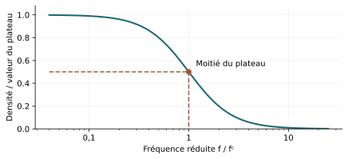

# Banque PT 2023 — Informatique et modélisation · Corrigé brut

*Corrigé rédigé par IA, non officiel. Signalez toute erreur.*

**Rédaction** · GPT-6.2 Astra Ultra · vitesse non renseignée

**Révision (tour 1)** · GPT-6.2 Astra Ultra · vitesse non renseignée

[Sujet officiel](https://www.banquept.fr/documents/2023/info_mod_2023_pt.pdf) · [Rapport du jury](https://www.banquept.fr/documents/ecrit/rapport/2023/rapport_info_model_ecrit_2023.pdf) · [Notice de la session](https://www.banquept.fr/documents/livret/2023/Livret_PT_2023.pdf#page=13)

**Élasticité de l’ADN et étalonnage d’une pince optique.** Épreuve de quatre heures, sans calculatrice. La première phrase du rapport mentionne la réverbération à convolution. Le feuillet et les commentaires numérotés du jury portent sur les ressorts, le piège optique et son étalonnage. Les questions vont de 1 à 38 et la documentation Python occupe la page 16.

## Ressorts et chaîne de bâtonnets

### Question 1 · Forces élastiques sur A et B

Dans le sens de $\vec u_x$, les allongements algébriques des ressorts valent $x_1$ et $x_2-x_1$. Le premier exerce sur A $-k_1 x_1\vec u_x$, le second $+k_2(x_2-x_1)\vec u_x$. Sur B, le second exerce $-k_2(x_2-x_1)\vec u_x$. La pesanteur est négligée et la traction extérieure n’intervient qu’à la question suivante. Une compression change le signe de la force par la même formule. Le point fixe subit la réaction opposée à la force du premier ressort sur A.

### Question 2 · Deux ressorts en série

À l’équilibre de B, $F_0=k_2(x_2-x_1)$. L’équilibre de A donne $k_1x_1=k_2(x_2-x_1)=F_0$. En additionnant les allongements, $x_2=F_0(1/k_1+1/k_2)$. La force de rappel vaut donc $-k_{\rm eq}x_2\vec u_x$, avec $k_{\rm eq}=k_1k_2/(k_1+k_2)$. Si l’un des ressorts devient très raide, on retrouve la raideur de l’autre.



### Question 3 · Sept bases, six intervalles

GCTGAGG comporte sept bases et donc six intervalles covalents successifs. Chacun s’allonge de $F_0/k$. La raideur du simple brin est $k/6$.

### Question 4 · Deux branches en parallèle

Sept paires donnent six ressorts en série sur chacun des deux brins. Aux extrémités communes, les deux branches subissent le même allongement $\delta L$. Chaque branche tire avec la force $k\delta L/6$. Les forces s’additionnent, d’où $k_{\rm double}=2(k/6)=k/3$.

### Question 5 · Domaine de la loi de Hooke

La figure 4 montre une portion rapidement croissante, approximativement rectiligne, entre des extensions voisines de $0{,}98$ et $1{,}06$. Une fenêtre plus large, d’environ $0{,}95$ à $1{,}07$, laisse déjà apparaître les raccordements. Les points très peu tendus à gauche, le long plateau vers $90$ à $100$ pN et la remontée terminale ne sont pas décrits ensemble par ce même ressort. La loi testée est une pente constante en fonction de l’allongement près de la longueur de référence.

### Question 6 · Ordre de grandeur d’une liaison

Notons $N$ le nombre d’intervalles par brin, $d_0$ leur longueur à vide et $\lambda=L/L_0$, avec $L_0=Nd_0$. Les deux chaînes donnent $F=(2k/N)\,\delta L$ et donc $\mathrm dF/\mathrm d\lambda=2kd_0$. Sur la rampe, la force augmente d’environ $50$ à $60$ pN pour $0{,}05$ à $0{,}07$ d’extension. La pente est ainsi de l’ordre de $10^3$ pN. Avec les **3 pm imprimés** pour $d_0$, on obtient $k\simeq10^{-9}/(6\times10^{-12})\simeq1{,}7\times10^2\ \mathrm{N\,m^{-1}}$. Le nombre d’intervalles s’élimine.

### Question 7 · Corrélation entre deux bâtonnets

Pour $i\ne j$, $\vec r_i\cdot\vec r_j=a^2\cos\theta_{ij}$. La moyenne de configuration vaut $a^2(2\pi)^{-1}\int_0^{2\pi}\cos\theta\,\mathrm d\theta=0$. Pour $i=j$, le produit scalaire vaut toujours $a^2$.

### Question 8 · Déplacement et distance quadratique

Sans direction privilégiée, chaque vecteur de pas a une moyenne nulle. Par linéarité, $\langle\vec r\rangle=\sum_i\langle\vec r_i\rangle=\vec 0$. En développant $r^2$, les $N$ termes diagonaux donnent chacun $a^2$ et les termes croisés ont une moyenne nulle. Ainsi $\langle r^2\rangle=Na^2=La$. La distance quadratique moyenne vaut $a\sqrt N$.

### Question 9 · Force de rappel entropique

On dérive l’énergie potentielle fournie en gardant constants $L$, $a$ et $T$. Avec $k'=3k_bT$ et $\langle r^2\rangle=La$, la force sur l’extrémité mobile vaut $\vec F=-\partial_xU\,\vec u_x=-3k_bT x/(La)\,\vec u_x$. Le facteur $3k_bT/(La)$ a la dimension d’une raideur. Le signe oriente la force vers les séparations plus petites.

## Champ lumineux et force de rappel

### Question 10 · Forces électriques en champ uniforme

Au point $M_1$, la charge $-q$ subit $-q\vec E$. Au point $M_2$, la charge $+q$ subit $+q\vec E$. L’uniformité garantit la même valeur du champ aux deux points. La force électrique totale est donc $\vec F_E=\vec0$.

### Question 11 · Forces magnétiques sur le dipôle mobile

$\vec F_{B,1}=-q\vec v_1\times\vec B$ et $\vec F_{B,2}=q\vec v_2\times\vec B$. Le champ est uniforme et la charge $q$ est constante. Avec $\vec a=\overrightarrow{M_1M_2}$, on trouve $\vec F_B=q(\vec v_2-\vec v_1)\times\vec B=\frac{\mathrm d(q\vec a)}{\mathrm dt}\times\vec B$. La neutralité ne suffit pas à annuler cette force si les deux vitesses diffèrent.

### Question 12 · Direction et polarisation

Pour $\omega,k>0$, garder $\omega t-kz$ constant donne $\mathrm dz/\mathrm dt=\omega/k>0$. La propagation s’effectue vers $+z$. Le champ électrique oscille suivant une direction fixe, $\vec u_y$. La polarisation est rectiligne suivant $y$, perpendiculairement à cette direction de propagation. L’enveloppe varie transversalement suivant $x$.

### Question 13 · Moyenne du terme de gradient

À position fixée, $\langle E^2\rangle=\frac12 E_0^2e^{-2x^2/\sigma^2}$ car $\langle\cos^2(\omega t-kz)\rangle=1/2$. Le gradient spatial commute avec la moyenne sur une période optique. La composante en $z$ s’annule après cette moyenne. On obtient
$$\langle\vec F_1\rangle=\frac{\alpha}{2}\nabla\langle E^2\rangle=-\frac{\alpha E_0^2}{\sigma^2}\,x\,e^{-2x^2/\sigma^2}\vec u_x.$$

### Question 14 · Moyenne du terme dérivé

Pour une fonction périodique différentiable de période $P$, $\langle\dot f\rangle=[f(t_0+P)-f(t_0)]/P=0$. Le résultat s’applique à chaque composante de $\vec E\times\vec B$ en régime périodique, d’où $\langle\vec F_2\rangle=\vec0$.

### Question 15 · Intensité lumineuse

Dans l’approximation d’une onde localement plane, l’intensité est la norme du flux moyen d’énergie, $I=\langle E^2\rangle/Z$, où $Z$ est l’impédance d’onde du milieu. Ainsi $I(x)=I_0e^{-2x^2/\sigma^2}$, $I_0=E_0^2/(2Z)$. Dans le vide $Z=\mu_0 c$, donc $I_0=\epsilon_0 c E_0^2/2$. Dans un diélectrique non magnétique d’indice $n$, le facteur devient $n\epsilon_0c/2$. Le sujet donne le profil du champ et laisse le milieu optique implicite.

### Question 16 · Raideur locale du piège

Des deux moyennes précédentes, $\langle\vec F_{\rm EM}\rangle=-[2\alpha Z I(x)/\sigma^2]\,x\vec u_x$. Le facteur entre crochets est proportionnel à l’intensité locale. Pour une raideur **constante**, on se place au voisinage de l’axe, $|x|\ll\sigma$. Alors $\kappa_0=\alpha E_0^2/\sigma^2=2\alpha ZI_0/\sigma^2$ et $\langle\vec F_{\rm EM}\rangle=-\kappa_0x\vec u_x+O(x^3)$. Le piège attire vers l’axe pour $\alpha>0$.

### Question 17 · Orientation de la force au foyer

Au centre lumineux la force transversale s’annule. À gauche de l’axe, $x<0$, elle pointe vers la droite. À droite, $x>0$, elle pointe vers la gauche. Les flèches du schéma représentent la force de gradient transversale étudiée.



## Étalonnage et statistiques

### Question 18 · Étalonnage local du déplacement

Sur la partie centrale descendante commune aux courbes de la figure 9, environ $1{,}7$ à $2{,}0\ \mu\mathrm m$, on lit à titre indicatif $(1{,}70\ \mu\mathrm m,5{,}2\ \mathrm{mV})$ et $(2{,}00\ \mu\mathrm m,-0{,}7\ \mathrm{mV})$. Ainsi $a\simeq-20\ \mathrm{mV}/\mu\mathrm m=-2{,}0\times10^4\ \mathrm{V/m}$ et $b\simeq39\ \mathrm{mV}$. Avec $D_b$ en micromètres, $U$ en millivolts vaut approximativement $-20D_b+39$. L’ordonnée à l’origine est l’extrapolation de cette droite locale.

### Question 19 · Résolution de la conversion

Seize bits offrent $2^{16}=65\,536$ codes. Une pleine échelle de tension $\Delta U_{\rm PE}$ donne un quantum $q_U\simeq\Delta U_{\rm PE}/65\,536$ et un pas $q_D=q_U/|a|$. Le calibre du convertisseur est absent de l’énoncé. S’il couvre environ $13$ mV, l’étendue observée sur la figure 9, $q_U\simeq0{,}20\ \mu\mathrm V$ et $q_D\simeq10^{-11}$ m, soit $10$ pm. En réservant toute l’échelle aux $6$ mV de la partie affine, le pas serait voisin de $5$ pm. Ces chiffres portent sur la quantification.

### Question 20 · Somme d’une liste

L’accumulateur vaut zéro avant la boucle. Après $j$ lectures, il vaut la somme des $j$ premières valeurs. Les programmes supposent les listes d’entrée non vides comme dans l’énoncé. Les imports communs sont indiqués avant la première fonction.

```python
import numpy as np
import matplotlib.pyplot as plt

def somme(a):
    total = 0
    for valeur in a:
        total += valeur
    return total
```

### Question 21 · Moyenne arithmétique

Il suffit de diviser la somme par le nombre d’éléments. Le résultat est un flottant en Python 3. Par exemple, pour $[1,2,5]$, la somme est $8$ et la moyenne $8/3$.

```python
def moyenne(a):
    return somme(a) / len(a)
```

### Question 22 · Variance de population

On calcule la moyenne une fois, puis on parcourt les écarts à cette moyenne. On divise par $n$ selon la définition du sujet. Pour $[1,2,5]$ on obtient $26/9$ et pour un singleton zéro. Une multiplication de deux listes Python ne fait pas un produit terme à terme.

```python
def variance(a):
    centre = moyenne(a)
    ecart_carre = 0.0
    for valeur in a:
        ecart_carre += (valeur - centre) ** 2
    return ecart_carre / len(a)
```

## Ajustement linéaire et pondération

### Question 23 · Équations normales de la droite

Posons $r_i=y_i-a_0-a_1x_i$. Les équations $\partial_{a_0}e=-2\sum_i r_i=0$ et $\partial_{a_1}e=-2\sum_i x_i r_i=0$ donnent $na_0+a_1\sum x_i=\sum y_i$ et $a_0\sum x_i+a_1\sum x_i^2=\sum x_iy_i$. La première entraîne $a_0=Y-a_1X$. En reportant dans la seconde,
$$a_1=\frac{\sum x_iy_i-nXY}{\sum x_i^2-nX^2}
=\frac{(\sum x_i)(\sum y_i)-n\sum x_i y_i}{(\sum x_i)^2-n\sum x_i^2}.$$
Le dénominateur centré $\sum(x_i-X)^2$ est strictement positif si au moins deux abscisses diffèrent. Le critère est alors une somme de carrés strictement convexe et le minimum est unique.

### Question 24 · Régression linéaire centrée

Le numérateur est $\sum(x_i-X)(y_i-Y)$ et le dénominateur $\sum(x_i-X)^2$. Le programme calcule les moyennes hors de la boucle et renvoie l’ordonnée à l’origine avant la pente. Sur $(0,1),(1,3),(2,5)$, on retrouve $(a_0,a_1)=(1,2)$.

```python
def regression_lineaire(x, y):
    if len(x) != len(y):
        raise ValueError("Les deux listes doivent avoir la même taille.")
    xm, ym = moyenne(x), moyenne(y)
    numerateur = denominateur = 0.0
    for xi, yi in zip(x, y):
        dx = xi - xm
        numerateur += dx * (yi - ym)
        denominateur += dx * dx
    if denominateur == 0:
        raise ValueError("Il faut au moins deux abscisses distinctes.")
    a1 = numerateur / denominateur
    return ym - a1 * xm, a1
```

### Question 25 · Coût de la droite

Le calcul des deux moyennes prend un nombre linéaire d’opérations. La boucle qui accumule les deux moments centrés parcourt encore $n$ couples. La durée est $\Theta(n)$ et les accumulateurs demandent $\Theta(1)$ mémoire supplémentaire.

### Question 26 · Points mesurés et droite ajustée

Deux points d’abscisses extrêmes suffisent pour tracer une droite, même lorsque les mesures sont fournies dans le désordre. Le script attend les tensions en microvolts, comme sur l’axe de la figure 11. Si elles sont en volts, on multiplie les ordonnées par un million avant l’appel. Les points sont tracés sans barres d’erreur comme demandé. Le graphique ci-dessous utilise un jeu d’illustration, le sujet ne fournit pas les listes expérimentales de la figure 11.

```python
def tracer_regression(f, U):
    """Fréquences en Hz, mesures numériques U déjà exprimées en µV."""
    a0, a1 = regression_lineaire(f, U)
    bornes = [min(f), max(f)]
    fig, ax = plt.subplots()
    ax.plot(f, U, 'o', label='Mesures')
    ax.plot(bornes, [a0 + a1 * x for x in bornes], label='Ajustement')
    ax.set_xlabel('Fréquence (Hz)')
    ax.set_ylabel('Tension (µV)')
    ax.legend()
    return fig, ax

# Pour les listes f et U du sujet : tracer_regression(f, U), puis plt.show().
```



### Question 27 · Regrouper des répétitions

La ligne $i$ est l’ensemble des mesures prises à la même fréquence. La sortie contient pour cette ligne deux nombres, moyenne puis variance. La précision finale de la consigne impose donc un tableau $n\times2$ pour une entrée $n\times\ell$, quelle que soit $\ell$.

```python
def traitement(a):
    return [[moyenne(ligne), variance(ligne)] for ligne in a]
```

### Question 28 · Régression pondérée à plusieurs fonctions

On construit $J_{ij}=f_j(x_i)$ et $w_i=1/\nu_i^2$, exactement comme sur le feuillet, où $\nu_i$ désigne la variance fournie. Puis on résout $(J^\top VJ)\mathbf a=J^\top V\mathbf y$. Le code divise chaque ligne de $J$ et chaque observation par $\nu_i$. Leur produit dans les équations normales donne exactement le poids $1/\nu_i^2$. Les variances doivent être positives et $J$ de rang colonne $m$. La résolution linéaire est algébriquement équivalente à l’inversion de la matrice indiquée en annexe. Avec $x=[0,1,2]$, les couples (mesure, variance) $(1,1),(3,2),(6,1)$ et les bases $1,x$, les coefficients sont $17/18$ et $5/2$.

```python
def regression_lineaire_gen(x, yv, listf):
    n, m = len(x), len(listf)
    if len(yv) != n or not 0 < m < n:
        raise ValueError("Il faut n observations et 0 < m < n.")
    J = np.empty((n, m))
    y = np.empty(n)
    for i, (xi, (yi, vi)) in enumerate(zip(x, yv)):
        if vi <= 0:
            raise ValueError("Les variances doivent être positives.")
        y[i] = yi / vi
        for j, fonction in enumerate(listf):
            J[i, j] = fonction(xi) / vi
    # La division de chaque ligne par vi produit le poids 1 / vi**2.
    return np.linalg.solve(J.T @ J, J.T @ y)
```

### Question 29 · Coût de la régression pondérée

Pour des fonctions de base évaluables en temps constant, former le tableau des valeurs coûte $\Theta(nm)$. Former la matrice normale par pondération diagonale puis produits coûte $\Theta(nm^2)$ et sa résolution dense $\Theta(m^3)$. Total $\Theta(nm^2+m^3)$, soit $\Theta(n)$ pour $m=2$, comme à la question 25. Construire et multiplier une matrice dense $n\times n$ pour représenter $V$ ajouterait un terme en $\Theta(n^2m)$. Cette dépense ne figure pas dans le programme proposé.

## Spectre brownien et calibration en force

### Question 30 · Spectre du déplacement brownien

À conditions initiales nulles, $(k+j\gamma\omega)\widehat x=\widehat F_\ell$. En prenant le module au carré,
$$S_x(\omega)=\frac{S_f(\omega)}{k^2+\gamma^2\omega^2}
=\frac{4\gamma k_bT}{k^2+\gamma^2\omega^2}.$$
À pulsation nulle, on retrouve un gain statique en puissance égal à $1/k^2$.

### Question 31 · Fréquence de coupure et normalisation

En remplaçant $\omega$ par $2\pi f$ et en factorisant $(2\pi\gamma)^2$ au dénominateur de la question 30,
$$f_c=\frac{k}{2\pi\gamma},\qquad S_x(2\pi f)=\frac{k_bT}{\pi^2\gamma}\frac{1}{f^2+f_c^2}.$$
Le numérateur de la formule à démontrer page 13 comporte un facteur $4$ supplémentaire. La donnée $S_f=4\gamma k_bT$ conduit à l’expression ci-dessus. Dans la convention unilatérale en hertz utilisée pour la calibration, son intégrale sur les fréquences positives vaut $k_bT/k$. À $f_c$, la densité est la moitié de sa valeur à fréquence nulle.



### Question 32 · Intégrale sur les fréquences mesurées

Sur $[x_i,x_{i+1}]$, on interpole les ordonnées par une droite. Le trapèze a pour aire $(x_{i+1}-x_i)(y_i+y_{i+1})/2$. On additionne ces contributions en conservant les véritables espacements en hertz, même si l’axe de la figure 12 est logarithmique. La bande finie fournie donne une estimation de l’aire spectrale. Avec $x=[0,1,3]$ et $y=[2,5,11]$, l’aire vaut $3{,}5+16=19{,}5$.

```python
def aire(x, y):
    if len(x) != len(y):
        raise ValueError("Les deux listes doivent avoir la même taille.")
    total = 0.0
    for i in range(1, len(x)):
        largeur = x[i] - x[i - 1]
        if largeur <= 0:
            raise ValueError("Les abscisses doivent être croissantes.")
        total += largeur * (y[i] + y[i - 1]) / 2
    return total
```

### Question 33 · Dérivées du modèle spectral

Posons $d=a_1^2+f^2>0$. Comme $G=a_0/d$, les dérivées à fréquence fixée valent $\partial_{a_0}G=1/d$ et $\partial_{a_1}G=-2a_0a_1/d^2$. À $f=2,a_0=2,a_1=1$, elles valent respectivement $0{,}2$ et $-0{,}16$.

### Question 34 · Calcul du modèle et de ses dérivées

Les trois fonctions emploient le même dénominateur. Le couple $f=a_1=0$ est exclu. Pour l’exemple de la question 33, $G=0{,}4$.

```python
def G(f, a0, a1):
    return a0 / (a1**2 + f**2)


def dG_da0(f, a0, a1):
    return 1 / (a1**2 + f**2)


def dG_da1(f, a0, a1):
    return -2 * a0 * a1 / (a1**2 + f**2)**2
```

### Question 35 · Gradient de l’erreur totale

Avec $G_i=G(f_i,a_0,a_1)$, la règle de chaîne donne, pour $j=0,1$,
$$\partial_{a_j}e=2\sum_{i=0}^{n-1}(G_i-S_{u,i})\,\partial_{a_j}G(f_i,a_0,a_1).$$
Le facteur $2$ provient du carré. Si l’on choisit $S_{u,i}-G_i$ comme résidu, le facteur devient $-2$. Le résultat se vérifie en perturbant séparément chacun des paramètres.

### Question 36 · Descente du gradient

À chaque itération, on calcule les deux dérivées au **même** couple, puis les deux mises à jour. La condition imprimée page 15 est $h(g_0+g_1)\leq\mathrm{err}$, avec des barres indiquant le point d’évaluation. Des pentes opposées peuvent s’annuler et provoquer un arrêt alors que chacune est grande. Pour contrôler les deux déplacements, on adopte $h(|g_0|+|g_1|)\leq\mathrm{err}$. Un pas positif adapté et un point initial dans le bassin d’un minimum sont nécessaires. Comme $G$ dépend de $a_1^2$, on choisit une estimation positive non nulle de la coupure et on surveille la convergence.

```python
def methode_gradient(G, dG_da0, dG_da1, Su, f, h, a00, a10, err):
    if len(Su) != len(f) or h <= 0 or err <= 0:
        raise ValueError("Tailles incompatibles, pas ou tolérance invalide.")
    a0, a1 = a00, a10
    for _ in range(100_000):
        g0 = g1 = 0.0
        for fi, si in zip(f, Su):
            residu = G(fi, a0, a1) - si
            g0 += 2 * residu * dG_da0(fi, a0, a1)
            g1 += 2 * residu * dG_da1(fi, a0, a1)
        d0, d1 = h * g0, h * g1
        amplitude = abs(d0) + abs(d1)
        if not np.isfinite(amplitude):
            raise ArithmeticError("La descente a divergé.")
        if amplitude <= err:
            return a0, a1
        a0, a1 = a0 - d0, a1 - d1
    raise RuntimeError("Le critère d’arrêt n’a pas été atteint.")
```

### Question 37 · Coût des itérations

Chaque évaluation de gradient additionne deux contributions pour chacune des $n$ fréquences. Pour $i_T$ mises à jour, la durée est $\Theta((i_T+1)n)$, la dernière évaluation servant au test d’arrêt. Le programme utilise une mémoire auxiliaire constante pour l’accumulation.

### Question 38 · Force correspondant à une tension mesurée

L’ajustement fournit $f_c=|a_1|$. Avec $A=\mathrm{aire}(f,S_u)>0$, la calibration de la page 14 donne
$$K=\sqrt{\frac{2\pi\gamma k_bT\, f_c}{A}},\qquad F=KU.$$
Si la tension est en volts et les autres grandeurs en SI, $K$ est en N/V et $F$ en newtons. La tension signée $U$ doit être mesurée par rapport au zéro de calibration. Le spectre de fluctuations, à lui seul, ne donne pas son signe. Les cinq arguments de la signature ne donnent ni $U$, ni $\gamma$, ni $T$, ni la tolérance. On fixe donc ces quatre valeurs dans le contexte de la mesure, puis on appelle la fonction à cinq arguments fournie ci-dessous. Le sujet ne fournit aucune série brute permettant d’annoncer une force expérimentale numérique.

Sur un jeu synthétique, $f=[0{,}5;1;2;3;4]$ et $S_u=2/(1+f^2)$, la descente initialisée en $(1{,}6;1{,}2)$ avec $h=0{,}05$ et une tolérance $10^{-11}$ retrouve $(a_0,a_1)=(2,1)$ à $2\times10^{-9}$ près. Les trapèzes donnent $A=123/68$. En prenant $\gamma=10^{-8}$ kg/s, $T=300$ K et $U=1$ mV, on obtient $F\simeq1{,}20\times10^{-17}$ N pour cet exemple. Inverser $U$ inverse la force.

```python
def configurer_force(U, gamma, T, err):
    """Fixe la tension en V, le frottement en kg/s, T en K et la tolérance."""
    if gamma <= 0 or T <= 0 or err <= 0:
        raise ValueError("Le frottement, T et la tolérance doivent être positifs.")
    kB = 1.380649e-23

    def force(Su, f, h, a00, a10):
        A = aire(f, Su)
        if A <= 0 or a10 == 0:
            raise ValueError("Il faut A > 0 et une fréquence initiale non nulle.")
        _, a1 = methode_gradient(G, dG_da0, dG_da1, Su, f, h, a00, a10, err)
        fc = abs(a1)
        return U * np.sqrt(2 * np.pi * gamma * kB * T * fc / A)

    return force

# Avec les paramètres expérimentaux : force = configurer_force(U, gamma, T, err).
# La force en newtons est alors force(Su, f, h, a00, a10).
```
