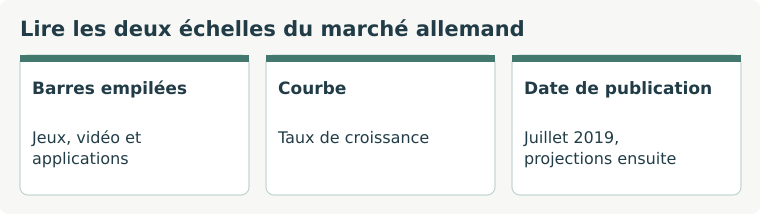

# Banque PT — Langue vivante A 2023 · Corrigé brut

*Corrigé rédigé par IA, non officiel.*

**Rédaction** · GPT-6.2 Astra Ultra · vitesse non renseignée

L’épreuve dure trois heures. Chaque candidat compose dans la langue choisie à l’inscription. Ce fascicule présente les cinq synthèses de 450 à 500 mots. Le décompte indiqué inclut le titre.

## Allemand

*Virtuelle und erweiterte Realitäten, die neuen Welten der Zukunft?*

**Wer räumt morgen die Tassen weg?**

In der Karikatur von Cloud Science sitzen die Beschäftigten als fantastische Wesen am Konferenztisch. Der Löwe, der das Wort führt, hat allerdings eine ganz gewöhnliche Bitte. Beim nächsten Besuch im wirklichen Büro sollen alle ihre benutzten Tassen in die Spülmaschine stellen. Der Witz trifft eine offene Frage in der Diskussion um das Metaversum. Welche Tätigkeiten lassen sich tatsächlich in eine neue Welt verlagern, und wo bleibt der Mensch mit den Bedingungen der bisherigen Welt verbunden?

Wie Innovae erklärt, ist bereits das Verhältnis zum physischen Raum je nach Technik verschieden. Ein Monteur kann durch eine Brille sowohl das Bauteil vor sich als auch die zugehörige Anleitung sehen. Er hat die Hände frei und kann das Gelesene unmittelbar anwenden. Die erweiterte Realität ergänzt also eine vorhandene Umgebung. Ein geschlossenes Headset dagegen kann den sichtbaren Arbeitsplatz vollständig durch eine Simulation ersetzen. Das ist besonders interessant, wenn jemand eine Tätigkeit unter kontrollierten Bedingungen erproben will. Für einen Durchbruch im Alltag dürften bei beiden Verfahren unterschiedliche Voraussetzungen gelten. Der Monteur muss seine gewohnte Tätigkeit weniger stark verändern als der Teilnehmer einer virtuellen Sitzung.

Das Projekt von Meta will diese Möglichkeiten verbinden. Wie der Beitrag bei Basecamp berichtet, sollen Menschen als Avatare zusammenkommen, arbeiten, spielen oder einkaufen können. Die Umbenennung des Unternehmens und die geplanten Arbeitsplätze in Europa zeigen, welche Erwartungen damit verbunden sind. Auch die von PwC veröffentlichte Darstellung des deutschen Marktes weist nach oben. Doch die gestapelten Balken und die Linie beschreiben Verschiedenes. Ein wachsender Gesamtmarkt ist durchaus damit vereinbar, dass die jährliche Wachstumsrate sinkt. Zudem stammt die Darstellung aus dem Jahr 2019, sodass die späteren Balken Erwartungen und keine nachträglich gemessenen Ergebnisse wiedergeben. Wirtschaftliches Interesse garantiert weder dauerhafte Nachfrage noch eine bestimmte Art der Nutzung.

Über solche Grenzen entscheiden auch die Körper der Nutzer. Ingenieur.de beschreibt Versuche, bei denen die Position virtueller Gegenstände bestimmte, wie lange jemand Arm und Nacken anspannen musste. Bereits eine kurze Tätigkeit mit ausgestrecktem Arm konnte Beschwerden verursachen. Was auf einem Bildschirm bequem erreichbar aussieht, kann also körperlich schlecht gestaltet sein. Für längere Schulungen stellt sich damit eine andere Frage als für eine kurze Werbevorführung. Die Geräte müssen tragbar sein, die Verbindung muss schnell reagieren und die Bewegungen müssen sich über längere Zeit ohne übermäßige Anstrengung ausführen lassen.

Der Scherz über die ungewaschenen Tassen erhält so eine zweite Bedeutung. Ein Avatar lässt sich frei gestalten, während die Person, die ihn steuert, weiterhin einen Körper und einen tatsächlichen Arbeitsplatz hat. Ob aus einzelnen Anwendungen eine gemeinsam bewohnte digitale Welt entsteht, hängt daher von mehr ab als von leistungsfähigeren Computern. Entscheidend ist, ob die Technik konkrete Aufgaben erleichtert und ob die Beteiligten einen hinreichenden Grund sehen, regelmäßig wiederzukommen. Das nachlassende Interesse an einem früheren Projekt wie Second Life mahnt gerade bei dieser letzten Frage zur Vorsicht.

**(461 Wörter, einschließlich Titel)**

## Anglais

*To what extent are the Commonwealth Games thought to be still relevant nowadays?*

**Whose Commonwealth do the Games celebrate?**

A photograph of Kadeena Cox taking part in a royal ceremony captures the appeal of the Commonwealth Games and the difficulty of explaining their place in the world. A black British Paralympian stands at the centre of a sporting event that promises recognition across borders. Yet the occasion also puts the monarchy at the centre of an association whose members have very different relationships with the Crown. Arguments about the future of the Games turn as much on that association as on the merits of the competition itself.

For Nicole Forrester, a Canadian athlete involved in Commonwealth sport, the history of the Games gives competitors a reason to value them. Athletes can compete internationally for teams that rarely command the attention enjoyed by the largest Olympic delegations. The participation of disabled athletes in the same event makes inclusion visible, as does the choice of Cox in the official photograph. From this perspective, the gathering offers its members something they could hardly obtain by competing separately. The map provides a geographical measure of that ambition, bringing together countries scattered across continents and oceans.

The very ceremony that conveys this message also invites a different reading. The officials surrounding Cox are British, and the ritual revolves around the sovereign. Writing in the British press, Andy Bull questions whether a competition inherited from the Empire can convincingly represent a modern association of equals. Sporting enthusiasm cannot settle the question of who occupies the centre and who is expected to travel there. The difficulty of finding hosts willing to meet the bill is a practical expression of that imbalance. Nor does the language of shared values resolve disagreements among members about the rights of the people whom a celebration of diversity purports to include.

Victoria Craw, writing for an Australian readership, examines what the wider association can achieve through cooperation. Its reach gives small states opportunities to draw attention to common concerns, including environmental damage. Britain, meanwhile, has particular reasons to cultivate international links after leaving the European Union. Those interests can coincide without being identical. The map helps explain why the passing of a monarch does not produce a single political response. Membership of the Commonwealth and recognition of the sovereign as head of state are different choices. The map lists Ireland and Zimbabwe as having left the association. Voters in Australia and Tuvalu, by contrast, rejected proposals to abandon the monarchy.

The Games thus offer a public test of an institution often discussed in the abstract. Athletes may gain opportunities and audiences may see experiences that usually receive little exposure. At the same time, official images and inherited rituals make the distribution of authority unusually visible. Whether the event continues to matter depends partly on whether participants can shape what it celebrates. For the Commonwealth itself, their willingness to meet is evidence of a continuing relationship, while the differences between their reasons for doing so explain why its future remains open.

**(495 words, title included)**

## Arabe

*على ضوء الوثائق الخمس المقدمة أدناه، إلى أي حد يمكن اعتبار شبكات الإعلام الاجتماعي شرطا أساسيا لتحقيق التقدم والانخراط في زمن العولمة؟*

**من يملك ثقة الجمهور على الشبكات الاجتماعية؟**

لم يعد القارئ الذي يبحث عن خبر مضطرا إلى شراء صحيفة أو انتظار موعد نشرة. فقد تصله المعلومة نفسها من حساب شاب يتابعه منذ سنوات ويعرف تفاصيل حياته اليومية. وقد يعلق عليها ثم ينقلها إلى جمهور آخر. هذا التحول في طريق الخبر يفسر بعضا من المكانة التي اكتسبها المؤثرون. لكنه يثير أيضا سؤالا عن الأساس الذي تقوم عليه سلطتهم وعن المصالح التي تتداخل حين تصبح العلاقة بالمتابعين عملا يتقاضى صاحبه أجرا.

تبدو الخريطة التي تعرض عالم المؤثرين أشبه بدليل إلى مهن متعددة. فهناك من يعرض الكتب ومن يقدم البث المباشر ومن يهتم بالأزياء، وهناك من يعرف أساسا باسم المنصة التي ينشر عليها. يجمع هؤلاء اتصال مباشر بجمهور اختار أن يتابعهم، لكن الاشتراك في وسيلة للنشر لا يعني الاشتراك في نوع العمل أو في المسؤولية عنه. وتزداد المسألة تعقيدا حين يقدم بعضهم تحقيقا أو شرحا لواقعة بينما يستعين صحفي بصورته الشخصية ليجذب القراء إلى حسابه. لذلك تدعو المقارنة بين المؤثر والصحفي إلى النظر في كيفية التثبت من الخبر وفي الغرض من نشره، خصوصا مع انتشار الأخبار الكاذبة وتراجع الثقة بالوسائط التقليدية.

وهذه الثقة تحديدا هي ما تبحث عنه الشركات. فالمتابع الذي اعتاد أن يسمع رأي شخص في شؤون الحياة قد يفهم مديحه لسلعة على أنه نصيحة صديق. أما العلامة التجارية فترى في تلك الصلة فرصة للوصول إلى مستهلكين يصعب إقناعهم بإعلان عادي. وقد يكون صاحب الحساب حصل على المنتج مجانا أو قبض مالا مقابل ذكره. فإذا غاب هذا التفصيل تعذر على القارئ أن يقدر قيمة التوصية على بينة. وتدفع صورة الأب الذي يريد أن يبدأ طفله الكلام مبكرا كي يظهر على تيك توك بهذا المنطق إلى أقصاه. فالفكاهة نابعة من تحويل زيارة طبيب الأطفال إلى استشارة عن مستقبل حساب إلكتروني، ومن سؤال الأهالي عما قد يكسبونه قبل السؤال عما يحتاج إليه الطفل نفسه.

مع ذلك لا تتلخص صناعة المحتوى في الترويج التجاري. فتعاون أكاديمية الإعلام الجديد في الإمارات مع تيك توك يدل على أن المؤسسات العامة بدورها تريد تعلم لغة هذه المنصات. وتتيح الدورة الافتراضية للمشاركين أن يفكروا في شكل الرسالة والجمهور الذي يخاطبونه. كما أن التدريب الموجه إلى صناع المحتوى العرب يتجاوز حدود البلد المنظم ويمنح هذا النشاط ملامح مهنة قابلة للتعلم. وهنا مفارقة، إذ إن المهارة التي تسهل إيصال معلومة نافعة إلى شريحة واسعة هي نفسها التي تزيد قيمة صاحبها لدى المعلن. ولا يحدد عدد المشاهدات وحده أي الاستخدامين يخدم المتلقي.

توزع الشبكات إذن قدرة النشر على أشخاص ومؤسسات لم يكونوا يشغلون المكان نفسه في الإعلام. وتبين الأمثلة أن هذا التوزيع يوسع إمكانات المعرفة والتعبير، فيما يترك على الجمهور عبء التمييز بين الخبر والرأي والرسالة المدفوعة. ومن ثم فالانخراط في زمن العولمة يستفيد من الشبكات بقدر ما يحافظ على شروط الثقة. ويظل تقدير دور كل مؤثر مرتبطا بالسؤال عمن يتكلم، ولأي غرض، وبأي قدر من الوضوح حيال من وضعوا ثقتهم فيه. وتزداد أهمية هذا الوضوح عندما يصبح أحد أطراف الصورة، مثل الطفل في الرسم، عاجزا عن اختيار الظهور أو عن المطالبة بنصيبه من ثمرة ذلك الظهور.

**(474 كلمة، بما فيها العنوان)**

## Espagnol

*¿De qué manera el 12 de octubre plantea un debate identitario en el mundo hispánico?*

**Una fecha compartida, ¿una memoria común?**

Al desembarcar en una isla de las Bahamas en 1492, Colón le dio un nombre nuevo a un lugar que ya tenía habitantes y nombre propio. Sara Mediavilla parte de ese detalle para plantear un problema todavía reconocible cada 12 de octubre. Quien nombra una tierra o una fiesta elige qué experiencia se recuerda y a quién corresponde contarla. Una misma fecha enfrenta así interpretaciones distintas de la conquista y de las comunidades que surgieron a ambos lados del Atlántico.

El mapa de Statista permite medir el alcance de esa discusión. Mientras ciertos nombres conservan la referencia a Colón o a la Hispanidad, otros destacan la resistencia indígena, la diversidad cultural o el encuentro de dos mundos. El calendario coincide, pero el protagonista cambia. Incluso términos aparentemente conciliadores pueden resultar insuficientes para quienes recuerdan la pérdida de lenguas, tierras y formas de vida. Mediavilla cuestiona precisamente que una ceremonia española de orgullo nacional pueda presentar la expansión imperial como origen feliz de una identidad común, sin escuchar a los pueblos para los que supuso violencia y desposesión.

La fotografía del desfile alternativo muestra que la discrepancia atraviesa también la sociedad española. Quienes sostienen la pancarta se dirigen a sí mismos y al público con un verbo en primera persona del plural. Piden revisar hábitos colectivos en el presente. Su marcha comparte la fecha con el desfile oficial, aunque le da un sentido opuesto. Los activistas zapatistas que viajaron a Europa ofrecen otro ejemplo de esa reapropiación. Al invertir simbólicamente el recorrido de los conquistadores, proponen dialogar sobre amenazas actuales y dar a conocer su resistencia.

El uso público de la historia tampoco garantiza que se escuchen voces diversas. Según informa El Mundo, Nicolás Maduro encargó a una comisión investigar los crímenes coloniales con vistas a exigir una reparación a España. La medida prolonga iniciativas venezolanas como el cambio de nombre de la festividad. Sin embargo, historiadores consultados por el periódico cuestionan tanto la independencia de la comisión como su utilidad política para el mandatario. La distancia entre el nombre oficial de algunos lugares y el que los habitantes siguen usando ilustra asimismo los límites de una memoria decretada desde el poder.

El editorial de El País propone un nacionalismo capaz de someter sus propios relatos a examen. Recuerda que los países de lengua española se formaron también mediante independencias, conflictos y migraciones posteriores. Reducirlos al legado de los conquistadores sería ignorar decisiones colectivas que los diferenciaron. Desde esta perspectiva, el debate identitario no exige elegir una versión única que satisfaga a todos. Obliga a distinguir quién habla en nombre de la comunidad, qué experiencias deja fuera y hasta qué punto una conmemoración pública puede acoger la crítica de quienes participan en ella o se manifiestan contra ella.

**(463 palabras, incluido el título)**

## Italien

*In che misura il futuro della mobilità in Italia e in Europa sarà green?*

**Quanto verde può diventare il viaggio quotidiano?**

Per chi deve arrivare al lavoro in orario, la scelta di un mezzo dipende anzitutto da ciò che trova fuori casa. Una pista ciclabile interrotta, una coincidenza incerta o l’assenza di una stazione possono rendere poco praticabile una preferenza ecologica. Il dossier sulla mobilità mette perciò in relazione tre questioni diverse. Occorre capire come cambieranno le abitudini, quali reti permetteranno di cambiarle e quanto potrà migliorare il bilancio ambientale dei veicoli che continueranno a circolare.

Lo studio presentato da Ecobnb prospetta un sorpasso dell’automobile da parte degli spostamenti a piedi, in bicicletta e con i mezzi pubblici. Nelle trentuno città esaminate, queste modalità insieme potrebbero arrivare al 49 per cento degli spostamenti urbani nel 2030, contro il 46 per cento dell’auto. La bicicletta avrebbe la crescita più marcata. Le differenze tra le città, però, invitano alla prudenza. Dove gli abitanti sarebbero disposti a cambiare, le infrastrutture possono essere insufficienti. Altrove esistono già alternative che devono ancora conquistare la fiducia del pubblico.

L’indagine Doxa condotta prima della pandemia aiuta a spiegare questa distanza. Il 72 per cento degli intervistati si serviva abitualmente dello stesso mezzo. Tra i fattori di scelta spiccano puntualità e tempi di percorrenza, seguiti dalla flessibilità degli orari. Un collegamento collettivo che soddisfi tali esigenze può quindi convincere anche chi attribuisce maggiore importanza alla praticità che all’ambiente. In quest’ottica si comprendono le proposte europee illustrate da Repubblica. Integrare le reti ferroviarie, stradali e navigabili e rendere possibile un solo biglietto per più mezzi faciliterebbe l’intero viaggio, compreso il passaggio da una rete all’altra.

In Italia le Ferrovie dello Stato vedono negli investimenti previsti dal piano di ripresa un’occasione per collegare meglio il Mezzogiorno al resto d’Europa. Secondo le stime riportate, in media un viaggiatore in treno produce il 71 per cento di anidride carbonica in meno rispetto a un viaggio in automobile. Treni regionali più leggeri e meno energivori aggiungerebbero un beneficio tecnico al vantaggio derivante dal trasferimento di passeggeri e merci sulla rotaia. La sua portata dipende comunque dalle tratte realmente accessibili.

Anche l’automobile può cambiare. L’osservatorio dell’assicuratore Verti registra una crescita delle ibride nel proprio portafoglio e indica la Lombardia come area particolarmente rappresentata. Si tratta di un segnale commerciale circoscritto, distinto dalla previsione sul futuro parco italiano. Le stazioni di ricarica previste dalla strategia europea potrebbero allargare le possibilità di scelta. Sostituire la motorizzazione, tuttavia, lascia intatte alcune ragioni per cui gli utenti evitano il traffico o cercano un mezzo più flessibile. Il futuro della mobilità dipenderà dunque dall’incontro tra interventi differenti. Una rete coerente, veicoli più efficienti e alternative credibili sull’ultimo tratto possono trasformare una preferenza occasionale in un’abitudine durevole. È a questa scala quotidiana che le ambizioni europee acquistano un significato concreto per chi viaggia.

**(459 parole, titolo compreso)**

