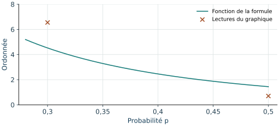

# Banque PT — Mathématiques A · 2023 · Corrigé guidé

*Corrigé rédigé par IA, non officiel. Signalez toute erreur.*

**Rédaction** · GPT-6.2 Astra Ultra · vitesse non renseignée

Le sujet comporte un exercice d’algèbre et un exercice de probabilités. Dans le second, la comparaison entre la courbe imprimée et la formule analytique importe dès la question 9. La dernière question demande d’interpréter une majoration admise dont nous examinons aussi la validité.

## Exercice 1 · Changement de base et matrices triangulaires

### Question I.1.a

> [!INDICATION]
> Faire apparaître un facteur dans la troisième ligne du déterminant.

#### Solution

Dans $xI-A$, remplaçons la troisième ligne par sa différence avec la première. Elle devient $(1-x,0,x-1)$. On factorise $x-1$ puis on ajoute la troisième colonne à la première. Le développement suivant la dernière ligne donne $(x-1)[(x-3)(x+1)+4]=(x-1)^3$. La seule valeur propre est $1$, de multiplicité algébrique trois.

### Question I.1.b

> [!INDICATION]
> Quelle matrice diagonale peut représenter cet endomorphisme ?

#### Solution

Si $A$ était diagonalisable, elle serait semblable à $I$ puisque toutes les entrées de la diagonale devraient valoir $1$. Or toute matrice semblable à $I$ est $I$, et $A$ possède par exemple un coefficient hors diagonale égal à $4$. Ainsi $A$ ne peut pas être diagonalisable.

### Question I.1.c

> [!INDICATION]
> Garder les deux équations indépendantes de la matrice $K=A-I$.

#### Solution

Dans $KX=0$, les lignes 1 et 3 donnent $x+y-2z=0$ et la ligne 2 donne $y=z$. On trouve $x=y=z$. L’unique espace propre est $E_1=\mathbb R(1,1,1)$.

### Question I.1.d

> [!INDICATION]
> Comparer la deuxième équation avec les deux copies de la première.

#### Solution

Le système équivaut à $y=z-1$ et $x+y-2z=-1$, donc à $x=z$ et $y=z-1$. Toutes les solutions sont les colonnes $(t,t-1,t)^{\mathsf T}$ pour $t\in\mathbb R$.

### Question I.1.e

> [!INDICATION]
> Prendre le vecteur propre de coordonnées toutes égales à un et choisir un paramètre simple.

#### Solution

Prenons $e_1=(1,1,1)$ et la solution $e_2=(0,-1,0)$ de la question précédente. On a $Ke_1=0$ et $Ke_2=2e_1$. Pour $Ke_3=-2e_2=(0,2,0)$ il suffit de résoudre $y=z-1$ et $x+y-2z=0$. Avec $z=0$ vient $e_3=(1,-1,0)$. En ajoutant chaque vecteur à son image par $K$, on obtient les trois relations imposées à $f$.

### Question I.1.f

> [!INDICATION]
> Mettre les trois vecteurs en colonnes et vérifier leur indépendance.

#### Solution

La matrice $P=\begin{pmatrix}1&0&1\\1&-1&-1\\1&0&0\end{pmatrix}$ a déterminant $1$. Les relations précédentes donnent $AP=PB$ colonne par colonne, avec $B=\begin{pmatrix}1&2&0\\0&1&-2\\0&0&1\end{pmatrix}$. Par conséquent $A=PBP^{-1}$.

### Question I.2.a

> [!INDICATION]
> Décomposer toute matrice suivant les trois places au-dessus de la diagonale.

#### Solution

Notons $E_{ij}$ la matrice élémentaire dont le seul coefficient non nul est un $1$ en $(i,j)$. L’ensemble $\mathcal N$ est exactement l’espace engendré par $E_{12},E_{13},E_{23}$. En lisant les trois coefficients d’une combinaison nulle, on voit que la famille est libre. C’est une base et $\dim\mathcal N=3$.

### Question I.2.b

> [!INDICATION]
> Utiliser la règle $E_{ij}E_{k\ell}=\delta_{jk}E_{i\ell}$.

#### Solution

Pour $N=aE_{12}+bE_{13}+cE_{23}$ et $M=a'E_{12}+b'E_{13}+c'E_{23}$, on a $NM=ac'E_{13}$. Ce produit appartient à $\mathcal N$, ce qui établit la stabilité.

### Question I.2.c

> [!INDICATION]
> Multiplier encore le résultat du carré par $N$.

#### Solution

On a $N^2=acE_{13}$ et $E_{13}N=0$ puisque la troisième ligne de $N$ est nulle. Donc $N^3=0$ pour toute matrice de $\mathcal N$.

### Question I.3.a

> [!INDICATION]
> Examiner la diagonale de toutes les matrices du nouvel ensemble.

#### Solution

Chaque élément de $\mathcal U=I+\mathcal N$ a ses trois coefficients diagonaux égaux à $1$. La matrice nulle en est exclue, donc $\mathcal U$ n’est pas un sous-espace vectoriel.

### Question I.3.b

> [!INDICATION]
> Isoler l’identité dans le développement du produit.

#### Solution

Pour $N,M\in\mathcal N$, $(I+N)(I+M)=I+(N+M+NM)$. Les trois termes de la somme appartiennent au sous-espace $\mathcal N$, ce qui place le produit dans $\mathcal U$.

### Question I.3.c

> [!INDICATION]
> La diagonale donne le déterminant d’une matrice triangulaire.

#### Solution

Toute matrice $U\in\mathcal U$ est triangulaire supérieure de diagonale $(1,1,1)$. Son déterminant vaut $1$, donc $U\in GL_3(\mathbb R)$.

## Exercice 1 · Puissances et racines

### Question I.4.a

> [!INDICATION]
> Le seul coefficient non nul du carré de $B-I$ se trouve en position $(1,3)$.

#### Solution

Posons $c(u)=u(u-1)/2$. Comme $(B-I)^2=-4E_{13}$, la définition donne
$$
B^{(\alpha)}=\begin{pmatrix}1&2\alpha&2\alpha(1-\alpha)\\0&1&-2\alpha\\0&0&1\end{pmatrix}.
$$

### Question I.4.b

> [!INDICATION]
> Exprimer la partie strictement triangulaire comme combinaison de deux matrices de $\mathcal N$.

#### Solution

Pour $U=I+N$, $U^{(\alpha)}-I=\alpha N+c(\alpha)N^2\in\mathcal N$, par stabilité vectorielle et multiplicative de $\mathcal N$. Donc $U^{(\alpha)}\in\mathcal U$.

### Question I.4.c

> [!INDICATION]
> Réduire les produits modulo $N^3=0$ avant de comparer les coefficients.

#### Solution

Dans le produit $U^{(\alpha)}U^{(\beta)}$, les coefficients de $N$ et $N^2$ valent respectivement $\alpha+\beta$ et $[\alpha^2-\alpha+\beta^2-\beta+2\alpha\beta]/2=c(\alpha+\beta)$. D’où le premier résultat $U^{(\alpha+\beta)}$. Pour le second, posons $R=\alpha N+c(\alpha)N^2$. Alors $R^2=\alpha^2 N^2$. Dans $I+\beta R+c(\beta)R^2$, le coefficient de $N$ est $\alpha\beta$ et celui de $N^2$ est $[\beta(\alpha^2-\alpha)+(\beta^2-\beta)\alpha^2]/2=c(\alpha\beta)$. On obtient $(U^{(\alpha)})^{(\beta)}=U^{(\alpha\beta)}$.

### Question I.4.d

> [!INDICATION]
> Utiliser la règle additive pour le passage d’un entier au suivant.

#### Solution

Au rang un, $U^{(1)}=I+N=U$. Si $U^{(n)}=U^n$ pour un entier $n\ge1$, alors $U^{(n+1)}=U^{(n)}U^{(1)}=U^nU=U^{n+1}$. La récurrence conclut pour tout entier $n\ge1$.

### Question I.4.e

> [!INDICATION]
> Dans le binôme, identifier les seuls degrés susceptibles de survivre.

#### Solution

Comme $I$ et $N$ commutent, pour $n\ge2$, $(I+N)^n=I+nN+\binom n2 N^2$, puisque toutes les puissances de $N$ d’ordre au moins trois sont nulles. C’est $U^{(n)}$. Au rang zéro la définition donne $I=U^0$, et au rang un elle donne directement $U=U^1$.

### Question I.4.f

> [!INDICATION]
> Employer la première identité avec les deux exposants opposés.

#### Solution

On a $U^{(1)}U^{(-1)}=U^{(0)}=I$ et $U^{(-1)}U^{(1)}=I$. Ainsi $U^{(-1)}=U^{-1}=I-N+N^2$.

### Question I.5.a

> [!INDICATION]
> Choisir un exposant dont la somme avec lui-même est un.

#### Solution

Pour $C=B^{(1/2)}=\begin{pmatrix}1&1&1/2\\0&1&-1\\0&0&1\end{pmatrix}$, I.4.c donne $C^2=B^{(1)}=B$. Il existe au moins une autre racine réelle, $-C$, car $(-C)^2=C^2$ et $C$ a des coefficients diagonaux non nuls.

### Question I.5.b

> [!INDICATION]
> Transporter l’identité $C^2=B$ dans la base initiale.

#### Solution

Pour $D=PCP^{-1}$, on obtient $D^2=PC(P^{-1}P)CP^{-1}=PBP^{-1}=A$. Cette construction donne la matrice demandée sans calculer ses coefficients.

## Exercice 2 · Lancers indépendants

### Question II.1

> [!INDICATION]
> Le rang du premier succès commence à un.

#### Solution

Avec $q=1-p$, $T$ suit la loi géométrique de paramètre $p$ sur les entiers strictement positifs. Sa loi est $\mathbb P(T=n)=q^{n-1}p$ pour $n\ge1$.

### Question II.2

> [!INDICATION]
> Étudier l’absence de succès parmi les $n$ premiers lancers.

#### Solution

L’événement « aucun succès » est l’intersection décroissante des événements « les $n$ premiers lancers échouent ». Leur probabilité vaut $q^n$ par indépendance. Comme $0<q<1$, la continuité décroissante donne une probabilité nulle à l’intersection. Il y a donc au moins un succès avec probabilité $1$.

### Question II.3.a

> [!INDICATION]
> Identifier les indicatrices dont la somme constitue le nombre observé.

#### Solution

$S_N$ est somme de $N$ indicatrices de Bernoulli de paramètre $p$, indépendantes. Il suit la loi binomiale $\mathcal B(N,p)$, soit $\mathbb P(S_N=k)=\binom Nk p^kq^{N-k}$ pour $0\le k\le N$.

### Question II.3.b

> [!INDICATION]
> Compléter un carré.

#### Solution

L’identité $p(1-p)=1/4-(p-1/2)^2$ donne $p(1-p)\le1/4$, avec égalité pour $p=1/2$.

### Question II.3.c

> [!INDICATION]
> Appliquer Bienaymé–Tchebychev à la fréquence.

#### Solution

La variable $S_N/N$ a espérance $p$ et variance $Np(1-p)/N^2=p(1-p)/N$. Pour tout $\varepsilon>0$, Bienaymé–Tchebychev donne $\mathbb P(|S_N/N-p|\ge\varepsilon)\le p(1-p)/(N\varepsilon^2)\le1/(4N\varepsilon^2)$.

## Exercice 2 · Loi conditionnelle et espérance

### Question II.4.a

> [!INDICATION]
> Compter les issues selon la couleur de la pièce tirée et vérifier le cas $n=1$.

#### Solution

Conditionnellement à $T=n$, il y a une pièce noire et $n-1$ ordinaires. Sur les $n$ unités reçues, l’organisateur reverse $M$ ou $1$. Ainsi $G_n=n-M$ de probabilité $1/n$, et $G_n=n-1$ de probabilité $(n-1)/n$. Les deux valeurs sont atteintes pour $n\ge2$. Pour $n=1$, seule la pièce noire est présente et le support se réduit à $\{1-M\}$, exception à l’égalité des ensembles imprimée.

### Question II.4.b

> [!INDICATION]
> Multiplier chaque valeur par la probabilité de la couleur correspondante.

#### Solution

La loi précédente donne $\mathbb E G_n=(n-M)/n+(n-1)^2/n=n-1-(M-1)/n$. Cela vaut aussi pour $n=1$.

### Question II.5

> [!INDICATION]
> Intégrer puis dériver la série géométrique dans son disque de convergence.

#### Solution

Les quotients des valeurs absolues de termes consécutifs tendent vers $|x|$ dans les deux séries pour $x\ne0$. Leurs rayons valent $1$. Pour $0<|x|<1$, l’intégration de $\sum_{j\ge0}x^j=1/(1-x)$ depuis zéro, puis la division par $x$, donnent $\sum_{n\ge1}x^{n-1}/n=-\ln(1-x)/x$. En $0$, la somme vaut $1$. Par dérivation de $\sum_{n\ge0}x^n$, on obtient $\sum_{n\ge1}nx^{n-1}=(1-x)^{-2}$ pour $|x|<1$. Aux bornes réelles, la première série vaut $\ln 2$ en $-1$ et diverge en $1$, tandis que la seconde diverge aux deux bornes.

### Question II.6.a

> [!INDICATION]
> Le rang fixe le nombre de pièces parmi lesquelles a lieu le tirage.

#### Solution

Conditionnellement à $T=n$, une seule des $n$ pièces équiprobables est noire. Donc $\mathbb P(A\mid T=n)=1/n$.

### Question II.6.b

> [!INDICATION]
> Les événements conditionnants couvrent les issues à un ensemble négligeable près.

#### Solution

Les événements $\{T=n\}$ sont disjoints, de probabilité strictement positive, et leur union a probabilité $1$ par II.2. La formule des probabilités totales et II.5 donnent $\mathbb P(A)=\sum_{n\ge1}pq^{n-1}/n=-(p/q)\ln(1-q)=(p/q)\ln(1/p)$.

### Question II.7.a

> [!INDICATION]
> Vérifier l’inclusion dans chaque sens en privilégiant la pièce noire.

#### Solution

Le support entier annoncé présuppose $M$ entier, convention retenue pour les questions qui suivent. Les deux valeurs conditionnelles sont au moins $1-M$. Réciproquement tout entier $k\ge1-M$ s’écrit $n-M$ avec $n=k+M\ge1$, et l’événement $T=n$ suivi de la pièce noire a probabilité $pq^{n-1}/n>0$. Ainsi le support est $\mathbb Z\cap[1-M,+\infty[$.

### Question II.7.b

> [!INDICATION]
> À rang fixé, les deux montants sont distincts puisque $M\ge2$.

#### Solution

Pour $T=n$, la probabilité de $G=k$ vaut $(n-1)/n$ si $k=n-1$, $1/n$ si $k=n-M$, et zéro autrement. En particulier, le premier coefficient s’annule lorsque $n=1$.

### Question II.7.c

> [!INDICATION]
> Rechercher les rangs admissibles pour chacun des deux types de pièce.

#### Solution

Le rang associé à la pièce noire est $n=k+M$ pour tout $k$ du support. Celui associé à une pièce ordinaire est $n=k+1$, admissible pour $k\ge0$. En multipliant les probabilités de II.7.b par celles de ces rangs, on obtient
$$
\mathbb P(G=k)=\frac{pq^{k+M-1}}{k+M}+\begin{cases}\dfrac{k}{k+1}pq^k& k\ge0,\\0&1-M\le k<0.\end{cases}
$$

### Question II.8.a

> [!INDICATION]
> Un majorant linéaire en $n$ suffit devant la décroissance géométrique.

#### Solution

$|\mathbb E G_n|\le n+M$ par II.4.b. Les séries $\sum pq^{n-1}$ et $\sum npq^{n-1}$ ont pour sommes $1$ et $1/p$. Le critère de comparaison donne la convergence absolue de $\sum(\mathbb E G_n)\mathbb P(T=n)$.

### Question II.8.b

> [!INDICATION]
> Séparer les trois séries désormais convergentes.

#### Solution

On somme $n-1-(M-1)/n$ avec les poids $pq^{n-1}$. Les trois espérances élémentaires sont $1/p$, $1$ et $(p/q)\ln(1/p)$. D’où
$$
\mathbb E G=\frac{1-p}{p}-(M-1)\frac p{1-p}\ln(1/p).
$$

## Exercice 2 · Lecture de la courbe du sujet

### Question II.9.a

> [!INDICATION]
> Isoler $M-1$ en contrôlant le signe de chaque facteur.

#### Solution

Comme $p$, $q=1-p$ et $\ln(1/p)$ sont positifs, la multiplication de II.8.b par $q/[p\ln(1/p)]$ conserve l’ordre. Ainsi $\mathbb E G\ge0$ équivaut à $\psi(p)\ge M-1$, avec $\psi(p)=(q/p)^2/\ln(1/p)$. La courbe de la page 5 présente un écart avec cette formule. Les réponses suivantes indiquent les conséquences des deux lectures.

### Question II.9.b

> [!INDICATION]
> Lire l’ordonnée en $0{,}30$ puis la vérifier dans la formule.

#### Solution

Le graphique donne environ $6{,}5$ pour $p=0{,}30$, donc les valeurs entières satisfaisant le critère graphique sont $2$ à $7$. La formule donne $49/[9\ln(10/3)]\simeq4{,}522$, si bien que le critère déduit de l’espérance est satisfait pour les entiers $M=2,3,4,5$.

### Question II.9.c

> [!INDICATION]
> Comparer le seuil d’ordonnée sept aux deux représentations.

#### Solution

Sur le graphique, l’intersection avec l’horizontale d’ordonnée $7$ se situe vers $p=0{,}295$. Pour la formule de II.9.a, écrivons $u=1/p>1$. La fonction $(u-1)^2/\ln u$ croît strictement, car sa dérivée a le signe de $2\ln u-(u-1)/u>0$ (l’intégrale de $1/t$ entre $1$ et $u$ dépasse $(u-1)/u$). Ainsi $\psi$ décroît strictement de $+\infty$ à $0$ sur $]0,1[$. La racine de $\psi(p)=7$ donne la probabilité maximale au sens de l’inégalité large, comprise entre $0{,}2404$ et $0{,}2405$.

### Question II.9.d

> [!INDICATION]
> La plus petite valeur entière admise de $M-1$ est un.

#### Solution

Aucun $M\ge2$ ne convient si $\psi(p)<1$. Le graphique situe le passage du niveau $1$ vers $0{,}465$ à $0{,}47$. Selon la formule, il existe un unique $p_*$ tel que $(1-p_*)^2=p_*^2\ln(1/p_*)$, avec $0{,}5724<p_*<0{,}5725$. La condition exacte est $p>p_*$. À égalité, $M=2$ donne une espérance nulle, admise en II.9.a.

## Exercice 2 · Fréquence et grandes déviations

### Question II.10.a

> [!INDICATION]
> Le théorème de transfert donne deux termes pour une variable de Bernoulli.

#### Solution

Pour $X_1\sim\mathcal B(p)$, $\mathbb E[e^{\lambda(X_1-p)}]=(1-p)e^{-\lambda p}+pe^{\lambda(1-p)}=h(\lambda)=e^{g(\lambda)}$. La définition de $g$ est licite car $h>0$.

### Question II.10.b

> [!INDICATION]
> Transformer l’exponentielle de la somme en produit de variables indépendantes.

#### Solution

Comme les $X_i$ sont indépendantes, les variables $e^{\lambda(X_i-p)}$ le sont aussi. Leur produit a pour espérance $\prod_{i=1}^N\mathbb E[e^{\lambda(X_i-p)}]=e^{Ng(\lambda)}\le e^{N\lambda^2/2}$ pour $\lambda\ge0$ par l’inégalité admise.

### Question II.10.c

> [!INDICATION]
> Appliquer Markov à une variable positive et à un seuil positif.

#### Solution

Pour $\lambda>0$, l’événement $S_N/N-p\ge\varepsilon$ équivaut à $e^{\lambda(S_N-Np)}\ge e^{N\lambda\varepsilon}$. Markov majore sa probabilité par $e^{-N\lambda\varepsilon}\mathbb E[e^{\lambda(S_N-Np)}]\le\exp(-N\lambda\varepsilon+N\lambda^2/2)$.

### Question II.10.d

> [!INDICATION]
> Minimiser l’exposant dans la demi-droite autorisée.

#### Solution

On a $-\lambda\varepsilon+\lambda^2/2=(\lambda-\varepsilon)^2/2-\varepsilon^2/2$. Le minimum est atteint en $\lambda=\varepsilon>0$. La probabilité de la déviation supérieure est donc au plus $e^{-N\varepsilon^2/2}$.

### Question II.11

> [!INDICATION]
> Comparer les deux majorants proposés, puis contrôler le passage de la déviation supérieure à la valeur absolue.

#### Solution

Si l’on suit l’admission de la page 6, $e^{-N\varepsilon^2/2}$ représente un plafond pour la probabilité d’une erreur absolue au moins égale à $\varepsilon$. Pour $x=N\varepsilon^2$, le plafond annoncé est inférieur à celui de II.3.c si et seulement si $4xe^{-x/2}<1$. Le membre gauche croît jusqu’à $x=2$ puis décroît vers zéro. Les deux racines de l’égalité sont environ $0{,}289$ et $6{,}523$. L’inégalité stricte vaut avant la première et après la seconde. Pour $\varepsilon$ fixé, la décroissance exponentielle en $N$ finit donc par l’emporter.
La majoration **bilatérale admise** ne vaut toutefois pas en général. Prenons $N=1$ et $p=\varepsilon=0{,}4$. Les deux déviations absolues possibles sont $0{,}4$ et $0{,}6$, si bien que la probabilité vaut $1>e^{-0{,}08}$. On peut obtenir une estimation valide des deux queues. Pour tout réel $\lambda$, posons $r=pe^{\lambda}/(1-p+pe^{\lambda})$. La fonction $g(\lambda)=\ln(1-p+pe^{\lambda})-p\lambda$ vérifie $g(0)=g'(0)=0$ et $g''(\lambda)=r(1-r)\le1/4$. Taylor donne $g(\lambda)\le\lambda^2/8$ pour les deux signes. Appliquons alors Markov séparément aux exponentielles d’exposants $4\varepsilon(S_N-Np)$ et $-4\varepsilon(S_N-Np)$. Chaque queue est majorée par $e^{-2N\varepsilon^2}$ et leur union par $\min(1,2e^{-2N\varepsilon^2})$. Ce second résultat justifie une garantie bilatérale exploitable pour les grands échantillons.

## Sources et rapport du jury

Le rapport du jury (p. 2–3) demande une justification des coefficients des puissances et de la récurrence. Pour les probabilités, il insiste p. 4 sur le système complet d’événements et p. 5 sur le signe du logarithme et les hypothèses de Markov. Il ne donne pas de rectificatif à la courbe ni à la borne bilatérale.

[Énoncé de la Banque PT](https://www.banquept.fr/documents/2023/math_a_2023_pt.pdf) · [Rapport du jury](https://www.banquept.fr/documents/ecrit/rapport/2023/rapport_math_a_ecrit_2023.pdf)
