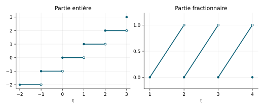
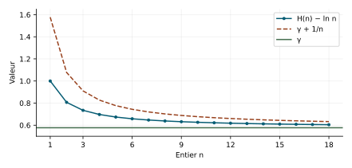

# Banque PT — Mathématiques C · Session 2023 · Corrigé brut

*Corrigé rédigé par IA, non officiel. Signalez toute erreur.*

**Rédaction** · GPT-6.2 Astra Ultra · vitesse non renseignée

Une décomposition en éléments simples permet de sommer une série entière. La partie II retrouve sa valeur au bord en comparant la somme harmonique au logarithme.

Écrit de quatre heures, sans calculatrice. Deux feuilles de papier millimétré sont à rendre pour II.1. La grille d’admissibilité attribue à Math C le coefficient 6 pour l’École polytechnique et 3 pour chacune des ENS Paris-Saclay et Rennes. [Sujet](https://www.banquept.fr/documents/2023/math_c_2023_pt.pdf) · [Livret, p. 13](https://www.banquept.fr/documents/livret/2023/Livret_PT_2023.pdf#page=13)

Le jury signale en page 10 une coquille en II.7.a. Le calcul au premier rang permet de repérer le terme de bord absent de l’énoncé. [Rapport du jury](https://www.banquept.fr/documents/ecrit/rapport/2023/rapport_math_c_ecrit_2023.pdf)

## Préambule. Trois éléments simples

### Question P.1

D’une part $(x-x_1)g(x)=P(x)/((x-x_2)(x-x_3))$ tend vers $P(x_1)/((x_1-x_2)(x_1-x_3))$. D’autre part, dans la décomposition donnée, le premier terme devient $a_1$ et les deux autres tendent vers zéro. En dérivant $Q=(X-x_1)(X-x_2)(X-x_3)$ en $x_1$, seul le terme où l’on a dérivé le premier facteur subsiste. Ainsi $a_1=P(x_1)/Q'(x_1)$. Le même calcul en $x_2$, puis en $x_3$, donne $a_j=P(x_j)/Q'(x_j)$ pour $j=2,3$. Tous les dénominateurs sont non nuls car les racines sont distinctes.

### Question P.2

Pour $(x_1,x_2,x_3)=(0,-1,-1/2)$ et $P=1$, les produits des deux différences valent $1/2,1/2,-1/4$ respectivement. On obtient $(a_1,a_2,a_3)=(2,2,-4)$.

## I. Une série entière et une série numérique

On pose $F(x)=\log(x(x+1)/(2x+1)^2)$ sur son domaine réel et $f=F'$. La série entière à sommer est $\sum_{n\ge1}f(n)x^{2n+1}$.

### Question I.1

Le logarithme existe si $x(x+1)/(2x+1)^2>0$. En dehors de $-1/2$, le dénominateur est strictement positif. Le tableau de signes est
$$
\begin{array}{c|ccccccc}
x&(-\infty,-1)&-1&(-1,-1/2)&-1/2&(-1/2,0)&0&(0,+\infty)\\\hline
x(x+1)&+&0&-&-&-&0&+\\
(2x+1)^2&+&+&+&0&+&+&+\\
\text{quotient}&+&0&-&\text{indéfini}&-&0&+
\end{array}
$$
On en déduit $D_F=]-\infty,-1[\,\cup\,]0,+\infty[$.

### Question I.2

Le quotient rationnel est dérivable là où son dénominateur ne s’annule pas et strictement positif sur $D_F$. Le logarithme étant dérivable sur $]0,+\infty[$, la composition $F$ est dérivable sur chacune des deux composantes de $D_F$.

### Question I.3

Sur $D_F$, on a $F(x)=\log|x|+\log|x+1|-2\log|2x+1|$. Par dérivation,
$$
f(x)=\frac1x+\frac1{x+1}-\frac4{2x+1}
=\frac{(2x+1)^2-4x(x+1)}{x(x+1)(2x+1)}
=\frac1{x(x+1)(2x+1)} .
$$

### Question I.4.a

Pour $x\ne0$, le rapport des modules de $f(n+1)x^{2n+3}$ et $f(n)x^{2n+1}$ vaut $|x|^2n(2n+1)/((n+2)(2n+3))\to |x|^2$. Le critère de d’Alembert donne la convergence absolue pour $|x|<1$ et la divergence pour $|x|>1$. La série vaut zéro en zéro. Son rayon est $R=1$.

### Question I.4.b

Pour $|x|<1$, $1/(1-x)=\sum_{k\ge0}x^k$. La primitivation terme à terme donne $\log(1-x)=-\sum_{k\ge1}x^k/k$, de rayon 1.

### Question I.4.c.i

La série géométrique fournit $(1-x^2)^{-1}=\sum_{k\ge0}x^{2k}$ si $|x|<1$. Si $|x|\ge1$, le terme ne tend pas vers zéro. Le rayon est 1.

### Question I.4.c.ii

Pour $x\ne\pm1$,
$$
\frac12\left(\frac1{1-x}+\frac1{1+x}\right)
=\frac{1+x+1-x}{2(1-x^2)}=\frac1{1-x^2}.
$$

### Question I.4.d

Dans $]-1,1[$, $L(x)=\tfrac12\log((1+x)/(1-x))$ vérifie $L(0)=0$ et $L'(x)=1/(1-x^2)$ par I.4.c.ii. Le théorème de primitivation des séries entières autorise l’intégration terme à terme à l’intérieur du disque et conserve le rayon. On obtient $L(x)=\sum_{n\ge0}x^{2n+1}/(2n+1)$, de rayon 1, égal à $R$.

### Question I.4.e

Pour $|x|<1$, I.4.b donne $\sum_{n\ge1}x^{2n}/n=-\log(1-x^2)$. Après multiplication par $x$, on obtient l’identité demandée, y compris en zéro.

### Question I.4.f

Notons $S(x)=\sum_{n\ge1}f(n)x^{2n+1}$. La décomposition de I.3, également obtenue de P.2 en divisant par deux, permet de séparer trois séries absolument convergentes pour $|x|<1$. La première vaut $-x\log(1-x^2)$. Pour $x\ne0$, la deuxième vaut $(-\log(1-x^2)-x^2)/x$ par décalage de I.4.b. La troisième vaut $-4(L(x)-x)$ par I.4.d. Ainsi
$$
S(x)=3x-(x+x^{-1})\log(1-x^2)-2\log((1+x)/(1-x)).
$$
En zéro, la série donne directement $S(0)=0$, valeur du prolongement continu de cette expression.

### Question I.4.g

Pour $0<x<1$, le résultat précédent s’écrit
$$
S(x)=3x-\frac{(1-x)^2}{x}\log(1-x)-\frac{(1+x)^2}{x}\log(1+x).
$$
Le terme en $(1-x)^2\log(1-x)$ tend vers zéro. L’autre logarithme tend vers $\log2$ et son coefficient vers 4. Par conséquent $\lim_{x\to1^-}S(x)=3-4\log2$.

### Question I.5.a

Les termes $f(n)$ sont strictement positifs et $f(n)\sim1/(2n^3)$. La série converge par comparaison à une série de Riemann d’exposant 3.

### Question I.5.b

Dans $H(2n+1)=\sum_{j=1}^{2n+1}1/j$, la somme des termes pairs vaut $\tfrac12 H(n)$. Les autres termes ont les indices $2k+1$ pour $0\le k\le n$. La différence donne exactement la somme demandée.

### Question I.5.c

D’après I.3,
$$
\sum_{k=1}^n f(k)=H(n)+H(n+1)-1-4\left(H(2n+1)-\tfrac12H(n)-1\right).
$$
En remplaçant $H(n+1)=H(n)+1/(n+1)$, on obtient $3+4H(n)-4H(2n+1)+1/(n+1)$.

## II. Sommation par parties et constante d’Euler

Pour $x\ge1$, on note $n_x=\lfloor x\rfloor$ et $A(x)=\sum_{k=1}^{n_x}a_k$, avec $a_k>0$ et $A(0)=0$. La fonction $h$ est de classe $C^1$ sur $[1,+\infty[$ et à valeurs positives. On appliquera la formule obtenue aux sommes harmoniques $H(n)=\sum_{k=1}^n1/k$.

### Question II.1

Pour chaque $k\in\mathbb Z$, la partie entière vaut $k$ sur $[k,k+1[$. Ainsi, par exemple, $\lfloor-0{,}3\rfloor=-1$. Sur $[k,k+1[$ avec $k\ge1$, la seconde fonction vaut $t-k$. Son segment va de $(k,0)$ inclus à $(k+1,1)$ exclu. Au prochain entier elle reprend la valeur zéro. Les deux graphes séparés indiquent les extrémités pleines et vides.

[Télécharger la planche pour la partie entière](https://raw.githubusercontent.com/knoel99/corriges-concours/d50a2fd77f11cb1d2431656f826a5165dfeed4ca/2023/banque-pt/banque-pt_pt_maths-c_2023/planches/partie-entiere.svg) · [Télécharger la planche pour la partie fractionnaire](https://raw.githubusercontent.com/knoel99/corriges-concours/d50a2fd77f11cb1d2431656f826a5165dfeed4ca/2023/banque-pt/banque-pt_pt_maths-c_2023/planches/partie-fractionnaire.svg)

Imprimez chaque planche sur A4 paysage à 100 %, sans ajustement, sans marges ni en-têtes de navigateur. Vérifiez à la règle que deux graduations entières successives sont distantes de 1 cm, sur chaque axe.

### Question II.2

En développant la somme de gauche, sa première contribution est $\sum_{j=2}^{n+1}A(j-1)u_j$ et la seconde est $-\sum_{j=1}^n A(j)u_j$. En isolant $A(n)u_{n+1}$ et en utilisant $A(0)=0$ pour le premier indice, il reste
$$
\sum_{j=1}^n(A(j-1)-A(j))u_j+A(n)u_{n+1}.
$$

### Question II.3

Comme $n_x=\lfloor x\rfloor$ est entier, $\lfloor n_x\rfloor=n_x$. Par la définition de $A$, les deux sommes $A(n_x)$ et $A(x)$ ont donc les mêmes termes et la même borne.

### Question II.4

Sur $[k,k+1[$, $A(t)=A(k)$. Les deux intégrandes coïncident donc, sauf éventuellement en $k+1$. Ce changement de valeur en un point laisse l’intégrale inchangée, d’où $\int_k^{k+1} A(t)h'(t)dt=A(k)\int_k^{k+1}h'(t)dt$.

### Question II.5

En sommant II.4 de $k=1$ à $n_x-1$ et en utilisant l’additivité de l’intégrale, on trouve $\int_1^{n_x}Ah'=\sum_{k=1}^{n_x-1}A(k)(h(k+1)-h(k))$, puisque $h$ est $C^1$. Pour $n_x=1$, les deux membres sont nuls.

### Question II.6

Par définition de $A$, $A(k)=a_1+\cdots+a_k$ et $A(k-1)=a_1+\cdots+a_{k-1}$. Leur différence vaut $a_k$. Avec $A(0)=0$, la formule vaut aussi pour $k=1$.

### Question II.7.a

La formule imprimée omet $-A(1)h(1)$. Pour $n_x=1$, par exemple, sa gauche est nulle et sa droite imprimée vaut $A(1)h(1)$, qui peut être strictement positif. Le rapport du jury signale la coquille en page 10. Pour $N=n_x\ge2$, appliquons II.2 aux $N-1$ termes avec $u_k=h(k)$. On obtient $\sum_{k=1}^{N-1}(A(k-1)-A(k))h(k)+A(N-1)h(N)$. Ajouter le terme d’indice $N$ à la somme exige de remplacer le terme final par $A(N)h(N)$. Ainsi l’identité correcte est
$$
\sum_{k=1}^{N-1}A(k)(h(k+1)-h(k))
=-A(1)h(1)+\sum_{k=2}^{N}(A(k-1)-A(k))h(k)+A(N)h(N).
$$
Pour $N=1$ elle donne bien zéro des deux côtés.

### Question II.7.b

D’après II.5–7.a, $\sum_{k=1}^{N}a_kh(k)=A(N)h(N)-\int_1^N A(t)h'(t)dt$. Sur $[N,x]$ la fonction $A$ est constante et égale à $A(x)$. On a donc $\int_N^x Ah'=A(x)(h(x)-h(N))$. Avec $A(N)=A(x)$ et Chasles, on en déduit
$$
\sum_{k=1}^{n_x}a_kh(k)=A(x)h(x)-\int_1^xA(t)h'(t)dt .
$$

### Question II.8.a

Si $a_k=1$, alors $A(t)=\sum_{k=1}^{n_t}1=n_t=\lfloor t\rfloor$ pour tout $t\ge1$.

### Question II.8.b

Comme $(th(t))'=h(t)+th'(t)$, l’intégration de 1 à $N=n_x$ donne $Nh(N)-h(1)=\int_1^N h(t)dt+\int_1^N th'(t)dt$.

### Question II.8.c

II.7.b et II.8.a donnent $\sum_{k=1}^N h(k)=Nh(N)-\int_1^N n_t h'(t)dt$. Remplaçons $Nh(N)$ par II.8.b. On obtient $h(1)+\int_1^N(t-n_t)h'(t)dt+\int_1^N h(t)dt$, avec $N=n_x$.

### Question II.9.a.i

Pour $t\ge1$, $0\le t-n_t<1$, donc $0\le(t-n_t)/t^2\le1/t^2$. C’est exactement la majoration $O(1/t^2)$ à l’infini.

### Question II.9.a.ii

L’intégrande est continue par morceaux sur tout $[1,T]$, les seuls sauts étant aux entiers. À l’infini, le majorant $1/t^2$ de II.9.a.i est intégrable. L’intégrale impropre positive converge.

### Question II.9.a.iii

Pour $N\ge1$, $0\le\int_N^\infty(t-n_t)dt/t^2\le\int_N^\infty dt/t^2=1/N$. La limite vaut zéro.

### Question II.9.b

Prenons $h(t)=1/t$ et $x=N$ entier dans II.8.c. Comme $h(1)=1$, $h'(t)=-1/t^2$, on obtient $H(N)=1+\int_1^Ndt/t-\int_1^N(t-n_t)dt/t^2$, l’égalité demandée.

### Question II.9.c

Posons $\gamma=1-\int_1^\infty(t-n_t)dt/t^2$, réel bien défini. La formule précédente devient $H(N)=\log N+\gamma+\int_N^\infty(t-n_t)dt/t^2$. Le dernier terme est $O(1/N)$ d’après II.9.a.iii, donc $o(1)$.

### Question II.10

D’après II.9.c, $H(n)-H(2n+1)=\log(n/(2n+1))+o(1)$. Le quotient tend vers $1/2$, donc $4H(n)-4H(2n+1)\to-4\log2$.

### Question II.11

I.5.c, II.10 et $1/(n+1)\to0$ donnent $\sum_{n\ge1}f(n)=3-4\log2$. On retrouve la limite au bord calculée en I.4.g.
