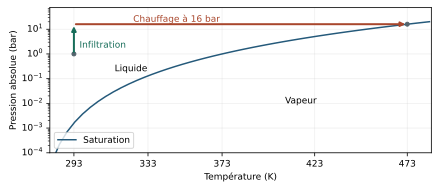
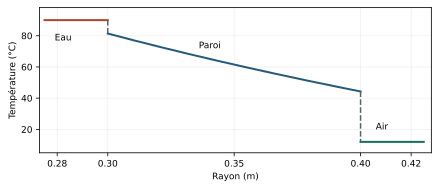
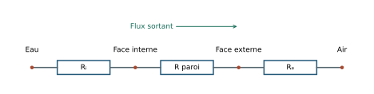
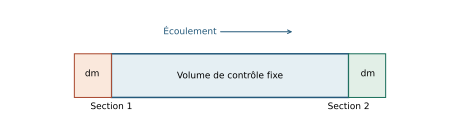
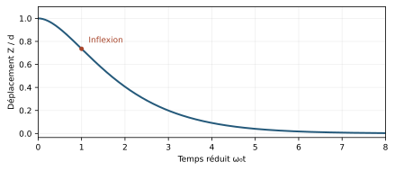
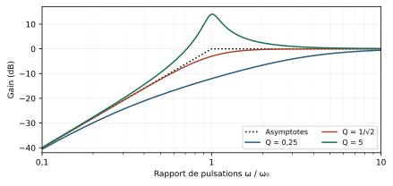

# Banque PT 2023 — Physique A · Corrigé brut

*Corrigé rédigé par IA, non officiel. Signalez toute erreur.*

**Rédaction** · GPT-6.2 Astra Ultra · vitesse non renseignée

**Révision (tour 1)** · GPT-6.2 Astra Ultra · vitesse non renseignée

Balade islandaise. Épreuve de quatre heures, sans calculatrice. Les pages du sujet sont comptées depuis la couverture. [Sujet et documents, p. 1–13](https://www.banquept.fr/documents/2023/ph_a_2023_pt.pdf) · [Rapport du jury, p. 1–3](https://www.banquept.fr/documents/ecrit/rapport/2023/rapport_phys_a_ecrit_2023.pdf)

## I. Les geysers

### Q1. Équilibre de la tranche

Prenons la verticale $z$ orientée vers le haut. Sur la tranche de section $S$ entre $z$ et $z+dz$, l'eau du dessous exerce $+P(z)S\vec e_z$, celle du dessus $-P(z+dz)S\vec e_z$. Les pressions latérales se compensent. Le poids vaut $-\rho S\,dz\,g_0\vec e_z$. L'équilibre donne $[P(z)-P(z+dz)]S-\rho S\,dz\,g_0=0$, donc $dP/dz=-\rho g_0$. Dans toute direction, la résultante des forces de pression sur un petit volume $dV$ vaut $-\nabla P\,dV$. Ainsi $\boxed{\nabla P=\rho\vec g}$, en $\mathrm{N\,m^{-3}}$.

### Q2. Pression à la profondeur H

L'intégration avec $P(0)=P_0$ donne $P(z)=P_0-\rho g_0z$. La cavité est à $z=-H$. Sa surpression vaut $\Delta P=\rho g_0H=1000\times10\times150=1{,}5\times10^6\ \mathrm{Pa}=15\ \mathrm{bar}$. Sa pression absolue, qui intervient dans le changement d'état, vaut **16 bar**.

### Q3. État de l'eau à l'infiltration

L'infiltration est rapide devant le réchauffement, si bien que $T\simeq293\ \mathrm K$. La loi du sujet donne $P_{\rm sat}=P_0(20/100)^4=0{,}0016\ \mathrm{bar}$. Même à l'ouverture, $P_0>P_{\rm sat}$, et la pression croît au cours de la descente. À cette température, l'eau reste dans le domaine du liquide. La figure fait aussi apparaître le parcours ultérieur à pression pratiquement constante jusqu'à la première bulle.

### Q4. Seuil d'ébullition en profondeur

La première vapeur apparaît quand $P_{\rm sat}(T)=P_0+\rho g_0H$. En prenant la racine quatrième positive de la relation empirique, on trouve, avec $T$ en kelvins,
$$
T(H)=273+100\left(1+\frac{\rho g_0H}{P_0}\right)^{1/4}.
$$
La colonne au-dessus de la cavité élève la température d'ébullition.

### Q5. Température et masse

Pour $H=150\ \mathrm m$, le rapport des pressions est 16, dont la racine quatrième est 2. La température vaut **473 K**, soit environ **200 °C**. Initialement le litre de liquide a pour masse $\rho V_0=10^3\times 10^{-3}=1\ \mathrm{kg}$. La vaporisation totale de l'eau présente dans la cavité produit donc **1 kg de vapeur**.

### Q6. Volume de vapeur et cycle du geyser

À la pression initiale de 16 bar, la vapeur idéale de masse $m$ occuperait $V=(m/M)RT/P\simeq(1/0{,}018)\times8{,}3\times473/(16\times10^5)=0{,}136\ \mathrm{m^3}$. L'ordre de grandeur demandé est **une centaine de litres**. Ce volume dépasse le litre disponible et la vapeur chasse de l'eau vers la cheminée. La colonne s'allège, la pression et la température d'ébullition baissent, puis une nouvelle fraction du liquide chaud se vaporise et amplifie l'éjection. La pression varie donc pendant l'éruption. Le réservoir doit ensuite se remplir et se réchauffer avant le prochain jaillissement. Une roche suffisamment imperméable confine l'eau et la vapeur et les canalise vers la cheminée.

## II. Le transport d'eau chaude pour le chauffage

### Q7. Loi de Fourier

Dans un solide isotrope au repos, $\vec j_Q=-\lambda\nabla T$. Le gradient de température, en $\mathrm{K\,m^{-1}}$, pointe vers les températures croissantes. La conductivité $\lambda>0$, en $\mathrm{W\,m^{-1}\,K^{-1}}$, mesure l'aptitude du milieu à conduire la chaleur. Le vecteur densité de courant thermique $\vec j_Q$, en $\mathrm{W\,m^{-2}}$, pointe vers le froid. La puissance thermique algébrique à travers une surface orientée vaut $\phi=\int_S\vec j_Q\cdot d\vec S$, en watts.

### Q8. Conservation de la puissance

Sur le tronçon entre deux sections, le bilan d'énergie est $dU/dt=\phi(z_1)-\phi(z_2)$, car la paroi est calorifugée et il n'y a aucune source volumique. En régime stationnaire $dU/dt=0$, donc les deux sections sont traversées par la même puissance orientée vers les $z$ croissants.

### Q9. Profil dans la barre et flux

La section et la conductivité sont constantes. La relation $\phi=-\lambda S\,dT/dz$ impose une pente constante. Avec les deux températures imposées,
$$
T(z)=T_0+(T_1-T_0)\frac zL,\qquad
\phi=\frac{\lambda S}{L}(T_0-T_1).
$$
Si $T_0>T_1$, le flux est positif dans le sens choisi.

### Q10. Résistance thermique de la barre

Avec le flux orienté de 0 vers $L$, on définit $\mathcal R=(T_0-T_1)/\phi$. La loi précédente donne $\boxed{\mathcal R=L/(\lambda S)}$ en $\mathrm{K\,W^{-1}}$. Allonger la barre à section constante augmente sa résistance.

### Q11. Résistance de la paroi cylindrique

Notons $R_i=R_{\min}$, $R_e=R_{\max}$, et comptons la puissance sortante positive. En régime radial stationnaire, $\phi_{\rm sort}=-2\pi r\ell\lambda\,dT/dr$ est constante. L'intégration de $R_i$ à $R_e$ donne
$$
T_{Si}-T_{Se}=\phi_{\rm sort}\mathcal R_c,\qquad
\mathcal R_c=\frac{\ln(R_e/R_i)}{2\pi\lambda\ell}.
$$
La différence de températures imprimée dans le sujet est écrite dans l'ordre inverse et correspond à un flux positif vers l'intérieur. La résistance est positive dans les deux conventions. Pour $\ell=1\ \mathrm m$, $\mathcal R_c=\ln(4/3)/(2\pi)\simeq0{,}046\ \mathrm{K\,W^{-1}}$, ou environ $0{,}048$ avec le logarithme fourni.

### Q12. Profil radial aux deux interfaces

Dans le modèle de températures moyennes des fluides, la courbe passe de $T_{\rm eau}$ à $T_{Si}$ par une première chute à $R_i$. Dans la paroi,
$$
T(r)=T_{Si}-\frac{\phi_{\rm sort}}{2\pi\lambda\ell}\ln(r/R_i).
$$
Le profil décroît, avec une pente de moins en moins forte en valeur absolue. À $R_e$, une seconde chute relie $T_{Se}$ à $T_{\rm ext}$. Les deux sauts représentent les couches d'échange des fluides dans la loi de Newton.

### Q13. Résistances aux échanges avec les fluides

La loi de Newton appliquée à la surface latérale donne $\phi_{\rm sort}=h(2\pi R_i\ell)(T_{\rm eau}-T_{Si})=h'(2\pi R_e\ell)(T_{Se}-T_{\rm ext})$. Ainsi $\mathcal R_i=1/(2\pi R_i\ell h)$ et $\mathcal R_e=1/(2\pi R_e\ell h')$. Sur un mètre, pour $h=50$ et $h'=10\ \mathrm{W\,m^{-2}\,K^{-1}}$, elles valent respectivement **0,0106 et 0,0398 K/W**.

### Q14. Circuit thermique équivalent

La même puissance traverse les trois résistances et les différences de température s'ajoutent. Les résistances sont donc en série. Pour la longueur $\ell$, $\phi_{\rm sort}=G_{\rm lin}\ell(T_{\rm eau}-T_{\rm ext})$, avec
$$
G_{\rm lin}=\frac{1}{\ell(\mathcal R_i+\mathcal R_c+\mathcal R_e)}
=\frac{2\pi}{1/(hR_i)+\ln(R_e/R_i)/\lambda+1/(h'R_e)} .
$$

### Q15. Conductance par unité de longueur

Pour un mètre, la somme vaut $0{,}0106+0{,}0458+0{,}0398=0{,}0962\ \mathrm{K\,W^{-1}}$. Ainsi $G_{\rm lin}\simeq10{,}4\ \mathrm{W\,m^{-1}\,K^{-1}}$, d'ordre **10 W par mètre et par kelvin**. Pour la suite, on emploie la valeur prescrite $11\ \mathrm{W\,m^{-1}\,K^{-1}}$.

### Q16. Premier principe industriel

On entoure une portion fixe de l'écoulement. En un temps $dt$, une masse $dm=\dot m\,dt$ entre en 1 et la même masse sort en 2. Comparons le même système matériel aux deux instants. Il est constitué du volume de contrôle plus la tranche entrante au début, et de ce volume plus la tranche sortante à la fin. Le contenu du volume fixe conserve son énergie totale en régime stationnaire. La variation d'énergie du système matériel est donc $dm\,\Delta(u+v^2/2+gz)$.

Le fluide amont fournit $+p_1\nu_1dm$ et le système fournit $p_2\nu_2dm$ au fluide aval, où $\nu=1/\rho$ est le volume massique. Les autres apports sont la chaleur $q\,dm$ et le travail utile, par exemple d'un arbre, $w_u\,dm$. Le premier principe donne, en réunissant les termes de pression avec $u$,
$$
\boxed{\Delta h+\Delta e_{\rm mec}=q+w_u},\qquad
h=u+p\nu,\quad e_{\rm mec}=v^2/2+gz.
$$
Toutes ces énergies sont massiques, en $\mathrm{J\,kg^{-1}}$. Les apports reçus sont positifs et $\Delta$ signifie sortie moins entrée.

### Q17. Vitesse de l'eau

Le débit volumique est $D_v=500\ \mathrm{L\,s^{-1}}=0{,}500\ \mathrm{m^3\,s^{-1}}$. La vitesse moyenne vaut $v=D_v/(\pi R_i^2)\simeq1{,}77\ \mathrm{m\,s^{-1}}$. Le débit massique $\rho Sv$ se conserve en régime stationnaire. Comme l'eau est incompressible et la section constante, la vitesse moyenne est la même tout le long du tuyau. Utiliser cette vitesse dans toute la section relève du modèle unidimensionnel à frottement négligé.

### Q18. Bilan local du refroidissement

Sur le tronçon de longueur $dx$, le fluide reçoit la puissance thermique $G_{\rm lin}(T_{\rm ext}-T(x))\,dx$. Aucun arbre n'agit, la vitesse est constante et on néglige la variation d'altitude. Avec une perte de charge négligeable et de l'eau liquide de capacité $c$, $dh\simeq c\,dT$. En multipliant le principe industriel par $\dot m=\rho D_v$, on trouve
$$
\rho D_v c\,[T(x+dx)-T(x)]=G_{\rm lin}[T_{\rm ext}-T(x)]\,dx
$$
au premier ordre en $dx$. Les deux membres sont des puissances, négatives pour une eau plus chaude que l'air.

### Q19. Équation et longueur caractéristique

Après division par $\rho D_vc\,dx$,
$$
\frac{dT}{dx}+\frac{T}{\delta}=\frac{T_{\rm ext}}{\delta},\qquad
\delta=\frac{\rho D_vc}{G_{\rm lin}}.
$$
Le numérateur se mesure en $\mathrm{W\,K^{-1}}$ et le dénominateur en $\mathrm{W\,K^{-1}\,m^{-1}}$, donc $\delta$ est une longueur. Elle vaut $1000\times0{,}5\times4200/11\simeq1{,}91\times10^5\ \mathrm m$.

### Q20. Température le long de la conduite

L'écart $Y=T-T_{\rm ext}$ vérifie $Y'=-Y/\delta$. Pour un air de température constante et une entrée à $T_0$, $\boxed{T(x)=T_{\rm ext}+(T_0-T_{\rm ext})e^{-x/\delta}}$. La formule retrouve $T_0$ à l'entrée et tend vers la température extérieure très loin en aval.

### Q21. Arrivée à Reykjavik

Sur 50 km, $x/\delta\simeq0{,}262$. Avec l'arrondi autorisé $\delta\simeq200\ \mathrm{km}$ et $e^{-0{,}25}\simeq0{,}78$, on trouve en été $285+78\times0{,}78\simeq346\ \mathrm K$, soit **73 °C**, et en hiver $273+90\times0{,}78\simeq343\ \mathrm K$, soit **70 °C**. En gardant $\delta=190{,}9\ \mathrm{km}$, le facteur vaut 0,770 et l'on obtient environ **72 °C en été, 69 °C en hiver**, avec la conversion arrondie du sujet.

### Q22. Échelles d'énergie et de flux

La descente de 240 à 40 m donne $\Delta e_p=g_0(40-240)=-2{,}0\ \mathrm{kJ\,kg^{-1}}$. La diminution d'enthalpie thermique vaut environ $c|\Delta T|=75$ à $87\ \mathrm{kJ\,kg^{-1}}$. L'altitude représente environ 2 à 3 % de ce terme.

À l'entrée en été, $|dT/dx|=78/\delta\simeq4{,}1\times10^{-4}\ \mathrm{K\,m^{-1}}$. Dans un mètre de paroi, la puissance sortante est d'environ $8\times10^2\ \mathrm W$, d'où une chute dans le matériau d'environ $37\ \mathrm K$ sur $0{,}10\ \mathrm m$. Le gradient radial est donc de l'ordre de $4\times10^2\ \mathrm{K\,m^{-1}}$. À conductivité identique, la densité de flux longitudinal y est de l'ordre du millionième du flux radial. Même en puissance, la conduction longitudinale à travers la section annulaire vaut environ $\lambda\pi(R_e^2-R_i^2)|dT/dx|\simeq9\times10^{-5}\ \mathrm W$. Le profil radial de II-A s'applique ainsi localement, même si la température moyenne baisse sur les 50 km. L'axe longitudinal appelé $z$ à Q22 est l'axe $x$ de la figure 4.

## III. Les centrales géothermiques

### Q23. Conversions et pertes de la centrale

La vapeur se détend dans la turbine et lui cède de l'énergie portée par l'écoulement. L'arbre transmet de l'énergie mécanique de rotation à l'alternateur, qui fournit de l'énergie électrique alternative au transformateur. La turbine et l'alternateur réalisent chacun une conversion entre deux formes d'énergie et sont des transducteurs. Dans le pompage, le moteur et la pompe convertissent aussi l'énergie électrique en travail mécanique puis en énergie hydraulique. Le transformateur élève la tension électrique tout en abaissant le courant.

Des pertes de charge et des fuites thermiques accompagnent le pompage et le transport. La turbine évacue un fluide encore énergétique et subit les irréversibilités de la détente et des frottements. L'alternateur et le transformateur dissipent de l'énergie par effet Joule dans les enroulements et par pertes magnétiques dans les noyaux. S'ajoutent les pertes mécaniques dans les pièces mobiles et l'effet Joule dans la ligne.

### Q24. Émissions annuelles de dioxyde de carbone

Pour 365 jours à la puissance nette constante de 80 MW, $E=80\times10^3\times365\times24=7{,}008\times10^8\ \mathrm{kWh}$. À $80\ \mathrm{g/kWh}$, la centrale géothermique émet $5{,}6064\times10^{10}\ \mathrm g$, soit environ **56 000 tonnes de CO₂**. À $1\ \mathrm{kg/kWh}$, la centrale à charbon équivalente émet **700 800 tonnes**, soit 12,5 fois plus. L'écart est d'environ 645 000 tonnes pour cette production annuelle.

### Q25. Origine de l'induction

Le champ extérieur $\vec B=B_0\vec e_x$ est constant dans le laboratoire. C'est la normale à la spire qui tourne. Le flux à travers les $N$ spires varie donc avec l'orientation, d'où une force électromotrice selon la loi de Faraday. Le circuit étant fermé, cette tension induite fait circuler un courant.

### Q26. Courant fourni par l'alternateur

Choisissons la normale initiale parallèle à $\vec B$ et le sens positif du courant associé à cette normale. Pour une spire de côté $2a$, $S=4a^2$. Le flux lié est $\Phi=N B_0 S\cos\theta$ et $\theta=\omega t$. D'où
$$
e=-\frac{d\Phi}{dt}=NB_0S\omega\sin\theta,\qquad
i=\frac{NB_0S\omega}{R}\sin\theta .
$$
On a négligé le champ propre et utilisé le modèle de circuit résistif donné. Le courant qui alimente le primaire est alternatif sinusoïdal, de moyenne nulle, de fréquence $f=\omega/(2\pi)$. Dans ce modèle son amplitude est $I_m=NB_0S\omega/R$ et sa valeur efficace $I_m/\sqrt2$.

### Q27. Moment des forces de Laplace

Avec $\vec n=\cos\theta\,\vec e_x+\sin\theta\,\vec e_y$, le moment magnétique est $\vec M=NiS\vec n$. Le couple $\vec\Gamma_L=\vec M\times\vec B$ vaut donc
$$
\vec\Gamma_L=-NB_0Si\sin\theta\,\vec e_z
=-\frac{(NB_0S)^2}{R}\,\omega\sin^2\theta\,\vec e_z .
$$
Il s'oppose à la rotation, et s'annule lorsque le courant s'annule. C'est l'effet modérateur de Lenz.

### Q28. Couple nécessaire pour entretenir la rotation

Le moment cinétique axial est constant puisque la vitesse angulaire est imposée. Le théorème du moment cinétique donne $\Gamma_{\rm arbre}+\Gamma_L=0$ en négligeant les frottements. Le couple fourni par la turbine vaut donc $+(NB_0S)^2\omega\sin^2\theta/R$ selon $\vec e_z$. Il est **moteur** et doit varier au cours du tour pour compenser exactement le freinage instantané.

### Q29. Puissance mécanique et puissance électrique

La puissance instantanée des forces de Laplace est $\mathcal P_L=\vec\Gamma_L\cdot\vec\omega$. Puisque $\langle\sin^2\omega t\rangle=1/2$,
$$
\langle\mathcal P_L\rangle=-\frac{(NB_0S\omega)^2}{2R},\qquad
\langle\mathcal P_J\rangle=R\langle i^2\rangle=+\frac{(NB_0S\omega)^2}{2R}.
$$
Le travail mécanique fourni par l'arbre compense le freinage électromagnétique. La puissance électrique correspondante est entièrement reçue par la résistance du modèle.

### Q30. Bilan d'un transformateur parfait

Posons $m=N_2/N_1$. Avec les deux courants entrant par les bornes indiquées sur la figure 7, $u_2=mu_1$ et $i_2=-i_1/m$. La puissance reçue au primaire est $p_1=u_1i_1$. La puissance cédée au circuit secondaire est $-u_2i_2=u_1i_1$. L'égalité est instantanée et vaut donc aussi en moyenne.

### Q31. Impédance ramenée au primaire

Le courant reçu par la charge est $-\underline I_2$, d'où $Z_c=\underline U_2/(-\underline I_2)$. En substituant les rapports de transformation, on trouve $\boxed{Z_{\rm ent}=\underline U_1/\underline I_1=Z_c/m^2}$. Une résistance passive au secondaire présente bien une résistance positive au primaire.

### Q32. Admittance de la ligne ramenée au primaire

Les admittances des deux branches en parallèle s'ajoutent. À la pulsation $\omega$, $Y_c=1/R+j\omega C$. Par inversion du résultat de Q31, $\boxed{Y_{\rm ent}=m^2(1/R+j\omega C)}$, en siemens. Le modèle primaire équivalent porte donc une capacité $m^2 C$ en dérivation.

### Q33. Rapport de transformation

Les valeurs efficaces se transforment dans le même rapport que les amplitudes. Ainsi $N_2/N_1=132/11=\boxed{12}$. Il s'agit d'un élévateur.

### Q34. Variation de vitesse et résonance

Le jury attend l'identification d'une **résonance**. Si les pertes sont faibles, l'inductance série $L$ de l'alternateur et la capacité ramenée $C_{\rm ent}=m^2C$ échangent de l'énergie. En faisant varier la vitesse, on fait varier la pulsation électrique. Près de $\omega=1/\sqrt{L m^2 C}$, les réactances série se compensent et le courant peut présenter un maximum marqué.

La formulation « résistance $R$ négligeable » demande une précision. Dans le schéma *parallèle* de Q32, la branche résistive est négligeable lorsque sa **conductance** $1/R$ est faible devant $\omega C$. Si l'on prend littéralement $R\to0$, la charge ramenée $1/[m^2(1/R+j\omega C)]$ tend vers zéro à toute pulsation finie. La capacité est court-circuitée et cette limite ne produit pas la résonance LC décrite ci-dessus.

### Q35. Pertes dans la ligne résistive

Notons $U_s$ la tension efficace en sortie de l'élévateur, $I$ le courant efficace et $R'$ la charge de la figure 8. Les résistances sont en série. On a
$$
U_s=(r+R')I,\qquad p=R'I^2,\qquad P_J=rI^2=\frac{r}{R'}p
=\frac{rp^2}{U_s^2}\left(1+\frac r{R'}\right)^2 .
$$
Le jury signale l'omission de $R'$ dans les données demandées. Si l'on souhaite éliminer $R'$ exactement, $p=U_s I-rI^2$. Pour $r>0$ et $4rp\le U_s^2$, la solution de faible courant, continue en $r=0$, donne
$$
I=\frac{2p}{U_s+\sqrt{U_s^2-4rp}},\qquad P_J=rI^2 .
$$
L'autre racine correspond à une charge de plus faible résistance et à de plus fortes pertes. La branche de transport usuelle vérifie $r\ll R'$, pour laquelle $I\simeq p/U_s$ et $P_J\simeq rp^2/U_s^2$.

### Q36. Intérêt de la haute tension

À même puissance utile, une tension de transport plus élevée exige moins de courant. Lorsque la chute de tension de ligne est petite, multiplier $U_s$ par 12 divise l'intensité par 12 et les pertes Joule par $12^2=\boxed{144}$. Cette comparaison suppose la charge effective adaptée à la puissance utile dans les deux configurations. Pour une chute non négligeable, il faut utiliser la tension reçue $U_s-rI$ ou le bilan exact de Q35.

## IV. Le sismographe vertical

### Q37. Longueur à l'équilibre

Ici la verticale est orientée vers le bas. Le poids vaut $+Mg_0$ et le ressort exerce $-k(L-L_0)$. Sur le plateau immobile, l'équilibre donne $\boxed{L_{\rm eq}=L_0+Mg_0/k=L_0+g_0/\omega_0^2}$. Le poids allonge le ressort.

### Q38. Équation du déplacement relatif

La seconde loi de Newton, projetée vers le bas, donne $M\ddot L=Mg_0-k(L-L_0)-2\lambda M\dot L$. Poser $Z=L-L_{\rm eq}$ élimine les termes constants grâce à l'équilibre précédent. Il reste
$$
\boxed{\ddot Z+2\lambda\dot Z+\omega_0^2 Z=0},\qquad \omega_0^2=k/M .
$$

### Q39. Amortissement critique

Les exposants $s$ vérifient $s^2+2\lambda s+\omega_0^2=0$. Le régime critique correspond à la racine double $s=-\omega_0$, pour $\boxed{\lambda=\omega_0}$. La solution générale est $Z(t)=(A+Bt)e^{-\omega_0 t}$, où $A,B$ sont fixées par les conditions initiales.

### Q40. Retour critique sans vitesse initiale

Pour $Z(0)=d$ et $\dot Z(0)=0$, on trouve $A=d$ et $B=\omega_0d$, donc $Z=d(1+\omega_0 t)e^{-\omega_0t}$. Sa pente $-d\omega_0^2t e^{-\omega_0t}$ est nulle à l'origine, puis négative si $d>0$. Le déplacement tend vers zéro sans franchissement et s'infléchit à $t=1/\omega_0$. Pour $d<0$, la courbe est symétrique par rapport à l'axe du temps.

### Q41. Excitation par le mouvement du sol

La coordonnée absolue de la masse est, à une constante d'origine près, $z_P=z_\Sigma+L_{\rm eq}+Z$. Les forces élastique et visqueuse répondent à la longueur relative et à sa dérivée. La seconde loi de Newton dans le référentiel terrestre s'écrit donc
$$
\ddot Z+2\lambda\dot Z+\omega_0^2 Z=-\ddot z_\Sigma .
$$
Pour $z_\Sigma=\Re(z_m e^{j\omega t})$, en régime forcé permanent, les dérivées correspondent à des multiplications par $j\omega$. Avec $r=\omega/\omega_0$ et $Q=\omega_0/(2\lambda)$,
$$
\underline A_m=z_m\frac{\omega^2}{\omega_0^2-\omega^2+2j\lambda\omega}
=z_m\frac{r^2}{1-r^2+jr/Q}.
$$
Au régime critique $Q=1/2$ et $\underline A_m=z_m r^2/(1+jr)^2$, de module $z_m r^2/(1+r^2)$.

### Q42. Existence et position du maximum

Pour $z_m>0$, $A_m/z_m=r^2/\sqrt{(1-r^2)^2+r^2/Q^2}$. Posons $u=r^2$. Le carré du gain vaut $F(u)=u^2/[u^2+(Q^{-2}-2)u+1]$. Le signe de sa dérivée pour $u>0$ est celui de $2+(Q^{-2}-2)u$. Il y a un maximum à pulsation finie si et seulement si $Q>1/\sqrt2$. Au seuil, la réponse reste croissante et tend vers le plateau de haute fréquence. Pour $Q$ au-dessus du seuil,
$$
\omega_{\max}=\frac{\omega_0}{\sqrt{1-1/(2Q^2)}},\qquad
A_{\max}=\frac{Qz_m}{\sqrt{1-1/(4Q^2)}}.
$$
La première formule provient de l'annulation de $F'$ et la seconde de la substitution dans $F$. Pour $Q\gg1$, $\omega_{\max}\simeq\omega_0[1+1/(4Q^2)]\simeq\omega_0$ et $A_{\max}\simeq Qz_m$.

### Q43. Allure du diagramme de Bode

En basse fréquence $H=\underline A_m/z_m\sim r^2$. Le gain $20\log_{10}|H|$ suit donc $40\log_{10}r$, de pente **+40 dB par décade**, et la phase tend vers zéro. À haute fréquence $H\to-1$. Le module tend vers 1, le gain vers **0 dB** et la phase vers $-\pi$. C'est un passe-haut du second ordre.

À $r=1$, $H=Q/j$ et le gain vaut $20\log_{10}Q$. Les courbes de la figure 10 pour $Q=0{,}25$ et $Q=1/\sqrt2$ montent sans pic. Celle pour $Q=5$ présente un pic d'environ 14 dB juste au-dessus de $r=1$, comme le prévoit Q42. Toutes ont les deux asymptotes précédentes.

### Q44. Choix de la pulsation propre

Pour mesurer le mouvement sur toute la bande $[\omega_1,\omega_2]$, on place la bande dans le plateau de haute fréquence, donc on choisit $\omega_0\ll\omega_1$. On vérifie également que $2\lambda/\omega_1\ll1$ si l'amortissement est fort. Alors $H\simeq-1$ sur toute la bande et $Z(t)\simeq-z_\Sigma(t)$. La masse demeure presque fixe dans le référentiel terrestre tandis que le support suit le sol. L'inversion du signe du déplacement mesuré restitue le mouvement vertical du sol.
