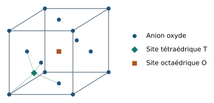
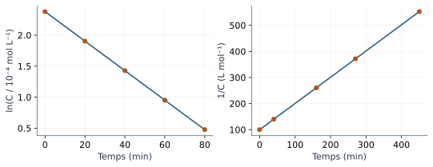
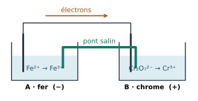
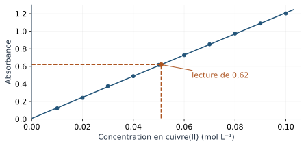
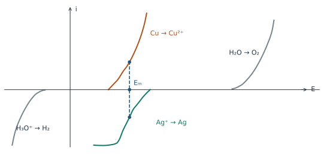

# Banque PT — Physique B, chimie 2023 · Corrigé guidé

*Corrigé rédigé par IA, non officiel. Signalez toute erreur.*

**Rédaction** · GPT-6.2 Astra Ultra · vitesse non renseignée · 26 novembre 2026

**Révision** · GPT-6.2 Astra Ultra · vitesse non renseignée · 26 novembre 2026

L’écrit de chimie « Autour des métaux de transition » dure deux heures. Le fascicule comprend six parties indépendantes et un document-réponse pour la question 36. Le rapport de Physique B consacre ses deux premières pages à la chimie. Le livret attribue le coefficient 2 à Physique B pour les ENS Paris-Saclay et Rennes.

[Sujet et document-réponse](https://www.banquept.fr/documents/2023/ph_b_ch_2023_pt.pdf) · [Rapport du jury](https://www.banquept.fr/documents/ecrit/rapport/2023/rapport_phys_b_ecrit_2023.pdf) · [Livret, p. 13](https://www.banquept.fr/documents/livret/2023/Livret_PT_2023.pdf#page=13)

## A — Structure de la chromite

### Q1 — Maille des anions et localisation des cavités

> [!INDICATION]
> Situer d’abord les centres des anions. Les huit petits cubes d’arête $a/2$ ont chacun un centre, et les sites de coordinence six s’observent sur les axes de la maille.

Les anions occupent les huit sommets et les centres des six faces. En coordonnées réduites, les huit sites tétraédriques ont pour coordonnées toutes les combinaisons de $1/4$ et $3/4$. Le site $(1/4,1/4,1/4)$ est à égale distance de l’origine et des trois centres des faces qui la touchent. Les sites octaédriques sont au centre $(1/2,1/2,1/2)$ et au milieu des douze arêtes. Les six centres de faces entourent le site central.

### Q2 — Population d’anions

> [!INDICATION]
> Combien de cubes adjacents se partagent un sommet ? Et une face ?

Un ion d’un sommet compte pour $1/8$ et celui d’une face pour $1/2$. La maille contient donc $8/8+6/2=4$ ions oxyde.

### Q3 — Occupation des sites

> [!INDICATION]
> Appliquer les fractions d’occupation aux nombres de sites qui appartiennent effectivement à une maille.

Les huit sites tétraédriques sont intérieurs. Les sites octaédriques comptent pour $1+12/4=4$ par maille. On trouve ainsi $8\times(1/8)=1$ ion fer(II) et $4\times(1/2)=2$ ions chrome par maille anionique.

### Q4 — Formule et degré d’oxydation

> [!INDICATION]
> Écrire l’électroneutralité avec le rapport des populations, puis isoler la charge d’un ion chrome.

La formule est $\mathrm{FeCr_2O_4}$. Pour une charge $t$ par ion chrome en unités de charge élémentaire, $2+2t-8=0$, d’où $t=3$. Il s’agit de $\mathrm{Cr^{3+}}$.

### Q5 — Rayons maximaux des sites

> [!INDICATION]
> Calculer pour chaque site la distance entre son centre et le centre d’un anion voisin. La distance entre les deux centres vaut la somme des rayons au contact.

Pour le site octaédrique central, la distance au centre d’une face est $a/2$. On trouve $r_{\rm oct}=a/2-r_{\rm O}=210-140=70\,\mathrm{pm}$. Pour le site tétraédrique voisin de l’origine, la distance au sommet est $\sqrt3\,a/4$, d’où $r_{\rm tet}=\sqrt3\,a/4-r_{\rm O}\simeq42\,\mathrm{pm}$. Ces calculs utilisent le paramètre $a$ fourni. Le feuillet indique que les anions ne sont pas tangents.

### Q6 — Limite du modèle de sphères

> [!INDICATION]
> Comparer chaque cation à la cavité que lui attribue le feuillet.

Le rayon de $\mathrm{Cr^{3+}}$, $61{,}5\,\mathrm{pm}$, est inférieur de $8{,}5\,\mathrm{pm}$ à la limite octaédrique idéale. Le rayon de $\mathrm{Fe^{2+}}$, $76\,\mathrm{pm}$, dépasse d’environ $34\,\mathrm{pm}$ la limite tétraédrique. Un réseau idéal rigide avec ces rayons ne reproduit donc pas simultanément la géométrie et les occupations réelles. Une déformation locale des sites et le caractère effectif des rayons ioniques peuvent expliquer l’écart.

### Q7 — Masse volumique

> [!INDICATION]
> Employer la masse du contenu de la maille et le volume géométrique du cube.

La maille du réseau anionique décrite contient une unité de formule. Sa masse est $[M(\mathrm{Fe})+2M(\mathrm{Cr})+4M(\mathrm O)]/N_{\rm A}$. Ainsi $\rho=[M(\mathrm{Fe})+2M(\mathrm{Cr})+4M(\mathrm O)]/(N_{\rm A}a^3)$. Avec les masses molaires en kilogrammes par mole et $a$ en mètres, on obtient des kilogrammes par mètre cube.

## B — Exploitation des mesures cinétiques

### Q8 — Loi différentielle de vitesse

> [!INDICATION]
> Les ordres partiels sont les exposants de la loi expérimentale. Les coefficients de l’équation relient les variations de concentration à l’avancement.

Posons $C=[\mathrm{HCrO_4^-}]$, $h=[\mathrm H^+]$ et $x$ l’avancement volumique en $\mathrm{mol\,L^{-1}}$. À température et volume constants, $v=dx/dt=k[A]^\alpha C^\beta h^\gamma$. La stœchiométrie donne $[A]=a-3x$, $C=b-2x$, $h=h_0-8x$ et $[\mathrm{Cr^{3+}}]=2x$.

### Q9 — Première expérience et ordre apparent

> [!INDICATION]
> Majorer la consommation des deux réactifs en excès par leur consommation lorsque l’oxydant a disparu.

Dans le tableau 1, $x\leq b/2$. L’alcool perd au plus $3b/2=0{,}00162\,\mathrm{mol\,L^{-1}}$ sur $0{,}080$ et l’acide $4b=0{,}00432\,\mathrm{mol\,L^{-1}}$ sur $0{,}270$. Leurs concentrations varient donc d’au plus $2{,}1\,\%$ et $1{,}6\,\%$. La dégénérescence de l’ordre donne $v\simeq k_1 C^\beta$, avec $k_1=k a^\alpha h_{0,1}^\gamma$.

### Q10 — Pente logarithmique et première constante

> [!INDICATION]
> La vitesse de disparition de l’oxydant vaut deux fois la vitesse de réaction. Chercher la concentration dont le logarithme varie linéairement.

La grandeur suivie est $C$, donc $v=-\tfrac12\,dC/dt$. La figure 1 donne une droite pour $\ln C$ en fonction du temps. La loi $dC/dt=-2k_1 C$ s’intègre en $\ln(C/b)=-2k_1t$ et identifie $\beta=1$. La pente vaut $-0{,}0238\,\mathrm{min^{-1}}$, donc $k_1=0{,}0119\,\mathrm{min^{-1}}$. L’ordonnée à l’origine imprimée correspond au logarithme du nombre dans le tableau, exprimé en unités de $10^{-4}\,\mathrm{mol\,L^{-1}}$. Le choix de cette unité ajoute une constante verticale et conserve la pente.

### Q11 — Deuxième expérience et acidité

> [!INDICATION]
> Majorer la consommation en acide à partir de la quantité initiale d’oxydant, puis comparer les ordres de grandeur.

Dans le tableau 2, $b'=0{,}010\,\mathrm{mol\,L^{-1}}$ et $h_{0,2}=0{,}405\,\mathrm{mol\,L^{-1}}$. La consommation maximale d’acide est $4b'=0{,}040\,\mathrm{mol\,L^{-1}}$, soit environ $10\,\%$ de la valeur initiale. Au dernier point mesuré elle vaut $4\times0{,}00819$, soit $8{,}1\,\%$. L’hypothèse d’acidité quasi constante est ici une approximation. Avec $\beta=1$, $v\simeq k h_{0,2}^\gamma [A]^\alpha C$.

### Q12 — Rapport stœchiométrique et seconde constante

> [!INDICATION]
> Si $a'/b'=3/2$, soustraire $3x$ au numérateur et $2x$ au dénominateur.

Comme $a'=0{,}015=(3/2)b'$ en $\mathrm{mol\,L^{-1}}$, on a $[A]=a'-3x=(3/2)(b'-2x)=(3/2)C$ à tout instant. Ainsi $v=k_2C^{\alpha+1}$, où $k_2=k(3/2)^\alpha h_{0,2}^\gamma$.

### Q13 — Droite des concentrations inverses

> [!INDICATION]
> Exprimer l’oxydant restant en fonction du chrome(III) mesuré et rechercher la loi différentielle dont l’inverse s’intègre en une droite.

Le tableau donne $C=b'-[\mathrm{Cr^{3+}}]$. La figure 2 représente $1/C$ en fonction de $t$. Sa linéarité signifie $d(1/C)/dt=-C^{-2}dC/dt=2k_2$, d’où $\alpha+1=2$ et $\alpha=1$. L’intégration donne
$$
\frac{1}{b'-[\mathrm{Cr^{3+}}]}-\frac{1}{b'}=2k_2t.
$$
L’ordonnée initiale $1/b'=100\,\mathrm{L\,mol^{-1}}$ est cohérente avec $99{,}924$ lu sur la droite. La pente $1{,}0057\,\mathrm{L\,mol^{-1}\,min^{-1}}$ conduit à $k_2\simeq0{,}503\,\mathrm{L\,mol^{-1}\,min^{-1}}$.

### Q14 — Ordre en protons et dimension de la constante

> [!INDICATION]
> Éliminer $k$ entre les deux constantes apparentes en tenant compte de la présence du rapport $3/2$ dans la seconde.

Avec $\alpha=1$, $k_1/a=kh_{0,1}^{\gamma}$ et $k_2/(3/2)=kh_{0,2}^{\gamma}$. Le quotient des deux égalités conduit à
$$
\gamma=\frac{\ln\!\left(2ak_2/(3k_1)\right)}{\ln(h_{0,2}/h_{0,1})}.
$$
On retrouve $\gamma=2$ à l’arrondi des données. On détermine ensuite $k=k_1/(a h_{0,1}^2)=2k_2/(3h_{0,2}^2)$. L’ordre global est quatre, donc l’unité de $k$ est $\mathrm{L^3\,mol^{-3}\,min^{-1}}$ pour le temps du feuillet.

## C — Équilibre thermodynamique

### Q15 — Grandeurs standard de réaction

> [!INDICATION]
> Multiplier chaque donnée tabulée par son coefficient stœchiométrique algébrique. La vapeur d’eau a ici son enthalpie de formation propre.

Pour $\mathrm{Cr_2O_3(s)+3H_2(g)\rightleftharpoons 2Cr(s)+3H_2O(g)}$, les données à $1300\,\mathrm K$ donnent $\Delta_{\rm r}H^\circ=3(-240)-(-1140)=+420\,\mathrm{kJ\,mol^{-1}}$. De même, $\Delta_{\rm r}S^\circ=2(25)+3(190)-80-3(130)=+150\,\mathrm{J\,mol^{-1}\,K^{-1}}$. Les deux valeurs se rapportent à une mole d’avancement dans le sens écrit.

### Q16 — Déplacement de l’équilibre

> [!INDICATION]
> Distinguer l’effet sur la constante d’équilibre de l’effet sur le quotient de réaction. Compter les moles gazeuses des deux membres.

La réaction est endothermique. La relation de van ’t Hoff, $d\ln K^\circ/dT=\Delta_{\rm r}H^\circ/(RT^2)>0$, montre qu’une augmentation de température favorise thermodynamiquement les produits. À température donnée, un plus petit rapport $p_{\rm H_2O}/p_{\rm H_2}$ abaisse le quotient réactionnel et favorise l’avancement direct. Une variation de pression totale à fractions molaires fixes laisse le quotient inchangé, car les deux membres comportent trois moles de gaz. Les quantités de solides purs n’entrent pas dans le quotient tant que les deux phases sont présentes.

### Q17 — Enthalpie libre et sens d’évolution

> [!INDICATION]
> Employer la même unité d’énergie dans les deux termes de l’enthalpie libre. Préciser ce que son signe indique dans les conditions standard.

À $1300\,\mathrm K$, $\Delta_{\rm r}G^\circ=\Delta_{\rm r}H^\circ-T\Delta_{\rm r}S^\circ=420-1300(0{,}150)=+225\,\mathrm{kJ\,mol^{-1}}$. Le sens direct est défavorisé dans l’état standard. En général, $\Delta_{\rm r}G=RT\ln(Q_{\rm r}/K^\circ)$ détermine le sens spontané. La relation $\Delta_{\rm r}G^\circ=-RT\ln K^\circ$ donne $K^\circ=\exp[-\Delta_{\rm r}G^\circ/(RT)]$.

### Q18 — Ordre de grandeur de la constante

> [!INDICATION]
> Un exposant voisin de $-9\ln10$ correspond à quelle puissance de dix ?

Avec l’énergie en joules et $R=8{,}3\,\mathrm{J\,mol^{-1}\,K^{-1}}$, l’exposant vaut $-225\,000/(8{,}3\times1300)\simeq-20{,}85$. On obtient environ $8{,}8\times10^{-10}$, cohérent avec la valeur arrondie $10^{-9}$ donnée pour la suite. La constante est sans dimension.

### Q19 — Quotient en pressions partielles

> [!INDICATION]
> Remplacer l’activité de chaque gaz parfait par sa pression partielle divisée par la pression standard.

Les solides purs ont une activité égale à un. Pour les gaz parfaits,
$$
Q_{\rm r}=\frac{(p_{\rm H_2O}/p^\circ)^3}{(p_{\rm H_2}/p^\circ)^3}
=\left(\frac{p_{\rm H_2O}}{p_{\rm H_2}}\right)^3.
$$

### Q20 — Tableau d’avancement

> [!INDICATION]
> Faire apparaître une consommation de trois moles de dihydrogène et une production de deux moles de chrome par mole d’avancement.

L’avancement $\xi$ est ici une quantité de matière. Le tableau s’exprime en moles.

| État | $\mathrm{Cr_2O_3(s)}$ | $\mathrm{H_2(g)}$ | $\mathrm{Cr(s)}$ | $\mathrm{H_2O(g)}$ |
|---|---:|---:|---:|---:|
| Initial | $5{,}0\,10^{-4}$ | $0{,}100$ | $0$ | $0$ |
| À $\xi$ | $5{,}0\,10^{-4}-\xi$ | $0{,}100-3\xi$ | $2\xi$ | $3\xi$ |

La positivité donne $0\leq\xi\leq5{,}0\times10^{-4}\,\mathrm{mol}$. Cette borne est l’avancement maximal possible.

### Q21 — Avancement effectivement atteint

> [!INDICATION]
> Prendre la racine cubique de $K^\circ$ avant de résoudre l’équation. Puis vérifier que le solide initial subsiste.

Dans le même volume, les pressions partielles des gaz sont proportionnelles à leurs quantités. Le rapport $p_{\rm H_2O}/p_{\rm H_2}=3\xi/(0{,}100-3\xi)$ doit valoir $(10^{-9})^{1/3}=10^{-3}$. Ainsi $\xi_{\rm eq}=0{,}100(10^{-3})/[3(1+10^{-3})]\simeq3{,}33\times10^{-5}\,\mathrm{mol}$. Il se forme $2\xi_{\rm eq}\simeq6{,}66\times10^{-5}\,\mathrm{mol}$ de chrome. Il reste environ $4{,}67\times10^{-4}\,\mathrm{mol}$ d’oxyde, ce qui valide l’hypothèse de coexistence des deux solides.

## D — Potentiels et bilan de pile

### Q22 — Polarité et force électromotrice

> [!INDICATION]
> Écrire le potentiel de réduction de chaque électrode en circuit ouvert. À pH nul, l’activité du proton vaut un.

Les concentrations numériques sont rapportées à $c^\circ=1\,\mathrm{mol\,L^{-1}}$. En A, le rapport $[\mathrm{Fe^{3+}}]/[\mathrm{Fe^{2+}}]$ vaut un, donc $E_{\rm A}=0{,}77\,\mathrm V$. En B, la réduction du dichromate échange six électrons. La relation de Nernst donne
$$
E_{\rm B}=1{,}33+\frac{0{,}06}{6}\log_{10}
\frac{a(\mathrm{Cr_2O_7^{2-}})\,a(\mathrm H^+)^{14}}{a(\mathrm{Cr^{3+}})^2}.
$$
Le quotient vaut $1/0{,}06$. Avec l’approximation du sujet $\log_{10}(0{,}06)\simeq-1$, $E_{\rm B}\simeq1{,}34\,\mathrm V$. B, électrode 2, est la borne positive et A, électrode 1, la borne négative. La force électromotrice est $E_{\rm B}-E_{\rm A}\simeq0{,}57\,\mathrm V$.

### Q23 — Réaction en fonctionnement

> [!INDICATION]
> Inverser la demi-équation de réduction du couple qui présente le potentiel le plus faible. Faire ensuite disparaître tous les électrons.

À l’anode A, $\mathrm{Fe^{2+}\to Fe^{3+}+e^-}$. À la cathode B, $\mathrm{Cr_2O_7^{2-}+14H^++6e^-\to 2Cr^{3+}+7H_2O}$. Les électrons circulent de A vers B dans le circuit extérieur. En additionnant six fois la première demi-équation à la seconde, on obtient
$$
\mathrm{6Fe^{2+}+Cr_2O_7^{2-}+14H^+\longrightarrow 6Fe^{3+}+2Cr^{3+}+7H_2O}.
$$

### Q24 — Constante de la réaction de pile

> [!INDICATION]
> Employer la différence des potentiels standard et le nombre d’électrons effectivement échangés.

Pour six électrons, $\Delta_{\rm r}G^\circ=-6F(E_1^\circ-E_2^\circ)=-6F(1{,}33-0{,}77)\simeq-3{,}24\times10^2\,\mathrm{kJ\,mol^{-1}}$, avec $F\simeq96\,500\,\mathrm{C\,mol^{-1}}$. Par $\Delta_{\rm r}G^\circ=-RT\ln K^\circ$, $\log_{10}K^\circ\simeq6(0{,}56)/0{,}06=56$. Ainsi $K^\circ\simeq10^{56}$ et la réaction peut être traitée comme quasi totale dans le bilan.

### Q25 — Composition de la pile usée

> [!INDICATION]
> Chaque compartiment contient un litre. Identifier le réactif limitant en comparant les quantités divisées par les coefficients de la réaction.

Chaque soluté redox possède initialement $0{,}060\,\mathrm{mol}$ dans son compartiment. Le tampon maintient le pH à zéro. Le fer(II) est limitant et l’avancement final approche $0{,}060/6=0{,}010\,\mathrm{mol}$. En A, $[\mathrm{Fe^{3+}}]\simeq0{,}120\,\mathrm{mol\,L^{-1}}$, avec des traces de fer(II). En B, $[\mathrm{Cr_2O_7^{2-}}]\simeq0{,}050$ et $[\mathrm{Cr^{3+}}]\simeq0{,}080\,\mathrm{mol\,L^{-1}}$. Dans l’approximation idéale $[\mathrm H^+]\simeq1\,\mathrm{mol\,L^{-1}}$ en B. Les ions spectateurs n’étant pas spécifiés, le feuillet ne permet pas d’en chiffrer les concentrations. Le bilan donne aussi la charge maximale évoquée par le rapport du jury, $q_{\max}=6F\xi_{\max}\simeq5{,}8\times10^3\,\mathrm C$.

## E — Composition d’un laiton

### Q26 — Choix de la longueur d’onde

> [!INDICATION]
> Repérer le sommet de la bande du complexe de cuivre(II) sur le spectre.

La figure 4 situe le maximum d’absorbance près de $808\,\mathrm{nm}$, dans le proche infrarouge. À cette longueur d’onde la sensibilité en concentration $dA/dc$ est forte. Près d’un maximum, un petit décalage de longueur d’onde a un effet du premier ordre faible sur l’absorbance. Le dosage du feuillet attribue le signal mesuré à cette longueur d’onde au complexe du cuivre.

### Q27 — Droite d’étalonnage

> [!INDICATION]
> Écrire la loi reliant l’absorbance, l’épaisseur de la cuve et la concentration à une longueur d’onde fixée.

La loi de Beer-Lambert s’écrit $A=\varepsilon_\lambda\ell c$. L’absorbance est sans dimension. Pour une même cuve et une même longueur d’onde, la pente est constante et la droite idéale passe par l’origine. L’ajustement imprimé $A=12{,}033\,c+0{,}007$ présente un faible décalage expérimental et $R^2=0{,}9998$. Dans le tableau 3, les deuxième et troisième abscisses sont toutes deux imprimées $0{,}03$. La figure 5 place les points correspondants à $0{,}02$ et $0{,}03\,\mathrm{mol\,L^{-1}}$. En reprenant les dix abscisses visibles sur le graphe et les dix absorbances du tableau, on obtient une pente de $12{,}0327$ et une ordonnée à l’origine de $0{,}0070$, ce qui reproduit la régression imprimée.

### Q28 — Coefficient d’absorption molaire

> [!INDICATION]
> Diviser la pente par la longueur traversée. L’unité de la pente dépend de l’unité de concentration employée sur le graphe.

La grandeur recherchée est le coefficient d’absorption molaire du complexe de cuivre(II) à $808\,\mathrm{nm}$. Avec $\ell=1\,\mathrm{cm}$, on obtient $\varepsilon_{808}=12{,}033\,\mathrm{L\,mol^{-1}\,cm^{-1}}$, soit environ $1{,}20\,\mathrm{m^2\,mol^{-1}}$.

### Q29 — Concentration inconnue

> [!INDICATION]
> Partir de l’ordonnée $0{,}62$, rejoindre la droite horizontalement, puis projeter sur l’axe des concentrations.

La droite d’étalonnage donne $c=(0{,}62-0{,}007)/12{,}033\simeq0{,}051\,\mathrm{mol\,L^{-1}}$. La lecture à la précision de la figure est voisine de $0{,}050\,\mathrm{mol\,L^{-1}}$.

### Q30 — Fractions massiques du laiton

> [!INDICATION]
> Ramener le résultat de l’étalonnage aux cinq millilitres disponibles, puis comparer la masse de cuivre à celle de l’échantillon entier.

La masse de cuivre vaut $cV M_{\rm Cu}\simeq0{,}05095\times0{,}005\times64\,\mathrm g=16{,}3\,\mathrm{mg}$. Sur $24\,\mathrm{mg}$ de laiton, cela représente environ $68\,\%$ de cuivre et $32\,\%$ de zinc, soit $7{,}7\,\mathrm{mg}$ de zinc. La lecture graphique arrondie à $0{,}050$ conduit à deux tiers de cuivre et un tiers de zinc. Cette teneur en zinc appartient bien à l’intervalle de $5$ à $45\,\%$ annoncé pour les laitons.

## F — Courbes intensité-potentiel

### Q31 — Rapidité des systèmes électrochimiques

> [!INDICATION]
> Pour chaque couple, chercher les deux branches et le voisinage du courant nul. La position d’une branche isolée doit être comparée au potentiel d’équilibre pour mesurer une surtension.

Les systèmes $\mathrm{Cu^{2+}/Cu}$ et $\mathrm{Ag^+/Ag}$ présentent chacun des branches anodique et cathodique qui se raccordent sans plage de courant nul visible. Dans la convention du dessin, ces deux systèmes sont rapides. Pour $\mathrm{H_3O^+/H_2}$ seule la réduction est tracée, et pour $\mathrm{O_2/H_2O}$ seule l’oxydation est tracée. L’axe ne donne pas les potentiels d’équilibre correspondants. Le dessin seul ne permet donc pas de classer ces deux derniers systèmes.

### Q32 — Courant limite

> [!INDICATION]
> En augmentant la polarisation cathodique, que devient la concentration en ion métallique à la surface ?

Les réductions des ions $\mathrm{Cu^{2+}}$ et $\mathrm{Ag^+}$ présentent un palier cathodique. Quand la consommation à l’interface dépasse les possibilités d’apport, la concentration de l’espèce consommée devient presque nulle à la surface. Le courant est alors limité par le transport de matière, notamment la diffusion de l’ion dissous. Accroître la polarisation n’augmente plus sensiblement son module.

### Q33 — Branches sans palier visible

> [!INDICATION]
> Examiner l’état physique du réactif consommé dans chaque branche. Un tracé fini ne décrit qu’un domaine de potentiels.

Le cuivre et l’argent oxydés sont des solides présents directement à l’interface. L’oxydation de l’eau consomme le solvant, disponible en très grand excès. Ces branches ne présentent donc pas le même épuisement d’un ion métallique en solution. Pour la réduction des protons, aucun palier n’est atteint dans le domaine représenté. La figure ne donne ni la concentration ni les conditions de transport qui permettraient d’exclure un courant limite dans un autre domaine.

### Q34 — Bilan cuivre–argent

> [!INDICATION]
> Associer la branche anodique du métal disponible à la branche cathodique de l’ion présent.

La lame fournit $\mathrm{Cu\to Cu^{2+}+2e^-}$ et les ions argent captent les électrons par $\mathrm{Ag^++e^-\to Ag}$. Le bilan est $\mathrm{Cu(s)+2Ag^+(aq)\to Cu^{2+}(aq)+2Ag(s)}$. Le nitrate est spectateur. De l’argent se dépose pendant que du cuivre passe en solution.

### Q35 — Prévision thermodynamique

> [!INDICATION]
> Utiliser deux électrons pour une mole d’avancement et employer le logarithme décimal avec le coefficient $0{,}06\,\mathrm V$.

La différence standard de potentiel vaut $0{,}80-0{,}34=0{,}46\,\mathrm V$. Ainsi $\log_{10}K^\circ=2(0{,}46)/0{,}06\simeq15{,}3$, soit $K^\circ\simeq2\times10^{15}$. L’équilibre est très déplacé vers l’argent métallique et le cuivre(II). La vitesse nécessite en plus l’examen des courbes.

### Q36 — Potentiel mixte sur l’annexe

> [!INDICATION]
> À circuit extérieur ouvert, la somme des courants vaut zéro. Chercher sur la même verticale deux courants non nuls de modules égaux.

Au potentiel de la lame, $i_{\rm Cu,ox}(E_{\rm m})+i_{\rm Ag^+,red}(E_{\rm m})=0$. Sur l’annexe, on place une verticale entre les deux pieds des branches métalliques, puis on ajuste sa position pour que les segments au-dessus et au-dessous de l’axe aient la même hauteur. Le pied de cette verticale sur l’axe donne $E_{\rm m}$, ici à peu près à mi-distance des deux pieds. Chacun des deux courants partiels a un module appréciable sur le dessin, ce qui indique une réaction relativement rapide dans les conditions représentées. Les axes n’étant pas gradués, on ne peut pas donner de valeur en volts ou en ampères.

