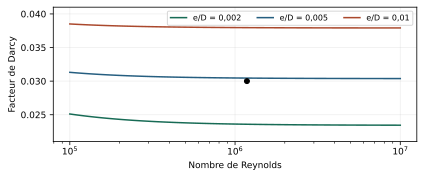
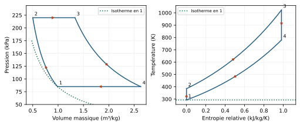

# Banque PT 2023 — Physique B - Thermodynamique · Corrigé guidé

*Corrigé rédigé par IA, non officiel.*

**Rédaction** · GPT-6.2 Astra Ultra · vitesse non renseignée

**Révision (tour 1)** · GPT-6.2 Astra Ultra · vitesse non renseignée

Production d’énergie électrique à partir de ressources renouvelables. Épreuve de deux heures, sans calculatrice. [Sujet et documents](https://www.banquept.fr/documents/2023/ph_b_th_2023_pt.pdf) · [Rapport du jury, p. 3–5](https://www.banquept.fr/documents/ecrit/rapport/2023/rapport_phys_b_ecrit_2023.pdf)

## I. Quelques questions générales

### Q1. Puissances électriques typiques

**Piste.** Choisissez la machine de référence avant de convertir en watts.

Une grande centrale thermique à flamme fournit typiquement quelques centaines de mégawatts, soit de l'ordre de $10^8$ à $10^9\ \mathrm W$. Une tranche nucléaire de puissance électrique voisine de 1 000 MW est d'ordre $10^9\ \mathrm W$. Un parc éolien en mer de cinquante machines de 8 MW représente par exemple 400 MW installés, soit quelques $10^8\ \mathrm W$. La puissance instantanée dépend du vent.

### Q2. Variabilité du vent et du Soleil

**Piste.** Une puissance installée reste-t-elle disponible à la demande ?

Vent, nébulosité et alternance jour–nuit imposent une production variable. Une baisse du vent peut coïncider avec une pointe de consommation. L'équilibre instantané du réseau requiert des moyens complémentaires tels que stockage et restitution, production pilotable, échanges entre régions ou adaptation de la demande.

## II. Centrales hydrauliques en montagne

### Q3. Pompage-turbinage

**Piste.** Suivez l'énergie excédentaire entre deux périodes de la journée.

Lorsque la production dépasse les besoins ou que l'électricité est bon marché, on utilise de l'électricité pour remonter l'eau et augmenter son énergie potentielle. Lors d'une pointe, on la laisse redescendre à travers une turbine et on restitue de l'énergie au réseau. Une STEP déplace donc la disponibilité d'une partie de l'énergie dans le temps. Les pertes de pompage et de turbinage rendent le rendement global inférieur à un.

### Q4. Débit et vitesse après la confluence

**Piste.** Le débit du document 2 porte déjà sur les eaux réunies. Prenez le diamètre aval.

Avec $\rho\simeq10^3\ \mathrm{kg/m^3}$, $D_m=\rho D_v=650\ \mathrm{kg/s}$, soit environ $7\times10^2\ \mathrm{kg/s}$ à un chiffre significatif. La conduite aval a pour section $\pi D_2^2/4$ avec $D_2=0{,}70\ \mathrm m$. La vitesse débitante vaut $u=4D_v/(\pi D_2^2)=1{,}69\ \mathrm{m/s}$, soit environ $2\ \mathrm{m/s}$.

### Q5. Puissance brute de la chute

**Piste.** Évaluez l'énergie perdue par une masse d'eau qui descend de la hauteur brute.

La variation d'énergie potentielle de pesanteur d'une masse $m$ d'eau vaut $-mgH_b$. L'énergie mécanique idéalement récupérable est $E_{mb}=mgH_b$. Sur une durée $dt$, $m=\rho D_vdt$, d'où $\mathcal P_{mb}=\rho D_vgH_b$. Avec $H_b=683{,}20\ \mathrm m$ et $g=9{,}81\ \mathrm{m/s^2}$, on trouve $4{,}36\ \mathrm{MW}$, soit environ 4 MW à un chiffre significatif, en accord avec les 4 356 kW du document 2.

### Q6. Signification de la viscosité

**Piste.** Deux couches voisines d'eau n'ont pas la même vitesse. Que transmet l'une à l'autre ?

La viscosité dynamique $\eta$ caractérise le transport diffusif de quantité de mouvement et les contraintes de cisaillement entre couches de fluide en mouvement relatif. Dans un écoulement simple, $\tau=\eta\,du/dy$. Les frottements internes dissipent de l'énergie mécanique en énergie interne, y compris à l'intérieur du fluide.

### Q7. Dimension de la viscosité dynamique

**Piste.** Donnez les dimensions d'une force par unité de volume puis de la dérivée spatiale seconde de la vitesse.

L'unité de force volumique est $\mathrm{N/m^3}$ et celle de $\Delta\vec v$ est $(\mathrm{m/s})/\mathrm{m^2}=\mathrm{m^{-1}s^{-1}}$. La proportionnalité des normes donne $[\eta]=\mathrm{N\,s/m^2}=\boxed{\mathrm{Pa\,s}}$, soit $\mathrm{kg\,m^{-1}s^{-1}}$. Un poiseuille vaut un pascal-seconde.

### Q8. Régime après la réunion des conduites

**Piste.** Cherchez la dimension transversale qui fixe l'échelle du cisaillement.

La longueur caractéristique est le diamètre intérieur $D_2$. Avec $\eta=10^{-3}\ \mathrm{Pa\,s}$, $\mathrm{Re}=\rho uD_2/\eta\simeq1{,}2\times10^6$, donc d'ordre $10^6$. Cette valeur excède très largement les quelques milliers associés à la transition en tube. Le régime est turbulent.

### Q9. Pertes régulières et singulières

**Piste.** Distinguez ce qui se produit sur chaque mètre de tube et ce qui se produit à un raccord.

Les pertes linéaires, données en mètres de colonne d'eau, traduisent la dissipation par frottement réparti dans la conduite et dépendent notamment de sa rugosité et de sa longueur. Les pertes singulières sont liées aux changements locaux de direction ou de section, aux jonctions, entrées et vannes. Les deux formes correspondent à de l'énergie mécanique dissipée par unité de poids.

### Q10. Coefficient de Darcy

**Piste.** Le membre de gauche est une hauteur. Recherchez les dimensions de chacun des deux facteurs qui suivent le coefficient.

Dans $H_{pc,\ell}=\lambda (L/D)u^2/(2g)$, $L/D$ est sans dimension et $u^2/g$ est une longueur. Comme $H_{pc,\ell}$ est aussi une longueur, le coefficient de Darcy $\lambda$ est **sans dimension**.

### Q11. Bernoulli idéal

**Piste.** Précisez si vous écrivez la relation par unité de masse, de volume ou de poids.

Pour un fluide parfait, incompressible, en écoulement stationnaire, soumis à la pesanteur uniforme et sans machine interposée, le long d'une ligne de courant, $p/\rho+u^2/2+gz$ est constant. Les trois termes sont des énergies par unité de masse. Diviser par $g$ donne la charge en mètres.

### Q12. Bilan avec pertes de charge

**Piste.** L'énergie mécanique doit décroître dans le sens de l'écoulement.

En notant 1 l'amont, 2 l'aval et $H_{pc}>0$ la somme des pertes, sans machine entre ces sections,
$$
\frac{p_1}{\rho g}+\frac{u_1^2}{2g}+z_1
=\frac{p_2}{\rho g}+\frac{u_2^2}{2g}+z_2+H_{pc}.
$$
Dans un bilan en pascals, la perte correspondante vaut $\rho gH_{pc}$. Écrire directement des mètres à côté d'une pression rendrait le bilan inhomogène.

### Q13. Lecture de la rugosité

**Piste.** À Reynolds fixé, repérez la courbe passant par le facteur de Darcy retenu.

Sur l'abaque de la figure 1, la verticale $\mathrm{Re}\sim10^6$ rencontre l'horizontale $\lambda=0{,}03$ près de la courbe $e/D\simeq0{,}005$. Avec le diamètre aval de 0,70 m, $e\simeq3{,}5\times10^{-3}\ \mathrm m$, soit quelques millimètres. Ces irrégularités sont petites devant le diamètre et assez marquées pour influer sur le frottement turbulent. L'estimation représente une rugosité hydraulique équivalente.

### Q14. Travail massique utile

**Piste.** Divisez chacune des puissances du document 2 par le même débit massique.

L'ensemble fournit en sortie $w_{u,\rm fourni}=\mathcal P_{ma}/D_m=3{,}380\times10^6/650\simeq5{,}2\ \mathrm{kJ/kg}$. Dans la convention du travail reçu par l'eau, le travail indiqué est négatif. La chute brute offre $gH_b\simeq6{,}7\ \mathrm{kJ/kg}$, et la chute nette annoncée, voisine de 650 m, environ $6{,}4\ \mathrm{kJ/kg}$. Le rapport utile/brut vaut environ 0,78, le rapport utile/net environ 0,82. Une partie de l'énergie est perdue dans la conduite et une autre dans la conversion turbine–alternateur. Le document 3 arrondit la chute nette à 650 m, tandis que soustraire 26 m à 683,2 m donne 657 m. Cet écart reste petit à la précision demandée.

## III. Centrale solaire thermique

### Q15. Effet cosinus

**Piste.** Projetez le miroir sur un plan normal aux rayons incidents.

Si $i$ est l'angle entre la normale au miroir et la direction vers le Soleil, la surface interceptant le faisceau est $S\cos i$. La puissance interceptée par un miroir est donc $M_sS\cos i$. La normale qui réfléchit le rayon vers la tour bissecte les directions miroir–Soleil et miroir–récepteur. Lorsque ces directions s'écartent l'une de l'autre, la surface efficace diminue. Le maximum théorique sous incidence normale vaut $M_sS=54\ \mathrm{kW}$ par miroir.

### Q16. Rendement maximal

**Piste.** Placez au numérateur l'énergie obtenue sous la forme électrique souhaitée.

Si chaque héliostat reçoit la puissance maximale $\Phi_p$, le rendement de l'installation s'écrit $r_{\max}=P_e/(N\Phi_p)$. Pour une puissance solaire interceptée $NM_sS$ correspondant à l'incidence normale, la référence vaut $2{,}5\times10^6/(201\times54\times1000)\simeq0{,}23$. Pour une orientation réelle il faut employer $M_sS\cos i$ pour chaque héliostat et sommer les puissances. Le rapport de 23 % est donc associé à la référence de flux non projeté.

### Q17. Stocker la chaleur

**Piste.** Distinguez un stockage par variation de température d'un stockage par changement d'état.

Lorsque l'ensoleillement est fort, une fraction de la chaleur peut être stockée dans un réservoir de sels fondus chauds sous forme sensible $mc_p\Delta T$. Un matériau à changement de phase peut aussi accumuler $mL_f$ lors de sa fusion. Pendant un passage nuageux ou après le coucher du Soleil, le fluide se refroidit ou le matériau se solidifie en restituant de la chaleur au cycle producteur. La continuité de service est limitée par la capacité du stock et ses pertes.

### Q18. Pression d'admission

**Piste.** Situez la tour Thémis par rapport au niveau de la mer.

Le compresseur aspire de l'air atmosphérique dans les Pyrénées, à une altitude notable. La pression atmosphérique diminue avec l'altitude par équilibre hydrostatique. Une pression absolue d'admission de 0,85 bar est compatible avec cette implantation.

### Q19. Capacité thermique de l'air

**Piste.** Combinez la relation de Mayer et le rapport des capacités molaires.

Pour un gaz parfait $C_{p,m}-C_{v,m}=R$ et $\gamma=C_{p,m}/C_{v,m}$. On en tire $C_{p,m}=\gamma R/(\gamma-1)$, puis $c_{pa}=\gamma R/[M_{\rm air}(\gamma-1)]$. Avec $M_{\rm air}=0{,}029\ \mathrm{kg/mol}$, on trouve $c_{pa}\simeq1{,}0\ \mathrm{kJ\,kg^{-1}\,K^{-1}}$.

### Q20. Cycle idéal de Brayton

**Piste.** Sur le diagramme de Clapeyron, comparez la pente de l'isotherme et celle de l'isentrope passant par un même état.

Le cycle moteur se parcourt $1\to2\to3\to4\to1$. La compression 1–2 et la détente 3–4 suivent $pv^\gamma=\mathrm{constante}$, avec $v$ volume massique. L'apport de chaleur 2–3 suit $P_2$, le rejet 4–1 suit $P_a$. Dans le plan $(v,p)$ les isobares sont horizontales et une isotherme vérifie $pv=\mathrm{constante}$. Au même point, l'isentrope a une pente $-\gamma p/v$ plus forte en valeur absolue que l'isotherme $-p/v$.

Dans le plan $(s,T)$, les isentropes sont verticales et les isothermes horizontales. Une isobare vérifie $ds=c_p dT/T$, donc $T$ augmente exponentiellement avec $s$. La formule molaire cohérente est $S_m=C_{p,m}\ln(T/T_*)-R\ln(P/P_*)+S_*$, le signe de pression imprimé au rappel est une coquille. Pour un tracé chiffré illustratif, $T_{i1}=293\ \mathrm K$ et un même sommet $T_{i3}=1023\ \mathrm K$ donnent $T_{i2}\simeq385\ \mathrm K$ et $T_{i4}\simeq779\ \mathrm K$. Les températures du cycle réel de la figure 3 ne sont pas toutes celles du cycle idéal.

### Q21. Chaleur reçue de la source chaude

**Piste.** Repérez l'étape durant laquelle l'air s'échauffe à pression constante.

Dans l'organe chauffant, entre 2 et 3, il n'y a pas de travail d'arbre. En régime permanent, les variations d'énergie cinétique et potentielle négligées, le premier principe donne
$$
\mathcal P_{i,ch}=D_m(h_3-h_2)=D_m\frac{\gamma R}{(\gamma-1)M_{\rm air}}(T_{i3}-T_{i2})>0 .
$$

### Q22. Chaleur reçue de la source froide

**Piste.** Conservez la même convention « reçu par l'air » pour les deux échangeurs.

Dans l'échangeur froid idéal, entre 4 et 1, $\mathcal P_{i,fr}=D_m(h_1-h_4)=D_m\gamma R(T_{i1}-T_{i4})/[(\gamma-1)M_{\rm air}]<0$. La source froide reçoit la valeur opposée.

### Q23. Puissance mécanique produite

**Piste.** Pourquoi le fluide peut-il restituer du travail sans changer d'énergie sur un tour ?

Le fluide revient au même état après un cycle. Son énergie interne, fonction d'état, retrouve la même valeur. Le premier principe avec $\mathcal P_{iu}$ comptée **fournie** donne $\boxed{\mathcal P_{iu}=\mathcal P_{i,ch}+\mathcal P_{i,fr}}$. La sortie mécanique nette est déjà diminuée du travail absorbé par le compresseur.

### Q24. Définition du rendement

**Piste.** Quelle énergie doit être achetée à la source chaude pour produire le travail utile ?

Le rendement d'un moteur est la puissance utile divisée par la puissance thermique positive reçue de la source chaude. Ainsi $r_i=\mathcal P_{iu}/\mathcal P_{i,ch}=1+\mathcal P_{i,fr}/\mathcal P_{i,ch}$, inférieur à 1 puisque $\mathcal P_{i,fr}<0$.

### Q25. Rendement exprimé avec les températures

**Piste.** Simplifiez le débit et la capacité thermique communs aux deux puissances.

En remplaçant les puissances obtenues aux questions 21 et 22,
$$
r_i=1-\frac{T_{i4}-T_{i1}}{T_{i3}-T_{i2}}.
$$
Le numérateur de la fraction est la baisse de température de l'air dans l'échangeur froid et le dénominateur son échauffement dans le récepteur chaud.

### Q26. Températures des transformations isentropiques

**Piste.** Utilisez les températures absolues et la même paire de pressions sur les deux adiabatiques.

Pour un gaz parfait de $\gamma$ constant en adiabatique réversible, $TP^{(1-\gamma)/\gamma}$ est constant. Avec $a=(\gamma-1)/\gamma$ et $\beta=(P_2/P_a)^a$, on obtient $T_{i2}=\beta T_{i1}$ pour 1–2 et $T_{i3}=\beta T_{i4}$ pour 3–4.

### Q27. Rendement selon le taux de compression

**Piste.** Factorisez la différence entre les températures 3 et 2 avec la relation précédente.

On a $T_{i3}-T_{i2}=\beta(T_{i4}-T_{i1})$, donc
$$
\boxed{r_i=1-(P_a/P_2)^{(\gamma-1)/\gamma}} .
$$
Avec le facteur fourni $0{,}76$, le rendement vaut environ **0,24**, soit 24 %, ou $0{,}2$ à un seul chiffre significatif.

### Q28. Géométrie de l'échangeur

**Piste.** À section totale de passage égale, comparez les surfaces latérales qui séparent les deux fluides.

Pour $n$ tubes de même longueur et de diamètre $d$, la section totale varie comme $nd^2$, tandis que la surface d'échange varie comme $nd$. À section totale fixée, multiplier le nombre de tubes augmente donc la surface disponible et favorise le transfert de chaleur. Les petits diamètres augmentent en contrepartie les pertes de charge par frottement et la puissance de pompage nécessaire.

### Q29. Bilan air–huile

**Piste.** Entourez les deux fluides à la fois. La chaleur que l'air perd est précisément celle que l'huile reçoit.

L'échangeur entier est stationnaire, isolé de l'extérieur et sans travail utile. Avec variations d'énergies cinétique et potentielle négligeables et capacités constantes, la somme des variations des débits d'enthalpie est nulle. Ainsi $D_{mh}c_{ph}(T_{sh}-T_{eh})=D_{ma}c_{pa}(T_{ea}-T_{sa})$.

### Q30. Température d'entrée de l'huile

**Piste.** Vérifiez que le résultat est plus froid que la sortie d'huile et compatible avec un échange à contre-courant.

On en déduit $T_{eh}=T_{sh}-[D_{ma}c_{pa}/(D_{mh}c_{ph})](T_{ea}-T_{sa})$. Les valeurs du tableau p. 7 donnent $350-[0{,}82\times1{,}0/(0{,}60\times2{,}1)](495-100)\simeq\boxed{93\ ^\circ\mathrm C}$, soit $9\times10^1\ ^\circ\mathrm C$ à un chiffre significatif. Les deux fluides échangent environ 324 kW. Les écarts terminaux $495-350$ et $100-93$ sont positifs pour un montage à contre-courant.
