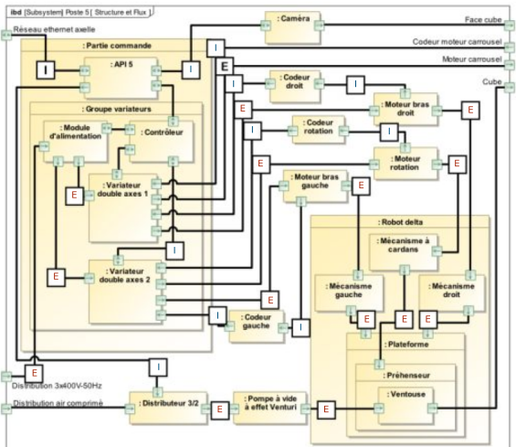
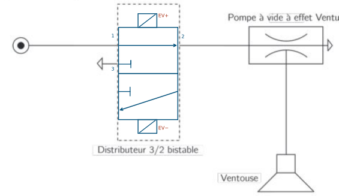
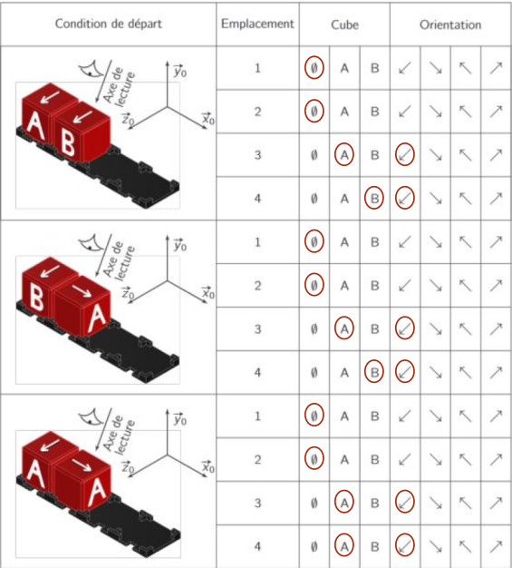
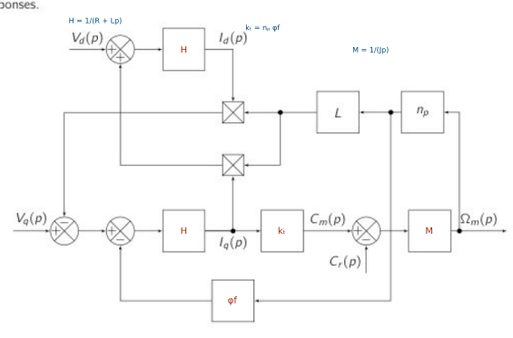
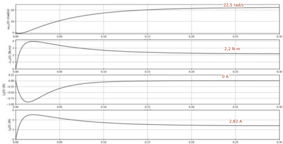
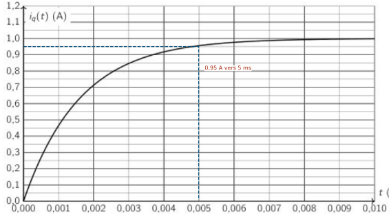
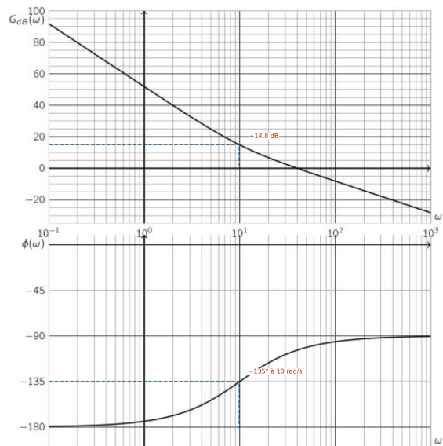
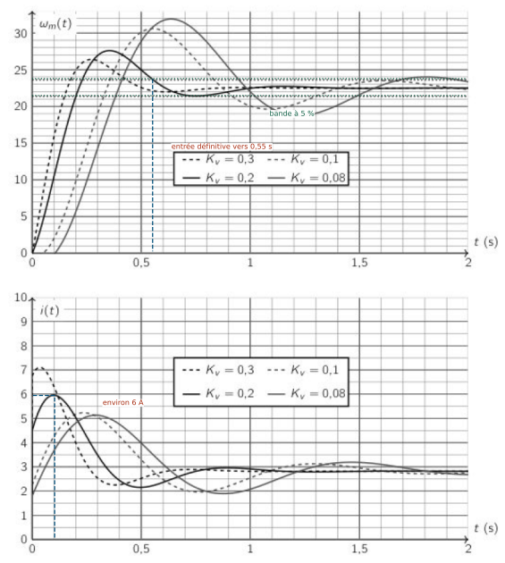
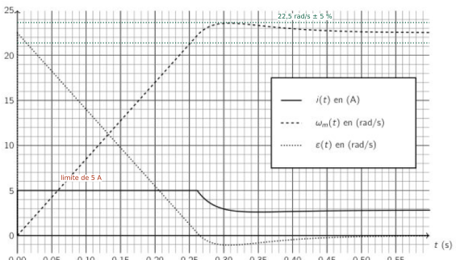

# Banque PT 2023 — Sciences industrielles A · Corrigé guidé

*Corrigé rédigé par IA, non officiel. Signalez toute erreur.*

**Rédaction** · GPT-6.2 Astra Ultra · vitesse non renseignée · 26 novembre 2026

Le poste Axelle saisit deux cubes, les identifie puis les dépose. Le mouvement plan du plateau provient de deux bras motorisés. Un troisième moteur oriente le préhenseur autour de la verticale. Les numéros de page des renvois comptent depuis la garde du PDF officiel.

[Sujet et cahier officiels](https://www.banquept.fr/documents/2023/si_a_2023_pt.pdf) · [Rapport du jury](https://www.banquept.fr/documents/ecrit/rapport/2023/rapport_si_a_ecrit_2023.pdf)

Le jury signale trois difficultés précises. Pour un codeur, la grandeur mesurée appartient à la chaîne d’information. Pour une bielle à deux forces, il faut établir le bilan des actions avant de déduire leur direction. Enfin, chaque validation requiert une comparaison chiffrée avec le niveau exigé, y compris pour le rejet d’une perturbation.

## A — Fonctionnement du poste

### Question 1 — Tracer les flux du poste

> [!INDICATION]
> Suivre les deux extrémités de chaque connexion. Un angle de codeur est une information, même lorsque l’arbre tourne.

#### Solution

La figure remplit les cases du cahier. E désigne une puissance transmise, I un ordre, un compte rendu ou une mesure. Sont en E le secteur, les alimentations de puissance des variateurs, les sorties vers les moteurs, les transmissions des mécanismes jusqu’au plateau, l’air et la dépression. Sont en I Ethernet, les mesures de la caméra et des codeurs, les échanges de commande avec les variateurs et la commande du distributeur.



[Sujet p. 5](https://www.banquept.fr/documents/2023/si_a_2023_pt.pdf#page=5) · [Cahier p. 33 du PDF](https://www.banquept.fr/documents/2023/si_a_2023_pt.pdf#page=33)

### Question 2 — Nommer les organes des chaînes

> [!INDICATION]
> Remonter du cube vers la source d’air, puis du bras vers l’automate.

#### Solution

API 5, unité de traitement, traiter les informations. Variateur double axe 1, préactionneur, distribuer et moduler la puissance électrique. Ventouse, effecteur, saisir ou maintenir le cube. Moteur du bras gauche, actionneur, convertir la puissance électrique en puissance mécanique de rotation. Codeur gauche, capteur, acquérir la position angulaire. Pompe à vide Venturi, générateur de vide, convertir l’énergie de l’air comprimé en dépression. Distributeur 5/2 de la liste, préactionneur pneumatique, distribuer l’air. Le schéma suivant concerne le 3/2 du préhenseur.

### Question 3 — Câbler la prise par aspiration

> [!INDICATION]
> Un 3/2 a trois orifices et deux positions. Quelle liaison faut-il établir entre la pompe et l’échappement à la libération ?

#### Solution

Relier 1 à l’arrivée, 2 à l’entrée du Venturi et 3 à l’échappement. En prise, EV+ connecte 1 à 2 et ferme 3. En dépose, EV− connecte 2 à 3 et ferme 1. Le débit moteur du Venturi cesse, la ventouse revient à la pression ambiante. Les deux commandes opposées mémorisent la dernière position.



[Sujet p. 5](https://www.banquept.fr/documents/2023/si_a_2023_pt.pdf#page=5) · [Cahier p. 34 du PDF](https://www.banquept.fr/documents/2023/si_a_2023_pt.pdf#page=34)

### Question 4 — Suivre les trois départs du cycle aller

> [!INDICATION]
> Traiter le cube 1 puis le cube 2. Suivre la boucle de reconnaissance tant que la caméra lit zéro.

#### Solution

Pour les trois dessins, 1 et 2 finissent vides. Dans l’ordre des départs du cahier, les cases 3 et 4 contiennent respectivement (A, B), (A, B) et (A, A). Les deux cubes déposés ont dans chaque cas leur inscription vers l’avant, flèche sud-ouest sur le cahier. La caméra placée à l’arrière reconnaît la face après zéro ou plusieurs quarts de tour. Le demi-tour suivant impose donc la même orientation finale.



[Sujet p. 5](https://www.banquept.fr/documents/2023/si_a_2023_pt.pdf#page=5) · [Cahier p. 35 du PDF](https://www.banquept.fr/documents/2023/si_a_2023_pt.pdf#page=35)

## B.1 — Architecture spatiale

### Question 5 — Identifier la liaison équivalente partielle

> [!INDICATION]
> Observer le plateau du seul hexagone de la figure 5.

#### Solution

Deux translations selon les axes du plan et une rotation suivant sa normale sont possibles, soit trois degrés de liberté. La liaison équivalente est un appui plan de normale $z_0$. La rotation du plateau reste libre dans cette structure partielle, alors que le plateau recherché doit conserver son orientation.

[Sujet p. 7](https://www.banquept.fr/documents/2023/si_a_2023_pt.pdf#page=7) · [Cahier p. 36 du PDF](https://www.banquept.fr/documents/2023/si_a_2023_pt.pdf#page=36)

### Question 6 — Compter les contraintes en trois dimensions

> [!INDICATION]
> Compter les cinq solides mobiles et les six pivots, puis introduire la mobilité.

#### Solution

Six pivots imposent $6\\times5=30$ contraintes scalaires. Les cinq solides mobiles portent $6\\times5=30$ coordonnées et la mobilité totale vaut 3. Le rang des contraintes est donc 27 et $h=30-27=3$. Ce décompte utilise les torseurs spatiaux.

### Question 7 — Décrire la mobilité du plateau complet

> [!INDICATION]
> Suivre les orientations des côtés opposés dans les parallélogrammes.

#### Solution

Le parallélogramme avec 8 conserve l’orientation du triangle 7, puis celui qui comprend 6 reporte cette orientation sur la plate-forme. Il subsiste deux translations indépendantes dans le plan $(x_0,y_0)$ et aucune rotation du plateau. Un point du plateau peut décrire une courbe.

### Question 8 — Déterminer le degré d’hyperstatisme complet

> [!INDICATION]
> Séparer mobilités de sortie et rotations propres des bielles à deux rotules.

#### Solution

Dix solides mobiles, onze pivots et quatre rotules donnent $N_s=11\\times5+4\\times3=67$. Les deux mouvements commandés et les rotations de 6 et 8 chacune autour de l’axe de ses rotules donnent $m=4$. Ainsi $h=N_s-60+m=11$.

### Question 9 — Assouplir les liaisons du bras gauche

> [!INDICATION]
> Une rotule lève deux contraintes d’orientation par rapport à un pivot. Conserver de quoi orienter chaque tige.

#### Solution

Une solution consiste à garder les pivots en $B_2$ sur 4a et 4b et à remplacer leurs pivots en $C_2$ par deux rotules centrées aux mêmes points. Les pivots conservés imposent encore les trajectoires circulaires des centres et empêchent la rotation propre de chaque bras autour de sa longueur. L’autre côté du mécanisme guide déjà l’orientation du plateau. Les mouvements antérieurs restent possibles, les deux bielles gauches imposent les mêmes fermetures en position, et $m=4$. Quatre contraintes redondantes disparaissent, soit $h=7$.

## B.2 — Cinématique inverse

### Question 10 — Projeter la fermeture de droite

> [!INDICATION]
> Aller de O à D en passant par A1, B1 et C1.

#### Solution

On a $OD=OA_1+A_1B_1+B_1C_1+C_1D$ en vecteurs. Les composantes valent $x=a-d+b\\cos\\theta_{10}+c\\cos\\theta_{30}$ et $y=b\\sin\\theta_{10}+c\\sin\\theta_{30}$. Le signe du décalage vient de $DC_1=d x_0$.

[Sujet p. 7](https://www.banquept.fr/documents/2023/si_a_2023_pt.pdf#page=7) · [Cahier p. 38 du PDF](https://www.banquept.fr/documents/2023/si_a_2023_pt.pdf#page=38)

### Question 11 — Trouver la position de référence

> [!INDICATION]
> À la position la plus basse, les deux angles de droite coïncident. Choisir la branche inférieure.

#### Solution

À $x=0$, $\\cos\\theta_{ref}=(d-a)/(b+c)$. Comme $-\\pi<\\theta_{ref}<0$, $\\theta_{ref}=-\\arccos((d-a)/(b+c))$. On obtient $h_0=-(b+c)\\sin\\theta_{ref}=\\sqrt{(b+c)^2-(a-d)^2}$, soit environ 657 mm et un angle de $-95,2^\\circ$.

### Question 12 — Éliminer l’angle passif

> [!INDICATION]
> Isoler les composantes du vecteur de longueur c puis sommer leurs carrés.

#### Solution

La distance de $B_1$ à $C_1$ impose $(x-a+d-b\\cos\\theta_{10})^2+(y-b\\sin\\theta_{10})^2=c^2$. Le signe de $a-d$ s’inverse dans la fermeture du bras gauche donnée par B.1.

### Question 13 — Échantillonner le mouvement de prise et de dépose

> [!INDICATION]
> Raccorder deux segments verticaux à un demi-cercle parcouru de gauche à droite.

#### Solution

Posons $u=-h_0+e$. Pour $0\\le k\\le n$, $(x_k,y_k)=(-r_p,u+\\Delta y\\, k/n)$. Entre $n$ et $2n$, avec $v=\\pi(k-n)/n$, $(x_k,y_k)=(-r_p\\cos v,u+\\Delta y+r_p\\sin v)$. Entre $2n$ et $3n$, $(x_k,y_k)=(r_p,u+\\Delta y(3n-k)/n)$.

### Question 14 — Programmer la dichotomie

> [!INDICATION]
> Conserver un intervalle où les signes aux bornes sont opposés. Le test de sortie porte sur la largeur.

#### Solution

Pour une fonction continue, les changements de signe successifs encadrent un zéro. Le résultat est le milieu du dernier intervalle, avec une erreur au plus égale à la moitié de sa largeur.

```python
def dichotomie(f, xg, xd, eps=10**-8):
    if eps <= 0 or xg > xd:
        raise ValueError("Intervalle ou précision invalide")
    fg, fd = f(xg), f(xd)
    if fg == 0:
        return xg
    if fd == 0:
        return xd
    if fg * fd > 0:
        raise ValueError("Changement de signe requis")
    while xd - xg > eps:
        m = (xg + xd) / 2
        if m == xg or m == xd:
            break
        fm = f(m)
        if fm == 0:
            return m
        if fg * fm < 0:
            xd = m
        else:
            xg, fg = m, fm
    return (xg + xd) / 2
```

## B.3 — Dynamique des bras

### Question 15 — Expliquer les deux produits d’inertie nuls

> [!INDICATION]
> Trouver une symétrie matérielle qui change le signe de y seul.

#### Solution

Le plan $(A_i,x_i,z_0)$ peut être un plan de symétrie de la distribution de masse. À tout élément $(x,y,z)$ correspond alors un élément de même masse $(x,-y,z)$. Leurs contributions à $\\int xy\\,dm$ et à $\\int yz\\,dm$ se compensent. Le terme en $xz$ peut subsister.

[Sujet p. 9](https://www.banquept.fr/documents/2023/si_a_2023_pt.pdf#page=9) · [Cahier p. 42 du PDF](https://www.banquept.fr/documents/2023/si_a_2023_pt.pdf#page=42)

### Question 16 — Transporter le torseur dynamique au point D

> [!INDICATION]
> Le plateau est en translation, mais son centre de masse peut être décalé de D.

#### Solution

La résultante est $m_5(\\ddot x x_0+\\ddot y y_0)$. Le moment dynamique au centre d’inertie est nul car le plateau garde son orientation. Au point D, le produit vectoriel de $DG_5$ par la résultante donne $m_5(x_g\\ddot y-y_g\\ddot x)z_0$.

### Question 17 — Identifier la ligne d’action de la bielle 6

> [!INDICATION]
> Isoler 6 et réduire le théorème du moment à l’une des rotules.

#### Solution

Les deux rotules en E et F ne transmettent aucun couple. L’inertie et le poids de la bielle sont négligés. La somme des forces est nulle et leur moment en E est nul, d’où deux forces opposées portées par EF. Par action réciproque, 6 exerce sur 5 un glisseur d’axe $(E,x_3)$.

### Question 18 — Identifier la ligne d’action du bras 4

> [!INDICATION]
> Un pivot spatial peut porter des couples transversaux. Quels couples restent dans le problème plan ?

#### Solution

Isoler 4, dont le poids et l’inertie sont négligés. Les pivots parfaits en $B_2,C_2$ ne transmettent pas de moment selon $z_0$, et la représentation plane ne retient que cette composante. La résultante et le moment en $B_2$ imposent deux forces opposées de support $B_2C_2$. L’action sur 5 est donc un glisseur de direction $x_4$ passant par $C_2$.

### Question 19 — Choisir trois équations indépendantes

> [!INDICATION]
> Éliminer une famille de forces en projetant perpendiculairement à sa direction ou en prenant le moment sur son support.

#### Solution

Isoler 5 seul dans les trois lignes. Posons $S=m_5[\\ddot x x_0+(\\ddot y+g)y_0]$. Ligne 1, résultante sur $y_3$ : $F_{45}(x_4\\cdot y_3)=S\\cdot y_3$. Ligne 2, résultante sur $y_4$ : $(F_{35}+F_{65})(x_3\\cdot y_4)=S\\cdot y_4$. Ligne 3, moment au point $C_2$ sur $z_0$ : $[C_2C_1\\times F_{35}x_3+C_2E\\times F_{65}x_3]\\cdot z_0=(C_2G_5\\times S)\\cdot z_0$.

### Question 20 — Projeter le moment dynamique du bras 2

> [!INDICATION]
> Le pivot fixe permet de calculer directement le moment cinétique en A2.

#### Solution

La composante du moment cinétique sur l’axe fixe vaut $C_p\\dot\\theta_{20}$. En dérivant dans le référentiel galiléen on trouve $\\delta(A_2,2/0)\\cdot z_0=C_p\\ddot\\theta_{20}$. Le terme transversal en $E_p$ ne contribue pas à cette projection.

### Question 21 — Dimensionner le couple en sortie du réducteur

> [!INDICATION]
> Reporter au pivot du bras 2 l’action réciproque de la bielle 4 et le poids.

#### Solution

En $B_2$, 4 exerce sur 2 la force $-F_{45}x_4$. Le poids s’applique à $a_g x_2$ de $A_2$. Les moments suivant $z_0$ donnent $C_{r2}-b F_{45}\\sin(\\theta_{40}-\\theta_{20})-m_p g a_g\\cos\\theta_{20}=C_p\\ddot\\theta_{20}$. Le couple demandé est donc la somme du terme inertiel et des deux termes de compensation.

## C.1 — Modèle du moteur

### Question 22 — Ramener les inerties à l’entrée

> [!INDICATION]
> Égaler l’énergie cinétique totale à la moitié de l’inertie équivalente multipliée par la vitesse moteur au carré.

#### Solution

La vitesse du bras vaut $\\omega_m/r$ et celle des masses ponctuelles $b\\omega_m/r$. En sommant les quatre énergies, $J_{eq}=J_{bmot}+J_r+[C_p+(m_c+m_5)b^2]/r^2$. Le réducteur est déjà ramené à l’entrée.

[Sujet p. 11](https://www.banquept.fr/documents/2023/si_a_2023_pt.pdf#page=11) · [Cahier p. 47 du PDF](https://www.banquept.fr/documents/2023/si_a_2023_pt.pdf#page=47)

### Question 23 — Lire la charge admissible par la ventouse

> [!INDICATION]
> Le tableau 1 donne directement une force de maintien à la dépression imposée.

#### Solution

Pour le diamètre de 30 mm, le fabricant donne 26,2 N sous 0,7 bar de dépression. À l’équilibre vertical $m_c g\\le26,2$, soit $m_c\\le2,67$ kg pour $g=9,81$ m/s². La donnée intègre la géométrie réelle du soufflet.

### Question 24 — Évaluer l’inertie équivalente

> [!INDICATION]
> Convertir les kilogrammes-centimètres carrés en unités SI avant d’additionner.

#### Solution

$J_{bmot}=1,49\\times10^{-4}$ kg·m². Avec $b=0,220$ m, $m_c+m_5=3$ kg et $r=5$, on trouve $J_{eq}=0,000149+0,000050+(0,2+3\\times0,22^2)/25=0,014007$ kg·m². À un chiffre significatif, $0,01$ kg·m². La suite impose $0,02$ kg·m².

### Question 25 — Exprimer les tensions de Park

> [!INDICATION]
> Remplacer les flux, puis dériver en traitant le flux des aimants comme constant.

#### Solution

Les équations deviennent $v_d=Ri_d+L\\dot i_d-n_p\\omega_m L i_q$ et $v_q=Ri_q+L\\dot i_q+n_p\\omega_m(L i_d+\\phi_f)$. La rotation couple les deux axes même pour des inductances égales.

### Question 26 — Compléter le modèle de Laplace

> [!INDICATION]
> Isoler chaque courant, sans transformer un produit temporel en produit de transformées.

#### Solution

Au repos initial, $V_d=(R+Lp)I_d-n_pL\\Pi[\\omega_m,i_q]$, $V_q=(R+Lp)I_q+n_pL\\Pi[\\omega_m,i_d]+n_p\\phi_f\\Omega_m$. Les deux autres relations sont $C_m=n_p\\phi_f I_q$ et $J_{eq}p\\Omega_m=C_m-C_r$ pour $f_v=0$.



[Sujet p. 12](https://www.banquept.fr/documents/2023/si_a_2023_pt.pdf#page=12) · [Cahier p. 48 du PDF](https://www.banquept.fr/documents/2023/si_a_2023_pt.pdf#page=48)

### Question 27 — Calculer le courant permanent

> [!INDICATION]
> À vitesse constante, le couple moteur équilibre le couple résistant.

#### Solution

Avec $k_t=n_p\\phi_f=0,780$ N·m/A et $f_v=0$, $i_{q\\infty}=C_{r\\max}/k_t=2,2/0,780=2,82$ A.

### Question 28 — Déduire les tensions permanentes

> [!INDICATION]
> En régime établi seules les dérivées s’annulent. La vitesse reste non nulle.

#### Solution

En posant $i_d=0$ dans les deux tensions de Q25, $v_{d\\infty}=-n_p\\omega_{m\\max}Li_{q\\infty}$ et $v_{q\\infty}=Ri_{q\\infty}+n_p\\omega_{m\\max}\\phi_f$. Le premier terme compense le couplage de quadrature.

### Question 29 — Vérifier le point de fonctionnement électrique

> [!INDICATION]
> Sommer quadratiquement les composantes en quadrature.

#### Solution

On trouve $v_{d\\infty}=-6,95$ V, $v_{q\\infty}=36,73$ V et $|V_{\\infty}|=37,38$ V. Le couple de 2,2 N·m reste inférieur aux 2,9 N·m à l’arrêt de la fiche, le courant inférieur aux 12,9 A de crête. La fiche donne 2,15 A en continu sans ventilation et 3 A en ventilation forcée.

### Question 30 — Lire les quatre sorties de la simulation

> [!INDICATION]
> Comparer les plateaux, pas les crêtes transitoires, aux résultats précédents.

#### Solution

Sur le cahier, la vitesse se stabilise vers 22,5 rad/s, le couple vers 2,2 N·m, $i_d$ vers zéro et $i_q$ vers 2,8 A. Au démarrage, le courant direct descend vers −0,9 A et le courant de quadrature dépasse 5 A. Ces excursions se résorbent et les quatre valeurs finales valident la cohérence du modèle au point étudié.



[Sujet p. 13](https://www.banquept.fr/documents/2023/si_a_2023_pt.pdf#page=13) · [Cahier p. 51 du PDF](https://www.banquept.fr/documents/2023/si_a_2023_pt.pdf#page=51)

## C.2 — Commande en courant et en vitesse

### Question 31 — Découpler les axes de courant

> [!INDICATION]
> Substituer dans les définitions des tensions corrigées les expressions de Q25.

#### Solution

Le terme croisé de chaque axe s’annule par compensation : $v'_d=Ri_d+L\\dot i_d$ et $v'_q=Ri_q+L\\dot i_q$. Chaque tension corrigée n’agit alors que sur le courant de son axe dans le modèle.

[Sujet p. 13](https://www.banquept.fr/documents/2023/si_a_2023_pt.pdf#page=13) · [Cahier p. 51 du PDF](https://www.banquept.fr/documents/2023/si_a_2023_pt.pdf#page=51)

### Question 32 — Mettre les deux transferts en forme canonique

> [!INDICATION]
> Factoriser la résistance du dénominateur.

#### Solution

Au repos initial $I_d/V'_d=I_q/V'_q=1/(R+Lp)=K/(1+Tp)$ avec $K=1/R=0,147$ A/V et $T=L/R=5,37$ ms. Les valeurs arrondies imposées pour la boucle sont 0,15 A/V et 5 ms.

### Question 33 — Tester un correcteur proportionnel

> [!INDICATION]
> Quel est le gain statique du retour unitaire avec un gain fini ?

#### Solution

Pour une consigne $I_0$, l’erreur statique est $I_0/(1+K_pK)$. Tout gain proportionnel fini laisse une erreur non nulle. L’exigence 1.1 impose une action intégrale.

### Question 34 — Régler le PI de courant

> [!INDICATION]
> Après compensation du pôle, la boucle fermée est du premier ordre.

#### Solution

Choisir $T_i=T=0,005$ s. La boucle ouverte vaut $K_pK/(Tp)$ et la constante fermée $T/(KK_p)$. L’exigence impose $K_p\\ge T\\ln(20)/(0,005K)=19,97$ V/A. On retient $K_p=20$ V/A, qui donne un temps à 5 % de 4,99 ms.

### Question 35 — Vérifier le courant sur la grille

> [!INDICATION]
> Pour un échelon de 1 A, repérer le dernier passage dans l’intervalle 0,95 à 1,05 A.

#### Solution

Le plateau est à 1 A, l’erreur finale vaut 0 A. La courbe croît sans dépasser la consigne. Elle atteint 0,95 A vers 5 ms et demeure dans la bande. Les trois niveaux du tableau 2 sont atteints à la précision de lecture près.



[Sujet p. 14](https://www.banquept.fr/documents/2023/si_a_2023_pt.pdf#page=14) · [Cahier p. 53 du PDF](https://www.banquept.fr/documents/2023/si_a_2023_pt.pdf#page=53)

### Question 36 — Justifier l’approximation de la boucle interne

> [!INDICATION]
> Comparer les temps de réponse des deux boucles et le gain continu de la première.

#### Solution

La boucle de courant suit avec un gain continu égal à 1 et se stabilise en 5 ms, contre 0,6 s autorisée pour la vitesse. À l’échelle des variations de vitesse son déphasage et son atténuation sont faibles. On peut donc écrire $B_c(p)\\simeq1$ dans cette bande, hors saturation.

### Question 37 — Rejeter la perturbation de couple

> [!INDICATION]
> Écrire séparément l’effet de la consigne puis celui du couple lorsque la commande est proportionnelle.

#### Solution

L’intégrateur mécanique suffit déjà au suivi d’une vitesse constante dans le modèle sans frottements. Mais avec un correcteur statique $K_v$, l’équilibre sous couple constant impose une erreur $C_r/(k_tK_v)$. Pour avoir du courant à erreur finale nulle, le correcteur doit intégrer, soit une classe minimale de 1, sous réserve de stabilité.

### Question 38 — Étudier les pôles avec frottement

> [!INDICATION]
> Écrire le polynôme caractéristique pour le gain intégral positif.

#### Solution

Avec $C_v=K_v/p$, le dénominateur est $Jp^2+f_v p+k_tK_v$. Si $f_v=0$, les pôles imaginaires purs donnent une oscillation entretenue et excluent la stabilité asymptotique et BIBO. Si $f_v>0$, tous les coefficients du second ordre sont strictement positifs pour $J,K_v,k_t>0$, donc les deux pôles sont à partie réelle négative.

### Question 39 — Fixer la marge de phase avec une intégrale

> [!INDICATION]
> La phase à la coupure est moins 90 degrés moins l’argument du pôle mécanique.

#### Solution

Le module est $k_tK_v/[\\omega\\sqrt{f_v^2+(J\\omega)^2}]$. La marge vaut $90^\\circ-\\arctan(J\\omega_c/f_v)$. Au seuil de $45^\\circ$, $\\omega_c=f_v/J$, puis $K_v=\\sqrt2 f_v^2/(Jk_t)=9,07\\times10^{-7}$. Les gains positifs inférieurs conviennent aussi. La phase n’atteint −180° qu’à l’infini, où le gain s’annule.

### Question 40 — Régler le régime critique

> [!INDICATION]
> Faire coïncider les deux pôles du second ordre. Pour une réponse critique, la règle des trois constantes de temps ne s’applique pas.

#### Solution

Le régime critique le plus rapide sans dépassement exige $f_v^2=4Jk_tK_v$, soit $K_v=1,60\\times10^{-7}$. Le pôle double vaut $-f_v/(2J)$, la constante $2J/f_v=400$ s. En résolvant $(1+u)e^{-u}=0,05$, $u\\simeq4,744$, donc $t_{5\\%}\\simeq1,90\\times10^3$ s. La limite de 0,6 s est largement dépassée.

### Question 41 — Établir les conditions de stabilité du PI

> [!INDICATION]
> Former le dénominateur avec un retour unitaire et annuler les frottements.

#### Solution

Avec $J=J_{eq}$, le polynôme est $Jp^2+k_tK_v p+k_tK_v/T_v$. Le critère du deuxième ordre impose $K_v>0$ et $T_v>0$. Le terme proportionnel apporte l’amortissement qui manquait à l’intégrateur seul.

### Question 42 — Lire le gain minimal sur Bode

> [!INDICATION]
> Changer le gain translate le diagramme de module et laisse la phase inchangée.

#### Solution

La boucle ouverte est $k_tK_v(1+jT_v\\omega)/[JT_v(j\\omega)^2]$. À $\\omega=1/T_v=10$ rad/s, la phase est −135°. Pour $K_v=1$, le module vaut $5,52$, soit environ +14,8 dB sur la grille. La coupure doit se situer à 10 rad/s ou au-dessus. Ainsi $20\\log_{10}K_v\\ge-14,8$ dB, soit $K_v\\ge0,181$ dans les unités du sujet.



[Sujet p. 16](https://www.banquept.fr/documents/2023/si_a_2023_pt.pdf#page=16) · [Cahier p. 59 du PDF](https://www.banquept.fr/documents/2023/si_a_2023_pt.pdf#page=59)

### Question 43 — Choisir le gain sur les simulations

> [!INDICATION]
> Superposer la bande à 5 % et tenir compte des marges fréquentielles ainsi que du courant maximal.

#### Solution

Les gains 0,08 et 0,1 sont sous le seuil de marge de phase et oscillent longtemps. Les deux réglages 0,2 et 0,3 satisfont aux marges. Pour réduire le pic, retenir $K_v=0,2$ : la vitesse entre durablement entre 21,375 et 23,625 rad/s vers 0,55 s et converge vers 22,5 rad/s. Le léger creux suivant reste dans la bande. Le pic de courant est voisin de 6 A, contre 7 A à 0,3.



[Sujet p. 16](https://www.banquept.fr/documents/2023/si_a_2023_pt.pdf#page=16) · [Cahier p. 60 du PDF](https://www.banquept.fr/documents/2023/si_a_2023_pt.pdf#page=60)

### Question 44 — Calculer le courant de saturation minimal

> [!INDICATION]
> En saturation, le couple accélérateur est constant. Vérifier qu’il est positif.

#### Solution

La pente vaut $(k_tI_{max}-C_{r\\max})/J$. Partant du repos, $t_{95}=0,95J\\omega_{m\\max}/(k_tI_{max}-C_{r\\max})$. Exiger $t_{95}\\le0,6$ s donne $I_{max}\\ge[2,2+0,95\\times0,02\\times22,5/0,6]/0,78=3,73$ A.

### Question 45 — Conclure avec saturation et anti-emballement

> [!INDICATION]
> Lire le palier de courant, la valeur finale, puis la dernière sortie de la bande du tableau 3.

#### Solution

Le courant plafonne à 5 A et finit vers 2,8 A. La vitesse atteint environ 23,6 rad/s puis revient vers 22,5 rad/s, l’erreur tend vers zéro sous le couple résistant. Le passage à 95 % est vers 0,25 s et la vitesse reste ensuite au voisinage de la limite haute et se trouve durablement dans la bande au plus tard vers 0,35 s, sous 0,6 s. Le léger dépassement de vitesse est permis au tableau 3.



[Sujet p. 16](https://www.banquept.fr/documents/2023/si_a_2023_pt.pdf#page=16) · [Cahier p. 62 du PDF](https://www.banquept.fr/documents/2023/si_a_2023_pt.pdf#page=62)
