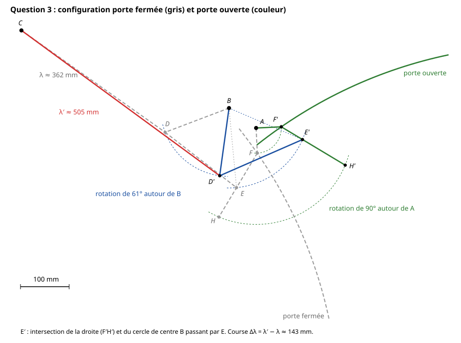
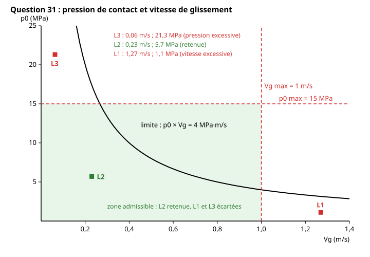
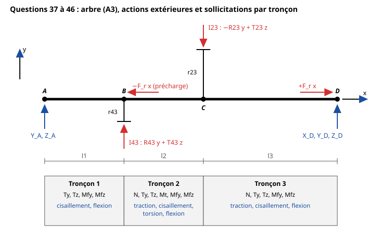

# Banque PT PT — Sciences industrielles B 2023 · Corrigé brut

*Corrigé rédigé par IA, non officiel. Signalez toute erreur.*

**Rédaction** · modèle exact non renseigné (famille Claude) · effort non renseigné · vitesse non renseignée

Épreuve de 6 h, sans calculatrice ni document. Support : système d'ouverture de la porte latérale avant d'un avion-cargo (actionneur linéaire électrique, basculeur, porte). Les 56 questions sont traitées dans l'ordre ; les tracés demandés sur le cahier réponse (questions 3 et 31) sont redessinés dans des figures originales.

Données principales (annexe P) : $T = 30\ \mathrm{s}$, $M = 100\ \mathrm{kg}$, $g = 9{,}81\ \mathrm{m\cdot s^{-2}}$, $a_1 = 0{,}25\ \mathrm{m}$, $b_1 = 0{,}5\ \mathrm{m}$, $r_3 = 41/11$, $\eta_r = 0{,}95$, $\eta_v = 0{,}7$, $p = 8\ \mathrm{mm}$ par tour, $U_m = 24\ \mathrm{V}$, $k_m = 0{,}03\ \mathrm{N\cdot m\cdot A^{-1}}$, $R_m = 1\ \Omega$, $J_m = 140\times10^{-7}\ \mathrm{kg\cdot m^2}$, $J_{eq} = 3000\ \mathrm{kg\cdot m^2}$, $R = 1{,}5\ \mathrm{m}$, $r' = 0{,}1\ \mathrm{m\cdot rad^{-1}}$, $\mu = 0{,}1$, $\sigma_e = 240\ \mathrm{MPa}$, $s = 2$, $N_3 = 140\ \mathrm{tr\cdot min^{-1}}$.

Notation abrégée : $K = \omega_m/\dot\theta_1$ (rapport de transmission global entre le moteur et la porte, question 17).

---

## Partie I — Caractéristiques d'un actionneur permettant de valider l'exigence 1.4

### Question 1 — Trajectoires de D, E et F

Le basculeur $(S_2)$ est en liaison pivot d'axe $(B,\vec z)$ avec le châssis, la porte $(S_1)$ en liaison pivot d'axe $(A,\vec z)$.

- **Point $D$** de $(S_2)$ par rapport à $(S_0)$ : cercle (arc) de centre $B$ et de rayon $BD = a_2$.
- **Point $E$** de $(S_2)$ par rapport à $(S_0)$ : cercle de centre $B$ et de rayon $BE = \sqrt{b_2^2 + c_2^2}$.
- **Point $F$** de la porte $(S_1)$ par rapport à $(S_0)$ : cercle de centre $A$ et de rayon $AF = \sqrt{c_1^2 + d_1^2}$.

(L'énoncé écrit « basculeur $(S_1)$ » pour le point $F$ : il s'agit de la porte.)

### Question 2 — Choix de la liaison entre le basculeur et la porte

Le mécanisme est plan. $(S_1)$ tourne autour de $A$, $(S_2)$ autour de $B$, $A$ et $B$ étant fixes.

| Liaison $(S_1)/(S_2)$ | Mécanisme bloqué | Mécanisme mobile | À retenir |
|---|---|---|---|
| Pivot d'axe $(E,\vec z)$ | X | | |
| Glissière d'axe $(F,\vec x_1)$ | X | | |
| Ponctuelle de normale $(E,\vec y_1)$ | | X | X |
| Rotule de centre $E$ | X | | |

Justification. Avec une pivot (ou une rotule, équivalente dans le plan) en $E$, le triangle $ABE$ a trois côtés de longueur fixe : il est indéformable. Avec une glissière, les deux solides tourneraient du même angle et le point $B$, vu de la porte, devrait se déplacer en ligne droite alors qu'il y décrit un cercle de centre $A$ : blocage. La ponctuelle de normale $\vec y_1$ impose seulement à $E$ de rester sur la droite $(F,\vec x_1)$ de la porte : une seule équation de liaison dans le plan, le mécanisme garde une mobilité.

### Question 3 — Tracé de la configuration porte ouverte

Construction à la règle et au compas sur le cahier réponse :

1. Les points $A$, $B$ et $C$ sont fixes.
2. La porte tourne de $90°$ autour de $A$ dans le sens trigonométrique (elle se relève vers l'extérieur du fuselage, annexe A). $F'$ et $H'$ sont les images de $F$ et $H$ : $AF' = AF$, $AH' = AH$, $(AF')\perp(AF)$, $(AH')\perp(AH)$. La droite $(F'H')$ est l'image de $(FH)$.
3. $E'$ appartient au cercle de centre $B$ passant par $E$ (question 1) et à la droite $(F'H')$ : c'est leur intersection située entre $F'$ et $H'$.
4. Le basculeur est indéformable : $D'$ est à l'intersection du cercle de centre $B$ passant par $D$ et du cercle de centre $E'$ de rayon $ED$, du même côté de $(BE')$ que $D$ l'est de $(BE)$.
5. On trace $C D'$ (actionneur), $B D'$, $D' E'$ (basculeur), $A F'$, $F' H'$ et l'arc de la porte tourné de $90°$.

Le basculeur tourne d'environ $61°$ autour de $B$.

### Question 4 — Longueurs et course de l'actionneur

Mesures sur le tracé, avec l'échelle du document ($100\ \mathrm{mm}$ représentés par le segment de référence) :

$$\boxed{\lambda = CD \approx 360\ \mathrm{mm}\qquad \lambda' = CD' \approx 505\ \mathrm{mm}\qquad \Delta\lambda = \lambda' - \lambda \approx 145\ \mathrm{mm}}$$

(Reconstruction numérique à partir des coordonnées des points du document : $362\ \mathrm{mm}$, $505\ \mathrm{mm}$ et $143\ \mathrm{mm}$.) Cette course est cohérente avec celle de $150\ \mathrm{mm}$ retenue en partie II et avec l'écart lu sur la figure 8 ($428 - 276 = 152\ \mathrm{mm}$ entre $40°$ et $130°$).

### Question 5 — Vitesse linéaire moyenne

$$\boxed{\widetilde V = \frac{\Delta\lambda}{T}}$$

$$\boxed{\widetilde V \approx \frac{145}{30} \approx 4{,}8\ \mathrm{mm\cdot s^{-1}}}$$

soit environ $5\ \mathrm{mm\cdot s^{-1}}$, valeur retenue par l'énoncé en partie II.

### Question 6 — Mobilités, paramètres, équations

- Nombre de mobilités utiles : **1** (l'allongement du vérin commande l'ouverture de la porte).
- Nombre de paramètres introduits : **5** ($\theta_1$, $\theta_2$, $\theta_3$, $\lambda$, $\delta$).
- Nombre d'équations scalaires liant ces paramètres : $5 - 1 =$ **4**, soit deux fermetures géométriques planes. Pour la seule loi $\lambda = f(\theta_1)$, trois équations suffisent si l'on évite d'introduire $\delta$ (question 7).

### Question 7 — Équations utiles à la loi entrée/sortie

| Jeu d'équations | Nombre d'équations scalaires | Paramètres impliqués | À retenir |
|---|---|---|---|
| $\overrightarrow{CD}+\overrightarrow{DB}+\overrightarrow{BC} = \vec 0$ | 2 | $\lambda$, $\theta_3$, $\theta_2$ | X |
| $\overrightarrow{BE}\cdot\vec x_1 = (\overrightarrow{BA}+\overrightarrow{AF}+\overrightarrow{FE})\cdot\vec x_1$ | 1 | $\theta_1$, $\theta_2$, $\delta$ | |
| $\overrightarrow{BE}\cdot\vec y_1 = (\overrightarrow{BA}+\overrightarrow{AF}+\overrightarrow{FE})\cdot\vec y_1$ | 1 | $\theta_1$, $\theta_2$ | X |

La fermeture $C,D,B$ donne $\lambda$ en fonction de $\theta_2$ après élimination de $\theta_3$. La projection sur $\vec y_1$ de la seconde fermeture relie $\theta_2$ à $\theta_1$ sans faire intervenir $\delta$, puisque $\overrightarrow{FE} = \delta\,\vec x_1$ est orthogonal à $\vec y_1$. La projection sur $\vec x_1$ introduit l'inconnue supplémentaire $\delta$ : elle ne sert qu'à calculer $\delta$.

### Question 8 — Vitesse linéaire du vérin

$\lambda = f(\theta_1)$, donc en dérivant par rapport au temps :

$$\boxed{V(\theta_1) = \dot\lambda = f'(\theta_1)\,\dot\theta_1}$$

### Question 9 — Vitesse du vérin pour encadrer la vitesse de la porte

Avec $V$ constante, $\dot\theta_1 = V/f'(\theta_1)$. La figure 9 donne $f'_{max}\approx 0{,}125\ \mathrm{m\cdot rad^{-1}}$ (vers $52°$) et $f'_{min}\approx 0{,}064\ \mathrm{m\cdot rad^{-1}}$ (à $130°$). On convertit $3°\cdot\mathrm{s^{-1}} = \pi/60 \approx 0{,}0524\ \mathrm{rad\cdot s^{-1}}$.

Vitesse de la porte au moins égale à $3°\cdot\mathrm{s^{-1}}$ partout : la condition la plus sévère est celle où $f'$ est maximal.

$$\boxed{V \geq f'_{max}\times\frac{\pi}{60} \approx 0{,}125\times0{,}0524 \approx 6{,}5\ \mathrm{mm\cdot s^{-1}}}$$

Vitesse de la porte au plus égale à $3°\cdot\mathrm{s^{-1}}$ partout : la condition la plus sévère est celle où $f'$ est minimal.

$$\boxed{V \leq f'_{min}\times\frac{\pi}{60} \approx 0{,}064\times0{,}0524 \approx 3{,}4\ \mathrm{mm\cdot s^{-1}}}$$

### Question 10 — Puissances du vérin et de la pesanteur

Puissance développée par l'actionneur (effort $F_v\,\vec x_3$ entre le corps et la tige, vitesse relative $\dot\lambda\,\vec x_3$) :

$$\boxed{P_v = F_v\,V(\theta_1)}$$

Puissance de la pesanteur sur la porte. Avec $\overrightarrow{AG} = -a_1\vec x_1 - b_1\vec y_1$ :

$$\begin{aligned}
\vec V(G\in S_1/S_0) &= \dot\theta_1\,\vec z\wedge\overrightarrow{AG}\\
&= \dot\theta_1\,(b_1\,\vec x_1 - a_1\,\vec y_1)
\end{aligned}$$

Avec $\vec y\cdot\vec x_1 = \sin\theta_1$ et $\vec y\cdot\vec y_1 = \cos\theta_1$ :

$$\boxed{P_p = -M g\,\vec y\cdot\vec V(G) = M g\,\dot\theta_1\,(a_1\cos\theta_1 - b_1\sin\theta_1)}$$

Cette puissance est négative sur toute la plage $40°$ à $130°$ : le poids s'oppose à l'ouverture.

### Question 11 — Effort de poussée du vérin

- **Hypothèses** : référentiel lié au châssis supposé galiléen ; liaisons parfaites (puissance des inter-efforts de liaison nulle) ; régime permanent, donc variation d'énergie cinétique négligée ; masses négligées sauf celle de la porte.
- **Système isolé** : l'ensemble des pièces mobiles $\{S_1, S_2, S_3, S_4\}$.

Théorème de l'énergie cinétique : $0 = P_v + P_p$, soit $F_v\,f'(\theta_1)\,\dot\theta_1 = M g\,\dot\theta_1\,(b_1\sin\theta_1 - a_1\cos\theta_1)$.

$$\boxed{F_v = \frac{M g\,(b_1\sin\theta_1 - a_1\cos\theta_1)}{f'(\theta_1)}}$$

Contrôle à $130°$ pour $1\ \mathrm{kg}$ : $9{,}81\times(0{,}383 + 0{,}161)/0{,}064 \approx 83\ \mathrm{N}$, valeur de la figure 10.

### Question 12 — Effort maximal

La figure 10 est croissante sur toute la plage ; son maximum, environ $83{,}5\ \mathrm{N}$ pour $1\ \mathrm{kg}$, est atteint en fin d'ouverture. L'effort est proportionnel à la masse ; pour la masse nominale $M = 100\ \mathrm{kg}$ :

$$\boxed{F_v^{max} \approx 100\times83{,}5 \approx 8{,}4\times10^{3}\ \mathrm{N}\qquad\text{pour}\quad \theta_1 = 130°\ \text{(porte ouverte)}}$$

---

## Partie II — Choix de la transmission interne à l'actionneur

### Question 13 — Rendement et puissance moteur

Trois étages de réduction puis le système vis-écrou :

$$\boxed{\eta = \eta_r^{3}\,\eta_v}$$

$$\eta = 0{,}95^3\times0{,}7 \approx 0{,}857\times0{,}7 \approx 0{,}60$$

$$\boxed{P_m = \frac{F_v\,V}{\eta}}$$

$$\boxed{P_m = \frac{12\,000\times5\times10^{-3}}{0{,}60} = 100\ \mathrm{W}}$$

### Question 14 — Moteurs adaptés

Critères : puissance nominale au moins égale à $100\ \mathrm{W}$ ; tension d'alimentation compatible avec le réseau de bord, entre $18$ et $30\ \mathrm{V}$ et $24\ \mathrm{V}$ au nominal (exigence 1.1.1.1) ; diamètre compatible avec l'encombrement radial de $80\ \mathrm{mm}$ (tous les moteurs du tableau le sont, $D\leq50\ \mathrm{mm}$).

Les moteurs de $80$ et $90\ \mathrm{W}$ sont insuffisants. Parmi les moteurs de $150$ et $200\ \mathrm{W}$, seuls ceux alimentés en $24\ \mathrm{V}$ conviennent :

$$\boxed{\text{RE-40-150-24}\quad\text{et}\quad\text{RE-50-200-24}}$$

Le premier ($7580\ \mathrm{tr\cdot min^{-1}}$ à vide, $177\ \mathrm{mN\cdot m}$) correspond au moteur dont l'énoncé donne ensuite les caractéristiques.

### Question 15 — Vitesse de la vis et vitesse du vérin

Un tour de vis ($2\pi$ radians) fait avancer l'écrou d'un pas $p$ (exprimé en mètres par tour) :

$$\boxed{V = \frac{p}{2\pi}\,\omega_v\qquad\text{soit}\qquad \omega_v = \frac{2\pi\,V}{p}}$$

Avec $\omega_v = \omega_m/(r_1 r_2 r_3)$ :

$$\boxed{V = \frac{p\,\omega_m}{2\pi\,r_1\,r_2\,r_3}}$$

### Question 16 — Rapport p/r

$$\boxed{\frac{p}{r} = \frac{2\pi\,V}{\omega_m}}$$

Au régime nominal, $N_m = 7000\ \mathrm{tr\cdot min^{-1}}$, soit $7000/60\approx116{,}7\ \mathrm{tr\cdot s^{-1}}$. Le pas étant en millimètres par tour :

$$\boxed{\frac{p}{r} = \frac{V}{N_m/60} = \frac{5\times60}{7000} \approx 0{,}043\ \mathrm{mm\cdot tr^{-1}}}$$

Avec $p = 8\ \mathrm{mm}$ par tour, il faut $r\approx187$.

### Question 17 — Rapport entre la vitesse du moteur et celle de la porte

$\lambda = r'\theta_1$ donne $V = r'\dot\theta_1$ ; la question 15 donne $V = p\,\omega_m/(2\pi r)$.

$$\boxed{\frac{\omega_m}{\dot\theta_1} = \frac{2\pi\,r\,r'}{p}}$$

$$\boxed{\frac{\omega_m}{\dot\theta_1} = \frac{2\pi\times0{,}1}{0{,}0429\times10^{-3}} \approx 1{,}47\times10^{4}}$$

(sans unité, $p/r$ étant exprimé en mètres par tour). On note $K$ ce rapport.

### Question 18 — Masse élémentaire et distance au pivot

La masse est répartie uniformément sur l'arc d'angle $\beta_0$ :

$$\boxed{dm = \frac{M}{\beta_0}\,d\beta}$$

$A$ et $P$ sont sur le cercle de rayon $R$, séparés par l'angle au centre $\beta$ ; $w$ est la corde correspondante :

$$\boxed{w^2 = 4R^2\sin^2\frac{\beta}{2} = 2R^2\,(1-\cos\beta)}$$

### Question 19 — Moment d'inertie de la porte

$$\begin{aligned}
J_p &= \int_0^{\beta_0} 2R^2(1-\cos\beta)\,\frac{M}{\beta_0}\,d\beta\\
&= \frac{2MR^2}{\beta_0}\,(\beta_0 - \sin\beta_0)
\end{aligned}$$

$$\boxed{J_p = 2\,M R^2\left(1 - \frac{\sin\beta_0}{\beta_0}\right)}$$

Pour $\beta_0 = \pi/2$ et $R = 1{,}5\ \mathrm{m}$ :

$$\boxed{J_p = 2\times100\times2{,}25\times\left(1-\frac{2}{\pi}\right) \approx 450\times0{,}363 \approx 164\ \mathrm{kg\cdot m^2}}$$

### Question 20 — Inertie équivalente du rotor

Égalité des énergies cinétiques : $\tfrac12 J_{m,eq}\,\dot\theta_1^2 = \tfrac12 J_m\,\omega_m^2$.

$$\boxed{J_{m,eq} = J_m\left(\frac{2\pi\,r\,r'}{p}\right)^{2}}$$

$$\boxed{J_{m,eq} = 140\times10^{-7}\times(1{,}47\times10^{4})^{2} \approx 3{,}0\times10^{3}\ \mathrm{kg\cdot m^2}}$$

Commentaire : l'inertie du rotor ramenée à l'axe de la porte est environ dix-huit fois plus grande que celle de la porte. On ne peut pas la négliger ; c'est au contraire elle qui domine, ce qui explique la valeur $J_{eq} = 3000\ \mathrm{kg\cdot m^2}$ de l'énoncé.

### Question 21 — Équation différentielle du mouvement

Théorème de l'énergie cinétique appliqué à l'ensemble mobile (rotor, transmission, porte), dans le référentiel du châssis, liaisons parfaites :

$$\frac{d}{dt}\left(\tfrac12 J_{eq}\,\dot\theta_1^2\right) = C_m\,\omega_m + C_p(\theta_1)\,\dot\theta_1$$

Avec $\omega_m = K\dot\theta_1$ et les équations du moteur, $C_m = k_m\,i_m = \dfrac{k_m}{R_m}\,(U_m - k_m K\dot\theta_1)$ :

$$J_{eq}\,\ddot\theta_1 = \frac{K k_m}{R_m}\,(U_m - k_m K\,\dot\theta_1) + C_p(\theta_1)$$

$$\boxed{\begin{aligned}
A_1 &= \frac{k_m^2}{R_m\,J_{eq}}\left(\frac{2\pi r r'}{p}\right)^{2}\\
A_0 &= 0\\
B(\theta_1) &= \frac{2\pi r r'}{p}\,\frac{k_m\,U_m}{R_m\,J_{eq}} + \frac{C_p(\theta_1)}{J_{eq}}
\end{aligned}}$$

avec, d'après la question 10, $C_p(\theta_1) = M g\,(a_1\cos\theta_1 - b_1\sin\theta_1)$.

### Question 22 — Ordre, linéarité, méthode numérique

- $C_p(\theta_1)$ quelconque : équation d'**ordre 2** en $\theta_1$, **non linéaire** (le second membre dépend de $\theta_1$ par des fonctions trigonométriques).
- $C_p$ indépendant de $\theta_1$ : équation **linéaire** à coefficients constants, toujours d'**ordre 2** en $\theta_1$ ; comme $A_0 = 0$, elle se ramène à une équation du premier ordre pour la vitesse $\dot\theta_1$, ce qui justifie la constante de temps de la question 23.
- Méthode dans le cas général : mise sous forme d'un système du premier ordre pour le vecteur $(\theta_1,\dot\theta_1)$, puis intégration pas à pas par un schéma d'Euler explicite (ou de Runge-Kutta), avec un pas de temps petit devant la constante de temps.

### Question 23 — Constante de temps

Avec $B$ constant, $\dot\theta_1$ vérifie $\dfrac{d\dot\theta_1}{dt} + A_1\,\dot\theta_1 = B$ : premier ordre.

$$\boxed{\tau = \frac{1}{A_1} = \frac{R_m\,J_{eq}}{k_m^2}\left(\frac{p}{2\pi r r'}\right)^{2}}$$

$$\boxed{\tau = \frac{1\times3000}{(0{,}03)^2\times(1{,}47\times10^{4})^2} \approx \frac{3000}{1{,}93\times10^{5}} \approx 1{,}6\times10^{-2}\ \mathrm{s}}$$

Commentaire : le régime permanent est atteint en $3\tau\approx50\ \mathrm{ms}$, durée négligeable devant les $30\ \mathrm{s}$ d'ouverture. Sous cette hypothèse, le régime transitoire n'a pas à être pris en compte dans l'estimation du temps d'ouverture. La vitesse établie vaut $B/A_1\approx U_m/(k_m K)\approx0{,}055\ \mathrm{rad\cdot s^{-1}}$, soit environ $3{,}1°\cdot\mathrm{s^{-1}}$.

### Question 24 — Constante de temps numérique et temps d'ouverture

Sur la figure 15 (b), la vitesse se stabilise à environ $3{,}35$ ; $63\ \%$ de cette valeur ($\approx2{,}1$) sont atteints vers $t\approx0{,}018\ \mathrm{s}$ (la courbe passe par $1{,}45$ à $0{,}01\ \mathrm{s}$ et $2{,}25$ à $0{,}02\ \mathrm{s}$).

$$\boxed{\widetilde\tau \approx 1{,}8\times10^{-2}\ \mathrm{s}}$$

Commentaire : même ordre de grandeur que $\tau\approx1{,}6\times10^{-2}\ \mathrm{s}$ ; l'hypothèse d'un couple de pesanteur constant est sans effet sensible sur le transitoire, qui reste négligeable. (L'axe de la figure 15 est libellé en radians par seconde ; les valeurs lues, voisines de $3$, correspondent à des degrés par seconde, en accord avec la pente de la figure 14 et la valeur établie calculée à la question 23.)

Temps d'ouverture : sur la figure 14, $\theta_1$ part de $40°$ et atteint $130°$ (débattement de $90°$) vers $t\approx28{,}7\ \mathrm{s}$ (la courbe passe par $119°$ à $25\ \mathrm{s}$ et $134°$ à $30\ \mathrm{s}$).

$$\boxed{t_{ouverture}\approx 29\ \mathrm{s} < 30\ \mathrm{s}\ :\ \text{exigence 1.4.2 respectée, avec peu de marge}}$$

### Question 25 — Effort presseur

Pression uniforme $p_0$ sur la couronne de rayons $R_i$ et $R_e$ :

$$\boxed{F_r = p_0\,\pi\,(R_e^2 - R_i^2)}$$

### Question 26 — Couple limite transmissible

À la limite du glissement, la densité surfacique d'effort tangentiel vaut $\mu\,p_0$. Pour une face de contact :

$$\int_{R_i}^{R_e}\mu\,p_0\;\rho\;2\pi\rho\,d\rho = \frac{2\pi}{3}\,\mu\,p_0\,(R_e^3 - R_i^3)$$

La roue dentée est serrée entre le plateau presseur et le plateau fixe, tous deux solidaires de l'arbre : deux faces transmettent le couple.

$$\boxed{C_l = \frac{4\pi}{3}\,\mu\,p_0\,(R_e^3 - R_i^3)}$$

(Avec une seule face frottante, le couple serait moitié moindre.)

### Question 27 — Couple à transmettre selon la configuration

Rendement unitaire : le couple sur l'arbre-vis $(A_4)$ associé à l'effort $F_v^{max}$ vaut $F_v^{max}\,p/(2\pi)$, $p$ en mètres par tour. Chaque étage divise le couple par son rapport en remontant vers le moteur.

$$\boxed{\begin{aligned}
C_l^{1} &= \frac{F_v^{max}\,p}{2\pi\,r_2\,r_3}\\
C_l^{2} &= \frac{F_v^{max}\,p}{2\pi\,r_3}\\
C_l^{3} &= \frac{F_v^{max}\,p}{2\pi}
\end{aligned}}$$

### Question 28 — Pression de contact à installer

D'après la question 26, $p_0 = \dfrac{3\,C_l}{4\pi\,\mu\,(R_e^3 - R_i^3)}$.

$$\boxed{\begin{aligned}
p_0^{1} &= \frac{3\,F_v^{max}\,p}{8\pi^2\,\mu\,r_2\,r_3\,(R_e^3 - R_i^3)}\\
p_0^{2} &= \frac{3\,F_v^{max}\,p}{8\pi^2\,\mu\,r_3\,(R_e^3 - R_i^3)}\\
p_0^{3} &= \frac{3\,F_v^{max}\,p}{8\pi^2\,\mu\,(R_e^3 - R_i^3)}
\end{aligned}}$$

### Question 29 — Vitesse de glissement maximale

Porte bloquée : tout ce qui est en aval du limiteur est arrêté, tout ce qui est en amont tourne. La vitesse de glissement est maximale au rayon extérieur $R_e$ et vaut $R_e$ fois la vitesse de rotation de la roue qui porte le limiteur.

$$\boxed{\begin{aligned}
V_g^{1} &= \frac{R_e\,\omega_m}{r_1}\\
V_g^{2} &= \frac{R_e\,\omega_m}{r_1\,r_2}\\
V_g^{3} &= \frac{R_e\,\omega_m}{r_1\,r_2\,r_3}
\end{aligned}}$$

### Question 30 — Puissance surfacique dissipée

Puissance dissipée par unité de surface au point le plus rapide : $P_d = \mu\,p_0\,V_g$.

$$\boxed{P_d^{1} = P_d^{2} = P_d^{3} = \frac{3\,F_v^{max}\,p\,R_e\,\omega_m}{8\pi^2\,r_1\,r_2\,r_3\,(R_e^3 - R_i^3)}}$$

Le coefficient $\mu$ se simplifie ; le pas $p$ de la vis intervient nécessairement, comme à la question 28.

Conclusion : la puissance surfacique maximale est la même dans les trois configurations (le produit $p_0\,V_g$ ne dépend pas de l'étage choisi). Ce n'est pas un critère pertinent pour les départager.

### Question 31 — Choix de la configuration

La pression croît et la vitesse de glissement décroît quand on se rapproche de la vis :

| Point du graphique | $V_g$ | $p_0$ | Configuration |
|---|---|---|---|
| en haut à gauche | $\approx0{,}06\ \mathrm{m\cdot s^{-1}}$ | $\approx21{,}3\ \mathrm{MPa}$ | $\mathcal L^3$ |
| au milieu | $\approx0{,}23\ \mathrm{m\cdot s^{-1}}$ | $\approx5{,}7\ \mathrm{MPa}$ | $\mathcal L^2$ |
| en bas à droite | $\approx1{,}27\ \mathrm{m\cdot s^{-1}}$ | $\approx1{,}1\ \mathrm{MPa}$ | $\mathcal L^1$ |

Contrôle : le rapport des pressions $21{,}3/5{,}7\approx3{,}7$ est bien $r_3 = 41/11$.

Les trois points sont sous la courbe limite de puissance surfacique ($p_0\,V_g = 4\ \mathrm{MPa\cdot m\cdot s^{-1}}$), comme attendu d'après la question 30. Les deux autres limites tranchent : $\mathcal L^3$ dépasse $p_0^{max} = 15\ \mathrm{MPa}$ ; $\mathcal L^1$ dépasse $V_g^{max} = 1\ \mathrm{m\cdot s^{-1}}$.

| Configuration | $\mathcal L^1$ | $\mathcal L^2$ | $\mathcal L^3$ |
|---|---|---|---|
| Choix | | X | |

$$\boxed{\text{Configuration retenue : } \mathcal L^{2}\ \text{(limiteur sur l'arbre } (A_3))}$$

### Question 32 — Effort presseur à installer

$$\begin{aligned}
C_l^{2} &= \frac{F_v^{max}\,p}{2\pi\,r_3}\\
&= \frac{20\,000\times8\times10^{-3}}{2\pi\times41/11}\\
&\approx \frac{160}{23{,}4} \approx 6{,}8\ \mathrm{N\cdot m}
\end{aligned}$$

$$\boxed{F_r = A\,C_l^{2} = 500\times6{,}83 \approx 3{,}4\times10^{3}\ \mathrm{N}}$$

### Question 33 — Raideur, écrasement maximal, effort installé

Rondelles en parallèle dans un paquet : les raideurs s'ajoutent ($n_{r/p}\,k_r$). Paquets en série : les souplesses s'ajoutent.

$$\boxed{K_r = \frac{n_{r/p}}{n_p}\,k_r}$$

Chaque paquet s'écrase au plus de $h_0$ :

$$\boxed{\Delta^{max} = n_p\,h_0}$$

$$\boxed{F_r = K_r\,\varepsilon\,\Delta^{max} = n_{r/p}\,k_r\,\varepsilon\,h_0}$$

Contrôle sur le tableau de la question 36 : Sol1 donne $k_r h_0 = 750/0{,}25 = 3000\ \mathrm{N}$, soit $k_r = 5000\ \mathrm{N\cdot mm^{-1}}$ pour la rondelle d'épaisseur $1{,}85\ \mathrm{mm}$ ; Sol10 donne $k_r = 9000\ \mathrm{N\cdot mm^{-1}}$ pour celle de $2\ \mathrm{mm}$.

### Question 34 — Tolérances sur le couple et sur l'effort presseur

La tolérance de $\pm10\ \%$ sur l'effort limite se reporte sur le couple de déclenchement :

$$\boxed{\Delta C = 0{,}1\,C_l^{nom} \approx 0{,}68\ \mathrm{N\cdot m}}$$

$$\boxed{\Delta F = A\,\Delta C}$$

$$\boxed{\Delta F = 500\times0{,}683 \approx 3{,}4\times10^{2}\ \mathrm{N}}$$

### Question 35 — Résolution du réglage

L'écrou ne peut être freiné que lorsqu'une des $N_l$ languettes fait face à une des $N_e$ encoches. Comme $4$ et $11$ sont premiers entre eux, deux positions de blocage successives sont séparées de $1/(N_e N_l)$ tour, soit un déplacement axial $p_e/(N_e N_l) = 1/44\ \mathrm{mm}$. L'effort presseur ne se règle donc que par pas de :

$$\boxed{\Delta F = K_r\,\frac{p_e}{N_e\,N_l} = \frac{n_{r/p}\,k_r\,p_e}{n_p\,N_e\,N_l}}$$

En divisant par $F_r = n_{r/p}\,k_r\,\varepsilon\,h_0$ :

$$\boxed{\frac{\Delta F}{F_r} = \frac{p_e}{\varepsilon\,h_0\,n_p\,N_e\,N_l}}$$

Contrôle : Sol1 donne $5000/44\approx114\ \mathrm{N}$, valeur du tableau.

Commentaire : l'erreur relative ne dépend pas du nombre de rondelles en parallèle. Elle diminue quand $n_p$ augmente : il faut un empilement **en série**, souple, avec le plus grand nombre de paquets, une grande flèche $h_0$ et un taux d'écrasement $\varepsilon$ élevé.

### Question 36 — Choix de l'empilement

Critères, avec $F_r\approx3416\ \mathrm{N}$ (question 32) et $\Delta F\leq342\ \mathrm{N}$ (question 34) :

1. l'effort à installer doit être atteint pour $0{,}25\leq\varepsilon\leq0{,}75$ : $F_r(0{,}25)\leq3416\ \mathrm{N}\leq F_r(0{,}75)$ ;
2. le pas de réglage $\Delta F$ de la solution doit rester inférieur à la tolérance de $342\ \mathrm{N}$.

| Ref | Critère 1 | Critère 2 | Convient |
|---|---|---|---|
| Sol1 | non ($2250 < 3416$) | oui | |
| Sol3 | oui ($\varepsilon\approx0{,}57$) | oui ($227$) | X |
| Sol4 | oui ($\varepsilon\approx0{,}38$) | à la limite ($341$) | X (limite) |
| Sol5 | non | oui | |
| Sol6 | oui ($\varepsilon\approx0{,}38$) | oui ($170$) | X |
| Sol7 | oui ($\varepsilon\approx0{,}28$) | oui ($227$) | X |
| Sol8 | non | oui | |
| Sol9 | oui ($\varepsilon\approx0{,}57$) | oui ($76$) | X |
| Sol10 | non ($3375 < 3416$) | oui | |
| Sol11 | oui | non ($409$) | |
| Sol12 | oui | non ($614$) | |
| Sol13 | non | oui | |
| Sol14 | à la limite ($\varepsilon\approx0{,}25$) | oui ($307$) | X (limite) |
| Sol15 | non | oui | |
| Sol16 | oui ($\varepsilon\approx0{,}38$) | oui ($136$) | X |

Justification : Sol1, 5, 8, 10, 13 et 15 n'ont qu'une rondelle par paquet et ne fournissent pas l'effort presseur, même écrasées à $75\ \%$ ; Sol11 et Sol12, trop raides, ont un pas de réglage supérieur à la tolérance. La meilleure solution est **Sol9** (trois paquets de deux rondelles) : effort atteint au milieu de la plage d'écrasement et réglage le plus fin ($76\ \mathrm{N}$).

Réserve : la colonne « $\Delta F\,\%$ » du cahier réponse correspond à $\Delta F$ rapporté à un effort d'environ $2200\ \mathrm{N}$, et non aux $3416\ \mathrm{N}$ obtenus ici avec les données de l'énoncé. Si l'on applique directement le seuil de $10\ \%$ à cette colonne, Sol3 et Sol7 ($10{,}3\ \%$), Sol4 ($15{,}5\ \%$) et Sol14 ($13{,}9\ \%$) sont aussi éliminées ; il reste alors Sol6, Sol9 et Sol16, qui conviennent quelle que soit la lecture.

---

## Partie III — Dimensionnement d'un arbre de transmission et de ses paliers

### Question 37 — Torseurs des liaisons en A et D

Sphère-cylindre d'axe $(A,\vec x)$ : pas d'effort axial, pas de moment en $A$. Rotule de centre $D$ : pas de moment en $D$.

$$\boxed{\left\{\mathcal T^{A}_{(0)\to(A_3)}\right\} = \begin{Bmatrix} 0 & 0\\ Y_A & 0\\ Z_A & 0\end{Bmatrix}_{A}\qquad \left\{\mathcal T^{D}_{(0)\to(A_3)}\right\} = \begin{Bmatrix} X_D & 0\\ Y_D & 0\\ Z_D & 0\end{Bmatrix}_{D}}$$

### Question 38 — Actions en B

Avec $T_{43} = C_3/r_{43}$ et $R_{43} = T_{43}\tan\alpha$ (figure 20 : $R_{43}\,\vec y + T_{43}\,\vec z$ en $I_{43}$) :

$$\boxed{\left\{\mathcal T^{I_{43}}_{(A_4)\to(A_3)}\right\} = \begin{Bmatrix} 0 & 0\\ \dfrac{C_3}{r_{43}}\tan\alpha & 0\\ \dfrac{C_3}{r_{43}} & 0\end{Bmatrix}_{I_{43}}\qquad \left\{\mathcal T^{B}_{(L)\to(A_3)}\right\} = \begin{Bmatrix} -F_r & 0\\ 0 & 0\\ 0 & 0\end{Bmatrix}_{B}}$$

Transport en $B$, avec $\overrightarrow{BI_{43}} = -r_{43}\,\vec y$ :

$$\begin{aligned}
\vec M_B &= -r_{43}\,\vec y\wedge(R_{43}\,\vec y + T_{43}\,\vec z)\\
&= -r_{43}\,T_{43}\,\vec x = -C_3\,\vec x
\end{aligned}$$

$$\boxed{\left\{\mathcal T^{B}_{Ext\to(A_3)}\right\} = \begin{Bmatrix} -F_r & -C_3\\ \dfrac{C_3}{r_{43}}\tan\alpha & 0\\ \dfrac{C_3}{r_{43}} & 0\end{Bmatrix}_{B}}$$

### Question 39 — Action d'engrènement en C

Figure 20 : $-R_{23}\,\vec y + T_{23}\,\vec z$ en $I_{23}$, avec $R_{23} = T_{23}\tan\alpha$ et $\overrightarrow{CI_{23}} = r_{23}\,\vec y$.

$$\boxed{\left\{\mathcal T^{I_{23}}_{(A_2)\to(A_3)}\right\} = \begin{Bmatrix} 0 & 0\\ -T_{23}\tan\alpha & 0\\ T_{23} & 0\end{Bmatrix}_{I_{23}} = \begin{Bmatrix} 0 & r_{23}\,T_{23}\\ -T_{23}\tan\alpha & 0\\ T_{23} & 0\end{Bmatrix}_{C}}$$

### Question 40 — Actions en D

$$\boxed{\left\{\mathcal T^{D}_{Ext\to(A_3)}\right\} = \begin{Bmatrix} X_D + F_r & 0\\ Y_D & 0\\ Z_D & 0\end{Bmatrix}_{D}}$$

### Question 41 — Inconnues, système, théorèmes

- **Inconnues statiques** : $Y_A$, $Z_A$, $X_D$, $Y_D$, $Z_D$ (actions de liaison) et $T_{23}$ (effort d'engrènement moteur) : six inconnues. $C_3$, $F_r$, $\alpha$ et la géométrie sont connus.
- **Système isolé** : l'arbre $(A_3)$ avec sa roue et son pignon.
- **Théorèmes** : principe fondamental de la statique (arbre en rotation uniforme, inertie négligée), théorème de la résultante et théorème du moment en $A$ : six équations scalaires. Le problème est isostatique.

### Question 42 — Équations du problème

Moments en $A$, avec $\overrightarrow{AB} = l_1\vec x$, $\overrightarrow{AC} = (l_1+l_2)\vec x$, $\overrightarrow{AD} = (l_1+l_2+l_3)\vec x$, $\vec x\wedge\vec y = \vec z$ et $\vec x\wedge\vec z = -\vec y$.

$$\boxed{\begin{aligned}
0 &= X_D\\
0 &= Y_A + Y_D + \frac{C_3}{r_{43}}\tan\alpha - T_{23}\tan\alpha\\
0 &= Z_A + Z_D + \frac{C_3}{r_{43}} + T_{23}\\
0 &= -C_3 + r_{23}\,T_{23}\\
0 &= -l_1\,\frac{C_3}{r_{43}} - (l_1+l_2)\,T_{23} - (l_1+l_2+l_3)\,Z_D\\
0 &= l_1\,\frac{C_3}{r_{43}}\tan\alpha - (l_1+l_2)\,T_{23}\tan\alpha + (l_1+l_2+l_3)\,Y_D
\end{aligned}}$$

(résultante sur $\vec x$, $\vec y$, $\vec z$, puis moment en $A$ sur $\vec x$, $\vec y$, $\vec z$). On retrouve bien la solution fournie par l'énoncé, par exemple $T_{23} = C_3/r_{23}$ et $Z_D = -C_3\,\dfrac{l_1 r_{23} + (l_1+l_2)\,r_{43}}{r_{23}\,r_{43}\,(l_1+l_2+l_3)}$.

### Question 43 — Sollicitations par tronçon

Le torseur de cohésion est l'action de la partie aval ($x$ plus grand) sur la partie amont. Il est égal à l'opposé des actions extérieures appliquées à la partie amont.

| | Tronçon 1 $[AB]$ | Tronçon 2 $[BC]$ | Tronçon 3 $[CD]$ |
|---|---|---|---|
| Torseur | $\begin{Bmatrix} 0 & 0\\ T_y^1 & M_{fy}^1\\ T_z^1 & M_{fz}^1\end{Bmatrix}_G$ | $\begin{Bmatrix} N^2 & M_t^2\\ T_y^2 & M_{fy}^2\\ T_z^2 & M_{fz}^2\end{Bmatrix}_G$ | $\begin{Bmatrix} N^3 & 0\\ T_y^3 & M_{fy}^3\\ T_z^3 & M_{fz}^3\end{Bmatrix}_G$ |
| Traction/Compression | | X (traction) | X (traction) |
| Cisaillement | X | X | X |
| Torsion | | X | |
| Flexion | X | X | X |

La précharge $F_r$ tend l'arbre entre $B$ et $D$ ; le couple ne transite qu'entre la roue ($C$) et le pignon ($B$).

### Question 44 — Torseur de cohésion sur le tronçon 1

Pour $0 < x < l_1$, la partie amont ne reçoit que l'action du palier $A$ ; $\overrightarrow{GA} = -x\,\vec x$.

$$\boxed{\begin{aligned}
N^1 &= 0 & T_y^1 &= -Y_A & T_z^1 &= -Z_A\\
M_t^1 &= 0 & M_{fy}^1 &= -Z_A\,x & M_{fz}^1 &= Y_A\,x
\end{aligned}}$$

### Question 45 — Torseur de cohésion sur le tronçon 2

Pour $l_1 < x < l_1 + l_2$, la partie amont reçoit en plus les actions en $B$ (question 38) ; la longueur $l_1$ intervient nécessairement.

$$\boxed{\begin{aligned}
N^2 &= F_r & T_y^2 &= -(Y_A + R_{43}) & T_z^2 &= -(Z_A + T_{43})\\
M_t^2 &= r_{43}\,T_{43} & M_{fy}^2 &= -Z_A\,x - T_{43}\,(x - l_1) & M_{fz}^2 &= Y_A\,x + R_{43}\,(x - l_1)
\end{aligned}}$$

### Question 46 — Torseur de cohésion sur le tronçon 3

Pour $l_1 + l_2 < x < l_1+l_2+l_3$, on utilise la partie aval, qui ne reçoit que les actions en $D$ (question 40, avec $X_D = 0$) ; $\overrightarrow{GD} = (l_1+l_2+l_3-x)\,\vec x$.

$$\boxed{\begin{aligned}
N^3 &= F_r & T_y^3 &= Y_D & T_z^3 &= Z_D\\
M_t^3 &= 0 & M_{fy}^3 &= -Z_D\,(l_1+l_2+l_3-x) & M_{fz}^3 &= Y_D\,(l_1+l_2+l_3-x)
\end{aligned}}$$

### Question 47 — Caractéristiques de la section circulaire

$$\boxed{S = \frac{\pi d^2}{4}\qquad I_{Gy} = I_{Gz} = \frac{\pi d^4}{64}\qquad I_0 = \frac{\pi d^4}{32}}$$

### Question 48 — Contraintes normales élémentaires

Avec la convention de l'énoncé (action de l'aval sur l'amont) :

$$\boxed{\text{flexion dans } (\vec x,\vec y)\ :\ \sigma^p = -\frac{M_{fz}^p}{I_{Gz}}\,y\qquad \text{flexion dans } (\vec x,\vec z)\ :\ \sigma^p = \frac{M_{fy}^p}{I_{Gy}}\,z}$$

$$\boxed{\text{traction-compression}\ :\ \sigma^p = \frac{N^p}{S}}$$

### Question 49 — Contrainte normale totale

Principe de superposition (élasticité linéaire, petites déformations) :

$$\boxed{\sigma^p(x,y,z) = \frac{N^p}{S} + \frac{M_{fy}}{I_{Gy}}\,z - \frac{M_{fz}}{I_{Gz}}\,y}$$

### Question 50 — Contrainte de cisaillement de torsion

$$\boxed{\tau^p = \frac{M_t}{I_0}\,\rho}$$

### Question 51 — Tracés sur la surface extérieure, comparaison des contraintes

Surface extérieure : la contrainte de flexion est proportionnelle à la distance à la fibre neutre et celle de torsion à $\rho$ ; toutes deux sont maximales pour $\rho = d/2$. Le point le plus sollicité de chaque section est donc sur la surface du cylindre.

Comparaison (figures 22 et 23, $d = 6\ \mathrm{mm}$) : $\sigma$ atteint environ $650\ \mathrm{MPa}$ et $\tau$ environ $155\ \mathrm{MPa}$ sur le tronçon 2. La contrainte normale domine, mais $\tau$ n'est pas négligeable : elle est pondérée par $\sqrt3$ dans le critère de Von Mises ($\sqrt3\,\tau\approx270\ \mathrm{MPa}$), elle relève la contrainte équivalente d'environ $8\ \%$ au point le plus chargé et elle est seule présente sur les génératrices où $\sigma$ s'annule. Il n'est judicieux de négliger ni l'une ni l'autre.

### Question 52 — Diamètre de l'arbre

$$\boxed{\sigma_{VM}^{max}\leq\frac{\sigma_e}{s} = \frac{240}{2} = 120\ \mathrm{MPa}}$$

Lecture de la figure 24 (maximum sur toutes les génératrices) : environ $700\ \mathrm{MPa}$ pour $d = 6\ \mathrm{mm}$, $315\ \mathrm{MPa}$ pour $8\ \mathrm{mm}$, $170\ \mathrm{MPa}$ pour $10\ \mathrm{mm}$, $103\ \mathrm{MPa}$ pour $12\ \mathrm{mm}$. Seul le dernier respecte le critère ; c'est aussi le plus léger des diamètres admissibles.

$$\boxed{d = 12\ \mathrm{mm}\qquad \text{tronçon 2, juste après } B\qquad \theta = \frac{\pi}{2}}$$

Ce diamètre est celui annoncé par l'énoncé avant la question 32.

### Question 53 — Charges sur les roulements

Le palier $A$ (sphère-cylindre) ne reprend aucun effort axial ; $X_D = 0$.

$$\boxed{F_{A,a} = 0\qquad F_{D,a} = |X_D|\qquad F_{A,r} = \sqrt{Y_A^2 + Z_A^2}\qquad F_{D,r} = \sqrt{Y_D^2 + Z_D^2}}$$

$$\boxed{F_{A,a} = 0\qquad F_{D,a} = 0\qquad F_{A,r} = \sqrt{180^2 + 810^2}\approx830\ \mathrm{N}\qquad F_{D,r} = \sqrt{18^2 + 355^2}\approx355\ \mathrm{N}}$$

### Question 54 — Durée de vie souhaitée

Chaque jour de service, $N_{of/j}$ manœuvres de durée $T$ :

$$\boxed{L_h = \frac{L_a\,N_{j/a}\,N_{of/j}\,T}{3600}}$$

$$\boxed{L_h = \frac{20\times300\times20\times30}{3600} = 1000\ \mathrm{h}}$$

$$\boxed{L = \frac{60\,N_3\,L_h}{10^{6}}}$$

$$\boxed{L = \frac{60\times140\times1000}{10^{6}} = 8{,}4\ \text{millions de tours}}$$

### Question 55 — Charges dynamiques de base minimales

Roulements à billes (exposant 3), charge purement radiale : $L = (C/F_r)^3$ avec ici $F_r$ la charge radiale du roulement.

$$\boxed{C_A = F_{A,r}\,L^{1/3}\qquad C_D = F_{D,r}\,L^{1/3}}$$

Avec $8{,}4^{1/3}\approx2{,}03$ :

$$\boxed{C_A \approx 830\times2{,}03\approx1{,}7\ \mathrm{kN}\qquad C_D\approx355\times2{,}03\approx0{,}72\ \mathrm{kN}}$$

### Question 56 — Roulements non adaptés

Critères : alésage au moins égal au diamètre minimal de l'arbre aux portées, $d_r = 6\ \mathrm{mm}$ ; charge dynamique de base $C\geq1{,}7\ \mathrm{kN}$ en $A$ et $C\geq0{,}72\ \mathrm{kN}$ en $D$ ; vitesse limite très supérieure à $140\ \mathrm{tr\cdot min^{-1}}$ pour tous.

$$\boxed{\text{Roulements non adaptés : 624 et 625}}$$

Le 624 ($d = 4\ \mathrm{mm}$, $C = 0{,}936\ \mathrm{kN}$) et le 625 ($d = 5\ \mathrm{mm}$, $C = 1{,}14\ \mathrm{kN}$) ont un alésage inférieur à $6\ \mathrm{mm}$ et une capacité insuffisante pour le palier $A$. Tous les autres conviennent pour les deux paliers, à partir du 626 ($d = 6\ \mathrm{mm}$, $C = 2{,}34\ \mathrm{kN}$) ; le 61801 ($C = 1{,}74\ \mathrm{kN}$) passe de justesse en $A$.
