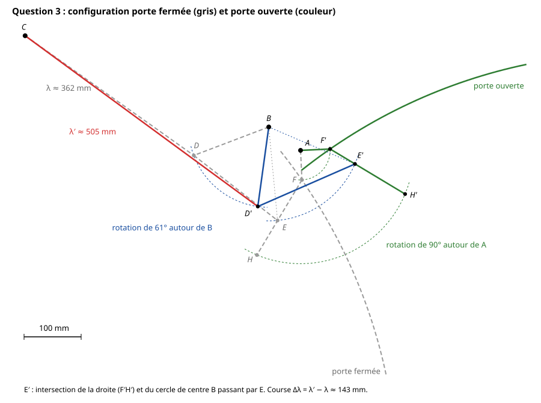
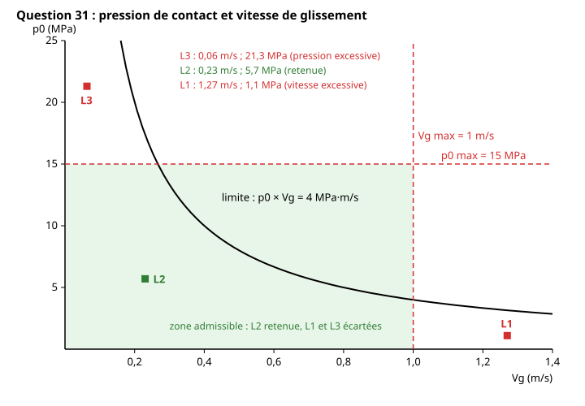
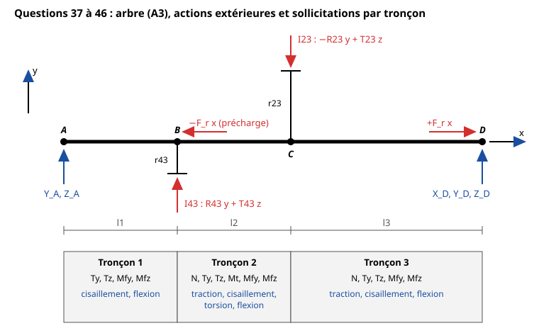

# Banque PT PT — Sciences industrielles B 2023 · Corrigé guidé

*Corrigé rédigé par IA, non officiel. Signalez toute erreur.*

**Rédaction** · modèle exact non renseigné (famille Claude) · effort non renseigné · vitesse non renseignée

## Présentation du sujet

**Support.** Un avion-cargo de petite capacité embarque ses marchandises par une porte latérale avant, articulée en haut du fuselage. Un actionneur linéaire électrique (moteur à courant continu, réducteur à trois étages, vis-écrou) pousse un basculeur qui relève la porte de $90°$ en moins de $30\ \mathrm{s}$. L'étude valide la cinématique, choisit la transmission et son limiteur de couple, puis dimensionne un arbre du réducteur et ses roulements.

**Durée et format.** 6 heures, calculatrice interdite, réponses à porter dans les cadres d'un cahier réponse de 11 pages. 56 questions, trois parties indépendantes. Le rapport précise que la session 2023 inaugure un nouveau format : la partie de conception graphique disparaît au profit d'une notice plus longue.

| Partie | Contenu | Questions | Durée conseillée | Poids (rapport du jury) |
|---|---|---|---|---|
| I | Trajectoires, choix d'une liaison, tracé de la position ouverte, loi entrée/sortie, effort du vérin par l'énergie cinétique | 1 à 12 | 1 h 45 | 22 % |
| II | Rendement, choix du moteur, rapports de transmission, inerties, régime transitoire, limiteur de couple, rondelles élastiques | 13 à 36 | 2 h | 42 % |
| III | Statique de l'arbre, torseur de cohésion, contraintes, critère de Von Mises, durée de vie des roulements | 37 à 56 | 1 h 45 | 36 % |

L'énoncé conseille 30 minutes de lecture préalable.

**Notions mobilisées.** Trajectoires et liaisons planes, fermeture géométrique, loi entrée/sortie, puissance et théorème de l'énergie cinétique, rendement d'une chaîne de transmission, système vis-écrou, moteur à courant continu, inertie équivalente, réponse d'un premier ordre, couple transmissible par adhérence, association de ressorts, principe fondamental de la statique, torseur de cohésion, contraintes de flexion, traction et torsion, contrainte de Von Mises, durée de vie $L_{10}$.

**Documents-réponses.** Deux questions demandent un travail graphique sur le cahier : le tracé de la position ouverte (question 3) et l'identification de trois points sur un graphique (question 31). Les figures 1 et 2 de ce corrigé les redessinent à l'échelle, sans reprendre les fonds de l'énoncé ; la figure 3 résume le chargement de l'arbre.

**Notation abrégée.** $K = \omega_m/\dot\theta_1$, rapport global entre la vitesse du moteur et celle de la porte (question 17).

> [!JURY]
> Le rapport 2023 juge le sujet structurellement long mais sans difficulté particulière de compréhension, chaque question ayant été réussie intégralement par plusieurs candidats. Il regrette que des connaissances de base ne soient pas maîtrisées par bon nombre de candidats (il cite le torseur de cohésion, les formules de résistance des matériaux, le principe fondamental de la statique, celui de la dynamique et le théorème de l'énergie cinétique). Il demande de répondre précisément à la question posée, en distinguant expression littérale et application numérique, dans l'unité requise et avec les variables spécifiées, et de mener les applications numériques à la main ; une tolérance de quelques pourcents est appliquée aux résultats numériques.

**Sources officielles.** [Sujet](https://www.banquept.fr/documents/2023/si_b_2023_pt.pdf) · [Rapport du jury](https://www.banquept.fr/documents/ecrit/rapport/2023/rapport_si_b_ecrit_2023.pdf)

---

## Partie I — Caractéristiques d'un actionneur permettant de valider l'exigence 1.4

### Question 1

> [!INDICATION]
> Un point d'un solide en liaison pivot avec le châssis décrit un cercle : quel est son centre, quel est son rayon ?

> [!INDICATION]
> Exprimer les rayons avec les paramètres géométriques de l'annexe C.

#### Solution

Le basculeur $(S_2)$ est en liaison pivot d'axe $(B,\vec z)$ avec le châssis, la porte $(S_1)$ en liaison pivot d'axe $(A,\vec z)$.

- **Point $D$** de $(S_2)$ par rapport à $(S_0)$ : cercle (arc) de centre $B$ et de rayon $BD = a_2$.
- **Point $E$** de $(S_2)$ par rapport à $(S_0)$ : cercle de centre $B$ et de rayon $BE = \sqrt{b_2^2 + c_2^2}$.
- **Point $F$** de la porte $(S_1)$ par rapport à $(S_0)$ : cercle de centre $A$ et de rayon $AF = \sqrt{c_1^2 + d_1^2}$.

(L'énoncé écrit « basculeur $(S_1)$ » pour le point $F$ : il s'agit de la porte.)

> [!PIEGE]
> Une trajectoire circulaire n'est définie que si l'on donne à la fois son centre et son rayon ; « un cercle » seul ne répond pas à la question.

### Question 2

> [!INDICATION]
> Le mécanisme est plan : la porte et le basculeur tournent chacun autour d'un point fixe. Que devient le triangle $ABE$ si $E$ est un point commun aux deux solides ?

> [!INDICATION]
> Compter les équations de liaison dans le plan : une pivot en apporte deux, une ponctuelle une seule.

#### Solution

Le mécanisme est plan. $(S_1)$ tourne autour de $A$, $(S_2)$ autour de $B$, $A$ et $B$ étant fixes.

| Liaison $(S_1)/(S_2)$ | Mécanisme bloqué | Mécanisme mobile | À retenir |
|---|---|---|---|
| Pivot d'axe $(E,\vec z)$ | X | | |
| Glissière d'axe $(F,\vec x_1)$ | X | | |
| Ponctuelle de normale $(E,\vec y_1)$ | | X | X |
| Rotule de centre $E$ | X | | |

Justification. Avec une pivot (ou une rotule, équivalente dans le plan) en $E$, le triangle $ABE$ a trois côtés de longueur fixe : il est indéformable. Avec une glissière, les deux solides tourneraient du même angle et le point $B$, vu de la porte, devrait se déplacer en ligne droite alors qu'il y décrit un cercle de centre $A$ : blocage. La ponctuelle de normale $\vec y_1$ impose seulement à $E$ de rester sur la droite $(F,\vec x_1)$ de la porte : une seule équation de liaison dans le plan, le mécanisme garde une mobilité.

> [!METHODE]
> Pour décider si un mécanisme plan est mobile, on peut compter : trois paramètres par solide mobile, deux équations par pivot ou glissière, une par ponctuelle. Ici la ponctuelle est la seule liaison qui laisse une mobilité.

### Question 3

> [!INDICATION]
> Commencer par ce qui est imposé : la porte tourne de $90°$ autour de $A$. Où vont $F$ et $H$ ?

> [!INDICATION]
> $E'$ doit être à la fois sur la droite $(F'H')$ et sur la trajectoire de $E$ trouvée à la question 1. Le basculeur est un solide : le triangle $BDE$ se reporte au compas.

#### Solution

Construction à la règle et au compas sur le cahier réponse :

1. Les points $A$, $B$ et $C$ sont fixes.
2. La porte tourne de $90°$ autour de $A$ dans le sens trigonométrique (elle se relève vers l'extérieur du fuselage, annexe A). $F'$ et $H'$ sont les images de $F$ et $H$ : $AF' = AF$, $AH' = AH$, $(AF')\perp(AF)$, $(AH')\perp(AH)$. La droite $(F'H')$ est l'image de $(FH)$.
3. $E'$ appartient au cercle de centre $B$ passant par $E$ (question 1) et à la droite $(F'H')$ : c'est leur intersection située entre $F'$ et $H'$.
4. Le basculeur est indéformable : $D'$ est à l'intersection du cercle de centre $B$ passant par $D$ et du cercle de centre $E'$ de rayon $ED$, du même côté de $(BE')$ que $D$ l'est de $(BE)$.
5. On trace $C D'$ (actionneur), $B D'$, $D' E'$ (basculeur), $A F'$, $F' H'$ et l'arc de la porte tourné de $90°$.

Le basculeur tourne d'environ $61°$ autour de $B$.

> [!PIEGE]
> Le point $E$ glisse le long de la porte : $E'$ n'est pas l'image de $E$ par la rotation de centre $A$. Seuls $F$ et $H$ tournent de $90°$ autour de $A$.

> [!JURY]
> Le rapport indique que le tracé des trajectoires a été réussi par moins de la moitié des candidats, ce qui les a pénalisés pour la suite.

### Question 4

> [!INDICATION]
> Mesurer $CD$ et $CD'$ à la règle et convertir avec le segment de $100\ \mathrm{mm}$ du document.

#### Solution

Mesures sur le tracé, avec l'échelle du document ($100\ \mathrm{mm}$ représentés par le segment de référence) :

$$\boxed{\lambda = CD \approx 360\ \mathrm{mm}\qquad \lambda' = CD' \approx 505\ \mathrm{mm}\qquad \Delta\lambda = \lambda' - \lambda \approx 145\ \mathrm{mm}}$$

(Reconstruction numérique à partir des coordonnées des points du document : $362\ \mathrm{mm}$, $505\ \mathrm{mm}$ et $143\ \mathrm{mm}$.) Cette course est cohérente avec celle de $150\ \mathrm{mm}$ retenue en partie II et avec l'écart lu sur la figure 8 ($428 - 276 = 152\ \mathrm{mm}$ entre $40°$ et $130°$).

> [!JURY]
> D'après le rapport, moins d'un quart des candidats poursuivent en choisissant une liaison adaptée et trouvent les longueurs et la course de vérin adaptées au problème.

### Question 5

> [!INDICATION]
> Vitesse moyenne : distance parcourue divisée par la durée. Attention à l'unité demandée.

#### Solution

$$\boxed{\widetilde V = \frac{\Delta\lambda}{T}}$$

$$\boxed{\widetilde V \approx \frac{145}{30} \approx 4{,}8\ \mathrm{mm\cdot s^{-1}}}$$

soit environ $5\ \mathrm{mm\cdot s^{-1}}$, valeur retenue par l'énoncé en partie II.

### Question 6

> [!INDICATION]
> Lister les paramètres variables de l'annexe C. Combien de relations indépendantes faut-il pour qu'il ne reste qu'un paramètre libre ?

#### Solution

- Nombre de mobilités utiles : **1** (l'allongement du vérin commande l'ouverture de la porte).
- Nombre de paramètres introduits : **5** ($\theta_1$, $\theta_2$, $\theta_3$, $\lambda$, $\delta$).
- Nombre d'équations scalaires liant ces paramètres : $5 - 1 =$ **4**, soit deux fermetures géométriques planes. Pour la seule loi $\lambda = f(\theta_1)$, trois équations suffisent si l'on évite d'introduire $\delta$ (question 7).

> [!PIEGE]
> Le décompte dépend de ce que l'on compte : quatre équations relient les cinq paramètres, mais la question 7 montre qu'en évitant $\delta$ trois équations suffisent pour la loi $\lambda = f(\theta_1)$. Préciser le raisonnement sur la copie.

### Question 7

> [!INDICATION]
> Pour chaque vecteur, repérer la base dans laquelle il est constant et les angles qui apparaissent une fois projeté.

> [!INDICATION]
> $\overrightarrow{FE}$ est porté par $\vec x_1$ : que vaut sa projection sur $\vec y_1$ ?

#### Solution

| Jeu d'équations | Nombre d'équations scalaires | Paramètres impliqués | À retenir |
|---|---|---|---|
| $\overrightarrow{CD}+\overrightarrow{DB}+\overrightarrow{BC} = \vec 0$ | 2 | $\lambda$, $\theta_3$, $\theta_2$ | X |
| $\overrightarrow{BE}\cdot\vec x_1 = (\overrightarrow{BA}+\overrightarrow{AF}+\overrightarrow{FE})\cdot\vec x_1$ | 1 | $\theta_1$, $\theta_2$, $\delta$ | |
| $\overrightarrow{BE}\cdot\vec y_1 = (\overrightarrow{BA}+\overrightarrow{AF}+\overrightarrow{FE})\cdot\vec y_1$ | 1 | $\theta_1$, $\theta_2$ | X |

La fermeture $C,D,B$ donne $\lambda$ en fonction de $\theta_2$ après élimination de $\theta_3$. La projection sur $\vec y_1$ de la seconde fermeture relie $\theta_2$ à $\theta_1$ sans faire intervenir $\delta$, puisque $\overrightarrow{FE} = \delta\,\vec x_1$ est orthogonal à $\vec y_1$. La projection sur $\vec x_1$ introduit l'inconnue supplémentaire $\delta$ : elle ne sert qu'à calculer $\delta$.

> [!METHODE]
> Dans une fermeture géométrique, projeter sur la direction perpendiculaire à un vecteur de norme inconnue fait disparaître cette inconnue.

### Question 8

> [!INDICATION]
> Dériver $\lambda = f(\theta_1(t))$ par rapport au temps (fonction composée).

#### Solution

$\lambda = f(\theta_1)$, donc en dérivant par rapport au temps :

$$\boxed{V(\theta_1) = \dot\lambda = f'(\theta_1)\,\dot\theta_1}$$

### Question 9

> [!INDICATION]
> À $V$ fixée, la vitesse de la porte $V/f'(\theta_1)$ varie avec la position. Où est-elle la plus faible ? la plus forte ?

> [!INDICATION]
> Convertir $3°\cdot\mathrm{s^{-1}}$ en radians par seconde, car $f'$ est en mètres par radian.

#### Solution

Avec $V$ constante, $\dot\theta_1 = V/f'(\theta_1)$. La figure 9 donne $f'_{max}\approx 0{,}125\ \mathrm{m\cdot rad^{-1}}$ (vers $52°$) et $f'_{min}\approx 0{,}064\ \mathrm{m\cdot rad^{-1}}$ (à $130°$). On convertit $3°\cdot\mathrm{s^{-1}} = \pi/60 \approx 0{,}0524\ \mathrm{rad\cdot s^{-1}}$.

Vitesse de la porte au moins égale à $3°\cdot\mathrm{s^{-1}}$ partout : la condition la plus sévère est celle où $f'$ est maximal.

$$\boxed{V \geq f'_{max}\times\frac{\pi}{60} \approx 0{,}125\times0{,}0524 \approx 6{,}5\ \mathrm{mm\cdot s^{-1}}}$$

Vitesse de la porte au plus égale à $3°\cdot\mathrm{s^{-1}}$ partout : la condition la plus sévère est celle où $f'$ est minimal.

$$\boxed{V \leq f'_{min}\times\frac{\pi}{60} \approx 0{,}064\times0{,}0524 \approx 3{,}4\ \mathrm{mm\cdot s^{-1}}}$$

> [!PIEGE]
> Les deux conditions ne font pas intervenir la même valeur de $f'$ : le minimum de vitesse de la porte se produit là où $f'$ est maximal, et inversement. Les deux exigences ne peuvent pas être tenues simultanément avec une vitesse de vérin constante.

> [!JURY]
> Selon le rapport, la sous-partie sur la vitesse de l'actionneur (temps d'ouverture et de fermeture) n'est traitée correctement que par 10 % environ des candidats.

### Question 10

> [!INDICATION]
> Puissance d'une force : produit scalaire de la force par la vitesse de son point d'application.

> [!INDICATION]
> Calculer la vitesse de $G$ par $\dot\theta_1\,\vec z\wedge\overrightarrow{AG}$, puis projeter $\vec x_1$ et $\vec y_1$ sur la verticale $\vec y$.

#### Solution

Puissance développée par l'actionneur (effort $F_v\,\vec x_3$ entre le corps et la tige, vitesse relative $\dot\lambda\,\vec x_3$) :

$$\boxed{P_v = F_v\,V(\theta_1)}$$

Puissance de la pesanteur sur la porte. Avec $\overrightarrow{AG} = -a_1\vec x_1 - b_1\vec y_1$ :

$$\begin{aligned}
\vec V(G\in S_1/S_0) &= \dot\theta_1\,\vec z\wedge\overrightarrow{AG}\\
&= \dot\theta_1\,(b_1\,\vec x_1 - a_1\,\vec y_1)
\end{aligned}$$

Avec $\vec y\cdot\vec x_1 = \sin\theta_1$ et $\vec y\cdot\vec y_1 = \cos\theta_1$ :

$$\boxed{P_p = -M g\,\vec y\cdot\vec V(G) = M g\,\dot\theta_1\,(a_1\cos\theta_1 - b_1\sin\theta_1)}$$

Cette puissance est négative sur toute la plage $40°$ à $130°$ : le poids s'oppose à l'ouverture.

> [!PIEGE]
> Le résultat doit être exprimé avec les grandeurs demandées : $V(\theta_1)$ et $F_v$ pour $P_v$ ; $M$, $g$, $\theta_1$, $\dot\theta_1$, $a_1$ et $b_1$ pour $P_p$. Vérifier le signe : le poids résiste à l'ouverture.

### Question 11

> [!INDICATION]
> En régime permanent, que vaut la dérivée de l'énergie cinétique ? Quelles puissances restent si les liaisons sont parfaites ?

> [!INDICATION]
> Remplacer $V(\theta_1)$ par l'expression de la question 8 : $\dot\theta_1$ se simplifie.

#### Solution

- **Hypothèses** : référentiel lié au châssis supposé galiléen ; liaisons parfaites (puissance des inter-efforts de liaison nulle) ; régime permanent, donc variation d'énergie cinétique négligée ; masses négligées sauf celle de la porte.
- **Système isolé** : l'ensemble des pièces mobiles $\{S_1, S_2, S_3, S_4\}$.

Théorème de l'énergie cinétique : $0 = P_v + P_p$, soit $F_v\,f'(\theta_1)\,\dot\theta_1 = M g\,\dot\theta_1\,(b_1\sin\theta_1 - a_1\cos\theta_1)$.

$$\boxed{F_v = \frac{M g\,(b_1\sin\theta_1 - a_1\cos\theta_1)}{f'(\theta_1)}}$$

Contrôle à $130°$ pour $1\ \mathrm{kg}$ : $9{,}81\times(0{,}383 + 0{,}161)/0{,}064 \approx 83\ \mathrm{N}$, valeur de la figure 10.

### Question 12

> [!INDICATION]
> La figure 10 est tracée pour $1\ \mathrm{kg}$ : l'effort est proportionnel à la masse.

#### Solution

La figure 10 est croissante sur toute la plage ; son maximum, environ $83{,}5\ \mathrm{N}$ pour $1\ \mathrm{kg}$, est atteint en fin d'ouverture. L'effort est proportionnel à la masse ; pour la masse nominale $M = 100\ \mathrm{kg}$ :

$$\boxed{F_v^{max} \approx 100\times83{,}5 \approx 8{,}4\times10^{3}\ \mathrm{N}\qquad\text{pour}\quad \theta_1 = 130°\ \text{(porte ouverte)}}$$

> [!JURY]
> Le rapport note que la sous-partie consacrée aux efforts à développer par l'actionneur est en moyenne un peu mieux traitée que les précédentes.

---

## Partie II — Choix de la transmission interne à l'actionneur

### Question 13

> [!INDICATION]
> Les rendements d'éléments en série se multiplient. Combien d'étages de réduction ?

> [!INDICATION]
> La puissance utile est $F_v V$ ; attention aux millimètres par seconde.

#### Solution

Trois étages de réduction puis le système vis-écrou :

$$\boxed{\eta = \eta_r^{3}\,\eta_v}$$

$$\eta = 0{,}95^3\times0{,}7 \approx 0{,}857\times0{,}7 \approx 0{,}60$$

$$\boxed{P_m = \frac{F_v\,V}{\eta}}$$

$$\boxed{P_m = \frac{12\,000\times5\times10^{-3}}{0{,}60} = 100\ \mathrm{W}}$$

> [!METHODE]
> Sans calculatrice : $0{,}95^3\approx1 - 3\times0{,}05 + 3\times0{,}0025\approx0{,}857$, puis $0{,}857\times0{,}7\approx0{,}6$.

> [!JURY]
> Le rapport juge cette partie la moins bien traitée des trois : il y compte 7 questions sur 23 réussies par plus de 20 % des candidats.

### Question 14

> [!INDICATION]
> Trois filtres : la puissance trouvée à la question 13, la tension disponible à bord (annexe B, figure 6), l'encombrement.

#### Solution

Critères : puissance nominale au moins égale à $100\ \mathrm{W}$ ; tension d'alimentation compatible avec le réseau de bord, entre $18$ et $30\ \mathrm{V}$ et $24\ \mathrm{V}$ au nominal (exigence 1.1.1.1) ; diamètre compatible avec l'encombrement radial de $80\ \mathrm{mm}$ (tous les moteurs du tableau le sont, $D\leq50\ \mathrm{mm}$).

Les moteurs de $80$ et $90\ \mathrm{W}$ sont insuffisants. Parmi les moteurs de $150$ et $200\ \mathrm{W}$, seuls ceux alimentés en $24\ \mathrm{V}$ conviennent :

$$\boxed{\text{RE-40-150-24}\quad\text{et}\quad\text{RE-50-200-24}}$$

Le premier ($7580\ \mathrm{tr\cdot min^{-1}}$ à vide, $177\ \mathrm{mN\cdot m}$) correspond au moteur dont l'énoncé donne ensuite les caractéristiques.

### Question 15

> [!INDICATION]
> Un tour de vis fait avancer l'écrou d'un pas. Relier ensuite $\omega_v$ à $\omega_m$ par les trois rapports de réduction (tous supérieurs à 1).

#### Solution

Un tour de vis ($2\pi$ radians) fait avancer l'écrou d'un pas $p$ (exprimé en mètres par tour) :

$$\boxed{V = \frac{p}{2\pi}\,\omega_v\qquad\text{soit}\qquad \omega_v = \frac{2\pi\,V}{p}}$$

Avec $\omega_v = \omega_m/(r_1 r_2 r_3)$ :

$$\boxed{V = \frac{p\,\omega_m}{2\pi\,r_1\,r_2\,r_3}}$$

### Question 16

> [!INDICATION]
> Isoler $p/r$ dans la relation de la question 15. Quel régime moteur retenir en fonctionnement permanent ?

> [!INDICATION]
> Exprimer la vitesse du moteur en tours par seconde pour obtenir directement des millimètres par tour.

#### Solution

$$\boxed{\frac{p}{r} = \frac{2\pi\,V}{\omega_m}}$$

Au régime nominal, $N_m = 7000\ \mathrm{tr\cdot min^{-1}}$, soit $7000/60\approx116{,}7\ \mathrm{tr\cdot s^{-1}}$. Le pas étant en millimètres par tour :

$$\boxed{\frac{p}{r} = \frac{V}{N_m/60} = \frac{5\times60}{7000} \approx 0{,}043\ \mathrm{mm\cdot tr^{-1}}}$$

Avec $p = 8\ \mathrm{mm}$ par tour, il faut $r\approx187$.

> [!JURY]
> Le rapport regrette que des candidats au raisonnement juste soient fortement pénalisés parce qu'ils donnent l'expression littérale au lieu de l'application numérique (ou l'inverse), n'expriment pas le résultat en fonction des quantités demandées ou n'effectuent pas l'application numérique dans l'unité demandée.

### Question 17

> [!INDICATION]
> Dériver $\lambda = r'\theta_1$ et égaler à la vitesse du vérin de la question 15.

#### Solution

$\lambda = r'\theta_1$ donne $V = r'\dot\theta_1$ ; la question 15 donne $V = p\,\omega_m/(2\pi r)$.

$$\boxed{\frac{\omega_m}{\dot\theta_1} = \frac{2\pi\,r\,r'}{p}}$$

$$\boxed{\frac{\omega_m}{\dot\theta_1} = \frac{2\pi\times0{,}1}{0{,}0429\times10^{-3}} \approx 1{,}47\times10^{4}}$$

(sans unité, $p/r$ étant exprimé en mètres par tour). On note $K$ ce rapport.

### Question 18

> [!INDICATION]
> Masse uniformément répartie sur un arc d'angle $\beta_0$ : quelle fraction de $M$ porte l'angle $d\beta$ ?

> [!INDICATION]
> $w$ est une corde du cercle de rayon $R$ interceptant l'angle $\beta$ : triangle isocèle ou théorème d'Al-Kashi.

#### Solution

La masse est répartie uniformément sur l'arc d'angle $\beta_0$ :

$$\boxed{dm = \frac{M}{\beta_0}\,d\beta}$$

$A$ et $P$ sont sur le cercle de rayon $R$, séparés par l'angle au centre $\beta$ ; $w$ est la corde correspondante :

$$\boxed{w^2 = 4R^2\sin^2\frac{\beta}{2} = 2R^2\,(1-\cos\beta)}$$

### Question 19

> [!INDICATION]
> Intégrer $w^2\,dm$ de $0$ à $\beta_0$.

#### Solution

$$\begin{aligned}
J_p &= \int_0^{\beta_0} 2R^2(1-\cos\beta)\,\frac{M}{\beta_0}\,d\beta\\
&= \frac{2MR^2}{\beta_0}\,(\beta_0 - \sin\beta_0)
\end{aligned}$$

$$\boxed{J_p = 2\,M R^2\left(1 - \frac{\sin\beta_0}{\beta_0}\right)}$$

Pour $\beta_0 = \pi/2$ et $R = 1{,}5\ \mathrm{m}$ :

$$\boxed{J_p = 2\times100\times2{,}25\times\left(1-\frac{2}{\pi}\right) \approx 450\times0{,}363 \approx 164\ \mathrm{kg\cdot m^2}}$$

> [!METHODE]
> Contrôle par un cas limite : pour $\beta_0\to0$, $1 - \sin\beta_0/\beta_0\to0$ et l'inertie s'annule (toute la masse est sur l'axe). Sans calculatrice : $2/\pi\approx0{,}637$.

### Question 20

> [!INDICATION]
> Écrire que l'inertie équivalente donne la même énergie cinétique que le rotor réel.

> [!INDICATION]
> Le rapport des vitesses est celui de la question 17 ; il intervient au carré.

#### Solution

Égalité des énergies cinétiques : $\tfrac12 J_{m,eq}\,\dot\theta_1^2 = \tfrac12 J_m\,\omega_m^2$.

$$\boxed{J_{m,eq} = J_m\left(\frac{2\pi\,r\,r'}{p}\right)^{2}}$$

$$\boxed{J_{m,eq} = 140\times10^{-7}\times(1{,}47\times10^{4})^{2} \approx 3{,}0\times10^{3}\ \mathrm{kg\cdot m^2}}$$

Commentaire : l'inertie du rotor ramenée à l'axe de la porte est environ dix-huit fois plus grande que celle de la porte. On ne peut pas la négliger ; c'est au contraire elle qui domine, ce qui explique la valeur $J_{eq} = 3000\ \mathrm{kg\cdot m^2}$ de l'énoncé.

> [!PIEGE]
> Une inertie de $1{,}4\times10^{-5}\ \mathrm{kg\cdot m^2}$ paraît négligeable, mais elle est multipliée par le carré d'un rapport de transmission de l'ordre de $10^4$. Comparer des inerties n'a de sens que ramenées au même axe.

### Question 21

> [!INDICATION]
> Écrire le théorème de l'énergie cinétique avec deux puissances : celle du moteur $C_m\omega_m$ et celle du poids $C_p\dot\theta_1$.

> [!INDICATION]
> Éliminer $i_m$ et $e_m$ avec les trois équations électriques, puis remplacer $\omega_m$ par $K\dot\theta_1$ et diviser par $J_{eq}\dot\theta_1$.

#### Solution

Théorème de l'énergie cinétique appliqué à l'ensemble mobile (rotor, transmission, porte), dans le référentiel du châssis, liaisons parfaites :

$$\frac{d}{dt}\left(\tfrac12 J_{eq}\,\dot\theta_1^2\right) = C_m\,\omega_m + C_p(\theta_1)\,\dot\theta_1$$

Avec $\omega_m = K\dot\theta_1$ et les équations du moteur, $C_m = k_m\,i_m = \dfrac{k_m}{R_m}\,(U_m - k_m K\dot\theta_1)$ :

$$J_{eq}\,\ddot\theta_1 = \frac{K k_m}{R_m}\,(U_m - k_m K\,\dot\theta_1) + C_p(\theta_1)$$

$$\boxed{\begin{aligned}
A_1 &= \frac{k_m^2}{R_m\,J_{eq}}\left(\frac{2\pi r r'}{p}\right)^{2}\\
A_0 &= 0\\
B(\theta_1) &= \frac{2\pi r r'}{p}\,\frac{k_m\,U_m}{R_m\,J_{eq}} + \frac{C_p(\theta_1)}{J_{eq}}
\end{aligned}}$$

avec, d'après la question 10, $C_p(\theta_1) = M g\,(a_1\cos\theta_1 - b_1\sin\theta_1)$.

> [!JURY]
> Le rapport constate que plus on avance dans cette sous-partie (régime transitoire, inerties), moins les questions sont traitées et moins les réponses sont justes.

### Question 22

> [!INDICATION]
> L'ordre est celui de la dérivée la plus élevée de $\theta_1$. Une équation est linéaire si l'inconnue et ses dérivées n'apparaissent qu'au premier degré, sans fonction non linéaire.

#### Solution

- $C_p(\theta_1)$ quelconque : équation d'**ordre 2** en $\theta_1$, **non linéaire** (le second membre dépend de $\theta_1$ par des fonctions trigonométriques).
- $C_p$ indépendant de $\theta_1$ : équation **linéaire** à coefficients constants, toujours d'**ordre 2** en $\theta_1$ ; comme $A_0 = 0$, elle se ramène à une équation du premier ordre pour la vitesse $\dot\theta_1$, ce qui justifie la constante de temps de la question 23.
- Méthode dans le cas général : mise sous forme d'un système du premier ordre pour le vecteur $(\theta_1,\dot\theta_1)$, puis intégration pas à pas par un schéma d'Euler explicite (ou de Runge-Kutta), avec un pas de temps petit devant la constante de temps.

> [!PIEGE]
> Selon que l'on regarde l'inconnue $\theta_1$ ou la vitesse $\dot\theta_1$, le cas simplifié se lit comme une équation d'ordre 2 ou d'ordre 1. Indiquer sur la copie l'inconnue considérée.

> [!JURY]
> Le rapport juge regrettable que, pour les réponses à choix multiples comme celle de cette question, des candidats cochent les cases de façon aléatoire.

### Question 23

> [!INDICATION]
> Avec $A_0 = 0$ et $B$ constant, poser $\omega = \dot\theta_1$ : forme canonique d'un premier ordre.

#### Solution

Avec $B$ constant, $\dot\theta_1$ vérifie $\dfrac{d\dot\theta_1}{dt} + A_1\,\dot\theta_1 = B$ : premier ordre.

$$\boxed{\tau = \frac{1}{A_1} = \frac{R_m\,J_{eq}}{k_m^2}\left(\frac{p}{2\pi r r'}\right)^{2}}$$

$$\boxed{\tau = \frac{1\times3000}{(0{,}03)^2\times(1{,}47\times10^{4})^2} \approx \frac{3000}{1{,}93\times10^{5}} \approx 1{,}6\times10^{-2}\ \mathrm{s}}$$

Commentaire : le régime permanent est atteint en $3\tau\approx50\ \mathrm{ms}$, durée négligeable devant les $30\ \mathrm{s}$ d'ouverture. Sous cette hypothèse, le régime transitoire n'a pas à être pris en compte dans l'estimation du temps d'ouverture. La vitesse établie vaut $B/A_1\approx U_m/(k_m K)\approx0{,}055\ \mathrm{rad\cdot s^{-1}}$, soit environ $3{,}1°\cdot\mathrm{s^{-1}}$.

> [!METHODE]
> Sans calculatrice : $K^2\approx2{,}15\times10^{8}$, $k_m^2 = 9\times10^{-4}$, produit $\approx1{,}93\times10^{5}$ ; $3000/1{,}93\times10^{5}\approx1{,}6\times10^{-2}$.

### Question 24

> [!INDICATION]
> Constante de temps d'un premier ordre : instant où la réponse atteint 63 % de sa valeur finale.

> [!INDICATION]
> Pour le temps d'ouverture, lire sur la figure 14 l'instant où la porte a tourné de $90°$ depuis sa position initiale.

#### Solution

Sur la figure 15 (b), la vitesse se stabilise à environ $3{,}35$ ; $63\ \%$ de cette valeur ($\approx2{,}1$) sont atteints vers $t\approx0{,}018\ \mathrm{s}$ (la courbe passe par $1{,}45$ à $0{,}01\ \mathrm{s}$ et $2{,}25$ à $0{,}02\ \mathrm{s}$).

$$\boxed{\widetilde\tau \approx 1{,}8\times10^{-2}\ \mathrm{s}}$$

Commentaire : même ordre de grandeur que $\tau\approx1{,}6\times10^{-2}\ \mathrm{s}$ ; l'hypothèse d'un couple de pesanteur constant est sans effet sensible sur le transitoire, qui reste négligeable. (L'axe de la figure 15 est libellé en radians par seconde ; les valeurs lues, voisines de $3$, correspondent à des degrés par seconde, en accord avec la pente de la figure 14 et la valeur établie calculée à la question 23.)

Temps d'ouverture : sur la figure 14, $\theta_1$ part de $40°$ et atteint $130°$ (débattement de $90°$) vers $t\approx28{,}7\ \mathrm{s}$ (la courbe passe par $119°$ à $25\ \mathrm{s}$ et $134°$ à $30\ \mathrm{s}$).

$$\boxed{t_{ouverture}\approx 29\ \mathrm{s} < 30\ \mathrm{s}\ :\ \text{exigence 1.4.2 respectée, avec peu de marge}}$$

### Question 25

> [!INDICATION]
> Effort = pression × aire de la couronne.

#### Solution

Pression uniforme $p_0$ sur la couronne de rayons $R_i$ et $R_e$ :

$$\boxed{F_r = p_0\,\pi\,(R_e^2 - R_i^2)}$$

> [!JURY]
> Le rapport relève que le début de la sous-partie sur le limiteur de couple, pourtant assez classique, a été peu réussi.

### Question 26

> [!INDICATION]
> Sur un anneau élémentaire de rayon $\rho$, l'effort tangentiel limite vaut $\mu\,p_0\,2\pi\rho\,d\rho$ et son bras de levier est $\rho$.

> [!INDICATION]
> Combien de surfaces frottantes la roue dentée présente-t-elle (annexe J) ?

#### Solution

À la limite du glissement, la densité surfacique d'effort tangentiel vaut $\mu\,p_0$. Pour une face de contact :

$$\int_{R_i}^{R_e}\mu\,p_0\;\rho\;2\pi\rho\,d\rho = \frac{2\pi}{3}\,\mu\,p_0\,(R_e^3 - R_i^3)$$

La roue dentée est serrée entre le plateau presseur et le plateau fixe, tous deux solidaires de l'arbre : deux faces transmettent le couple.

$$\boxed{C_l = \frac{4\pi}{3}\,\mu\,p_0\,(R_e^3 - R_i^3)}$$

(Avec une seule face frottante, le couple serait moitié moindre.)

> [!PIEGE]
> Écrire $C_l = \mu F_r R_{moyen}$ suppose l'effort concentré au rayon moyen ; avec une pression uniforme, il faut intégrer, et ne pas oublier que la roue frotte sur ses deux faces.

### Question 27

> [!INDICATION]
> Couple sur la vis pour un effort axial $F$ et un rendement unitaire : $F\,p/(2\pi)$. Remonter ensuite étage par étage.

#### Solution

Rendement unitaire : le couple sur l'arbre-vis $(A_4)$ associé à l'effort $F_v^{max}$ vaut $F_v^{max}\,p/(2\pi)$, $p$ en mètres par tour. Chaque étage divise le couple par son rapport en remontant vers le moteur.

$$\boxed{\begin{aligned}
C_l^{1} &= \frac{F_v^{max}\,p}{2\pi\,r_2\,r_3}\\
C_l^{2} &= \frac{F_v^{max}\,p}{2\pi\,r_3}\\
C_l^{3} &= \frac{F_v^{max}\,p}{2\pi}
\end{aligned}}$$

### Question 28

> [!INDICATION]
> Inverser la relation de la question 26 et y reporter les trois couples.

#### Solution

D'après la question 26, $p_0 = \dfrac{3\,C_l}{4\pi\,\mu\,(R_e^3 - R_i^3)}$.

$$\boxed{\begin{aligned}
p_0^{1} &= \frac{3\,F_v^{max}\,p}{8\pi^2\,\mu\,r_2\,r_3\,(R_e^3 - R_i^3)}\\
p_0^{2} &= \frac{3\,F_v^{max}\,p}{8\pi^2\,\mu\,r_3\,(R_e^3 - R_i^3)}\\
p_0^{3} &= \frac{3\,F_v^{max}\,p}{8\pi^2\,\mu\,(R_e^3 - R_i^3)}
\end{aligned}}$$

### Question 29

> [!INDICATION]
> Porte bloquée : quelles pièces tournent encore, lesquelles sont arrêtées ? La vitesse de glissement est la vitesse relative au rayon le plus grand.

#### Solution

Porte bloquée : tout ce qui est en aval du limiteur est arrêté, tout ce qui est en amont tourne. La vitesse de glissement est maximale au rayon extérieur $R_e$ et vaut $R_e$ fois la vitesse de rotation de la roue qui porte le limiteur.

$$\boxed{\begin{aligned}
V_g^{1} &= \frac{R_e\,\omega_m}{r_1}\\
V_g^{2} &= \frac{R_e\,\omega_m}{r_1\,r_2}\\
V_g^{3} &= \frac{R_e\,\omega_m}{r_1\,r_2\,r_3}
\end{aligned}}$$

### Question 30

> [!INDICATION]
> Puissance surfacique de frottement : contrainte tangentielle $\mu p_0$ multipliée par la vitesse de glissement.

> [!INDICATION]
> Multiplier les résultats des questions 28 et 29 : que deviennent les rapports de réduction ?

#### Solution

Puissance dissipée par unité de surface au point le plus rapide : $P_d = \mu\,p_0\,V_g$.

$$\boxed{P_d^{1} = P_d^{2} = P_d^{3} = \frac{3\,F_v^{max}\,p\,R_e\,\omega_m}{8\pi^2\,r_1\,r_2\,r_3\,(R_e^3 - R_i^3)}}$$

Le coefficient $\mu$ se simplifie ; le pas $p$ de la vis intervient nécessairement, comme à la question 28.

Conclusion : la puissance surfacique maximale est la même dans les trois configurations (le produit $p_0\,V_g$ ne dépend pas de l'étage choisi). Ce n'est pas un critère pertinent pour les départager.

> [!JURY]
> Le rapport signale qu'à partir de cette question, les questions ont fréquemment été délaissées au profit de la dernière partie du sujet.

### Question 31

> [!INDICATION]
> Plus le limiteur est proche de la vis, plus le couple (donc la pression) est grand et plus la vitesse est faible.

> [!INDICATION]
> Comparer chaque point aux deux limites $p_0^{max}$ et $V_g^{max}$ données dans l'énoncé.

#### Solution

La pression croît et la vitesse de glissement décroît quand on se rapproche de la vis :

| Point du graphique | $V_g$ | $p_0$ | Configuration |
|---|---|---|---|
| en haut à gauche | $\approx0{,}06\ \mathrm{m\cdot s^{-1}}$ | $\approx21{,}3\ \mathrm{MPa}$ | $\mathcal L^3$ |
| au milieu | $\approx0{,}23\ \mathrm{m\cdot s^{-1}}$ | $\approx5{,}7\ \mathrm{MPa}$ | $\mathcal L^2$ |
| en bas à droite | $\approx1{,}27\ \mathrm{m\cdot s^{-1}}$ | $\approx1{,}1\ \mathrm{MPa}$ | $\mathcal L^1$ |

Contrôle : le rapport des pressions $21{,}3/5{,}7\approx3{,}7$ est bien $r_3 = 41/11$.

Les trois points sont sous la courbe limite de puissance surfacique ($p_0\,V_g = 4\ \mathrm{MPa\cdot m\cdot s^{-1}}$), comme attendu d'après la question 30. Les deux autres limites tranchent : $\mathcal L^3$ dépasse $p_0^{max} = 15\ \mathrm{MPa}$ ; $\mathcal L^1$ dépasse $V_g^{max} = 1\ \mathrm{m\cdot s^{-1}}$.

| Configuration | $\mathcal L^1$ | $\mathcal L^2$ | $\mathcal L^3$ |
|---|---|---|---|
| Choix | | X | |

$$\boxed{\text{Configuration retenue : } \mathcal L^{2}\ \text{(limiteur sur l'arbre } (A_3))}$$

> [!JURY]
> Le rapport note un léger mieux sur le choix de configuration par rapport au début de la sous-partie.

### Question 32

> [!INDICATION]
> Calculer d'abord le couple limite dans la configuration retenue, avec $F_v^{max} = 20\,000\ \mathrm{N}$, puis multiplier par $A$.

#### Solution

$$\begin{aligned}
C_l^{2} &= \frac{F_v^{max}\,p}{2\pi\,r_3}\\
&= \frac{20\,000\times8\times10^{-3}}{2\pi\times41/11}\\
&\approx \frac{160}{23{,}4} \approx 6{,}8\ \mathrm{N\cdot m}
\end{aligned}$$

$$\boxed{F_r = A\,C_l^{2} = 500\times6{,}83 \approx 3{,}4\times10^{3}\ \mathrm{N}}$$

> [!METHODE]
> Sans calculatrice : $2\pi\times41/11\approx6{,}28\times3{,}73\approx23{,}4$ ; $160/23{,}4\approx6{,}8$.

### Question 33

> [!INDICATION]
> Ressorts en parallèle : les raideurs s'ajoutent. Ressorts en série : les inverses des raideurs s'ajoutent.

#### Solution

Rondelles en parallèle dans un paquet : les raideurs s'ajoutent ($n_{r/p}\,k_r$). Paquets en série : les souplesses s'ajoutent.

$$\boxed{K_r = \frac{n_{r/p}}{n_p}\,k_r}$$

Chaque paquet s'écrase au plus de $h_0$ :

$$\boxed{\Delta^{max} = n_p\,h_0}$$

$$\boxed{F_r = K_r\,\varepsilon\,\Delta^{max} = n_{r/p}\,k_r\,\varepsilon\,h_0}$$

Contrôle sur le tableau de la question 36 : Sol1 donne $k_r h_0 = 750/0{,}25 = 3000\ \mathrm{N}$, soit $k_r = 5000\ \mathrm{N\cdot mm^{-1}}$ pour la rondelle d'épaisseur $1{,}85\ \mathrm{mm}$ ; Sol10 donne $k_r = 9000\ \mathrm{N\cdot mm^{-1}}$ pour celle de $2\ \mathrm{mm}$.

### Question 34

> [!INDICATION]
> Le couple est proportionnel à l'effort du vérin : la tolérance relative est la même.

#### Solution

La tolérance de $\pm10\ \%$ sur l'effort limite se reporte sur le couple de déclenchement :

$$\boxed{\Delta C = 0{,}1\,C_l^{nom} \approx 0{,}68\ \mathrm{N\cdot m}}$$

$$\boxed{\Delta F = A\,\Delta C}$$

$$\boxed{\Delta F = 500\times0{,}683 \approx 3{,}4\times10^{2}\ \mathrm{N}}$$

### Question 35

> [!INDICATION]
> De quel angle minimal faut-il tourner l'écrou pour passer d'une position où une languette fait face à une encoche à la suivante ?

> [!INDICATION]
> Convertir cet angle en déplacement axial avec le pas $p_e$, puis en effort avec la raideur $K_r$.

#### Solution

L'écrou ne peut être freiné que lorsqu'une des $N_l$ languettes fait face à une des $N_e$ encoches. Comme $4$ et $11$ sont premiers entre eux, deux positions de blocage successives sont séparées de $1/(N_e N_l)$ tour, soit un déplacement axial $p_e/(N_e N_l) = 1/44\ \mathrm{mm}$. L'effort presseur ne se règle donc que par pas de :

$$\boxed{\Delta F = K_r\,\frac{p_e}{N_e\,N_l} = \frac{n_{r/p}\,k_r\,p_e}{n_p\,N_e\,N_l}}$$

En divisant par $F_r = n_{r/p}\,k_r\,\varepsilon\,h_0$ :

$$\boxed{\frac{\Delta F}{F_r} = \frac{p_e}{\varepsilon\,h_0\,n_p\,N_e\,N_l}}$$

Contrôle : Sol1 donne $5000/44\approx114\ \mathrm{N}$, valeur du tableau.

Commentaire : l'erreur relative ne dépend pas du nombre de rondelles en parallèle. Elle diminue quand $n_p$ augmente : il faut un empilement **en série**, souple, avec le plus grand nombre de paquets, une grande flèche $h_0$ et un taux d'écrasement $\varepsilon$ élevé.

> [!METHODE]
> Avec $N_e$ encoches et $N_l$ languettes premiers entre eux, les coïncidences se succèdent tous les $1/(N_e N_l)$ tour : c'est le principe du vernier.

### Question 36

> [!INDICATION]
> Deux conditions : l'effort presseur de la question 32 doit être compris entre $F_r(0{,}25)$ et $F_r(0{,}75)$ ; le pas de réglage doit rester sous la tolérance de la question 34.

#### Solution

Critères, avec $F_r\approx3416\ \mathrm{N}$ (question 32) et $\Delta F\leq342\ \mathrm{N}$ (question 34) :

1. l'effort à installer doit être atteint pour $0{,}25\leq\varepsilon\leq0{,}75$ : $F_r(0{,}25)\leq3416\ \mathrm{N}\leq F_r(0{,}75)$ ;
2. le pas de réglage $\Delta F$ de la solution doit rester inférieur à la tolérance de $342\ \mathrm{N}$.

| Ref | Critère 1 | Critère 2 | Convient |
|---|---|---|---|
| Sol1 | non ($2250 < 3416$) | oui | |
| Sol3 | oui ($\varepsilon\approx0{,}57$) | oui ($227$) | X |
| Sol4 | oui ($\varepsilon\approx0{,}38$) | à la limite ($341$) | X (limite) |
| Sol5 | non | oui | |
| Sol6 | oui ($\varepsilon\approx0{,}38$) | oui ($170$) | X |
| Sol7 | oui ($\varepsilon\approx0{,}28$) | oui ($227$) | X |
| Sol8 | non | oui | |
| Sol9 | oui ($\varepsilon\approx0{,}57$) | oui ($76$) | X |
| Sol10 | non ($3375 < 3416$) | oui | |
| Sol11 | oui | non ($409$) | |
| Sol12 | oui | non ($614$) | |
| Sol13 | non | oui | |
| Sol14 | à la limite ($\varepsilon\approx0{,}25$) | oui ($307$) | X (limite) |
| Sol15 | non | oui | |
| Sol16 | oui ($\varepsilon\approx0{,}38$) | oui ($136$) | X |

Justification : Sol1, 5, 8, 10, 13 et 15 n'ont qu'une rondelle par paquet et ne fournissent pas l'effort presseur, même écrasées à $75\ \%$ ; Sol11 et Sol12, trop raides, ont un pas de réglage supérieur à la tolérance. La meilleure solution est **Sol9** (trois paquets de deux rondelles) : effort atteint au milieu de la plage d'écrasement et réglage le plus fin ($76\ \mathrm{N}$).

Réserve : la colonne « $\Delta F\,\%$ » du cahier réponse correspond à $\Delta F$ rapporté à un effort d'environ $2200\ \mathrm{N}$, et non aux $3416\ \mathrm{N}$ obtenus ici avec les données de l'énoncé. Si l'on applique directement le seuil de $10\ \%$ à cette colonne, Sol3 et Sol7 ($10{,}3\ \%$), Sol4 ($15{,}5\ \%$) et Sol14 ($13{,}9\ \%$) sont aussi éliminées ; il reste alors Sol6, Sol9 et Sol16, qui conviennent quelle que soit la lecture.

---

## Partie III — Dimensionnement d'un arbre de transmission et de ses paliers

### Question 37

> [!INDICATION]
> Une sphère-cylindre d'axe $\vec x$ laisse libre la translation selon $\vec x$ et les trois rotations ; une rotule laisse libres les trois rotations.

#### Solution

Sphère-cylindre d'axe $(A,\vec x)$ : pas d'effort axial, pas de moment en $A$. Rotule de centre $D$ : pas de moment en $D$.

$$\boxed{\left\{\mathcal T^{A}_{(0)\to(A_3)}\right\} = \begin{Bmatrix} 0 & 0\\ Y_A & 0\\ Z_A & 0\end{Bmatrix}_{A}\qquad \left\{\mathcal T^{D}_{(0)\to(A_3)}\right\} = \begin{Bmatrix} X_D & 0\\ Y_D & 0\\ Z_D & 0\end{Bmatrix}_{D}}$$

> [!JURY]
> Le rapport présente cette partie, calculatoire mais classique, comme la mieux réussie : pour près d'une question sur deux, un tiers des candidats obtient le maximum des points.

### Question 38

> [!INDICATION]
> Lire sur la figure 20 le sens des composantes en $I_{43}$, puis exprimer $T_{43}$ et $R_{43}$ avec $C_3$, $r_{43}$ et $\alpha$.

> [!INDICATION]
> Transport du moment : $\vec M_B = \vec M_{I_{43}} + \overrightarrow{BI_{43}}\wedge\vec R$.

#### Solution

Avec $T_{43} = C_3/r_{43}$ et $R_{43} = T_{43}\tan\alpha$ (figure 20 : $R_{43}\,\vec y + T_{43}\,\vec z$ en $I_{43}$) :

$$\boxed{\left\{\mathcal T^{I_{43}}_{(A_4)\to(A_3)}\right\} = \begin{Bmatrix} 0 & 0\\ \dfrac{C_3}{r_{43}}\tan\alpha & 0\\ \dfrac{C_3}{r_{43}} & 0\end{Bmatrix}_{I_{43}}\qquad \left\{\mathcal T^{B}_{(L)\to(A_3)}\right\} = \begin{Bmatrix} -F_r & 0\\ 0 & 0\\ 0 & 0\end{Bmatrix}_{B}}$$

Transport en $B$, avec $\overrightarrow{BI_{43}} = -r_{43}\,\vec y$ :

$$\begin{aligned}
\vec M_B &= -r_{43}\,\vec y\wedge(R_{43}\,\vec y + T_{43}\,\vec z)\\
&= -r_{43}\,T_{43}\,\vec x = -C_3\,\vec x
\end{aligned}$$

$$\boxed{\left\{\mathcal T^{B}_{Ext\to(A_3)}\right\} = \begin{Bmatrix} -F_r & -C_3\\ \dfrac{C_3}{r_{43}}\tan\alpha & 0\\ \dfrac{C_3}{r_{43}} & 0\end{Bmatrix}_{B}}$$

### Question 39

> [!INDICATION]
> Même démarche en $C$, avec $\overrightarrow{CI_{23}} = r_{23}\,\vec y$.

#### Solution

Figure 20 : $-R_{23}\,\vec y + T_{23}\,\vec z$ en $I_{23}$, avec $R_{23} = T_{23}\tan\alpha$ et $\overrightarrow{CI_{23}} = r_{23}\,\vec y$.

$$\boxed{\left\{\mathcal T^{I_{23}}_{(A_2)\to(A_3)}\right\} = \begin{Bmatrix} 0 & 0\\ -T_{23}\tan\alpha & 0\\ T_{23} & 0\end{Bmatrix}_{I_{23}} = \begin{Bmatrix} 0 & r_{23}\,T_{23}\\ -T_{23}\tan\alpha & 0\\ T_{23} & 0\end{Bmatrix}_{C}}$$

### Question 40

> [!INDICATION]
> Deux torseurs déjà exprimés au même point : additionner les composantes.

#### Solution

$$\boxed{\left\{\mathcal T^{D}_{Ext\to(A_3)}\right\} = \begin{Bmatrix} X_D + F_r & 0\\ Y_D & 0\\ Z_D & 0\end{Bmatrix}_{D}}$$

### Question 41

> [!INDICATION]
> Quelles grandeurs sont données ($C_3$, $F_r$, géométrie) ? Quelles composantes de liaison et quel effort d'engrènement restent à trouver ?

#### Solution

- **Inconnues statiques** : $Y_A$, $Z_A$, $X_D$, $Y_D$, $Z_D$ (actions de liaison) et $T_{23}$ (effort d'engrènement moteur) : six inconnues. $C_3$, $F_r$, $\alpha$ et la géométrie sont connus.
- **Système isolé** : l'arbre $(A_3)$ avec sa roue et son pignon.
- **Théorèmes** : principe fondamental de la statique (arbre en rotation uniforme, inertie négligée), théorème de la résultante et théorème du moment en $A$ : six équations scalaires. Le problème est isostatique.

### Question 42

> [!INDICATION]
> Transporter chaque torseur en $A$ avec $\vec x\wedge\vec y = \vec z$ et $\vec x\wedge\vec z = -\vec y$.

> [!INDICATION]
> Contrôler avec la solution fournie par l'énoncé.

#### Solution

Moments en $A$, avec $\overrightarrow{AB} = l_1\vec x$, $\overrightarrow{AC} = (l_1+l_2)\vec x$, $\overrightarrow{AD} = (l_1+l_2+l_3)\vec x$, $\vec x\wedge\vec y = \vec z$ et $\vec x\wedge\vec z = -\vec y$.

$$\boxed{\begin{aligned}
0 &= X_D\\
0 &= Y_A + Y_D + \frac{C_3}{r_{43}}\tan\alpha - T_{23}\tan\alpha\\
0 &= Z_A + Z_D + \frac{C_3}{r_{43}} + T_{23}\\
0 &= -C_3 + r_{23}\,T_{23}\\
0 &= -l_1\,\frac{C_3}{r_{43}} - (l_1+l_2)\,T_{23} - (l_1+l_2+l_3)\,Z_D\\
0 &= l_1\,\frac{C_3}{r_{43}}\tan\alpha - (l_1+l_2)\,T_{23}\tan\alpha + (l_1+l_2+l_3)\,Y_D
\end{aligned}}$$

(résultante sur $\vec x$, $\vec y$, $\vec z$, puis moment en $A$ sur $\vec x$, $\vec y$, $\vec z$). On retrouve bien la solution fournie par l'énoncé, par exemple $T_{23} = C_3/r_{23}$ et $Z_D = -C_3\,\dfrac{l_1 r_{23} + (l_1+l_2)\,r_{43}}{r_{23}\,r_{43}\,(l_1+l_2+l_3)}$.

> [!METHODE]
> L'équation de moment sur $\vec x$ donne directement $T_{23}$ ; les deux autres équations de moment en $A$ donnent $Z_D$ et $Y_D$ sans faire intervenir $Y_A$ ni $Z_A$.

### Question 43

> [!INDICATION]
> Pour chaque tronçon, lister les actions extérieures appliquées d'un seul côté de la coupure.

> [!INDICATION]
> Entre quels points l'effort axial de précharge transite-t-il ? et le couple ?

#### Solution

Le torseur de cohésion est l'action de la partie aval ($x$ plus grand) sur la partie amont. Il est égal à l'opposé des actions extérieures appliquées à la partie amont.

| | Tronçon 1 $[AB]$ | Tronçon 2 $[BC]$ | Tronçon 3 $[CD]$ |
|---|---|---|---|
| Torseur | $\begin{Bmatrix} 0 & 0\\ T_y^1 & M_{fy}^1\\ T_z^1 & M_{fz}^1\end{Bmatrix}_G$ | $\begin{Bmatrix} N^2 & M_t^2\\ T_y^2 & M_{fy}^2\\ T_z^2 & M_{fz}^2\end{Bmatrix}_G$ | $\begin{Bmatrix} N^3 & 0\\ T_y^3 & M_{fy}^3\\ T_z^3 & M_{fz}^3\end{Bmatrix}_G$ |
| Traction/Compression | | X (traction) | X (traction) |
| Cisaillement | X | X | X |
| Torsion | | X | |
| Flexion | X | X | X |

La précharge $F_r$ tend l'arbre entre $B$ et $D$ ; le couple ne transite qu'entre la roue ($C$) et le pignon ($B$).

### Question 44

> [!INDICATION]
> Isoler la partie située entre $A$ et la coupure : elle ne reçoit que l'action du palier $A$. Attention à la convention de signe de l'énoncé.

#### Solution

Pour $0 < x < l_1$, la partie amont ne reçoit que l'action du palier $A$ ; $\overrightarrow{GA} = -x\,\vec x$.

$$\boxed{\begin{aligned}
N^1 &= 0 & T_y^1 &= -Y_A & T_z^1 &= -Z_A\\
M_t^1 &= 0 & M_{fy}^1 &= -Z_A\,x & M_{fz}^1 &= Y_A\,x
\end{aligned}}$$

> [!PIEGE]
> Le torseur demandé est l'action de la partie aval sur la partie amont : en isolant la partie amont, il faut changer le signe des actions extérieures.

### Question 45

> [!INDICATION]
> Ajouter au tronçon 1 la contribution du torseur en $B$ de la question 38, transporté au point courant.

#### Solution

Pour $l_1 < x < l_1 + l_2$, la partie amont reçoit en plus les actions en $B$ (question 38) ; la longueur $l_1$ intervient nécessairement.

$$\boxed{\begin{aligned}
N^2 &= F_r & T_y^2 &= -(Y_A + R_{43}) & T_z^2 &= -(Z_A + T_{43})\\
M_t^2 &= r_{43}\,T_{43} & M_{fy}^2 &= -Z_A\,x - T_{43}\,(x - l_1) & M_{fz}^2 &= Y_A\,x + R_{43}\,(x - l_1)
\end{aligned}}$$

> [!METHODE]
> Contrôle par les relations différentielles, avec cette convention : $dM_{fz}/dx = -T_y$ et $dM_{fy}/dx = T_z$ ; et par la continuité des moments de flexion en $B$.

### Question 46

> [!INDICATION]
> Il est plus simple d'isoler la partie aval : elle ne reçoit que les actions en $D$, et le torseur de cohésion est alors directement égal à ces actions.

#### Solution

Pour $l_1 + l_2 < x < l_1+l_2+l_3$, on utilise la partie aval, qui ne reçoit que les actions en $D$ (question 40, avec $X_D = 0$) ; $\overrightarrow{GD} = (l_1+l_2+l_3-x)\,\vec x$.

$$\boxed{\begin{aligned}
N^3 &= F_r & T_y^3 &= Y_D & T_z^3 &= Z_D\\
M_t^3 &= 0 & M_{fy}^3 &= -Z_D\,(l_1+l_2+l_3-x) & M_{fz}^3 &= Y_D\,(l_1+l_2+l_3-x)
\end{aligned}}$$

### Question 47

> [!INDICATION]
> Formules de la section circulaire pleine ; $I_0 = I_{Gy} + I_{Gz}$.

#### Solution

$$\boxed{S = \frac{\pi d^2}{4}\qquad I_{Gy} = I_{Gz} = \frac{\pi d^4}{64}\qquad I_0 = \frac{\pi d^4}{32}}$$

### Question 48

> [!INDICATION]
> La contrainte de flexion est proportionnelle à la distance à la fibre neutre. Le signe se retrouve en écrivant le moment résultant de $\sigma\,\vec x$ sur la section.

#### Solution

Avec la convention de l'énoncé (action de l'aval sur l'amont) :

$$\boxed{\text{flexion dans } (\vec x,\vec y)\ :\ \sigma^p = -\frac{M_{fz}^p}{I_{Gz}}\,y\qquad \text{flexion dans } (\vec x,\vec z)\ :\ \sigma^p = \frac{M_{fy}^p}{I_{Gy}}\,z}$$

$$\boxed{\text{traction-compression}\ :\ \sigma^p = \frac{N^p}{S}}$$

> [!PIEGE]
> Les signes dépendent de la convention du torseur de cohésion. Avec celle de l'énoncé, $M_{fz} = -\int y\,\sigma\,dS$ et $M_{fy} = \int z\,\sigma\,dS$.

### Question 49

> [!INDICATION]
> Les trois sollicitations donnent des contraintes de même direction : que permet la linéarité ?

#### Solution

Principe de superposition (élasticité linéaire, petites déformations) :

$$\boxed{\sigma^p(x,y,z) = \frac{N^p}{S} + \frac{M_{fy}}{I_{Gy}}\,z - \frac{M_{fz}}{I_{Gz}}\,y}$$

### Question 50

> [!INDICATION]
> Torsion d'une section circulaire : contrainte proportionnelle à la distance à l'axe.

#### Solution

$$\boxed{\tau^p = \frac{M_t}{I_0}\,\rho}$$

### Question 51

> [!INDICATION]
> Où $|y|$, $|z|$ et $\rho$ sont-ils maximaux ? Comparer ensuite les ordres de grandeur lus sur les figures 22 et 23, en pensant au facteur 3 du critère de Von Mises.

#### Solution

Surface extérieure : la contrainte de flexion est proportionnelle à la distance à la fibre neutre et celle de torsion à $\rho$ ; toutes deux sont maximales pour $\rho = d/2$. Le point le plus sollicité de chaque section est donc sur la surface du cylindre.

Comparaison (figures 22 et 23, $d = 6\ \mathrm{mm}$) : $\sigma$ atteint environ $650\ \mathrm{MPa}$ et $\tau$ environ $155\ \mathrm{MPa}$ sur le tronçon 2. La contrainte normale domine, mais $\tau$ n'est pas négligeable : elle est pondérée par $\sqrt3$ dans le critère de Von Mises ($\sqrt3\,\tau\approx270\ \mathrm{MPa}$), elle relève la contrainte équivalente d'environ $8\ \%$ au point le plus chargé et elle est seule présente sur les génératrices où $\sigma$ s'annule. Il n'est judicieux de négliger ni l'une ni l'autre.

### Question 52

> [!INDICATION]
> Comparer, pour chaque diamètre, le plus grand maximum des huit graphiques de la figure 24 à $\sigma_e/s$.

#### Solution

$$\boxed{\sigma_{VM}^{max}\leq\frac{\sigma_e}{s} = \frac{240}{2} = 120\ \mathrm{MPa}}$$

Lecture de la figure 24 (maximum sur toutes les génératrices) : environ $700\ \mathrm{MPa}$ pour $d = 6\ \mathrm{mm}$, $315\ \mathrm{MPa}$ pour $8\ \mathrm{mm}$, $170\ \mathrm{MPa}$ pour $10\ \mathrm{mm}$, $103\ \mathrm{MPa}$ pour $12\ \mathrm{mm}$. Seul le dernier respecte le critère ; c'est aussi le plus léger des diamètres admissibles.

$$\boxed{d = 12\ \mathrm{mm}\qquad \text{tronçon 2, juste après } B\qquad \theta = \frac{\pi}{2}}$$

Ce diamètre est celui annoncé par l'énoncé avant la question 32.

> [!PIEGE]
> Les lignes des figures 22 et 24 ne se correspondent pas angle pour angle (les contraintes de la figure 22 se retrouvent dans la figure 24 décalées d'un quart de tour). L'angle demandé se lit sur la figure 24, où le maximum apparaît sur la ligne $\theta = \pi/2$.

### Question 53

> [!INDICATION]
> Charge axiale : composante selon $\vec x$. Charge radiale : norme de la résultante des composantes selon $\vec y$ et $\vec z$.

#### Solution

Le palier $A$ (sphère-cylindre) ne reprend aucun effort axial ; $X_D = 0$.

$$\boxed{F_{A,a} = 0\qquad F_{D,a} = |X_D|\qquad F_{A,r} = \sqrt{Y_A^2 + Z_A^2}\qquad F_{D,r} = \sqrt{Y_D^2 + Z_D^2}}$$

$$\boxed{F_{A,a} = 0\qquad F_{D,a} = 0\qquad F_{A,r} = \sqrt{180^2 + 810^2}\approx830\ \mathrm{N}\qquad F_{D,r} = \sqrt{18^2 + 355^2}\approx355\ \mathrm{N}}$$

> [!JURY]
> Le rapport indique que les résultats sont un peu moins justes dans cette dernière sous-partie, bien que les résultats intermédiaires fournis aient permis à chacun de l'aborder.

### Question 54

> [!INDICATION]
> Compter le temps de fonctionnement : nombre de manœuvres sur la durée de vie multiplié par la durée d'une manœuvre.

> [!INDICATION]
> Passer des heures aux tours avec $N_3$ en tours par minute, puis aux millions de tours.

#### Solution

Chaque jour de service, $N_{of/j}$ manœuvres de durée $T$ :

$$\boxed{L_h = \frac{L_a\,N_{j/a}\,N_{of/j}\,T}{3600}}$$

$$\boxed{L_h = \frac{20\times300\times20\times30}{3600} = 1000\ \mathrm{h}}$$

$$\boxed{L = \frac{60\,N_3\,L_h}{10^{6}}}$$

$$\boxed{L = \frac{60\times140\times1000}{10^{6}} = 8{,}4\ \text{millions de tours}}$$

### Question 55

> [!INDICATION]
> Loi de durée de vie des roulements à billes : $L = (C/P)^3$ en millions de tours.

#### Solution

Roulements à billes (exposant 3), charge purement radiale : $L = (C/F_r)^3$ avec ici $F_r$ la charge radiale du roulement.

$$\boxed{C_A = F_{A,r}\,L^{1/3}\qquad C_D = F_{D,r}\,L^{1/3}}$$

Avec $8{,}4^{1/3}\approx2{,}03$ :

$$\boxed{C_A \approx 830\times2{,}03\approx1{,}7\ \mathrm{kN}\qquad C_D\approx355\times2{,}03\approx0{,}72\ \mathrm{kN}}$$

> [!METHODE]
> Sans calculatrice : $2^3 = 8$ et $2{,}05^3\approx8{,}6$, donc $8{,}4^{1/3}\approx2{,}03$.

### Question 56

> [!INDICATION]
> Trois filtres sur le catalogue : alésage, charge dynamique de base, vitesse limite.

#### Solution

Critères : alésage au moins égal au diamètre minimal de l'arbre aux portées, $d_r = 6\ \mathrm{mm}$ ; charge dynamique de base $C\geq1{,}7\ \mathrm{kN}$ en $A$ et $C\geq0{,}72\ \mathrm{kN}$ en $D$ ; vitesse limite très supérieure à $140\ \mathrm{tr\cdot min^{-1}}$ pour tous.

$$\boxed{\text{Roulements non adaptés : 624 et 625}}$$

Le 624 ($d = 4\ \mathrm{mm}$, $C = 0{,}936\ \mathrm{kN}$) et le 625 ($d = 5\ \mathrm{mm}$, $C = 1{,}14\ \mathrm{kN}$) ont un alésage inférieur à $6\ \mathrm{mm}$ et une capacité insuffisante pour le palier $A$. Tous les autres conviennent pour les deux paliers, à partir du 626 ($d = 6\ \mathrm{mm}$, $C = 2{,}34\ \mathrm{kN}$) ; le 61801 ($C = 1{,}74\ \mathrm{kN}$) passe de justesse en $A$.

> [!JURY]
> Parmi ses conseils généraux, le rapport demande de prendre du recul sur les résultats numériques en se demandant s'ils sont plausibles vis-à-vis du produit étudié.

---

## Bilan

**Méthodes à retenir.**

- Cinématique graphique : placer d'abord ce qui est imposé (rotation de la porte), puis chercher chaque point inconnu à l'intersection de deux lieux (cercle de centre fixe, droite portée par un solide déjà placé).
- Loi entrée/sortie : fermetures géométriques, projection sur la direction qui élimine l'inconnue inutile ; $V = f'(\theta_1)\,\dot\theta_1$.
- Énergétique : en régime permanent et liaisons parfaites, la somme des puissances est nulle ; c'est le chemin le plus court vers l'effort du vérin.
- Transmission : rendements en série multipliés, $V = p\,\omega_v/(2\pi)$, couple sur la vis $F\,p/(2\pi)$, inertie ramenée multipliée par le carré du rapport de vitesses.
- Dynamique : moteur à courant continu sans inductance, équation du premier ordre en vitesse, constante de temps $1/A_1$ comparée à la durée du mouvement.
- Limiteur de couple : $F_r = p_0\,\pi(R_e^2 - R_i^2)$, $C_l = \tfrac{2\pi}{3}\,\mu\,p_0\,(R_e^3 - R_i^3)$ par face ; le produit pression × vitesse de glissement ne dépend pas de l'étage.
- Résistance des matériaux : torseur de cohésion par le côté le plus simple, convention de signe, superposition $\sigma = N/S + M_{fy}z/I_{Gy} - M_{fz}y/I_{Gz}$, $\tau = M_t\rho/I_0$, critère $\sigma_{VM}\leq\sigma_e/s$.
- Roulements : $L = (C/P)^3$ en millions de tours pour des billes, durée en heures convertie avec la vitesse de rotation.

**Ce que le rapport 2023 retient.** La partie III, calculatoire mais classique, est la mieux réussie ; la partie II est la moins bien traitée (sa fin est fréquemment abandonnée au profit de la partie III) ; en partie I, le tracé des trajectoires n'est réussi que par moins de la moitié des candidats et la sous-partie sur la vitesse de l'actionneur par 10 % environ. Le jury conseille d'écrire lisiblement, de marquer suffisamment les tracés au crayon, de lire tout le sujet en début d'épreuve pour repérer les parties où l'on est le plus à l'aise, et de s'interroger sur la plausibilité des résultats numériques.

**Prérequis à revoir.** Liaisons planes et mobilité, puissance d'une action mécanique, théorème de l'énergie cinétique, équations du moteur à courant continu, frottement de Coulomb sur une couronne, liaisons sphère-cylindre et rotule, transport d'un moment, torseur de cohésion, moments quadratiques d'une section circulaire, durée de vie des roulements.

**Questions à ne pas laisser passer.** Les questions 1, 5, 8, 13, 15, 18, 25, 33, 37, 40, 47 à 50, 53 et 54 sont directes et indépendantes des tracés ; les parties et sous-parties sont indépendantes et les résultats intermédiaires de la partie III sont fournis.

**Points de vigilance propres à ce corrigé.** Trois réponses dépendent d'une interprétation et sont signalées à leur place : le décompte des équations (question 6), l'ordre de l'équation simplifiée (question 22) et le tri des empilements de rondelles (question 36), pour lequel la colonne « $\Delta F\,\%$ » du cahier réponse ne correspond pas à l'effort presseur obtenu avec les données de l'énoncé.

**Fil conducteur.** Une course de $150\ \mathrm{mm}$ en $30\ \mathrm{s}$ et un effort de $12\ \mathrm{kN}$ ne demandent que $100\ \mathrm{W}$ : toute la difficulté est dans la transmission, dont le rapport très élevé rend l'inertie du rotor prépondérante, impose un limiteur de couple bien placé (ni trop de pression, ni trop de vitesse de glissement) et fixe le diamètre de l'arbre intermédiaire à $12\ \mathrm{mm}$.
