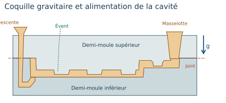
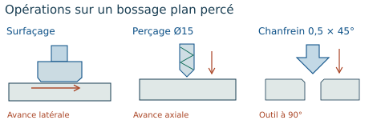
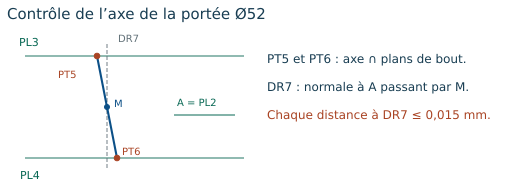
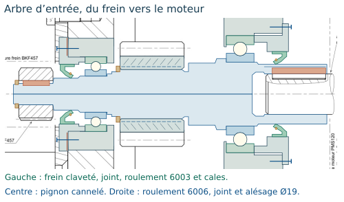

# Banque PT 2023 — Sciences industrielles C · Corrigé brut

*Corrigé rédigé par IA, non officiel. Signalez toute erreur.*

**Rédaction** · GPT-6.2 Astra Ultra · vitesse non renseignée · 26 novembre 2026

**Révision (tour 1)** · GPT-6.2 Astra Ultra · vitesse non renseignée · 27 novembre 2026

**COLOSSUS, robot-pompier de soutien aux secours.** Épreuve de six heures. Les 36 questions numérotées incluent les cinq fonctions du dessin final, décrit sur les pages 11 et 12. Le jury attribue 10 %, 20 %, 30 % et 40 % aux parties I à IV. Les points individuels ne sont pas publiés.

[Sujet et planches](https://www.banquept.fr/documents/2023/si_c_2023_pt.pdf) · [Rapport du jury](https://www.banquept.fr/documents/ecrit/rapport/2023/rapport_si_c_ecrit_2023.pdf)

## I. Performances du robot-pompier

### I.1 · Rotation du moteur sans balais

Le rotor porte les aimants permanents. Un onduleur alimente successivement les enroulements du stator avec des courants dont la répartition produit un champ tournant. Le couple résulte de l’interaction de ce champ avec celui des aimants. La commande règle le déphasage entre les champs pour entretenir un couple du sens voulu. En régime synchrone, les deux champs tournent à la même vitesse mécanique.

### I.2 · Comparaison avec le moteur à collecteur

La commutation électronique supprime le frottement et l’usure des balais, les étincelles au collecteur et l’entretien associé. Les enroulements statoriques évacuent facilement leur chaleur vers le carter, ce qui favorise le rendement et la puissance massique. Il faut en contrepartie un onduleur, une commande synchronisée avec le rotor et des aimants dont le coût et la tenue en température comptent. Un moteur continu à balais réalise directement la commutation au collecteur.

### I.3 · Rôle du capteur angulaire

Pour produire du couple, la direction du champ statorique doit rester convenablement décalée par rapport aux aimants, même à l’arrêt ou à basse vitesse. La position mécanique, convertie en angle électrique par le nombre de paires de pôles, permet de choisir les phases et la composante de courant en quadrature. Un mauvais déphasage diminue le couple et peut même le renverser.

### I.4 · Nature de la mesure du resolver

Après démodulation par l’excitation commune, les amplitudes de $E_{S1-S3}$ et $E_{S2-S4}$ sont respectivement proportionnelles à $\cos\theta$ et $\sin\theta$. Leur paire fournit l’angle par la fonction atan2, dès la mise sous tension, modulo un tour du modèle de la ressource IV. Le capteur est donc **absolu sur un tour** et **analogique** par ses tensions de sortie. La numérisation en aval est une opération de l’électronique de lecture.

### I.5 · Vérification de la puissance de traction

Lire 1 tonne de capacité de traction et de poussée comme environ 1 tonne-force, soit 9,81 kN. À 6 km/h, donc 1,667 m/s, le travail par seconde à l’horizontale est $P=Fv=16,35$ kW pour les deux chenilles. Avec un partage égal et des pertes négligées en première approche, chaque moteur doit fournir **8,18 kW**. La gamme PMS120 atteint cette puissance. La ligne sélectionnée à 4 500 tr/min annonce 6 kW nominaux et 16,9 kW maximaux. La comparaison valide donc un **point de pointe**. Elle ne garantit pas traction maximale et vitesse maximale simultanément en permanence. Pour une vérification en service continu il faudrait notamment le rendement de transmission et le cycle de charge.

### I.6 · Architecture des six packs

Six packs ayant chacun la tension du bus alimentent le même bus en parallèle. La tension reste voisine de 48 V tandis que les capacités et les courants disponibles s’additionnent. L’architecture du sujet autorise aussi l’isolement d’une branche lors de son échange sans couper toutes les autres. Mettre ces six packs en série multiplierait par six la tension destinée aux moteurs.

### I.7 · Nombre de cellules par pack

La tension impose $x\simeq48/3,6=13,33$. **13S9P** est une proposition pour un bus de classe 48 V si l’on arrondit à la tension nominale la plus proche. Elle donne 46,8 V. Avec les hypothèses de I.5 et six packs également chargés, le courant demandé par pack vaut $16350/(6\times46,8)=58,2$ A. À 6,5 A par cellule, il faut $y\geq58,2/6,5=8,96$, donc neuf branches en parallèle. Elles délivrent 58,5 A au niveau 2C, sous la limite continue de 60 A du pack. Le calcul est proche de la limite et ignore les pertes.

Si le cahier d’intégration exige **au moins** 48 V nominaux, arrondir x vers le haut donne **14S9P**, sous réserve de compatibilité du contrôleur avec la plage réelle de tension. On obtient 50,4 V, 54,1 A par pack et 6,01 A par cellule pour la même puissance. Si l’on prend 10 m/s² et la tension effective de 46,8 V, neuf branches manquent de peu la puissance de 16,67 kW au strict niveau 2C. Ces différences d’arrondi justifient d’annoncer tension, rendement supposé et puissance utilisée.

### I.8 · Autonomie au courant 2C

À 6,5 A par cellule, la courbe 2C de la ressource V atteint le seuil de 2,5 V vers 3,2 à 3,3 Ah délivrés. La durée vaut $t=Q/I\simeq3,25/6,5=0,50$ h, soit **environ 30 minutes**. Le nombre de branches multiplie à la fois le courant et la capacité disponibles dans la même proportion. Les 8 à 12 heures annoncées en opération correspondent à un courant moyen bien inférieur à la décharge constante de l’essai.

## II. Transmission de puissance

### II.1 · Rapport des trois engrènements

Chaque engrènement extérieur inverse le sens et multiplie la vitesse par le rapport du nombre de dents du menant à celui du mené. Les roues a et b de chaque arbre intermédiaire tournent ensemble. Ainsi $\omega_{4/0}/\omega_{1/0}=-(Z_1/Z_{2a})(Z_{2b}/Z_{3a})(Z_{3b}/Z_4)=-(14/52)(17/60)(20/54)$, soit **−0,02825**. Le signe vaut pour des axes orientés dans le même sens.

### II.2 · Compatibilité avec la vitesse nominale

À 4 500 tr/min, le barbotin tourne à $4500\times0,02825=127,1$ tr/min en valeur absolue. La ressource II donne un diamètre de 250 mm. Sans glissement, $v=\pi\times0,250\times127,1/60=1,66$ m/s, soit **5,99 km/h**. L’écart à l’exigence de 6 km/h est bien inférieur à 10 %.

### II.3 · Choix du dernier engrènement pour le dimensionnement

À puissance transmise voisine, le couple augmente quand la vitesse diminue. La force tangentielle dépend également du rayon. Sur les trois étages, les couples des arbres intermédiaires croissent avec la réduction et les rayons des pignons ne croissent pas dans la même proportion. Le dernier couple de roues porte donc le plus grand effort tangentiel. Avec largeur et module communs, cette sollicitation gouverne le calcul simplifié de flexion. Les durées de vie en fatigue réelles demanderaient aussi le nombre de cycles de chaque roue.

### II.4 · Effort tangentiel entre 3b et 4

Le diamètre primitif de la roue 4 est $m_0Z_4=3\times54=162$ mm. Le rayon à utiliser dans la relation de moment vaut 0,081 m. Ainsi $T_{s,max}=650/0,081=\mathbf{8,02\ kN}$. Les deux roues subissent des forces opposées de même norme.

### II.5 · Contrainte de flexion au pied de dent

La dent est assimilée à une console de hauteur $h=2,25m_0$, de largeur b et d’épaisseur de flexion $e=\pi m_0/2$. À l’encastrement, $M_{max}=Th$. Le moment quadratique vaut $be^3/12$ et la fibre extrême est à $e/2$. D’où $\sigma_{max}=M_{max}(e/2)/(be^3/12)=6Th/(be^2)$, soit **$\sigma_{max}=54T/(b\pi^2 m_0)$**. Pour T en newtons et b et le module en millimètres, la contrainte est en MPa. Le modèle néglige la forme du raccord et le partage entre dents.

### II.6 · Comparaison avec la limite élastique

La valeur donnée, 450 MPa, excède la limite élastique d’aciers courants de construction comme un S235. Elle peut rester inférieure à celle d’un acier d’engrenage correctement traité, par exemple une nuance alliée trempée et revenue avec limite certifiée au-delà de 650 MPa. Vérifier pour la nuance, la section et le traitement retenus que $R_e/s\geq450$ MPa avec le coefficient de sécurité s. La seule désignation générique « acier » ne permet pas de conclure définitivement.

### II.7 · Fatigue

Le passage périodique de la charge sollicite chaque pied de dent, même lorsque le couple moteur est constant. Sous contrainte variable, une fissure peut s’amorcer près du raccord puis croître au fil des cycles, jusqu’à la rupture de la section restante. La contrainte maximale peut être inférieure à la limite élastique statique. L’amplitude, la contrainte moyenne, le nombre de cycles et l’état de surface interviennent dans le dimensionnement.

### II.8 · Couple transmis par la couronne de contact

Poser $R_i=d/2$ et $R_e=D/2$ d’après la ressource IX. Pour une pression uniforme p, $P=p\pi(R_e^2-R_i^2)$. Sur un anneau de rayon r et largeur dr, l’effort tangentiel limite vaut $f p\,2\pi r\,dr$. Son moment vaut r fois cet effort. En intégrant, $C_{lim}=(2\pi fp/3)(R_e^3-R_i^3)$, donc

$$C_{lim}=\frac{2 f P}{3}\frac{R_e^3-R_i^3}{R_e^2-R_i^2}=\frac{fP}{3}\frac{D^3-d^3}{D^2-d^2}.$$

Utiliser une seule surface de frottement. L’effort indiqué P est la somme des précharges de toutes les vis.

### II.9 · Choix des vis M8

Il faut $nF_{pre}\geq140000$ N avec au plus dix vis. Une solution est **10 M8 de classe 8.8**, chacune réglée à 14 kN en précharge nominale. La ressource X donne une charge d’épreuve de 21,2 kN pour cette vis, donc la précharge représente 66 % de cette valeur. Une solution plus compacte serait 8 M8 classe 10.9 à 17,5 kN par vis pour une charge d’épreuve de 30,4 kN. La charge d’épreuve constitue une limite de vérification, tandis que la précharge effective doit être maîtrisée. La figure IX précise que le nombre de vis illustré est arbitraire.

### II.10 · Classe de résistance

Pour une classe $a.b$, la résistance nominale à la traction vaut $R_m=100a$ MPa et le rapport nominal $R_e/R_m$ vaut $b/10$. L’exemple 6.4 conduit à $R_m=600$ MPa et $R_e\simeq240$ MPa. C’est le décodage de l’exemple demandé. Pour le dimensionnement effectif, utiliser la ligne et la colonne réellement disponibles dans le tableau X.

## III. Demi-carter extérieur

### III.1 · Décoder les trois spécifications

**Planéité 0,02.** La surface extraite du plan de joint, désignée A sur le plan XI, doit être contenue entre deux plans parallèles écartés de 0,02 mm, libres en position et orientation. Cette spécification de forme est indépendante de toute référence.

**Perpendicularité Ø0,03 à A.** L’élément tolérancé est la ligne médiane extraite de l’alésage Ø52 H7. La surface de référence est la face du plan de joint et son plan idéal associé matérialise A. La zone est un cylindre de diamètre 0,03 mm dont l’axe doit être perpendiculaire à A. La position de cette zone dans le plan reste libre.

**Localisation Ø0,04 à A puis B.** La même ligne médiane doit se trouver dans un cylindre de diamètre 0,04 mm. Sa direction est normale à A, et sa position est définie par les cotes théoriquement exactes relatives au motif des **deux** alésages de pion Ø6 qui définit B. Construire d’abord A, puis associer le motif idéal des deux cylindres avec ses contraintes géométriques et son entraxe théorique, en respectant A. Le motif détermine l’origine et la direction dans le plan. Prendre isolément l’un des pions laisserait une rotation indéterminée. Les deux grilles sont remplies sur les planches de réponse.

### III.2 · Besoin fonctionnel des deux trous de pion

Les deux Ø6 H7 avec exigence d’enveloppe règlent le jeu fonctionnel et permettent à un pion de dimension compatible d’entrer sur la longueur utile. Pour un alésage, la forme parfaite à la condition du maximum de matière correspond à sa dimension minimale. La localisation de leurs lignes médianes dans des cylindres Ø0,03 perpendiculaires à A maîtrise l’orientation et l’écartement mutuel du motif de deux trous. Comme seule A est prescrite, la position globale dans le plan n’est pas ancrée par une deuxième référence. Ces exigences permettent d’engager simultanément les deux pions et de remonter les demi-carters de façon reproductible.

### III.3 · Références correspondant au montage réel

Le demi-carter extérieur vient en appui sur la grande face du demi-carter intérieur. Les deux pions assurent le repositionnement dans ce plan. Utiliser ces mêmes surfaces pour définir la position des logements de roulement rattache les axes de transmission au montage qui existera réellement. Cela limite le désalignement des deux paliers d’un arbre et les erreurs d’entraxe entre roues.

### III.4 · Ordre A puis B

Le contact plan prépondérant impose une translation normale et deux rotations de basculement. Il reste deux translations dans le plan et la rotation autour de sa normale. Le motif de pions les maîtrise ensuite. L’ordre A puis B reproduit cet assemblage et évite qu’une association prioritaire des cylindres ne force une orientation contraire à celle donnée par la grande surface d’appui.

### III.5 · Matériau du demi-carter

Le carter doit maintenir les portées sous l’effort, donc posséder une rigidité suffisante et une bonne stabilité dimensionnelle. Sa masse embarquée doit rester limitée. Il faut aussi une bonne tenue à la corrosion en ambiance humide et une conductivité thermique favorable à l’évacuation des pertes. L’usinabilité des logements et l’aptitude à la coulée interviennent en fabrication. Un **alliage d’aluminium de fonderie Al-Si**, par exemple AlSi7Mg, est un candidat cohérent. Les nervures compensent la rigidité plus faible que celle de l’acier. Le choix du matériau du carter se distingue de celui du châssis annoncé sur la fiche technique.

### III.6 · Comparer un brut coulé et un brut étiré usiné

Le brut coulé approche la forme finale, notamment les nervures. Il réduit les copeaux et le temps d’usinage mais demande un outillage et une mise au point, de l’énergie de fusion et des contrôles de santé matière. Le brut étiré minimise l’investissement spécifique, facilite les modifications et donne une matière homogène. L’évidement d’un grand volume mobilise la machine, use les outils et produit des copeaux qui demandent récupération et refusion. Comparer sur la durée de vie de la série le coût fixe d’outillage, le coût variable par pièce, le rendement matière, les rebuts et l’énergie. Avec environ 60 robots par an et deux boîtes par robot, c’est le nombre total de demi-carters identiques amortissant la même coquille qui compte.

### III.7 · Principe de la fonderie

Le métal liquide remplit l’empreinte d’un moule. Un noyau peut matérialiser un volume intérieur à garder vide. Après solidification et refroidissement suffisants, la pièce quitte le moule. L’ébarbage et la suppression des jets et masselottes précèdent le contrôle du brut et la reprise des surfaces fonctionnelles. La forme de l’empreinte intègre le retrait, les dépouilles de démoulage et les surépaisseurs nécessaires.

### III.8 · Retrait et défauts associés

La contraction volumique à la solidification appelle un apport de métal liquide. Une zone épaisse isolée qui se solidifie en dernier peut présenter une **retassure** ou de la **microporosité de retrait**. Si la contraction du métal encore chaud est entravée, des criques à chaud peuvent aussi apparaître. Après solidification, le retrait thermique et les gradients de refroidissement influencent les dimensions et les déformations.

### III.9 · Coquille ou sable

La coquille métallique se réutilise. Elle favorise la cadence, la répétabilité, l’état de surface et un refroidissement plus rapide. Sa fabrication est coûteuse. L’ouverture et le démoulage bornent les formes possibles et les chocs thermiques limitent la durée de vie de l’outillage. Un moule en sable se détruit au décochage, permet de nombreuses géométries avec noyaux et convient aux petites séries pour un outillage plus simple. L’état de surface est souvent plus grossier et la reconstitution du moule consomme du sable, du liant et du temps.

### III.10 · Moulage par gravité sur la coupe imposée

Placer le joint au niveau du plus grand contour qui permet la séparation, avec la partie supérieure du moule qui réalise les évidements ouverts, et la partie inférieure qui porte l’autre face. Les faces suivant la direction d’ouverture comportent des dépouilles. Le métal arrive par un entonnoir et une descente, puis un canal inférieur et une attaque qui remplit l’empreinte du bas vers le haut. Une masselotte communique avec la zone la plus massive et un évent laisse sortir l’air. La flèche g est verticale descendante. Le fond complété conserve le profil fourni.

### III.11 · Machines et axes

En phase 10, le plan de joint est présenté perpendiculairement à la broche. Les axes des alésages de guidage et des deux trous lisses sont parallèles à cette broche. Une **fraiseuse verticale à trois translations** suffit. Prendre Z suivant la broche et X, Y dans le plan à surfacer. En phase 20, les trous lamés s’ouvrent sur la grande face extérieure tandis que les bossages percés se trouvent sur les flancs. Il faut réorienter la pièce dans la même phase. Une **fraiseuse horizontale quatre axes** avec plateau indexable B autour de Y vertical convient. Monter le carter debout, présenter successivement face extérieure et flancs à la broche horizontale Z. X est la translation transversale de la machine. La ressource des surfaces usinées, p. 12 du fascicule, fixe ces directions.

### III.12 · Position de reprise en phase 20

L’appui plan sur A, déjà usiné en phase 10, supprime trois degrés de liberté. Un pion cylindrique court dans l’un des Ø6 réalise une liaison linéaire annulaire de guidage transversal, qui en supprime deux. Un pion dégagé ou « losange » dans l’autre Ø6 ne garde que le contact transversal à la ligne des centres et supprime la dernière rotation. Il équivaut à une contrainte ponctuelle dans cette modélisation. Laisser libre le défaut d’entraxe dans la direction joignant les pions. Un bridage presse la pièce vers ses appuis. Les six contraintes indépendantes évitent le coincement ou la déformation imposée par deux pions ronds serrés.

### III.13 · Trois opérations sur le bossage percé

Pour le plan, présenter une fraise à surfacer d’axe normal au bossage. Après la prise de profondeur, déplacer le centre parallèlement à la face en couvrant toute sa largeur. Pour le perçage débouchant, centrer le foret Ø15 sur l’axe normal au plan puis l’avancer suivant cet axe jusqu’au débouché complet de ses lèvres. Pour le chanfrein, employer une fraise conique d’angle au sommet 90°, coaxiale au trou. Son avance axiale produit un chanfrein à 45° d’étendue 0,5 mm au rayon. Son diamètre extérieur sur le plan doit être $15+2\times0,5=16$ mm. Prévoir le dégagement de l’outil de l’autre côté du bossage pour le perçage.

### III.14 · Contrôle de perpendicularité par l’angle

La référence A est le plan associé PL2. Calculer l’angle $\alpha$ entre sa normale et l’axe du cylindre CY1. Si la longueur nominale L du tronçon est mesurée suivant l’axe, l’étendue transversale vaut $L\sin\alpha$. Si la longueur H est mesurée suivant la normale à PL2, la même étendue vaut $H\tan\alpha$. Pour le logement Ø52, la ressource des surfaces usinées indique 13 mm. L’écart doit être **au plus égal à 0,03 mm** pour entrer dans un cylindre de diamètre 0,03. Pour une longueur de 13 mm, l’angle limite est environ $0,132°$. La démarche porte sur l’axe rectiligne associé suivant le modèle de l’exercice.

### III.15 · Construire PT5 et PT6

Associer PL3 et PL4 aux deux surfaces de bout de la portée. Extraire l’axe de CY1, puis prendre ses intersections avec ces deux plans. Désigner les points obtenus par PT5 et PT6. Ces points délimitent le segment axial réellement contrôlé. PL2 sert à l’orientation de référence et ne remplace pas indistinctement l’un des deux plans de limitation.

### III.16 · Construire la droite DR7

Construire le milieu M du segment PT5–PT6. Par M, construire la droite DR7 normale à PL2. Elle coupe l’axe de CY1 en M et lui est donc coplanaire. Le choix du milieu centre les deux écarts transversaux et convient à une tolérance d’orientation dont la position reste libre.

### III.17 · Critère de conformité par distances

Avec le choix de Q III.16, mesurer les distances perpendiculaires de PT5 et PT6 à DR7. Elles sont égales pour un segment rectiligne. Elles doivent rester chacune **au plus égales à 0,015 mm**, rayon de la zone. La convexité du cylindre garantit alors que le segment entier s’y trouve. Une autre construction place DR7 par PT5. Dans cette convention, la seule distance de PT6 à cette droite est le décalage transverse total et se compare à **0,03 mm**. Ne pas combiner la construction centrée avec un seuil de diamètre.

## IV. Coupe du palier d’entrée

### IV.1 · Concevoir et vérifier les cinq fonctions

**1. Pivot, arrêt et réglage.** La solution portée sur la feuille du concours conserve les deux demi-carters et le sens du moteur et du frein. Elle utilise deux roulements rigides à billes, de tailles différentes pour loger l’arbre creux côté moteur. Les bagues intérieures montent sur des portées tournées légèrement serrées, typiquement k5, avec des épaulements de reprise. Les bagues extérieures se logent dans des alésages H7 usinés dans les bossages des carters. Deux arrêts opposés fixent les limites axiales. Un flasque démontable avec un jeu de cales règle la position d’une butée de bague extérieure et le jeu axial total, à vérifier après serrage. Prévoir des congés de rayon inférieur aux chanfreins des bagues et des épaulements accessibles aux outils. Les enveloppes dessinées correspondent à des roulements de type **6003 (17 × 35 × 10 mm)** et **6006 (30 × 55 × 13 mm)**, dimensions proposées.

**2. Liaison au frein.** L’extrémité étagée, portée cylindrique d’environ Ø10 sur la feuille, centre le moyeu du frein. Une clavette parallèle assure la transmission par obstacle. L’épaule et la retenue axiale démontable positionnent le moyeu. Laisser libre le volume intérieur du frein, son entrefer et le coulissement du disque sur la denture extérieure du moyeu. La rainure et la retenue restent accessibles côté frein.

**3. Liaison au moteur.** L’arbre d’entrée est alésé à droite pour recevoir le bout d’arbre Ø19 donné par le constructeur. Le centrage est cylindrique avec ajustement démontable. Le rainurage intérieur reprend la clavette de largeur 6 mm existante. Un dégagement au fond permet la course de l’outil de mortaisage et une garde axiale empêche le bout du moteur de talonner. La face de la bride porte le moteur, dont le réglage de coaxialité est hors question.

**4. Liaison au pignon.** Le pignon est centré sur une portée cannelée, entre une épaule et un anneau d’arrêt démontable. Les cannelures transmettent le couple par obstacle. Elles sont accessibles au taillage de l’arbre, avec un dégagement d’outil à la sortie. La rainure d’anneau reste hors de la zone sollicitée des cannelures. L’alésage cannelé du pignon peut être broché de part en part avant montage. La denture extérieure est taillée sur le brut tourné.

**5. Étanchéité et montage.** Des joints radiaux à lèvres, ressort côté huile, sont centrés dans les flasques des deux carters. Les lèvres portent sur des pistes lisses distinctes des rainures et des cannelures. Les plans statiques reçoivent un joint adapté à l’huile. Introduire l’arbre depuis le côté moteur dans le pignon, poser sa retenue depuis le côté frein, puis assembler les demi-carters et les paliers par leurs faces accessibles. Les roulements se montent par effort sur la bague ajustée. Poser les flasques et leurs cales, vérifier la rotation, puis monter moyeu de frein et moteur. Le démontage suit l’ordre inverse. La planche officielle porte « Éch. 2:1 ». Le fac-similé PDF a été ramené au format Lettre. La géométrie ajoutée conserve son échelle interne, contrôlée sur le bout moteur Ø19.

