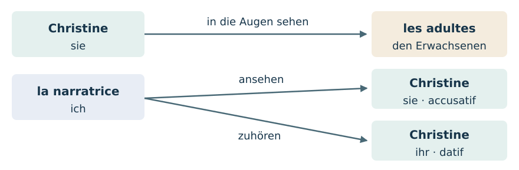

# BEL A/L — Allemand (thème, Lyon) 2023 · Corrigé brut

*Corrigé rédigé par IA, non officiel. Signalez toute erreur.*

**Rédaction** · GPT-6.2 Astra Ultra · vitesse non renseignée · 26 novembre 2026

**Révision** · GPT-6.2 Astra Ultra · vitesse non renseignée · 26 novembre 2026

Florence Seyvos, *Une bête aux aguets* (2020). Thème de quatre heures, sans dictionnaire.

[Sujet officiel, p. 10](https://www.ens-lyon.fr/sites/default/files/2023-09/Epreuve-de-specialite.pdf#page=10) · [Rapport du jury, p. 16–22](https://www.ens-lyon.fr/sites/default/files/2023-11/Allemand-2023.pdf#page=16)

## Proposition de thème

Gegen Ende der Grundschulzeit hatte ich Christine kennengelernt. Sie war eine gute Schülerin, still, fast unscheinbar. In der Pause mochte sie keiner festen Gruppe angehören. Sie ging von einer zur anderen und hielt sich dabei immer ein wenig im Hintergrund.

Ich mochte sie auf Anhieb. Sie hatte etwas sanft Aufmüpfiges an sich, ganz ohne Absicht. Den Erwachsenen sah sie immer in die Augen, und manchmal bekam sie Ärger, nur weil sie so war, wie sie war. Wenn man sie zurechtwies, senkte sie den Blick nicht. Ihre Wangen röteten sich ein wenig, und an ihren zusammengezogenen Brauen sah man, dass sie nicht begriff, warum man mit ihr schimpfte. Oft musste sie sich im Klassenzimmer ganz nach hinten setzen, obwohl sie niemanden störte. Ich richtete es so ein, dass ich neben ihr saß. Ich wollte ihr Blitzableiter sein. Wochenlang sprachen wir kaum miteinander, doch unsere Freundschaft wuchs, und allmählich wurde es uns zur Gewohnheit, unsere freien Nachmittage miteinander zu verbringen.

Ich mochte ihr leicht dreieckiges Gesicht, ihr sehr feines, dunkelblondes Haar, ihre schmal geschnittenen Augen und ihre lange, gerade Nase. Ich liebte es, sie anzusehen, besonders wenn sie Klavier spielte und mich dabei nicht ansah. Ebenso gern hörte ich ihr zu. »Ich muss Klavier üben«, sagte sie dann, und ich setzte mich so hin, dass ich sie gut sehen konnte. Sie hatte Angst, ich könnte mich langweilen. »Erst übe ich die Technik. Das wird dir lang vorkommen«, warnte sie mich, und dann spielte sie Tonleitern und Übungen, eine nach der anderen. Ich langweilte mich nie. Am liebsten war mir, wenn sie an einem Stück arbeitete und unermüdlich dieselbe schwierige Stelle wiederholte, bis zu zwanzig-, dreißigmal. »Geht dir das nicht auf die Nerven?«, fragte sie mich. »Kein bisschen«, antwortete ich. Wie unendlich tröstlich diese Wiederholung für mich war, konnte ich ihr ebenso wenig erklären wie mir selbst. Und wenn ich nach Hause ging, war mir die Stelle fest im Gedächtnis. Sie würde mir für immer so vertraut sein wie die Sonne, der Regen oder die Stimme meiner Mutter.

