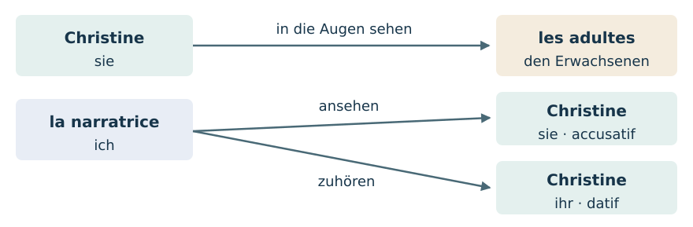

# BEL A/L — Allemand (thème, Lyon) 2023 · Corrigé guidé

*Corrigé rédigé par IA, non officiel. Signalez toute erreur.*

**Rédaction** · GPT-6.2 Astra Ultra · vitesse non renseignée · 26 novembre 2026

**Révision** · GPT-6.2 Astra Ultra · vitesse non renseignée · 26 novembre 2026

Florence Seyvos, *Une bête aux aguets* (2020). Thème de quatre heures, sans dictionnaire.

[Sujet officiel, p. 10](https://www.ens-lyon.fr/sites/default/files/2023-09/Epreuve-de-specialite.pdf#page=10) · [Rapport du jury, p. 16–22](https://www.ens-lyon.fr/sites/default/files/2023-11/Allemand-2023.pdf#page=16)

Le rapport identifie Anna comme la narratrice. Dans le feuillet, elle se souvient de Christine à la fin de l’école primaire.

## De la rencontre au souvenir musical

> [!INDICATION]
> Soulignez mentalement les verbes dont la narratrice est le sujet, puis ceux qui appartiennent à Christine. Au piano, la première écoute et la seconde répète. Cette répartition commande les pronoms aussi bien que le choix des verbes.

### Entrer dans le récit au bon temps

L’ouverture situe la rencontre en amont du portrait. Dans *hatte ich Christine kennengelernt*, l’auxiliaire conjugué occupe la deuxième position après le groupe de temps et le participe ferme la phrase. Le prétérit de *sie war* prend ensuite le relais. « En fin d’école primaire » situe les deux filles dans leur scolarité. *Gegen Ende der Grundschulzeit* évite d’inventer un dernier jour de classe.

Le retrait de Christine est volontaire pendant la récréation. *Keiner festen Gruppe angehören* appelle le datif, tandis que *von einer zur anderen* fait entendre son mouvement de groupe en groupe. Son attitude devant les adultes est en revanche spontanée. *Etwas sanft Aufmüpfiges* concilie la douceur et la résistance. Après *etwas*, l’adjectif substantivé prend une majuscule et la terminaison *-es*.

### Suivre les regards

Dans *den Erwachsenen sah sie … in die Augen*, le datif désigne les personnes regardées. Quand Christine reçoit une réprimande, *wenn* marque une situation qui se répète. Le rouge aux joues et les sourcils restent ceux de l’enfant. La narratrice ne reprend l’initiative que pour s’asseoir près d’elle. *Neben ihr saß* exprime sa place une fois obtenue. La métaphore du *Blitzableiter* suggère qu’elle souhaite attirer sur elle les reproches destinés à son amie.

Au piano, *wenn sie Klavier spielte und mich dabei nicht ansah* garde les deux verbes sous la dépendance de *wenn*. Le second membre reste une subordonnée. Le rapport souligne précisément le risque d’introduire ici un nouveau *dass*. Pour l’écoute, *ihr zuhören* demande le datif, là où *sie ansehen* demandait l’accusatif.

### Faire entendre une séance de travail

*Ich muss Klavier üben* laisse Christine exprimer la nécessité qu’elle ressent de s’exercer. Le rapport attire l’attention sur la nuance que produirait *sollen*, qui ferait intervenir une consigne extérieure. *Tonleitern*, *Übungen*, *Stück* et *Stelle* différencient les gammes, les exercices, l’œuvre et le seul passage repris. Garder *Stelle* à la fin permet d’entendre que la narratrice emporte exactement ce qu’elle vient d’écouter.

La question *Geht dir das nicht auf die Nerven?* porte sur l’effet de la répétition. *Kein bisschen* est une réponse orale complète. Dans l’incise *fragte sie mich*, le verbe précède le sujet après la réplique. La série finale des trois repères familiers reste dans l’ordre du feuillet, de la nature à la voix de la mère.

## Proposition de thème

Gegen Ende der Grundschulzeit hatte ich Christine kennengelernt. Sie war eine gute Schülerin, still, fast unscheinbar. In der Pause mochte sie keiner festen Gruppe angehören. Sie ging von einer zur anderen und hielt sich dabei immer ein wenig im Hintergrund.

Ich mochte sie auf Anhieb. Sie hatte etwas sanft Aufmüpfiges an sich, ganz ohne Absicht. Den Erwachsenen sah sie immer in die Augen, und manchmal bekam sie Ärger, nur weil sie so war, wie sie war. Wenn man sie zurechtwies, senkte sie den Blick nicht. Ihre Wangen röteten sich ein wenig, und an ihren zusammengezogenen Brauen sah man, dass sie nicht begriff, warum man mit ihr schimpfte. Oft musste sie sich im Klassenzimmer ganz nach hinten setzen, obwohl sie niemanden störte. Ich richtete es so ein, dass ich neben ihr saß. Ich wollte ihr Blitzableiter sein. Wochenlang sprachen wir kaum miteinander, doch unsere Freundschaft wuchs, und allmählich wurde es uns zur Gewohnheit, unsere freien Nachmittage miteinander zu verbringen.

Ich mochte ihr leicht dreieckiges Gesicht, ihr sehr feines, dunkelblondes Haar, ihre schmal geschnittenen Augen und ihre lange, gerade Nase. Ich liebte es, sie anzusehen, besonders wenn sie Klavier spielte und mich dabei nicht ansah. Ebenso gern hörte ich ihr zu. »Ich muss Klavier üben«, sagte sie dann, und ich setzte mich so hin, dass ich sie gut sehen konnte. Sie hatte Angst, ich könnte mich langweilen. »Erst übe ich die Technik. Das wird dir lang vorkommen«, warnte sie mich, und dann spielte sie Tonleitern und Übungen, eine nach der anderen. Ich langweilte mich nie. Am liebsten war mir, wenn sie an einem Stück arbeitete und unermüdlich dieselbe schwierige Stelle wiederholte, bis zu zwanzig-, dreißigmal. »Geht dir das nicht auf die Nerven?«, fragte sie mich. »Kein bisschen«, antwortete ich. Wie unendlich tröstlich diese Wiederholung für mich war, konnte ich ihr ebenso wenig erklären wie mir selbst. Und wenn ich nach Hause ging, war mir die Stelle fest im Gedächtnis. Sie würde mir für immer so vertraut sein wie die Sonne, der Regen oder die Stimme meiner Mutter.
