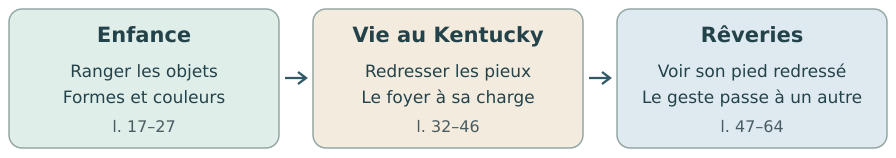

# BEL A/L — Anglais (commentaire et traduction) 2023 · Corrigé guidé

*Corrigé rédigé par IA, non officiel. Signalez toute erreur.*

**Rédaction** · GPT-6.2 Astra Ultra · vitesse non renseignée · 26 novembre 2026

**Révision** · GPT-6.2 Astra Ultra · vitesse non renseignée · 26 novembre 2026

Toni Morrison, *The Bluest Eye* (1970). Épreuve commune de six heures. Le commentaire porte sur les deux feuillets. La version commence ligne 10 et finit ligne 27.

[Sujet officiel, p. 4–5](https://www.ens-lyon.fr/sites/default/files/2023-09/Commentaire-d-un-texte-en-LVE.pdf#page=4) · [Rapport du jury, p. 2–22](https://www.ens-lyon.fr/sites/default/files/2023-11/Anglais-2023.pdf#page=2)

## Préparer les deux exercices

### Attribuer chaque explication

> [!INDICATION]
> Relever un indice grammatical de la certitude de Pauline et un indice de l’incertitude de la voix narrative. Revenir ensuite au mot isolé à la toute fin du texte.

À la ligne 3, *probably* porte sur la carie avancée par la voix narrative. À la ligne 11, *for her* attribue à Pauline l’explication par le pied. Créer deux colonnes évite de présenter l’une des hypothèses comme un diagnostic médical. À la fin, l’imagination de Pauline suffit à redresser ce pied. Le futur dans le passé qui confie son destin à un autre répond alors à la question posée dès l’ouverture sur la mort des rêves. Le commentaire peut passer de la concurrence entre explications à l’apprentissage d’un geste, puis à ce que devient ce geste dans le rêve.

### Vérifier une hypothèse sur deux détails éloignés

Les rangées que Pauline forme enfant (l. 18–25) se prolongent dans sa manière de redresser et d’attacher les pieux de la clôture (l. 39–41). La continuité du geste est sous ses yeux. Le changement est dans sa fonction, du jeu libre à l’entretien d’un foyer dont elle a la charge. Les petits noms des jumeaux rendent également sensible, bien plus tard, ce qui manquait à l’enfant du premier paragraphe. Le rapport de 2023 situe cette enfance dans l’histoire de la migration intérieure des familles noires américaines. Pour rattacher celle-ci au récit, observer les groupes de voyageurs, les emplois et la distribution du travail, en respectant la chronologie de la Première Guerre mondiale. [Commentaire du jury, p. 2–12](https://www.ens-lyon.fr/sites/default/files/2023-11/Anglais-2023.pdf#page=2)

### Garder les cinq membres de la phrase

La version commence après la comparaison des tourbillons. Dans *slight as it was*, l’adjectif a une valeur concessive. « Si légère fût-elle » permet de garder cette concession et le même sujet féminin que « difformité ». Les cinq *why* dépendent du verbe « expliquait ». Les exemples de la volaille et des petits pois se rattachent au troisième. Dans « pourquoi on ne la taquinait jamais », le tour négatif fait sentir un manque de familiarité jusque dans l’absence de moqueries. Pour *unworthiness*, « ne pas se sentir digne » est aussi défendable si le statut subjectif de ce sentiment reste explicite.

### Faire la part de l’habitude et du manque

Les rangées ne sont pas des collections précieuses que la famille reconstituerait à l’identique. Les objets sont ramassés, Pauline les dispose de nouveau, et c’est de cette seconde opération qu’elle tire plaisir. *Would never* renvoie aux actes répétés de l’enfant. En français, l’imparfait suffit. *Cottonwood* désigne un peuplier, *peach pits* des noyaux. La dernière phrase porte sur une expérience artistique qu’elle ignore avoir manquée. « Regretter » lui attribuerait une connaissance dont la parenthèse la prive. La version doit s’arrêter sur le matériel de dessin, avant le départ pour le Kentucky. [Analyse de la version, p. 12–22](https://www.ens-lyon.fr/sites/default/files/2023-11/Anglais-2023.pdf#page=12)

## Commentaire

Pauline has an explanation for the course of her life. The narrator of Toni Morrison’s *The Bluest Eye* starts by asking what entitles her, or anyone else, to give one. A foot injured in childhood, a bad tooth, the Great Migration, a song in church all appear to have some claim on her story. Why, then, does the narrator give so much space to the way a little girl lines up stones and jars? Arranging things is both Pauline’s talent and a model for what the narration asks us to do. The order we find depends on who has chosen the objects and where the sequence ends.

### The difficulty of making a case

The opening borrows a lawyer’s expression, “build a case” (l. 1), and immediately identifies the interested party. Pauline knows what detail she wants to put first. The maxim about distrusting dreamers appears to give the narrative voice a firmer hold on the truth, until its rival account introduces a tooth with the qualification “probably” (l. 3). The narrator can see further in time than the child. That privilege still leaves room for doubt. The tooth, so prominent for a moment, has no further part in the extract. What a reader can actually follow is the work Pauline makes her foot perform as an explanation.

The small whirlpools in the description of her walk give that explanation imaginative force. An observer can see the peculiar upward movement. The pull from below comes into existence through a simile (ll. 8–10). In much the same way, the long sequence of indirect questions makes an unseen force responsible for unrelated hurts. Five instances of “why” share a single answer. The irony is most painful where recognition would ordinarily take an unflattering form. Even having a joke made at her expense would give her a place in the family’s stock of stories. The missing chicken wing and the pot of peas turn an abstract sense of worth into the little extra labour someone might undertake for one particular child.

### What can be put in order

The family’s care is also visible in a form Pauline’s explanation cannot quite accommodate. Someone who knocks her rows apart stops to pick the objects up. She welcomes the chance to lay them out again. There is pleasure both in discrimination and in repetition. The fine distinctions of shape and colour make an artist’s activity imaginable before the belated naming of the art materials she never had (ll. 18–27). Her fondness for numbers carries over into the narrator’s compressed account of migration. Months and journeys can be counted. The serial groups in which people travel make each individual difficult to see. The scale has changed from a step outside a house to a movement of families between states.

In Kentucky, plumbing, a fence and extra rooms give substance to the family’s new prosperity. A death and two marriages enter the account as so much additional living space (ll. 32–37). The calculation is unsettling precisely because the gain in comfort is real. The mother’s paid work in a white minister’s home leaves the eldest girl still at home responsible for unpaid work in her own. The fence is especially revealing. Her mother plants flowers against it, while Pauline straightens its stakes and fixes them with wire. Each makes an enclosure habitable. The younger twins even have the affectionate names their sister lacked. For a few hours each day Pauline can work alone, and quiet proves a source of energy. By the end of the war the household is quiet for longer. Her enthusiasm begins to fail. An empty house has ceased to be an adequate account of what she wants.

### The promise of being understood

As sensation takes over from housekeeping, the lists change their character. The objects on the step could be moved into distinct rows. Lonely roads, newborn creatures dying and a permanently setting sun belong together by feeling. Church supplies words for a longing that the church service cannot altogether direct. Asked to think about sin, Pauline feels the songs as a caress. Rebirth enters her fantasy as something that will occur without her having to make it happen. There is an exact reversal here of the earlier pleasure of putting things back together herself.

The stranger first appears through the odd noun phrase “a someone” (l. 57). He acquires a capital letter as “Presence” while progressively losing the features by which any particular person could be known. His glance is enough to straighten the foot. It also makes Pauline lower her eyes. The same imagined encounter that grants recognition relieves her of the burden of looking back, speaking or deciding where to go. At the end, the possible destinations multiply until the suspension points leave only “forever” (l. 64). The dreamer can imagine relief with astonishing sensory precision. She cannot supply the next exchange. That limit gives the narrator’s opening distrust a human cost. Readers have come to understand the making of a dream whose eventual failure the opening has already made them expect.

## Version

Si légère fût-elle, cette difformité expliquait à ses yeux bien des choses qui, autrement, lui seraient demeurées incompréhensibles — pourquoi elle était la seule de tous les enfants à n’avoir pas de surnom, pourquoi on ne racontait jamais de plaisanteries ni d’anecdotes amusantes sur les drôleries qu’elle avait faites, pourquoi personne ne faisait jamais attention à ses goûts à table — jamais on ne lui réservait l’aile ou le cou, jamais on ne lui faisait cuire les petits pois dans une autre casserole, sans riz, parce qu’elle n’aimait pas le riz —, pourquoi on ne la taquinait jamais, pourquoi elle ne se sentait chez elle nulle part, à sa place en aucun lieu. Cette impression diffuse d’être à part et de ne rien valoir, elle la mettait sur le compte de son pied. Enfant, enfermée dans le cocon que les siens avaient filé autour d’elle, elle cultivait de petits plaisirs tranquilles et secrets. Ce qu’elle aimait par-dessus tout, c’était mettre les choses en ordre. Les disposer en rangs — les bocaux sur les étagères à la saison des conserves, les noyaux de pêche sur la marche, les brindilles, les cailloux, les feuilles — et personne chez elle ne dérangeait ces agencements. Si, par mégarde, quelqu’un éparpillait les objets d’une de ses rangées, il s’arrêtait toujours pour les ramasser à son intention. Cela ne la fâchait jamais, car elle avait ainsi l’occasion de les disposer de nouveau. Quels que fussent les menus objets qu’elle trouvait en nombre et pouvait transporter, elle en faisait des rangées bien nettes, selon leur taille, leur forme ou les nuances de leur couleur. Pas plus qu’elle n’alignait une aiguille de pin avec une feuille de peuplier, elle ne mettait les bocaux de tomates à côté des haricots verts. Pendant les quatre années qu’elle avait passées à l’école, elle avait toujours été enchantée par les nombres et découragée par les mots. Elle était passée à côté de quelque chose, sans savoir de quoi — de la peinture et des crayons de couleur.
