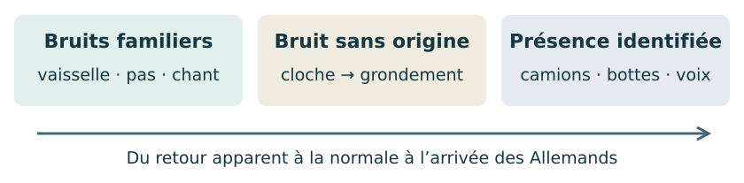

# BEL A/L — Anglais (thème, Lyon) 2023 · Corrigé brut

*Corrigé rédigé par IA, non officiel. Signalez toute erreur.*

**Rédaction** · GPT-6.2 Astra Ultra · vitesse non renseignée · 26 novembre 2026

**Révision** · GPT-6.2 Astra Ultra · vitesse non renseignée · 26 novembre 2026

Irène Némirovsky, *Suite française* (2004). Thème de quatre heures, sans dictionnaire.

[Sujet officiel, p. 11](https://www.ens-lyon.fr/sites/default/files/2023-09/Epreuve-de-specialite.pdf#page=11) · [Rapport du jury, p. 23–29](https://www.ens-lyon.fr/sites/default/files/2023-11/Anglais-2023.pdf#page=23)

## Proposition de thème

The hours slipped quietly by. There were fewer motorcars on the road. Bicycles still sped past, as if swept along by the fierce wind that had been blowing out of the north-east for a week, carrying those wretched people along with it. A little later came a surprising sight. A few cars appeared, travelling in the opposite direction to the one they had taken all week. They were making their way back towards Paris. At the sight of them some people really thought it was all over. Everyone went home. Once again the clink of crockery could be heard as the housewives washed up in their kitchens, along with the light tread of a little old woman taking grass to the rabbits and even the song of a little girl drawing water at the pump. Dogs were fighting and rolling in the dust.

Evening had come. It was a lovely dusk, the air clear, the shadows blue. The last glow of sunset was brushing the roses and the church bell calling the faithful to prayer when a sound began to swell on the road. It was unlike anything heard there in the past few days. Low and steady, the rumble seemed to draw nearer without haste, with a heavy, relentless tread. Lorries were rolling towards the village. This time it really was the Germans coming. Men climbed down from the lorries that had stopped in the square. Other lorries followed the first, then more, and more after them. Within minutes the whole of the old grey square, from the church to the town hall, was one dark, motionless mass of iron-coloured vehicles. Here and there a withered branch could still be seen on one of them, all that was left of the camouflage.

How many men there were! […] The Germans were pouring in from every side and swarming through the squares and streets, and still more kept coming. Since September the village had grown unused to the sound of footsteps and laughter and young voices. It was dazed, stifled by the din rising from that tide of green uniforms, by the smell of healthy human bodies, a smell of fresh meat, and above all by the sounds of that foreign tongue. The Germans streamed into the houses, the shops and the cafés. Their boots rang on the red kitchen tiles. They asked for food and drink. They patted the children as they passed. They waved their arms, sang and laughed with the women.

