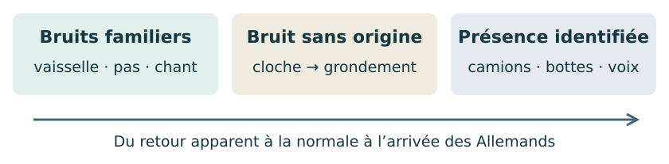

# BEL A/L — Anglais (thème, Lyon) 2023 · Corrigé guidé

*Corrigé rédigé par IA, non officiel. Signalez toute erreur.*

**Rédaction** · GPT-6.2 Astra Ultra · vitesse non renseignée · 26 novembre 2026

**Révision** · GPT-6.2 Astra Ultra · vitesse non renseignée · 26 novembre 2026

Irène Némirovsky, *Suite française* (2004). Thème de quatre heures, sans dictionnaire.

[Sujet officiel, p. 11](https://www.ens-lyon.fr/sites/default/files/2023-09/Epreuve-de-specialite.pdf#page=11) · [Rapport du jury, p. 23–29](https://www.ens-lyon.fr/sites/default/files/2023-11/Anglais-2023.pdf#page=23)

Le passage appartient à « Tempête en juin » et évoque l’exode de juin 1940. Le village se croit d’abord revenu à la normale.

## Du silence à la rumeur

### Suivre les bruits avant de nommer leur cause

> [!INDICATION]
> Lire d’abord les deux premiers paragraphes en s’arrêtant juste avant le premier camion. Qu’a-t-on déjà entendu, et qui sait ce qui arrive ?

Le premier mouvement réduit l’intensité du trafic puis rend audibles les bruits de la cuisine, les pas et le chant. Le passif *the clink of crockery could be heard* laisse l’auditeur indéterminé. *Along with* rattache les deux autres sons à la même perception. Une attaque par *Once again you could hear…* rendrait le lecteur plus présent dans le village. Pour cette phrase, le jury privilégie le passif. *Clink* isole les petits chocs de la vaisselle. *Clatter* donnerait à la scène une sonorité plus forte. Dans le deuxième mouvement, la cloche appelle encore les fidèles quand s’élève le grondement. Nommer immédiatement un moteur ferait connaître son origine avant les habitants.

### Distinguer les deux emplois de « depuis »

Le vent soufflait déjà avant les instants décrits et souffle encore à ce moment du passé. *Had been blowing … for a week* fait entendre cette continuité. La semaine précédente peut aussi fournir le complément *all week* après le verbe qui décrit l’ancien sens de circulation. Au troisième paragraphe, *since September* fixe le point de départ d’un changement d’habitude antérieur à l’arrivée. Comparer *had grown unused to hearing* et *were not used to hearing*. La première formulation fait sentir la perte progressive d’une familiarité. Dans *from the church to the town hall*, c’est l’étendue de la place que le même mot français mesure.

### Rétablir le sujet en descendant des camions

Le groupe détaché en tête de phrase désigne les véhicules déjà arrêtés. Le sujet du mouvement est *men*, et le pronom français reprend les véhicules. On peut partir de l’action, *Men climbed down from the lorries*, ou déplacer en tête le lieu, *In the square men climbed out of the lorries that had stopped there*. *In the square* situe les hommes sur une place envisagée comme un espace. Les reprises de *lorries*, puis de *more*, remplissent cette place. Un synonyme nouveau à chaque occurrence ferait disparaître la série.

### Conserver la voix du village

Le nom collectif devient le sujet d’une perception presque physique. La suite *It was dazed, stifled…* reprend *the village* et laisse les habitants éprouver les sons et les odeurs comme un seul corps. *Din* donne de l’intensité à la rumeur, *hum* en ferait mieux entendre la continuité. *Fresh meat* maintient la comparaison brutale avec les corps. Dans *laughed with the women*, la préposition évite d’attribuer de la moquerie aux soldats. *Ruffled the children's hair* offrirait un geste plus concret pour *patted the children*, au prix d’une précision absente du français.

### Relire les quantités et le temps du récit

*Fewer motorcars* dénombre les véhicules. *A few cars* en fait apparaître quelques-uns, tandis que *few cars* soulignerait leur petit nombre. Les bicyclettes surgissent au pluriel sans article. Dans le dernier paragraphe, *were pouring in* présente l’afflux en cours, puis *streamed into*, *rang*, *asked* et *patted* rassemblent en quelques traits les gestes observés. Les trois paragraphes conservent la coupure imprimée après l’exclamation sur la foule.

## Proposition de thème

The hours slipped quietly by. There were fewer motorcars on the road. Bicycles still sped past, as if swept along by the fierce wind that had been blowing out of the north-east for a week, carrying those wretched people along with it. A little later came a surprising sight. A few cars appeared, travelling in the opposite direction to the one they had taken all week. They were making their way back towards Paris. At the sight of them some people really thought it was all over. Everyone went home. Once again the clink of crockery could be heard as the housewives washed up in their kitchens, along with the light tread of a little old woman taking grass to the rabbits and even the song of a little girl drawing water at the pump. Dogs were fighting and rolling in the dust.

Evening had come. It was a lovely dusk, the air clear, the shadows blue. The last glow of sunset was brushing the roses and the church bell calling the faithful to prayer when a sound began to swell on the road. It was unlike anything heard there in the past few days. Low and steady, the rumble seemed to draw nearer without haste, with a heavy, relentless tread. Lorries were rolling towards the village. This time it really was the Germans coming. Men climbed down from the lorries that had stopped in the square. Other lorries followed the first, then more, and more after them. Within minutes the whole of the old grey square, from the church to the town hall, was one dark, motionless mass of iron-coloured vehicles. Here and there a withered branch could still be seen on one of them, all that was left of the camouflage.

How many men there were! […] The Germans were pouring in from every side and swarming through the squares and streets, and still more kept coming. Since September the village had grown unused to the sound of footsteps and laughter and young voices. It was dazed, stifled by the din rising from that tide of green uniforms, by the smell of healthy human bodies, a smell of fresh meat, and above all by the sounds of that foreign tongue. The Germans streamed into the houses, the shops and the cafés. Their boots rang on the red kitchen tiles. They asked for food and drink. They patted the children as they passed. They waved their arms, sang and laughed with the women.
