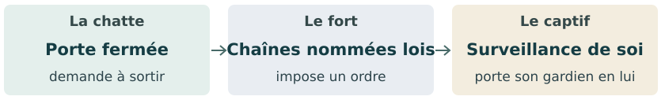

# BEL A/L — Arabe (commentaire et traduction) 2023 · Corrigé brut

*Corrigé rédigé par IA, non officiel. Signalez toute erreur.*

**Rédaction** · GPT-6.2 Astra Ultra · vitesse non renseignée · 26 novembre 2026

**Révision** · GPT-6.2 Astra Ultra · vitesse non renseignée · 26 novembre 2026

Muṣṭafā Luṭfī al-Manfalūṭī, « La Liberté », *al-Naẓarāt* (édition datée de 1984 sur le sujet). Écrit commun, ENS de Lyon et ENS (Paris), six heures. Commentaire en arabe sur l’extrait entier, version française des lignes 21 à 28.

[Sujet officiel, p. 6–7](https://www.ens-lyon.fr/sites/default/files/2023-09/Commentaire-d-un-texte-en-LVE.pdf#page=6) · [Rapport du jury, p. 2](https://www.ens-lyon.fr/sites/default/files/2023-12/Arabe-2023.pdf#page=2)

## Commentaire

يوقظ مواء هرّة صاحب الغرفة عند الفجر، فيظنّ القارئ أنّ عليه أن يكتشف ما ينقص الحيوان. وحين ينفتح الباب تركض الهرّة في سبيلها وينتهي الخبر، لكنّ المقالة لا تكاد عندئذ تبدأ. فقد أتاح الحيوان للرجل أن يسأل عمّا ينقص الإنسان نفسه، وأن يتأمّل خصوصًا حال من لا يشعر بأنّ هناك ما ينقصه. فكيف ينتقل المنفلوطي من إصغاء فرد إلى صوت ضعيف إلى محاكمة الاستبداد وقد اتّخذ من ضمير أسيره حارسًا عليه؟

في المشهد الأوّل يسارع الراوي إلى تفسير الإلحاح بالجوع ثم بالعطش. وتكرار «لعلّها» يفسح المجال في كلّ مرّة لردّ الهرّة الصامت، فهي تعرض عمّا يقدّم إليها فيسقط تفسيره. يتمنّى أن يكون سليمان ليفهم لغة الحيوان، لكنّ ما يدلّه على الحاجة الفعلية هو اتّجاه النظر إلى الباب واقتراب الهرّة منه كلّما تحرّك نحوه. ولا يسبق لفظ الحرية هذه التجربة، بل يأتي حين يعود الراوي إلى فراشه وقد رأى انقلاب الحزن فرحًا ما إن انكشف للهرّة وجه السماء. بذلك لا تعود حركاتها الأولى ضربًا من الاستعطاف طلبًا للطعام، بل تصبح محاولات متنوّعة لطلب شيء لا يُقدَّم في إناء.

يقابل الكاتب بعد ذلك بين الحيوان الأعجم والإنسان الناطق. الوحش المعتقل في قفصه والطائر المقصوص الجناح يتألّمان من القيد، في حين قد يألف بعض الناس السجن حتى يلتذّوا بما فيه من آلام. والاستفهام عن تمنّي الخرس يردّ إلى النطق، الذي يُفترض أن يكون مزيّة، صورة التهمة. ثم تتّسع حركة الطير والسمك والوحش حتى تشمل الجوّ والبحر والوادي، فيما يضيق موضع الإنسان بين محبسين، نفسه وحكومته. ليس المراد أن يكتفي الفرد بترك باب البيت مفتوحًا. فالإنسان قادر على أن يحمل سجنه معه.

يتضح ذلك في صناعة القيود وتسميتها. القويّ يصنع السلاسل ثم يمنحها أسماء يُنتظر منها أن تحمي الضعيف، كالعدل والقانون. وأشدّ ما تكشفه الجملة التالية هو تبدّل الفاعل. فالخائف نفسه ينصب من نفسه حرّاسًا على نفسه. يبدأ التفتيش باليدين والخطوات ثم يبلغ حركة اللسان فالخاطر الذي لا يراه أحد. وما دام العقاب متوقّعًا في الداخل، أمكن للحارس الخارجي أن يغيب ويبقى عمله قائمًا. وحين يقابل الكاتب بين دموع الهرّة في أول الخبر وعين الأسير التي لا تدمع في آخر هذا المقطع، يجعل فساد الوجدان أثرًا للاستبداد أشدّ من مجرّد الحرمان.

بعد هذا الحدّ تصوّر بقية المقالة ثمن الحرية في صور متتابعة. فالبلبل المحبوس لا يحتمل فقدها، والثوب الذي كان يحمي الجسد من الحرّ والريح يتحوّل إلى قماط وكفن حين تفرض الأزياء نظامها. وتمتدّ سلسلة الإملاءات من الطعام إلى الكتابة والمشي والسكون، لكلّ فعل فيها جهة تقرّره. يضع الكاتب بإزائها «أدب النفس»، أي قدرة المرء على أن يضبط أفعاله من داخله من غير أن يستبطن عين المستبدّ. وتستعيد صورة الشمس في الختام ضوء الفجر ووجه السماء اللذين انطلق منهما الخبر. من لم يطلع عليه هذا النور يظلّ ما بين ظلمة الرحم وظلمة القبر. عندئذ يتبيّن أنّ من كان أحوج إلى درس الهرّة هو صاحب المفتاح.

## Version

L’homme fort a forgé pour l’homme faible des chaînes et des fers. Il leur a donné tantôt le nom de règle, tantôt celui de loi, afin de l’opprimer au nom de la justice et de lui ravir le joyau de sa liberté au nom de la règle et de l’ordre. Il lui a fabriqué cette machine effrayante et l’a laissé en proie à l’angoisse, sur ses gardes, le cœur épouvanté, tremblant de tous ses membres. Le faible tire de lui-même des gardiens qu’il prépose à sa propre surveillance. Ils surveillent les gestes de ses mains, ses moindres pas, les mouvements de sa langue et jusqu’aux pensées qui traversent son esprit et son imagination. Tout cela pour échapper au châtiment du despote et se soustraire à son supplice. Malheur à lui, quelle ignorance ! Le malheureux, quelle folie ! Y a-t-il au monde pire torture que celle qu’il endure, prison plus étroite que celle où il se trouve ?

Le crime du despote envers son captif va bien au-delà de la liberté qu’il lui a ravie. Son plus grand crime est de lui avoir perverti la conscience, au point que désormais il ne s’afflige plus de cette liberté perdue et ne verse pas sur elle une seule larme.
