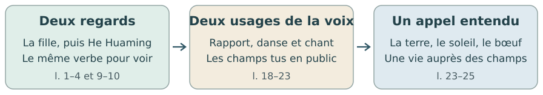

# BEL A/L — Chinois (commentaire et traduction) 2023 · Corrigé brut

*Corrigé rédigé par IA, non officiel. Signalez toute erreur.*

**Rédaction** · GPT-6.2 Astra Ultra · vitesse non renseignée · 26 novembre 2026

**Révision** · GPT-6.2 Astra Ultra · vitesse non renseignée · 26 novembre 2026

Ding Ling 丁玲, « Nuit » (夜, 1941). Épreuve commune de six heures. Le commentaire porte sur les deux feuillets. La version commence ligne 18 et finit ligne 25.

[Sujet officiel, p. 8–9](https://www.ens-lyon.fr/sites/default/files/2023-09/Commentaire-d-un-texte-en-LVE.pdf#page=8) · [Rapport du jury, p. 2–4](https://www.ens-lyon.fr/sites/default/files/2023-11/Chinois-2023.pdf#page=2)

## Commentaire

### 桥头分路，目光相接

丁玲的《夜》写于一九四一年。何华明从会上回家，不过走了一段山路，读者却先后看见了在会场、在别人面前、在自家田里三个不能完全重合的他。文章开头的一个“只有”就把问题提了出来。众人往南，他独自往北；离开人群，照说可以按自己的心意行动，可是他一看到门边的姑娘，连责备她的话都带着会场上的口气。丁玲怎样让一个在人前十分会说话的人，把说不出口的心事透露给读者？

姑娘没有转过身来与他对视。她只是靠着门，向远处“眺望”。先发生变化的是看她的人。那一眼竟把会上没弄明白的问题一下子全赶走了；轻快的脚步、吹起的口哨，先于解释把他的兴奋传了出来。偏偏在这里，脚步忽然停住，叙述让位给一句几乎出了声的自言自语。他称姑娘“落后”，拿她不去冬学来作证；说到她父亲，却越说越不是滋味，连人家把女儿养到这么大还不出嫁也管到了。读者听得出话里的恼意，却不必替姑娘说她在想什么。她始终沉默，何华明那套现成的评语反倒把说话者自己的慌乱暴露出来。

### 抹过头发，抹不掉田地

他有意摇头，叫短发碰着耳朵，再把头发往后一抹。手碰得到头发，碰不到那层烦人的思绪。这个动作并没有结束上一场景，因为动手之后，他“也眺望起四周来”。一个“也”悄悄把两个人放在同一姿势里。视野随即拉远：两山之间的厚云像停住了，云上的淡黄光线却在眼睛难以察觉间迅速变幻。轮廓模糊，天色沉郁，叙述由“他”转向泛称的“人”，仿佛谁在此时望向远山，都会想到一点没有明说的事。

再往西看，山上还亮着。有人跟着牛在松土里来回走，有人背着犁赶牛回家。前面是没有明确对象的心情，现在却有了可以数得出的损失：二十天，要应付选举，回家更少，上山一次也没有，听到的埋怨反而更多。第二个“只有”落在“作为指导员的他”身上。第一次是他选择了回家的方向，这一次，他却不能选择和别人一样照料自己的地。公务占去的不只是钟点，也是一双手原本应该接触泥土的机会。

### 会场里的嗓子与山上的呼声

末段由一次归途转写“每当”如此的日子。土地在等人，工作又一时脱不开身；正因为两边都切实，他才有一种“说不出”的痛楚。然而他绝非不会表达。别人关切地问，他能把话题扯开；在众人面前，他会谈笑，会作报告，还会跳秧歌、唱郿鄠。叙述特意把全乡人熟悉的那副嗓子写得这样动听，紧接着才交代他唯独不肯同别人谈哪一件事。他在会上的受欢迎是真的，他在人前的沉默也是真的，两者恰好发生在同一个人身上。

选举结束、重新上山，暂时还只是他的盼望。可结尾连用几个“那”，仿佛指给自己看：先是地，继而是泥土的气息、强烈的阳光，再到那头作伴的牛。远处刚才还是一幅暮色中的画，到这里已有了气味、温度和声音。众人要他唱，他能唱给全乡人听；他自己所听见的，却是山上那头牛对他的呼唤。篇末没有让他马上回到田里，而把这些事物同他的生命连在了一起。开篇往北走的那几步，到结尾才显出全部分量。

## Version

À vrai dire, chaque fois qu’il voyait les autres peiner aux champs, il pensait à ces quelques parcelles qui attendaient qu’il vienne les cultiver. En songeant aussi à ce travail que, quoi qu’il fasse, il ne pourrait quitter de sitôt, il éprouvait toujours une douleur qu’il ne savait comment dire. Si quelqu’un s’en inquiétait et l’interrogeait, il faisait dévier la conversation. Devant les gens, il riait et plaisantait, débattait des questions du jour, présentait des rapports. Aux assemblées électorales des paysans, on l’entraînait même à danser le yangge et à chanter des airs de meihu, l’opéra de son pays. Tout le canton connaissait sa voix entre toutes et lui faisait fête. Pourtant, de ses champs en friche, il ne voulait parler à personne. Il n’attendait qu’une chose, que ces élections soient enfin terminées et qu’il puisse remonter là-haut. Cette terre, cette odeur de terre, cette lumière ardente du soleil, ce bœuf qui lui tenait compagnie et qui l’appelait… Tout cela était inséparable de sa vie.
