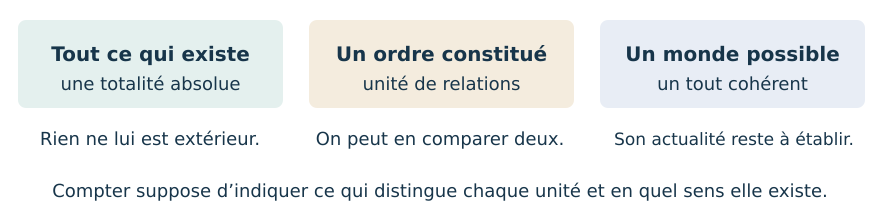

# BEL A/L — Deuxième composition de philosophie, Lyon 2023 · Corrigé guidé

*Corrigé rédigé par IA, non officiel. Signalez toute erreur.*

**Rédaction** · GPT-6.2 Astra Ultra · vitesse non renseignée · 26 novembre 2026

**Révision** · GPT-6.2 Astra Ultra · vitesse non renseignée · 26 novembre 2026

**Sujet** · Y a-t-il plusieurs mondes ? Écrit de spécialité de la série Sciences humaines, durée de six heures.

[Sujet officiel, p. 3](https://www.ens-lyon.fr/sites/default/files/2023-09/Epreuve-de-specialite.pdf#page=3) · [Rapport du jury, p. 9–17](https://www.ens-lyon.fr/sites/default/files/2023-11/Philosophie-2023.pdf#page=9)

## Trouver un critère pour compter

> [!INDICATION]
> Deux trains sur un même quai sont faciles à compter. Qu’est-ce qui devrait différer pour que l’on puisse compter deux mondes ? Demandez ensuite ce qu’il faudrait établir pour passer de deux mondes concevables à deux mondes existants.

La gare fournit une situation à laquelle revenir. La carcasse du bâtiment est observable aujourd’hui. Le réseau, les billets et les correspondances avaient des conséquences vérifiables quand elle fonctionnait. On dispose donc d’un cas où quelque chose a réellement cessé d’être alors même que la matière demeure. Ce déplacement prépare le passage d’une totalité délimitée à une organisation de relations. Le jury demande de traiter la force existentielle de la question et de justifier les passages d’un sens à l’autre.

### Mettre chaque raison à l’épreuve

Dans le premier mouvement, l’argument du tout ne vaut qu’en vertu du sens donné à « monde ». Épicure permet d’en mesurer la portée. Le tout unique de l’atomisme accueille plusieurs formations physiques. L’hypothèse de Leibniz modifie un autre paramètre, la modalité. « Possible » et « actuel » répondent à deux questions différentes. Un devoir qui invoque des univers parallèles doit préciser le statut de son affirmation et la raison qui permettrait de compter de tels univers.

Au deuxième mouvement, testez l’objection d’un seul arbre diversement regardé. Un arbre et deux points de vue suffiraient à une simple diversité d’apparences. Une branche réellement praticable pour l’oiseau et impraticable pour l’homme établit une différence dans leur pouvoir d’agir. Pour passer au milieu humain, indiquez alors ce que l’institution ajoute à la dépendance biologique. Des règles peuvent être apprises ou abrogées.

### Donner une conséquence à la conclusion

La décision sur le devenir de la gare oblige ses usagers à rencontrer les conséquences de ce qu’avancent les autres. La table d’Arendt permet de penser une même chose publique durable et plusieurs places réelles. Dans une relecture de la copie, demandez à chaque emploi de « monde » ce qui en fixe la limite, pour qui il existe et ce qui permettrait de constater sa disparition. Vous aurez alors une réponse argumentée à la question du nombre.

## Dissertation

Sur le guichet fermé d’une gare désaffectée, une photographie montre une file de voyageurs. Le bâtiment est toujours là et pourtant le monde dont cette scène faisait partie a disparu. Prendre au sérieux un tel jugement, est-ce admettre qu’il y a plusieurs mondes ? Une chose peut disparaître tandis que le monde continue. Mais si un monde est ce dans quoi chaque chose trouve sa place, où faudrait-il se tenir pour en compter deux ? Le pluriel paraît à la fois indispensable pour nommer une perte réelle et contradictoire dès qu’on prétend l’appliquer au tout. La difficulté tient au principe qui permet d’individuer un monde. Est-ce l’étendue de ce qu’il contient ou le système de rapports qui en fait un tout ? Ce choix déterminera ce que nous sommes en droit de dire existant, aussi bien du cosmos que des mondes qu’habitent des êtres différents.

### À quelles conditions deux mondes pourraient-ils exister ?

Pour compter deux maisons, j’ai besoin d’un critère qui fixe où finit l’une et où commence l’autre. Je peux les indiquer sur la même carte. Pour deux mondes entendus chacun comme la totalité de ce qui existe, une opération de ce genre échoue avant même qu’on cherche à l’accomplir. S’il existe quelque chose hors du premier, celui-ci ne contenait pas tout. Si le second ne contient rien qui soit hors du premier, il reste à montrer ce qui les distingue. Cela n’établit ni que l’espace est fini ni qu’il a un centre. Un univers infini serait tout aussi unique s’il comprenait tout ce qui existe. La simple découverte de planètes en très grand nombre laisserait intacte cette unicité.

L’argument ne décide pourtant pas à lui seul de la question cosmologique. Dans la *Lettre à Hérodote*, Épicure distingue le tout, infini, et les mondes qui s’y forment. Ayant posé des atomes en nombre infini et l’étendue du vide, il soutient que la formation de notre monde n’a pas épuisé les matériaux dont d’autres agencements de même ordre peuvent se former. Un monde est ici un ensemble doté d’une constitution propre, assez stable pour avoir une histoire et susceptible de se défaire. Deux mondes peuvent relever des mêmes principes physiques et être numériquement distincts. La pluralité est alors une thèse de physique, soumise aux raisons données en sa faveur. Le pluriel exprime davantage qu’une façon commode de parler et exige davantage que la constatation de plusieurs points lumineux dans le ciel.

Un nouvel écart apparaît lorsqu’on envisage ce qui aurait pu être. Si le train avait été maintenu, le guichet pourrait être en service aujourd’hui. Chez Leibniz, un monde possible comprend toute une suite d’événements compatibles entre eux. On ne change pas arbitrairement un seul détail en supposant que tous les autres événements resteront les mêmes. Plusieurs ensembles cohérents de possibilités peuvent être conçus. Leur compossibilité interne n’entraîne pourtant pas leur existence ensemble, et dans la *Théodicée* un seul reçoit l’existence par le choix divin. Ainsi la possibilité de compter plusieurs descriptions complètes laisse ouverte la question du « il y a ». Il nous faut un cas où la différence des mondes soit attestée dans l’actuel, sans supposer un observateur placé hors de toute réalité.

### Ce qui change lorsque change le vivant

Un promeneur entre sous un arbre pour se mettre à l’ombre. Pour un oiseau, la même ramure offre des perchoirs, des prises et des abris. On pourrait objecter que nous venons précisément d’indiquer un arbre unique. Chacun en verrait certains caractères selon sa position ou son intérêt. Mais tâchons de décrire ce qui existe pour chacun. Une branche trop mince pour soutenir le promeneur peut être pour l’oiseau un chemin praticable. Elle ne possède la qualité de chemin que dans une relation effective entre la résistance du bois, le poids de l’animal et ses manières de se déplacer. Ce que le promeneur imagine du haut de sa taille peut se tromper sur ce que l’oiseau peut faire. Un monde vécu offre à ce titre une prise à la vérification et à la rectification.

Dans ses recherches sur les mondes animaux, Jakob von Uexküll définit le milieu propre d’un animal par le lien entre ce qu’il peut y percevoir et ce sur quoi il peut agir. Une variation de lumière peut valoir comme un signal dans la conduite d’une espèce et rester sans effet sur la conduite d’une autre. Les relations dessinent alors une organisation entière qui se maintient d’une situation à l’autre. C’est par là qu’on peut parler de mondes, au-delà d’une collection d’impressions changeantes. Il serait excessif d’en attribuer un nouveau au promeneur chaque fois qu’il tourne la tête. La différence engage les prises dont dispose durablement un être. Ces mondes se recouvrent matériellement et dépendent de relations distinctes, si bien qu’abattre un même arbre peut supprimer pour l’un un coin d’ombre et pour l’autre une voie de circulation.

Ce résultat change la portée de l’exemple de la gare. L’argent permettait d’y acheter un billet, un horaire d’y attendre quelqu’un, un agent d’y faire valoir un droit. Enlever au guichet ses usages, ses règles et le réseau des autres gares qu’il desservait, c’est lui enlever des propriétés réelles, même si le bois du comptoir subsiste. Une pratique historique peut ainsi ouvrir et perdre un monde. L’analogie avec le vivant rencontre ici sa limite. Dans une institution humaine, des hommes peuvent apprendre les règles, les transmettre, les contester et s’accorder pour les changer. Notre question devient alors plus exigeante. Si plusieurs mondes humains existent, que font ceux qui cherchent ensemble à sauver ou à transformer cette gare ?

### Comment une chose peut devenir commune

Un promoteur voit une parcelle à construire, des habitants isolés du centre un moyen de rejoindre des services, d’anciens cheminots un lieu de mémoire. On tomberait dans une facilité en autorisant chacun à se retirer dans son monde. Une décision unique peut être prise et ses conséquences atteindront aussi ceux qui y étaient opposés. Inversement, en fixant les dimensions du terrain, on ne répond pas encore à la question de savoir ce que l’on perdrait. L’existence d’un sol commun est une condition du conflit. La constitution d’un monde commun où ce conflit puisse être jugé demande un travail supplémentaire.

Dans *Condition de l’homme moderne*, Hannah Arendt prend la table autour de laquelle on se rassemble pour caractériser cette chose publique qui à la fois relie les hommes et les sépare. Pour qu’une chose apparaisse en commun, il faut que plusieurs puissent la désigner tout en la voyant depuis des places distinctes, et qu’elle dure assez pour supporter leurs désaccords. Dans le cas de la gare, plans, souvenirs, horaires et trajets effectifs peuvent être exposés, comparés, critiqués. Ouvrir un lieu de confrontation fait découvrir des effets depuis une autre place, par exemple ce que représente pour celui qui ne conduit pas un détour minime sur une carte. On acquiert un monde commun en donnant aux différences une chose durable sur laquelle porter. Que cette possibilité soit fragile apparaît précisément lorsque disparaissent les lieux où l’on pouvait encore se répondre.

Il y a donc plusieurs mondes là où l’on peut établir plusieurs organisations effectives de ce qui compte, de ce qui se fait et de ce qui arrive à des êtres. Les distinguer demande d’en montrer les rapports constitutifs et le mode d’existence. L’idée de la totalité et l’hypothèse des mondes possibles ne suffisent ni l’une ni l’autre à en fixer le nombre. Quant au monde commun des hommes, son unité se mesure à ce qu’il permet de confronter sans effacer les conditions depuis lesquelles chacun y prend part. La photographie de la gare atteste ainsi quelque chose de plus précis qu’une nostalgie. Des murs ont duré plus longtemps que l’ordre de relations auquel ils donnaient lieu.
