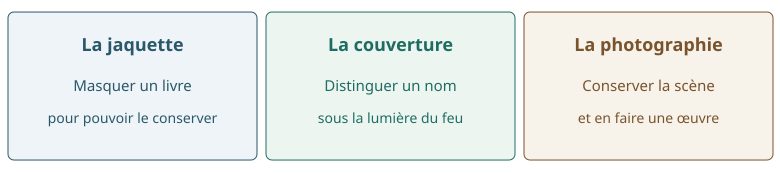

# BEL A/L — Espagnol (commentaire et traduction) 2023 · Corrigé guidé

*Corrigé rédigé par IA, non officiel. Signalez toute erreur.*

**Rédaction** · GPT-6.2 Astra Ultra · vitesse non renseignée

**Révision (tour 1)** · GPT-6.2 Astra Ultra · vitesse non renseignée

Wendy Guerra, *Nunca fui Primera Dama* (2008). Épreuve commune de six heures. [Sujet, p. 10–11](https://www.ens-lyon.fr/sites/default/files/2023-09/Commentaire-d-un-texte-en-LVE.pdf#page=10) · [Rapport du jury, p. 2–12](https://www.ens-lyon.fr/sites/default/files/2023-11/Espagnol-2023.pdf#page=2)

## Préparer le commentaire et la version

### Qui connaît la seconde bibliothèque ?

Dessinez mentalement les rayonnages de face. Un visiteur voit les genres littéraires. Un ami admis dans le cercle lit des indices sociaux et sait ce qui se trouve derrière. Reliez ce dispositif à la question d’enfant, lignes 40–44. Nadia croit que le papier qui couvre le livre fait partie de l’écriture de l’auteur. La réponse de la mère transforme un objet concret en image d’une expérience collective. On peut ainsi commenter ensemble l’apprentissage de la lectrice et l’histoire politique, en gardant la maison pour point de départ.

### Qui donne à voir ?

Comparez les verbes de la mère qui recueille, classe et protège avec ceux de la fille qui installe, dévoile et photographie. La fille accomplit devant sa mère devenue spectatrice le geste inverse de celui qui a sauvegardé les volumes. Relisez ensuite les lignes 69–76, qui appartiennent au commentaire. La scène pourrait s’achever sur le slogan. Elle se termine sur une photographie en train de se faire. Le rapport attire l’attention sur la dimension artistique du rituel et l’importance de ces dernières lignes.

### Décisions de version

« Vamos quitándole » porte sur une série d’actions qui se déroulent peu à peu. En français, « une à une » et des verbes conjugués rendent cette progression. Les enveloppes de fortune partent au feu, les couvertures d’origine réapparaissent. Un même mot français aux deux endroits ferait brûler ce que Nadia veut ensuite montrer. Dans l’adresse aux auteurs, « les » est un complément indirect de deuxième personne en français, d’où « je vous présente ». Le dernier « juntas » désigne la mère et la fille qui regardent ensemble. « Avant qu’elle ne perde » rétablit la mère comme sujet de la perte de mémoire. La version s’arrête à l’exclamation de la ligne 68.

## Comentario en español

En el diario de Nadia Guerra hay dos bibliotecas donde apenas cabría una y, al final, un fuego junto al cual se puede seguir leyendo. ¿Cómo se pasa del espacio clandestino que la memoria reconstruye al principio a la escena al aire libre que se fotografía al final? Entre el recuerdo de la madre y la gesto de firmar una obra nueva, Nadia descubre una dificultad singular. Para transmitir lo que su madre ha salvado tiene que deshacer, ante ella, la labor que un día lo hizo posible.

El primer plano de la casa es una trampa para el visitante. Las baldas visibles se ordenan por géneros literarios, mientras que el criterio para reconocer los libros de atrás es saber quién ha caído en desgracia (líneas 1–16). La anáfora de «cuando» obliga a aprender con la niña todo un código. Basta que de alguien se hable en pasado o que se altere un apellido para que aparezca otro libro camuflado. Un título que promete aprender sin sufrir presta su inocencia al objeto más peligroso del estante. La alusión al conde de Montecristo hace de los libros húmedos unas herramientas de evasión en el corazón mismo del encierro. Y en esa casa sin espacio sobra ingenio para inventar comidas y reutilizar los posos del café. La literatura tampoco es un lujo que se disfrute cómodamente sentado. Se lee de pie y solo entre personas de confianza.

En el centro de ese grupo está una poeta de la que no leemos un solo verso. La serie entrecortada que va de «no poder» a «no querer» editar (líneas 20–24) impide atribuir enteramente su silencio a la censura. La hija recuerda el original sin respuesta, pero mide también una obra menos visible. Por cada amigo en desgracia la madre recoge unos libros, hasta reunir más de trescientos. Contra esa contabilidad de lo que queda, una frase casi simétrica hace sentir lo irrecuperable. La mujer que despidió a todos se marchó sin despedirse. Cuando Nadia pregunta de niña si un poeta «escribe libros “forrados”», toma una precaución material por un género literario. La madre le contesta trasladando el adjetivo a toda una generación. El paréntesis sobre el hijo de Eliseo Diego prolonga el diálogo más allá de la comprensión de aquella niña.

Con el presente de «Estamos» (línea 47), la memorialista pasa a dirigir la escena. Cubre a su madre para protegerla del aire justo antes de descubrir los libros. Entre la casa doble y el jardín abierto al Malecón han cambiado las condiciones de la protección. En el fuego desaparecen los disfraces, desde fotos de mártires hasta carteles de cine. Quedan los nombres que ahora alcanza la luz. La mordaza y la careta de la enumeración convierten en cuerpo el objeto que parecía inerte. De ahí que se pueda presentar la ciudad a los autores como a personas recién llegadas. La pregunta por las aduanas señala, sin embargo, la escala precisa de la victoria. Nadia puede abrir sus cofres, pero todavía no decide qué se publica en Cuba.

El gesto más libre es también el más incierto. Las formas concesivas de las líneas 65–68 dejan en suspenso lo que entiende la madre. Sus aplausos admiten una alegría que la hija no puede interpretar por ella. La proclamación pública del derecho a leer desemboca en algo tan concreto como pasar el dedo por un lomo para elegir. Al final vuelve el aplauso y vuelve el llanto de Lujo, pero Nadia está haciendo fotos. Frente a los forros que ocultaban la identidad de los libros, ha producido unas imágenes que conservan el instante en que se la restituyeron. Las tres palabras finales, «Mi nueva obra», permiten reconocer en la hija a otra artista y en la memoria una tarea que cambia de manos.

## Version française, lignes 47–68

L’heure est venue de mettre les livres à nu. Je conduis ma mère jusqu’à la véranda, je la couvre, car l’air de la mer est traître. Je l’installe dans le fauteuil en bois qu’elle a fait sien au fil des jours. Je tiens à ce qu’elle assiste à notre rituel depuis le premier rang. Enfin nos demandes, nos prières sont exaucées.

Avec Lujo, j’allume un bûcher dans le jardin qui donne sur le Malecón. Là, une à une, nous dépouillons les œuvres de leur écorce, de leur bâillon, de leur masque ou de leur ceinture de chasteté. Nous leur arrachons cette virginité que leur imposait la peur et jetons les enveloppes en pâture au feu. Sur certaines de ces jaquettes s’étalent des photos de martyrs, sur d’autres le visage de mannequins russes, sur les plus récentes des publicités et des affiches de films américains.

Le feu nous fait délirer. Ma mère ne sait pas bien pourquoi, mais à les voir brûler elle applaudit. Lujo pleure et moi je ris. Je ne veux pas que ce moment s’efface de ma mémoire. Voici la liberté conquise par le feu, ma petite revanche historique. Le moment est venu d’ouvrir les coffres, de révéler ce que ces livres ont été et de les laisser sortir à l’air chargé d’humidité du Malecón de La Havane. Une lumière dorée éclaire leurs prénoms et leurs noms.

Chers auteurs, je vous présente La Havane en couleurs.

Je me demande quand on les laissera survivre au passage de la douane, ou quand on finira par les publier à Cuba une bonne fois pour toutes. Plus un livre caché, plus une parole étouffée. C’est là mon vœu le plus cher de citoyenne.

Ma bibliothèque est mise à nu. Il me reste à sauver ma mère. Avant qu’elle ne perde tout à fait la mémoire, je me permets de lui dévoiler les couvertures d’origine. Je lui offre le plaisir de les voir dans toute leur splendeur, même si elle ne comprend rien, même s’il est déjà trop tard pour elle. Quelle merveille de les contempler toutes les deux devant le feu !
