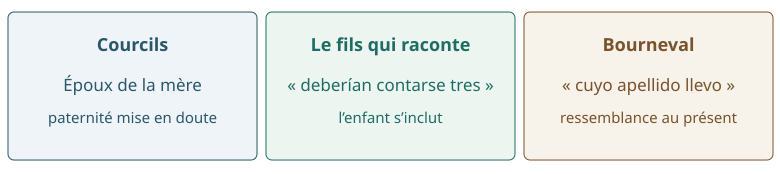

# BEL A/L — Espagnol (thème Lyon) 2023 · Corrigé brut

*Corrigé rédigé par IA, non officiel. Signalez toute erreur.*

**Rédaction** · GPT-6.2 Astra Ultra · vitesse non renseignée

**Révision (tour 1)** · GPT-6.2 Astra Ultra · vitesse non renseignée

Guy de Maupassant, « Le Testament », *Contes de la Bécasse* (1883). Thème de spécialité, quatre heures, sans dictionnaire. [Sujet, p. 13](https://www.ens-lyon.fr/sites/default/files/2023-09/Epreuve-de-specialite.pdf#page=13) · [Rapport du jury, p. 13–16](https://www.ens-lyon.fr/sites/default/files/2023-11/Espagnol-2023.pdf#page=13)

## Proposition de thème

Mi madre, la señora de Courcils, era una pobre mujercita tímida con la que su marido se había casado por el dinero de ella. Su vida entera fue un martirio. Tenía un alma afectuosa, medrosa, delicada, y recibió sin tregua los malos tratos de quien habría debido ser mi padre, uno de esos patanes a los que llaman gentilhombres de campo. Al mes de casado ya vivía con una criada. Tuvo, además, por amantes a las esposas y a las hijas de sus arrendatarios, lo cual no le impidió tener dos hijos con su esposa. Deberían contarse tres, incluyéndome a mí. Mi madre callaba. Vivía en aquella casa siempre bulliciosa como esos ratoncillos que se escabullen por debajo de los muebles. Apocada, casi invisible, temblorosa, miraba a la gente con sus ojos claros e inquietos, que no paraban de moverse, ojos de criatura asustada a la que nunca abandona el miedo. Y sin embargo era bonita, muy bonita, toda rubia, de un rubio ceniciento, de un rubio tímido, como si sus continuos temores le hubiesen desteñido un poco el cabello.

Entre los amigos del señor de Courcils que acudían de continuo al castillo se contaba un antiguo oficial de caballería, viudo, hombre temido, tierno y violento, capaz de tomar las más enérgicas resoluciones. Era el señor de Bourneval, cuyo apellido llevo. Era un hombrón alto y flaco, de grandes bigotes negros. Me parezco mucho a él. Aquel hombre había leído mucho y estaba muy lejos de pensar como los de su clase. Su bisabuela había sido amiga de J.-J. Rousseau, y se habría dicho que algo había heredado de aquella amistad de su antepasada. Sabía de memoria *El contrato social*, *La nueva Eloísa* y todos esos libros filosofantes que con tanta antelación prepararon el futuro trastorno de nuestras antiguas costumbres, de nuestros prejuicios, de nuestras leyes caducas, de nuestra estúpida moral.

## Repère de lecture

