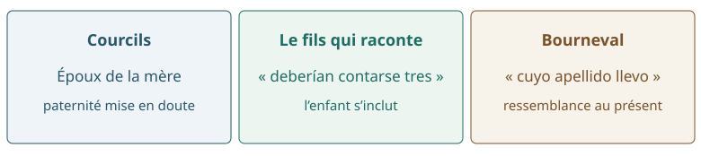

# BEL A/L — Espagnol (thème Lyon) 2023 · Corrigé guidé

*Corrigé rédigé par IA, non officiel. Signalez toute erreur.*

**Rédaction** · GPT-6.2 Astra Ultra · vitesse non renseignée

**Révision (tour 1)** · GPT-6.2 Astra Ultra · vitesse non renseignée

Guy de Maupassant, « Le Testament », *Contes de la Bécasse* (1883). Thème de spécialité, quatre heures, sans dictionnaire. [Sujet, p. 13](https://www.ens-lyon.fr/sites/default/files/2023-09/Epreuve-de-specialite.pdf#page=13) · [Rapport du jury, p. 13–16](https://www.ens-lyon.fr/sites/default/files/2023-11/Espagnol-2023.pdf#page=13)

## Lecture du passage

### Qui peut être le père du narrateur ?

> [!INDICATION]
> Attribuer à chaque homme ce que le récit affirme de lui. Suivre ensuite le passage du passé de la famille au présent de celui qui parle.

Le narrateur désigne Courcils comme le mari de sa mère. La formule *quien habría debido ser mi padre* exprime une attente démentie et laisse au lecteur le soin de tirer la conclusion. Avec *debía de ser mi padre*, on ferait entendre une supposition sur l’identité du père. Bourneval apparaît ensuite par deux indices donnés au présent, *cuyo apellido llevo* et *me parezco mucho a él*. Le relatif possessif *cuyo* s’accorde avec *apellido*. Écrire *de quien llevo el apellido* donnerait une autre construction juste. Un prénom ou un nom de baptême ne ferait pas entendre la filiation.

### Quels temps rendent audibles le bilan et l’habitude ?

La vie de la mère, embrassée d’un seul regard, appelle *fue un martirio*. Les imparfaits *callaba*, *vivía*, *miraba* font ensuite durer son effacement. *Ya vivía con una criada* indique qu’au terme d’un seul mois la liaison est déjà installée. L’entrée du personnage de Bourneval, *se contaba entre…*, le situe à l’intérieur du même monde familier. *Había leído mucho* signale une formation acquise avant le portrait. La comparaison avec le narrateur revient au présent. La maintenir à l’imparfait rendrait sa ressemblance aussi révolue que les visites au château.

### Comment compter les enfants et désigner les personnes ?

*Deberían contarse tres, incluyéndome a mí* fait entrer le narrateur dans le total des enfants. Le sujet grammatical de la passive en *se* est au pluriel. *Habría que contar tres, yo incluido* transmettrait le même compte par une obligation impersonnelle. Dans *a los que llaman gentilhombres*, la troisième personne du pluriel laisse l’agent indéterminé. Dans *miraba a la gente*, la préposition introduit au contraire le complément d’objet humain du verbe de perception. Le rapport distingue ces deux difficultés et souligne aussi que *antiguo oficial* désigne un homme qui a quitté ses fonctions. [Rapport du jury, p. 14–15](https://www.ens-lyon.fr/sites/default/files/2023-11/Espagnol-2023.pdf#page=14)

### Où se fait entendre le jugement du narrateur ?

*Un rubio ceniciento, de un rubio tímido* déplace la peur sur la couleur des cheveux. Pour la teinte, *rubio grisáceo* est également défendable. Supprimer la seconde occurrence du blond effacerait l’image qui prépare *como si… le hubiesen desteñido el cabello*. Enfin, le tour *se habría dicho* mesure prudemment ce qui a pu passer de l’amitié de la bisaïeule à son descendant. Il n’établit aucune liaison amoureuse avec Rousseau. Dans la dernière période, les reprises de *de* portent l’énumération jusqu’au jugement brutal, *nuestra estúpida moral*.

## Proposition de thème

Mi madre, la señora de Courcils, era una pobre mujercita tímida con la que su marido se había casado por el dinero de ella. Su vida entera fue un martirio. Tenía un alma afectuosa, medrosa, delicada, y recibió sin tregua los malos tratos de quien habría debido ser mi padre, uno de esos patanes a los que llaman gentilhombres de campo. Al mes de casado ya vivía con una criada. Tuvo, además, por amantes a las esposas y a las hijas de sus arrendatarios, lo cual no le impidió tener dos hijos con su esposa. Deberían contarse tres, incluyéndome a mí. Mi madre callaba. Vivía en aquella casa siempre bulliciosa como esos ratoncillos que se escabullen por debajo de los muebles. Apocada, casi invisible, temblorosa, miraba a la gente con sus ojos claros e inquietos, que no paraban de moverse, ojos de criatura asustada a la que nunca abandona el miedo. Y sin embargo era bonita, muy bonita, toda rubia, de un rubio ceniciento, de un rubio tímido, como si sus continuos temores le hubiesen desteñido un poco el cabello.

Entre los amigos del señor de Courcils que acudían de continuo al castillo se contaba un antiguo oficial de caballería, viudo, hombre temido, tierno y violento, capaz de tomar las más enérgicas resoluciones. Era el señor de Bourneval, cuyo apellido llevo. Era un hombrón alto y flaco, de grandes bigotes negros. Me parezco mucho a él. Aquel hombre había leído mucho y estaba muy lejos de pensar como los de su clase. Su bisabuela había sido amiga de J.-J. Rousseau, y se habría dicho que algo había heredado de aquella amistad de su antepasada. Sabía de memoria *El contrato social*, *La nueva Eloísa* y todos esos libros filosofantes que con tanta antelación prepararon el futuro trastorno de nuestras antiguas costumbres, de nuestros prejuicios, de nuestras leyes caducas, de nuestra estúpida moral.
