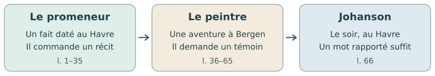

# BEL A/L — Étude de texte français (Lyon) 2023 · Corrigé guidé

*Corrigé rédigé par IA, non officiel. Signalez toute erreur.*

**Rédaction** · GPT-6.2 Astra Ultra · vitesse non renseignée · 26 novembre 2026

**Révision** · GPT-6.2 Astra Ultra · vitesse non renseignée · 26 novembre 2026

Alphonse Allais, « Une mort bizarre », *À se tordre* (1891). Étude littéraire et stylistique de spécialité, cinq heures.

[Sujet, p. 6–7](https://www.ens-lyon.fr/sites/default/files/2023-09/Epreuve-de-specialite.pdf#page=6) · [Rapport du jury, p. 2–8](https://www.ens-lyon.fr/sites/default/files/2023-11/Lettres-Modernes-2023.pdf#page=2)

## Construire la lecture

> [!INDICATION]
> Avant d’expliquer le tableau, remplacez dans la première phrase la parenthèse par un silence. Quelle promesse d’exactitude le journal pourrait-il faire ? Que devient cette promesse dès que la parenthèse est rétablie ?

### Suivre une parole qui change de propriétaire

Lignes 1–35, le promeneur adresse des questions à son lecteur puis s’adresse au peintre. Lignes 36–65, Axelsen raconte son passé tout en interrogeant celui qui l’écoute. Ligne 66, la parole de Johanson revient au discours indirect. Un « je » reste donc présent à chaque niveau, avec des référents différents. Dans la première moitié, distinguer l’appel de note sur Rispal de la note étoilée attribuée à l’auteur qui poursuit la provocation contre François Ier.

### Tester une interprétation sur deux endroits éloignés

Les eaux usées qui remontent au Havre rendent imaginable le pouvoir de débordement prêté à l’aquarelle. Dans le premier épisode les médecins en tirent un profit attendu. Dans le second, aucun groupe professionnel n’est visé par la chute. Pour mesurer la portée de la satire, relève-t-on partout la même cible, ou le récit passe-t-il à un autre jeu ? Revenir au mot « spectacle » avant et après l’interruption sur le roi. [Rapport du jury, p. 5–7](https://www.ens-lyon.fr/sites/default/files/2023-11/Lettres-Modernes-2023.pdf#page=5)

### Passer du constat à un paragraphe

Pour commenter les six infinitifs répétés des lignes 54–55, compter les trois occurrences dans chaque sens et lire la phrase à haute voix. La symétrie mime le flot et le reflux, mais installe aussi une régularité tranquille avant la nuit fatale. Ce double effet fait avancer le commentaire de la matière picturale vers le temps du récit. Sur la dernière ligne, indiquer qui qualifie les faits et par quelle voix cette qualification nous parvient.

## Commentaire

Une jeune fille meurt dans son lit à Bergen. Pour arriver jusqu’à elle, Alphonse Allais nous fait d’abord visiter les égouts du Havre et attendre qu’un promeneur ait relevé le col de son pardessus. Une telle disproportion invite à chercher où se produit exactement le plaisir d’« Une mort bizarre », nouvelle intégralement donnée ici, publiée dans *À se tordre* en 1891. Le titre promet une explication. L’ouverture offre toutes les garanties de la chose vue, la fin apporte un second témoignage. Entre ces deux vérifications, une voix s’est fait entendre qui a su transformer un verre de punch en invitation à croire l’impossible. Comment le récit ménage-t-il le plaisir d’être dupé, alors que les raisons de se méfier sont présentes dès sa première ligne ?

### Le crédit d’un témoin qui fait rire à ses dépens

Au début, on peut situer le jour, le mois, la direction du vent, et presque suivre sur un plan le parcours de l’eau jusqu’aux caves. Le passé composé d’un événement encore proche, le tour administratif « ladite ville » et le nom de l’adjoint à la voirie donnent au conte l’assise d’une chronique locale. Pourtant une parenthèse s’interpose avant même le verbe de la première phrase. Une marée qualifiée par le superlatif « la plus forte » serait déjà la quinzième du genre pour le même homme. Le souhait de lui en voir encore dépasse la simple plaisanterie arithmétique. Le narrateur aime le retour de l’événement qui lui donne quelque chose à regarder et à raconter. Plus tard Axelsen dira que *toutes* ces marées lui brisent le cœur. La formule de la chronique a préparé jusqu’au pluriel de la confidence.

Le témoin se recommande d’autre part par son exactitude scrupuleuse en matière insignifiante. Il tient à préciser qu’il ne donnerait le spectacle ni pour deux boulets de canon ni pour trois. L’objet de l’échange est déjà saugrenu quand la rectification le multiplie. Il observe méthodiquement les bateaux qui entrent et ceux qui sortent. La symétrie de la phrase tient lieu de bilan pour une journée réputée bien remplie. Il s’apprête enfin à relever le bas du pantalon après le collet du pardessus. Au moment où le peintre apparaît, la parenthèse sur le soin donné aux habits nous a déjà fourni du personnage une image plus persuasive qu’un certificat de probité. Il se surveille dans le détail tout en laissant passer l’énormité de ses propres énoncés.

On reconnaît là une façon singulière de traiter l’actualité. Les ordures, grammaticalement sujets, « s’épanouissent » dans les artères luxueuses. Le verbe conviendrait aux fleurs, le complément à une promenade élégante. Aux médecins les typhoïdes paraissent petites et prometteuses, puisque le désastre des autres est un revenu pour eux. La pointe atteint juste, mais la longue apostrophe à François Ier, traité en responsable contemporain des ponts et chaussées, dilapide aussitôt l’indignation. La note étoilée, expressément attribuée à l’auteur, va jusqu’à défier les descendants des Valois au bas de la page. Avec « N’importe ! » (l. 17), le promeneur reprend sans embarras le fil de sa contemplation. L’épisode nous a surtout habitués à suivre un homme qui jouit de ses écarts et sait retrouver son chemin.

### La fabrication à deux voix d’une confidence

La rencontre transporte ce plaisir dans la conversation. Axelsen est présenté comme doué de talent et de sentimentalité. La phrase suivante répartit habilement ces dispositions entre deux moments. Le talent vient à jeun, la sentimentalité « le reste du temps ». Sitôt dit que la seconde domine, le lecteur tire lui-même la conclusion que le narrateur s’abstient de formuler. Les larmes peuvent venir de la brise, du trop-plein du cœur ou d’un état que la visite à l’arrière-boutique risque de prolonger. Aucune explication n’empêche d’écouter. Le milieu change à propos. Face au vent, il faut relever son col. À l’abri, devant une boisson servie par une Anglaise, on peut laisser parler le Norvégien. Le pittoresque des nationalités et du nom du punch garantit moins la véracité d’une aventure qu’il n’organise une bonne séance de récit.

Le peintre hérite du goût de son interlocuteur pour la précision déplacée. Il corrige « un jour » en « un soir », donne la profession de son hôte au bal et nomme une baie dont l’autre, naturellement, ignore tout. Son récit réunit en quelques mots la rencontre, la faveur de la jeune fille, l’accès à la maison et l’idée du cadeau. Sous la double atténuation de « pas complètement indifférent », le peintre invite à deviner son succès. Il garde ainsi au séducteur une modestie fort avantageuse. En revanche, l’affaire de l’eau réclame des questions, une intervention au discours direct intérieur, une réflexion sur les marchands de vins. Le « mouillage » est une fraude chez eux et une nécessité pour le peintre. Le mot fait déjà subir à une matière identique un changement de métier. L’aventure procédera de la même façon avec un changement d’échelle.

Dans ce jeu, l’auditeur travaille autant que le conteur. « Contez-moi ça » lui donne la main. Plus loin, à la question attendue de savoir ce qui arriva, la réponse rappelle une évidence, qu’il le saura quand l’autre le lui aura dit. Cette façon d’impatienter le récit lui accorde exactement la pause dont il avait besoin. Les répliques les plus brèves, « Ah ! » ou « Pauvre ami ! », peuvent se lire avec autant de complaisance que de conviction. Une émotion instruite par de si bons partenaires se passe fort bien d’un lecteur entièrement crédule.

### Une catastrophe contenue dans le matériau d’une image

Le Havre avait fourni en vraie grandeur l’expérience que Bergen réduit à un petit coin de baie. Dans les premières lignes, la mer passe du quai aux égouts, puis des égouts aux caves. L’aquarelle franchit à son tour la limite qui sépare la côte du mur d’une chambre. L’invention tient à une opération minuscule sur la désignation de l’objet. « La mer de mon aquarelle » serait normalement la mer représentée. Sa peinture contenant effectivement de l’eau de mer, Axelsen lui applique les lois auxquelles obéit l’océan. Le tour d’exposé sur les « attractions lunaires » garantit avec le plus grand sérieux la conséquence la plus extravagante. Les trois « monter » et les trois « baisser » donnent à voir un tableau en mouvement. Le lecteur a le temps d’en goûter la délicatesse avant d’en découvrir le pouvoir démesuré.

À l’orage annoncé à grand bruit succède le compte rendu d’une seule ligne (l. 61). Le premier membre de phrase livre une constatation de peintre, l’aquarelle a débordé. Du second membre, on attendrait un cadre ou un mur taché. On trouve une morte. La disproportion tient dans l’espace entre les deux propositions. La main serrée au survivant et les larmes du « veau marin », curieux résultat de la rencontre entre une locution familière et le bestiaire de la côte, prolongent peu les funérailles. Axelsen veut encore obtenir bien davantage que la sympathie. Il réclame une vérification nominative.

Ce dernier excès d’assurance livre sa propre chute au narrateur du Havre. Il suffit à celui-ci d’une rencontre le soir même et d’une ligne de discours indirect pour rendre à l’ami garant le dernier mot, « blague ». La nouvelle s’achève précisément au moment où un chroniqueur consciencieux devrait commencer son enquête. Qui sait ce que Johanson a vu ? Il importe à cet instant que l’homme qu’Axelsen invoquait contre le doute soit celui qui autorise le rire. La première parenthèse nous apprenait que l’événement du siècle pouvait se répéter à volonté. Le dernier mot nous rend libres de recommencer l’histoire, avec le plaisir supplémentaire de savoir cette fois comment elle nous mène en bateau.
