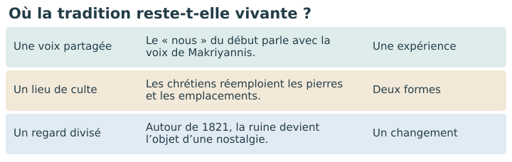

# BEL A/L — Grec moderne (commentaire et traduction) 2023 · Corrigé guidé

*Corrigé rédigé par IA, non officiel. Signalez toute erreur.*

**Rédaction** · GPT-6.2 Astra Ultra · vitesse non renseignée

**Révision (tour 1)** · GPT-6.2 Astra Ultra · vitesse non renseignée

[Sujet officiel](https://www.ens-lyon.fr/sites/default/files/2023-09/Commentaire-d-un-texte-en-LVE.pdf#page=12) · [Rapport du jury](https://www.ens-lyon.fr/sites/default/files/2023-12/Grec-moderne-2023-V2.pdf#page=2) · [Archives de la session](https://www.ens-lyon.fr/formation/admission/archives-du-concours-lettres-et-sciences-humaines/concours-dentree-session-2023)

Ζήσιμος Λορεντζάτος, Το χαμένο κέντρο (1961, édition citée de 1989). Épreuve commune de six heures. Commentaire en grec moderne, pages 12 et 13. Lignes 1 à 34, de l’affirmation collective jusqu’à la qualification de la nouvelle lecture historique de la tradition, dans la dernière phrase. Version française. Lignes 1 à 25, de « Οἱ Ἕλληνες δὲν εἴχαμε ἔλλειψη » à « τῶν ἀρχαίων Ἑλλήνων ».

## Lire le sujet

**Lire un premier pluriel**

Le sujet nominal « les Grecs » commande en grec un verbe à la première personne du pluriel. Le français peut conserver cette implication avec « nous autres Grecs ». Elle éclaire aussi le dernier « nous » du commentaire.

**Délimiter l’emprunt et la citation**

Dans les mots de Makriyannis, la glose entre crochets explique le sens de « sacré ». Le titre anglais est celui d’une ode de John Keats. Son voisinage avec Shelley n’en fait pas l’auteur de cette ode.

**Conserver l’incise antique**

La formule sur l’eau qui parlait renvoie à l’oracle de Delphes et fait entendre le passage du langage à son extinction. La version s’arrête aux temples des Grecs anciens. La réflexion sur 1821 appartient au commentaire.

**Situer le document du jury**

Pour cette session, le jury indique avoir corrigé une seule copie. Afin de préserver l’anonymat, il donne le texte et une proposition de traduction littérale. Il ne décrit pas la prestation.

## Commentaire

Τι ακριβώς χάνεται όταν ένα έθνος αρχίζει να αναζητεί την παράδοσή του; Στο απόσπασμα από το δοκίμιο *Το χαμένο κέντρο* (1961) ο Ζήσιμος Λορεντζάτος δίνει μια παράδοξη απάντηση. Για να νιώσει κανείς νοσταλγία για την αρχαιότητα, πρέπει ήδη να έχει πάψει να αναγνωρίζει το παρελθόν στους τρόπους με τους οποίους ζει. Ο συγγραφέας κατασκευάζει πρώτα ένα συλλογικό υποκείμενο που δεν αισθανόταν τέτοια έλλειψη. Έπειτα αναζητεί τα ίχνη της συνέχειας σε συγκεκριμένους τόπους λατρείας. Στο τέλος εξετάζει τι συμβαίνει όταν οι ίδιοι αυτοί τόποι γίνονται θέαμα για ένα διχασμένο βλέμμα.

Η πρώτη φράση επιφυλάσσει μια μικρή συντακτική έκπληξη. Μετά το «Οι Έλληνες» θα περίμενε κανείς ένα ρήμα στο τρίτο πρόσωπο. Το «δεν είχαμε» βάζει αμέσως τον δοκιμιογράφο μέσα στην ιστορία του και καλεί τον αναγνώστη να πάρει θέση δίπλα του. Το επανειλημμένο «εμείς» αποκτά βάρος από όλα όσα ο ομιλητής αρνείται ότι ζήσαμε. Η Ιερή Εξέταση, η Αναγέννηση και η Μεταρρύθμιση παρατάσσονται στην ίδια σειρά. Δεν εξετάζεται η ιδιαίτερη σημασία τους. Εκείνο που ενδιαφέρει τον Λορεντζάτο είναι ότι η αλληλουχία με την οποία η δυτική Ευρώπη αφηγείται το δικό της παρελθόν δεν μπορεί να χρησιμεύσει ως αυτονόητο μέτρο για την ελληνική εμπειρία. Οι αλλεπάλληλες αρνήσεις διεκδικούν έτσι για την απουσία ορισμένων γεγονότων μια θετική σημασία.

Η αντίθεση αποκτά σώμα με το ρήμα «κοιλοπονάμε». Η επίπονη παραγωγή σκέψεων γύρω από τα αγάλματα ακούγεται σχεδόν κωμική δίπλα στο απλό «ξέραμε». Τι είδους γνώση δηλώνει αυτός ο παρατατικός; Το σύντομο παράθεμα του Μακρυγιάννη δείχνει έναν άνθρωπο που αναγνωρίζει στα αντικείμενα των άλλων το ιερό, επειδή έχει ο ίδιος όσια και ιερά. Η αγκύλη που εξηγεί τη λέξη «γερά» φανερώνει ωστόσο κάτι ενδιαφέρον. Για να ακούσει ο σύγχρονος αναγνώστης την αμεσότητα της παλαιότερης φωνής, χρειάζεται ήδη μια μικρή ερμηνευτική βοήθεια. Ο δοκιμιογράφος παρουσιάζει τη συνέχεια αλλά ταυτόχρονα εργάζεται για να την κάνει αντιληπτή.

Όταν περνά στη χριστιανική παράδοση, επιλέγει με προσοχή το υποκείμενο του ρήματος. Διαφυλάχτηκε ό,τι «προοριζότανε να ζήση». Το «ακέριο» λοιπόν δεν σημαίνει ότι πέρασαν αυτούσια στον χριστιανισμό όλα τα στοιχεία της αρχαίας θρησκείας. Δηλώνει την ακεραιότητα αυτού που μπορούσε ακόμη να ζήσει, και μάλιστα «ἐν ἑτέρᾳ μορφῇ». Η μακρά περίοδος τοποθετεί από τη μια μεριά τον Schleiermacher, τον Shelley και την ωδή του Keats για την ελληνική υδρία και από την άλλη το «άδυτο» της χριστιανικής πνευματικότητας. Απέναντι σε έργα που ο καθένας μπορεί να διαβάσει, η λέξη υποδηλώνει έναν εσωτερικό χώρο στον οποίο μπαίνει κανείς με διαφορετικό τρόπο. Οι Πατέρες μεταδίδουν μια εμπειρία. Άλλοι, συχνά ανώνυμοι, χτίζουν. Η ίδια πέτρα και ο ίδιος τόπος κάνουν αισθητή μια «ιερή γεωγραφία» που αλλιώς θα έμενε αφηρημένη. Κι όμως, το νερό που κάποτε μιλούσε έχει σωπάσει. Ο απόηχος του δελφικού χρησμού μέσα στην παρένθεση αφήνει να ακουστεί για μια στιγμή αυτό ακριβώς που δηλώνεται χαμένο.

Το «21» μετατοπίζει το επιχείρημα στο κατώφλι του νεότερου ελληνικού κράτους. Η διόρθωση «ή λίγο πριν» δείχνει ότι η Επανάσταση του 1821 λειτουργεί περισσότερο ως ορόσημο μιας αλλαγής του βλέμματος παρά ως ακριβής ημερομηνία της. Τα «κρούσματα» δανείζονται τη γλώσσα της αρρώστιας. Οι καινούργιες σκέψεις γύρω από τα ερείπια μοιάζουν κατόπιν με έργο που έχει «κύρια πρόσωπα». Στα λόγια του Σεφέρη τα μνημεία συνυπάρχουν με τη σημερινή θλίψη. Η κριτική κορυφώνεται στην ιδέα μιας θεαματικής νεκρανάστασης. Εκείνος που οργανώνει το θέαμα θεωρεί ήδη νεκρό ό,τι ο Λορεντζάτος είχε περιγράψει με το ρήμα «ζει».

Η τελική εικόνα του αλλοίθωρου βλέμματος αφορά και τον συγγραφέα, που επιστρέφει στο πρώτο πληθυντικό με το «πάμε». Η απόλυτη διάκριση ανάμεσα σε Έλληνες και Ευρωπαίους αφήνει λίγο χώρο για τις διαφορές στο εσωτερικό κάθε κοινότητας. Το δοκίμιο όμως δεν κλείνει με έναν αυτάρεσκο έπαινο των προγόνων. Κλείνει με την ανησυχία ότι εμείς οι ίδιοι μπορεί να χάσουμε την ικανότητα να διακρίνουμε, κάτω από μια διαφορετική μορφή, κάτι που εξακολουθεί να μας αφορά.

## Version française

Nous autres Grecs, nous ne manquions pas de tradition. Il faut se rappeler que nous n’avons connu ni l’Inquisition, ni la Renaissance, ni la Réforme. Jamais non plus notre tradition n’a traversé de crise face à l’ennemi ni connu de doutes, comme celle des Européens. Nous n’avions pas besoin de manifester de nostalgie pour nos ancêtres ni d’enfanter dans la douleur toutes sortes de réflexions sur les statues (nous n’avons jamais douté de notre tradition vivante). Nous savions tout simplement que les Anciens, eux aussi, avaient eu en leur temps leur tradition spirituelle ou métaphysique, ce qu’ils tenaient pour saint et sacré, comme nous avons, nous, ce que nous tenons pour tel. « Les statues, ce sont des choses sacrées », dit Makriyannis (B, 63). Ce qui, dans la forme grecque de la tradition, était destiné à vivre a été préservé tout entier dans sa forme chrétienne, où cela vit encore aujourd’hui, sous une autre forme. Car ce que nous appelons la Grèce, ou tout ce qui, de la tradition de l’Antiquité grecque, a survécu et reste spirituellement vivant, n’a jamais vécu, quoi qu’en pensent bien des gens, et ne vit assurément ni chez Schleiermacher, ni chez Shelley, ni dans l’« Ode sur une urne grecque » (*Ode on a Grecian Urn*). Cela vit au cœur du sanctuaire de la spiritualité chrétienne, telle que l’ont transmise à nos ancêtres orthodoxes les Pères d’Orient ou tous ceux qui, à travers tant de siècles impitoyables, ont maintenu inébranlable exactement la même géographie métaphysique ou sacrée. Souvent, pour bâtir leurs églises, ils reprenaient jusqu’aux pierres mêmes des temples des anciens Grecs ou choisissaient les lieux mêmes où ces temples, aujourd’hui muets (même l’eau qui parlait s’est éteinte), avaient jadis été construits.
