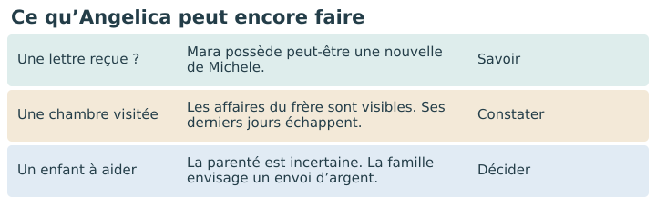

# BEL A/L — Italien (commentaire et traduction) 2023 · Corrigé guidé

*Corrigé rédigé par IA, non officiel. Signalez toute erreur.*

**Rédaction** · GPT-6.2 Astra Ultra · vitesse non renseignée

**Révision (tour 1)** · GPT-6.2 Astra Ultra · vitesse non renseignée

[Sujet officiel](https://www.ens-lyon.fr/sites/default/files/2023-09/Commentaire-d-un-texte-en-LVE.pdf#page=14) · [Rapport du jury](https://www.ens-lyon.fr/sites/default/files/2023-11/Italien-2023.pdf#page=2) · [Archives de la session](https://www.ens-lyon.fr/formation/admission/archives-du-concours-lettres-et-sciences-humaines/concours-dentree-session-2023)

Natalia Ginzburg, Caro Michele (1973, édition citée de 1995). Épreuve commune de six heures. Commentaire en italien, pages 14 et 15. Lettre du 12 juin 1971 à Mara, jusqu’à la signature d’Angelica, après la ligne 57. Version française. Lignes 14 à 34, de « Vorrei sapere » à « che mi piacevano ».

## Lire le sujet

**Retrouver le destinataire**

La date et la signature donnent les deux limites de la lettre. Relevez ensuite qui reçoit le courrier, qui pourrait en avoir reçu un autre et qui ne peut plus écrire. Le dernier impératif ouvre une correspondance possible entre les vivantes.

**Faire entendre les reprises**

Gardez les deux emplois de « tranquillement », les trois mentions de la langue allemande et les deux occurrences de « partir ». Le mouvement de la pensée dépend de ces répétitions. Le tout dernier relatif renvoie aux boucles.

**Distinguer les enfants**

Flora est la fille d’Angelica. Le garçon de Mara paraît après la version, dans le dernier paragraphe du commentaire. Pour lui, le raisonnement sur la paternité reste au mode de l’hypothèse.

## Commentaire

A che cosa può servire una lettera quando non c’è più nessuno che possa raccontare ciò che è accaduto? In questa pagina di *Caro Michele* (1973) Natalia Ginzburg affida la notizia della morte di Michele a una voce che viene dopo le altre. Viola ha già scritto a Mara. Eppure Angelica prende la penna il 12 giugno 1971. Dapprima dà un ritmo alle giornate vuote dei superstiti. Poi mette alla prova ciò che le parole e gli oggetti consentono di sapere del morto. Infine la lettera arriva a una proposta che dipende proprio dalla possibilità di agire senza aver risolto il mistero.

L’esordio fa sentire il paradosso del lutto nella durata stessa della frase. Le « giornate immobili » sono gremite di infiniti, perché occorre scrivere, guardare fotografie, parlare, persino ridere. Il raddoppiamento di « forte » fa quasi sentire lo sforzo di chi alza la voce per accertarsi che ne è ancora capace. Basta una pausa perché si senta il silenzio. Il possessivo di « nostro silenzio » gli dà la consistenza di qualcosa che madre e figlia hanno in comune. Di qui la delicatezza dell’osservazione su Osvaldo. Le sue visite fanno piacere proprio perché non richiedono a nessuno di uscire dal suo stato. La compagnia può consistere nel rispettare una pausa.

Chiedendo a Mara se abbia ricevuto lettere, Angelica spera per un momento che esista un altro archivio di Michele. Il condizionale di « Vorrei sapere » apre uno spiraglio subito richiuso dall’indicativo del futuro. Di certo si sa soltanto che si produrranno altre ipotesi. La ripresa di « credo » lascia intravedere negli anni della violenza politica il possibile movente di un delitto a Bruges. Non lo dimostra. Nemmeno il viaggio consente di ricomporre la vita del fratello. Dei biscotti nella valigia si può precisare perfino che sono sbriciolati, mentre il ragazzo danese conosceva Michele da appena tre giorni. La strada è adesso piena di voci e di camion. Un luogo visitabile, un orario dei treni, una birreria costituiscono un sapere esatto e terribilmente esiguo.

La frase che ripete « non posso pensare » compie intanto l’atto dichiarato impossibile. Angelica vede simultaneamente due scene che in quel momento non sapeva collegate. Mentre suo fratello moriva solo, lei fissava le calze di Flora con due mollette. Il secondo « tranquillamente », applicato ormai al tempo che conduceva allo squillo, estende l’angoscia perfino al giorno prima. Il telefono fa comunicare i due luoghi senza far passare un’ultima parola tra fratello e sorella. Michele ha ricordato una sequenza di cifre, Angelica ha sentito una lingua che non capiva. La triplice insistenza sul tedesco sfocia nell’elenco concitato delle incombenze assunte da Oreste. Solo alla fine emerge il motivo personale del viaggio, condensato nei riccioli rossi che piacevano alla sorella.

« Scrivimi » cambia il verso della corrispondenza. Alla fotografia e ai vestiti del fratello si sostituisce un bambino vivo, che forse gli appartiene. Angelica osserva che non gli somiglia e nello stesso periodo lascia aperta la possibilità che sia suo. Ma basta l’avverbio « ugualmente » perché l’incertezza, finora subita, perda il potere di sospendere una decisione. Alle donne della famiglia toccherebbe aiutare Mara, e il dovere prende la forma prosaica di un po’ di denaro da mandare di tanto in tanto. La voce conserva una punta di durezza nel rivolgere all’altra quegli aggettivi impietosi. Poi ne riprende due, « sbandato e balordo », al maschile di « ognuno ». Chi scrive si include nel giudizio che stava dando.

Il movimento conclusivo è affidato a un verbo di spostamento. Per capire Mara ciascuno può « trasferirsi » in una zona di se stesso. A Bruges uno spostamento reale aveva rivelato pochi oggetti e lasciato intatta una distanza. Qui un movimento immaginativo rende possibile la vicinanza fra due donne che si conoscono appena. La lettera non può dare una risposta per Michele. Può ancora attendere quella di Mara.

## Version française

J’aimerais savoir si tu avais reçu des lettres de Michele ces derniers temps. À nous, il n’avait plus écrit. Ceux qui l’ont tué, on ne les a pas retrouvés, et les indications données par le jeune homme qui les a vus sont confuses et incertaines. Je crois qu’à Bruges Michele avait repris contact avec des groupes politiques, et je crois que ceux qui l’ont tué avaient des raisons précises de le tuer. Mais ce sont là autant d’hypothèses. En vérité nous ne savons rien, et tout ce que nous parviendrons à savoir, ce seront d’autres hypothèses que nous garderons en nous et que nous continuerons à interroger sans jamais y lire de réponse claire.

Il y a des choses auxquelles je ne peux pas penser, et en particulier je ne peux pas penser à ces moments que Michele a passés seul sur cette route. Je ne peux pas penser non plus que pendant qu’il mourait, moi j’étais tranquillement chez moi à faire les gestes de tous les soirs, à laver les assiettes et à laver les bas de Flora et à les suspendre au balcon avec deux pinces à linge, jusqu’au moment où le téléphone a sonné. Je ne peux même pas penser à tout ce que j’ai fait la veille, parce que tout menait tranquillement à cette sonnerie de téléphone. Mon numéro de téléphone, c’est Michele qui l’a donné à ce jeune homme, à un moment où il a repris connaissance, mais il est mort tout de suite après, et cela aussi m’épouvante, que mon numéro de téléphone lui soit revenu en mémoire pendant qu’il mourait. Au téléphone je ne comprenais rien parce qu’on parlait allemand, moi je ne sais pas l’allemand, j’ai appelé Oreste qui sait l’allemand. Ensuite Oreste a tout fait lui-même, emmené la petite chez nos amis les Bettoia, appelé Osvaldo, appelé Viola. Chez ma mère, c’est Viola qui est allée. Je voulais que ce soit moi qui le lui dise, mais je voulais aussi partir, et finalement j’ai décidé de partir parce que je voulais dire adieu à Michele et revoir une fois encore ses boucles rousses que j’aimais.
