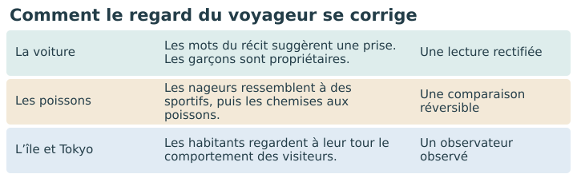

# BEL A/L — Japonais (commentaire et traduction) 2023 · Corrigé brut

*Corrigé rédigé par IA, non officiel. Signalez toute erreur.*

**Rédaction** · GPT-6.2 Astra Ultra · vitesse non renseignée

**Révision (tour 1)** · GPT-6.2 Astra Ultra · vitesse non renseignée

[Sujet officiel](https://www.ens-lyon.fr/sites/default/files/2023-09/Commentaire-d-un-texte-en-LVE.pdf#page=16) · [Rapport du jury](https://www.ens-lyon.fr/sites/default/files/2023-12/Japonais-2023-V2.pdf#page=2) · [Archives de la session](https://www.ens-lyon.fr/formation/admission/archives-du-concours-lettres-et-sciences-humaines/concours-dentree-session-2023)

三島由紀夫, アポロの杯 (Mishima Yukio, La Coupe d’Apollon, 1952). Épreuve commune de six heures. Commentaire en japonais, pages 16 et 17. De l’indication « Hawaï » et de la date du 1er janvier jusqu’à la phrase sur les Nisei, ligne 33. Version française. Lignes 3 à 14, de « ホノルルは » à « 速さを競うたりしている。 ». La phrase sur la tortue commence sur la même ligne et suit la version.

## Commentaire

三島由紀夫の旅行記『アポロの杯』のこの一節には、「一月一日」と日付がある。旅人がホノルルで見たものを順に記せば、その土地のありのままの姿が浮かび上がるのだろうか。実際に読むと、先に現れるのは土地についての評価であり、次に来るのはその評価の訂正である。少年たちの乗る車、水族館の魚、島を訪れる音楽家へと視線が移るたびに、見物する側が何を当然と思っているかが逆に照らし出される。

冒頭の「巧みな」という一語が、すぐに括弧に入れられ、吟味の対象になる。語り手は「未開」と「物質文明」を両立させるには工夫が要ると考えた。ところが二度の「かもしれない」によって、そもそも両者を隔てたのは観察者自身ではないかという疑いが生まれる。続く少年たちの場面はこの疑いを読者に体験させる。裸足、爆竹、薄汚れた少年たちの姿に、光沢のある新車が対置される。「攻め寄せて」「占領して」と動詞を重ねる速い叙述に引きこまれると、見知らぬ者の車が奪われたかのように思えてくる。そこへ「事実」という平凡な言葉が割って入る。車は彼らのものだった。三人に一台という最後の数字は、少年の身なりから購買力を推し量った読者の早合点を冷たくただす。「土民」「悪童」という呼称にも、ここでは名づける側のまなざしが残っている。

水族館へ移ると、今度は魚が運動選手の服を借りて泳ぎだす。すれ違うときにはサッカーの選手、並ぶときには競馬の騎手に見えるのだから、たとえは色だけでなく動き方にまで及ぶ。その魚の「服装」が、次の瞬間には花々の装いとともに、人間のアロハシャツを説明する。人間にたとえて魚を見たあと、魚にたとえて人間を見るのである。花の名が日本語から英語へ、さらに片仮名へと姿を変えて列挙されるのも面白い。目に映る色と、それを土産や広告の言葉に移して受け取る経験とが、同じ文章の中にある。

家は汚れかけるとすぐ塗り直される。そこで空と海の色まで、五セントの氷苺のシロップと同列に置かれる。値段と紙筒という細部のおかげで、色彩についての大きな逆説が手に取れるような品物に宿る。雑誌のカラー広告は現実を人工的に染めたものだと「われわれ」は信じてきた。ところが目の前の風景の方が、その広告を実現したように見える。ワイルドの名を出す結びの「筈である」は、商業美術が実際に海を青くしたという因果関係よりも、既に見た絵に沿って初めて景色が見えるという、旅行者の経験をよく表している。

最後の二段落では島の人々が見る側にも回る。ヴァイオリニストを迎える日系二世は、東京の人々の権威への弱さを笑う。旅人が評価するつもりだった島から、逆に東京が見られている。ただし冷静な歓迎を誇るのも二世たち自身であり、ここでも評価の主体は明記されている。車の普及は初めには繁栄の数字だったが、末尾では歩かなくなるという心配の種になる。さらに二世部隊の勇敢さが衰弱への不安に対する反証として持ち出される。病気についての記述もこの時代の人々の懸念として読む必要がある。軍隊の勇気で健康を測るその尺度まで、読者がそのまま引き受ける必要はない。

こうして旅行記には、目を奪われた瞬間と、その印象を疑い直す時間とが一緒に書き留められる。元日の短い見聞が遠くまで届くのは、最初の言い違いを消さず、訂正の跡を読者にも見えるように残したからである。

## Version française

À Honolulu, ce qui est resté à l’état sauvage se mêle à la civilisation matérielle avec une adresse remarquable. « Adresse » n’est peut-être pas le mot. Peut-être ces deux choses sont-elles par nature telles que rien ne s’oppose à leur rencontre.

Devant le zoo, sur la pelouse, des gamins du pays, pieds nus, en chemise hawaïenne, faisaient du tapage avec leurs pétards. Ils débouchèrent dans la rue en se poursuivant à tour de rôle. Parmi les innombrables voitures en stationnement, ces garnements un peu crasseux fondirent de tous côtés sur une voiture toute neuve, d’un beau brillant. En un clin d’œil ils en ouvrirent les portières, en prirent possession et, la tête passée par les fenêtres, criant quelque chose à tue-tête, démarrèrent et disparurent. C’est, en fait, leur voiture. Il y a une automobile pour trois personnes.

À l’aquarium nagent des poissons à éblouir les yeux. Lorsqu’ils se croisent, ils s’enchevêtrent comme des footballeurs en maillots éclatants, ou bien, parés comme des jockeys, ils nagent de front, à qui sera le plus rapide.
