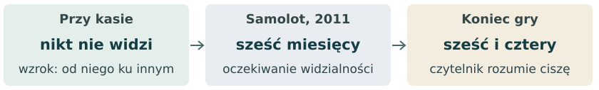

# BEL A/L — Polonais (commentaire et traduction) 2023 · Corrigé guidé

*Corrigé rédigé par IA, non officiel. Signalez toute erreur.*

**Rédaction** · GPT-6.2 Astra Ultra · vitesse non renseignée · 26 novembre 2026

**Révision** · GPT-6.2 Astra Ultra · vitesse non renseignée · 26 novembre 2026

Jakub Małecki, *Horyzont* (2019). Écrit commun de six heures, ENS de Lyon et ENS (Paris). Commentaire en polonais de l’extrait entier. Version française des lignes 26 à 39.

[Sujet officiel, p. 18–19](https://www.ens-lyon.fr/sites/default/files/2023-09/Commentaire-d-un-texte-en-LVE.pdf#page=18) · [Rapport du jury sur l’épreuve commune, p. 2–7](https://www.ens-lyon.fr/sites/default/files/2023-11/Polonais-2023.pdf#page=2)

## Lire le silence à partir de la dernière ligne

> [!INDICATION]
> Relire la liste des courses après la visite chez Miętowy. Qui choisit le saumon, qui le mangera et qui le rangera ? Ce petit trajet permet d’étudier un lien entre les deux hommes sans leur prêter un dialogue.

Le supermarché et l’appartement sont reliés par les provisions. Les amandes passent du panier au bocal puis à la main du narrateur. En suivant un objet au fil des pages, le commentaire peut montrer de quelle manière les deux hommes prennent place côte à côte. Pour expliquer leur silence, rapprocher le Boeing affrété en 2011, les six mois, le refus de tuer dans le jeu et les deux dernières phrases. Le jury lit dans ces indices l’expérience d’anciens militaires et juge l’Afghanistan probable. L’extrait ne nomme pas le pays. Garder cette différence permet d’interpréter les gestes sans transformer une hypothèse en souvenir explicite.

### Conserver les changements de personne

Dans la file, le récit est au présent et à la première personne. Le sujet énumère ce que les autres ne voient pas, puis prononce son nom. Le départ de Wrocław réclame un passage au passé. Les fragments commençant par *Że* reprennent les certitudes d’alors, d’où le conditionnel français pour leur avenir imaginé. La deuxième personne de *stoisz* entraîne ensuite le lecteur dans la file. Dans la dernière image, *przeszłości* désigne le passé dont les contours se brouillent. Le rapport fournit une proposition plus longue. La copie s’arrête au bref ajout de la ligne 39, avant le code de la porte.

## Commentaire

W pierwszych zdaniach fragmentu *Horyzontu* świat zdaje się łatwy do odczytania. Upał widać po krótkich rękawach, kolejkę po lody można objąć wzrokiem, zakupy dają się wyliczyć. Tymczasem mężczyzna, który to wszystko widzi, sam czuje się niewidoczny. Dopiero dwa ostatnie zdania ujawniają czytelnikowi coś, czego z twarzy mężczyzny nie wyczyta nikt w kolejce. Jak zwykła droga ze sklepu do przyjaciela staje się opowieścią o życiu po doświadczeniu przemocy?

Pierwsza osoba i czas teraźniejszy pozwalają niemal iść krok w krok za narratorem. Listę zakupów układa się w rytmie wkładania produktów do koszyka. Drobna poprawka przy łososiu zdradza, że kupujący bierze pod uwagę czyjeś zachcianki. Osobę, dla której to robi, poznamy dopiero po zakupach. Kiedy dzwoni Hubert, opis przestaje tak żwawo posuwać się naprzód. Pozdrowienia są identyczne, po obu stronach słuchawki słychać westchnienie, a upływ ciszy liczy się w sekundach. Podobna jest później oferta Mileny. W obu wypowiedziach pojawia się warunek, który pozostawia Mańkowi wybór. W sklepie narrator nie chce rozmawiać, w mieszkaniu nawet nie odpisuje. Przez telefon Hubert nie może zauważyć, że Maniek kiwa głową. Ciało zdążyło odpowiedzieć, choć do rozmówcy nic nie dotarło.

Przy kasie wzrok przesuwa się od jednego człowieka do drugiego. Mężczyzna nie oddzielił zakupów, dziewczęta patrzą w telefony, kasjerka wypowiada powitanie bez podnoszenia głowy. Dla czytelnika właśnie teraz pada pełne imię i nazwisko człowieka, którego nikt nie zauważa. Wspomnienie wylotu z Wrocławia w 2011 roku zmienia sens tej sceny. Sześć miesięcy miało go uczynić zarazem widocznym dla innych i odpornym na wszystko. Powtórzone zdania zaczynające się od „Że” przedłużają tamtą pewność, zanim krótkie stwierdzenie o odwrotnym skutku położy jej kres. Gdy mężczyzna mówi o kolejce w drugiej osobie, pozwala każdemu stanąć na swoim miejscu. Tyle że nawet z tak bliska jego przeszłości nie widać. Jej kontury zacierają się wśród ludzi.

W mieszkaniu Miętowego szczegóły materialne znów służą do mierzenia przestrzeni. Mężczyzna o ogromnych barkach ledwie mieści się w ciasnym mieszkaniu. W windzie narrator nie chciał zobaczyć siebie w lustrze. Teraz przyjaciel odwraca się do niego plecami, a oczy obu będzie później przyciągał ten sam ekran. Układa mu banany i przesypuje migdały. Ta troska ma postać zajęcia, które da się wykonywać bez słów. Słychać za to grę. Znajomy wraca po każdej wirtualnej śmierci do tej samej misji. Poza grą porzucił kolejne zajęcia i żyje dzięki pomocy brata. Z pozoru łatwo uznać go za obojętnego na wszystko. Dopiero wiadomość o tym, że stara się nikogo w grze nie skrzywdzić, nadaje uporowi inny sens.

Dwa końcowe rachunki, sześć zabitych przez przyjaciela i czterech przez narratora, są równie lakoniczne jak lista sprawunków. Tutaj nie ma jednak żadnego „zacznij od nowa”. Czytelnik może powiązać wyczarterowany samolot i sześciomiesięczną nieobecność z wojskowym wyjazdem, którego celu narrator nie nazywa. W zachowaniu obu mężczyzn widać ciężar tego, co zrobili, i tego, czego nie zrobili. Ostatnie zdanie nie przywraca Mańkowi widzialności w oczach przypadkowych ludzi. Zmienia za to spojrzenie czytelnika na milczenie, które od początku dzieliło go od innych.

## Version

Je glisse mon téléphone dans ma poche et me dirige vers les caisses. Dans la file, je regarde l’homme devant moi. Peut-être exprès, peut-être pas, il n’a pas mis derrière ses achats ce machin en plastique où on lit CLIENT SUIVANT. Mon regard passe à deux adolescentes qui ne prêtent aucune attention à tout ce qui existe hors des écrans de leurs téléphones – moi compris –, puis à la caissière qui me dit bonjour, attrape le riz, le saumon, les amandes, sans lever la tête. Moi, Maniek Małecki, pour eux, je n’existe pas.

En 2011, à Wrocław, quand je suis monté à bord d’un Boeing affrété auprès d’une compagnie aérienne américaine, j’étais convaincu que, si je survivais à ces six mois, je deviendrais quelqu’un qui ne pourrait passer inaperçu. Que tout le monde verrait en moi ce que j’aurais fait et ce que je n’aurais pas fait. Qu’après six mois comme ceux-là, plus rien ne pourrait m’atteindre.

C’est tout le contraire et tout m’atteint. Ce que j’ai fait de ma vie, ce que je n’ai pas fait, ça ne compte pas. Quand tu fais la queue à la caisse derrière un type qui a l’air de dormir debout et deux adolescentes, les contours de ton passé s’estompent.

À d’autres moments aussi.
