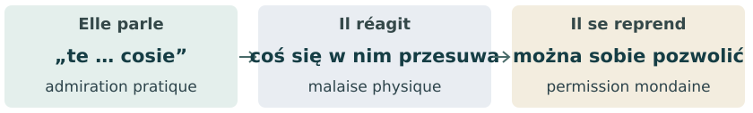

# BEL A/L — Polonais (thème, Lyon) 2023 · Corrigé brut

*Corrigé rédigé par IA, non officiel. Signalez toute erreur.*

**Rédaction** · GPT-6.2 Astra Ultra · vitesse non renseignée · 26 novembre 2026

**Révision** · GPT-6.2 Astra Ultra · vitesse non renseignée · 26 novembre 2026

Nathalie Sarraute, *Le Planétarium* (1959). Thème de quatre heures, sans dictionnaire.

Le thème figure dans le fascicule des spécialités de l’ENS de Lyon, p. 15. Le rapport de polonais traite du commentaire et de la version de *Horyzont* de Jakub Małecki, p. 2–7. Aucun rapport propre au thème de Sarraute n’est répertorié. [Sujet officiel, p. 15](https://www.ens-lyon.fr/sites/default/files/2023-09/Epreuve-de-specialite.pdf#page=15) · [Rapport de commentaire et version](https://www.ens-lyon.fr/sites/default/files/2023-11/Polonais-2023.pdf)

## Proposition de thème

„No, a teraz niech mi pan wszystko pokaże… Sam pan wie, że jeszcze niczego nie widziałam, a tu u pana, zdaje się, naprawdę wspaniale…” No, odwagi, zostawia mu jeszcze jakąś nadzieję, daje mu szansę… chwyta ją za rękę, pomaga jej wstać… „Tak, właśnie, proszę za mną. Przepraszam, pójdę pierwszy, żeby pani pokazać…”, idzie o krok przed nią wąskim korytarzem, zwrócony ku niej, otwiera wszystkie drzwi […] królowa jest u siebie w każdej z siedzib swoich wasali, nad zamkiem, który odwiedza, powiewa królewska chorągiew… Ogląda wszystko z życzliwym zaciekawieniem, uroczyście otwiera, wprowadza w świat, odsłania przed innymi, którzy przyjdą po niej podziwiać, dziwić się… Drobiazg zatrzymuje jej wzrok, drobniutka rzecz, ta ażurowa szafka na brudną bieliznę pod oknem w umywalni… „Dobre to, bardzo wygodne, moim zdaniem, te cosie…” Coś się w nim przesuwa… jakiś nieokreślony niepokój, irytacja, jakby leciutka odraza, odrobinę się kurczy, ma ochotę się odwrócić, odsunąć – to ten stary odruch obronny odzywa się w nim wbrew jego woli, ten, który go ogarnia, kiedy… Ale gdzie mu się zdaje, że jest? Z kim? O czym on myśli? Przed czym chce się tu bronić? Przed jaką pospolitością? Przed jaką ciasnotą praktycznego umysłu? Przed jaką małostkowością? Jest się tu przecież wśród wielkich panów, można sobie na to pozwolić, żeby z tym błyskiem podniecenia w oczach, z tak żywym zainteresowaniem, niemal z zazdrością, oglądać szafki na brudną bieliznę […] ona może sobie pozwolić na taki luksus, doceniać te „cosie” jako kobieta praktyczna, bo przecież i taką potrafi być, jakież to godne podziwu, jakież to wzruszające… Sama pieląc swój ogródek, sadząc kapustę, prowadząc rachunki, a jakże, lubiąc gotować…

## Note de traduction

Le mot familier *cosie* reparaît lorsque l’homme se figure le jugement de la visiteuse. La reprise fait glisser la remarque domestique dans son débat intérieur.

