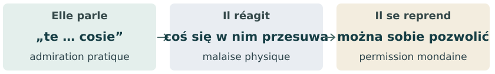

# BEL A/L — Polonais (thème, Lyon) 2023 · Corrigé guidé

*Corrigé rédigé par IA, non officiel. Signalez toute erreur.*

**Rédaction** · GPT-6.2 Astra Ultra · vitesse non renseignée · 26 novembre 2026

**Révision** · GPT-6.2 Astra Ultra · vitesse non renseignée · 26 novembre 2026

Nathalie Sarraute, *Le Planétarium* (1959). Thème de quatre heures, sans dictionnaire.

Le thème figure dans le fascicule des spécialités de l’ENS de Lyon, p. 15. Le rapport de polonais traite du commentaire et de la version de *Horyzont* de Jakub Małecki, p. 2–7. Aucun rapport propre au thème de Sarraute n’est répertorié. [Sujet officiel, p. 15](https://www.ens-lyon.fr/sites/default/files/2023-09/Epreuve-de-specialite.pdf#page=15) · [Rapport de commentaire et version](https://www.ens-lyon.fr/sites/default/files/2023-11/Polonais-2023.pdf)

## Entendre deux voix dans un seul paragraphe

> [!INDICATION]
> Relire les deux premiers « Allons ». Qui essaie de faire bouger qui ? Traduire ces deux départs avant d’ajouter le moindre verbe de parole.

La visiteuse commence par une invitation qui tient de l’ordre. Dans *niech mi pan wszystko pokaże*, la troisième personne et le titre *pan* gardent à la visite sa politesse. La désinence féminine de *widziałam* identifie la visiteuse. Quelques mots plus tard, *No, odwagi* reprend son premier *No* dans l’encouragement que l’homme semble s’adresser à lui-même. Glisser ici *pomyślał* fixerait trop tôt la frontière entre la voix qui raconte et la pensée qui se fait entendre. Lorsqu’il se met en marche, *pani* suffit à marquer le changement de destinataire.

### La souveraine et l’armoire à linge

Les verbes de cérémonie ont d’abord la reine pour sujet. *Uroczyście otwiera* conserve le geste public d’une inauguration. *Wprowadza w świat* suggère que le regard de la visiteuse met l’objet en circulation. Le français laisse ces gestes en suspens avant d’évoquer les futurs visiteurs. La traduction laisse également l’objet indéterminé. Quand un détail arrête ce mouvement, *drobiazg*, puis *drobniutka rzecz*, rétrécissent le champ. *Ażurowa szafka* indique les ouvertures qui laissent passer l’air. *Szafka na brudną bieliznę* désigne un meuble de rangement et rend possible sa reprise au pluriel.

*Cosie*, pluriel familier fabriqué sur *coś*, se prête à une appréciation presque enfantine. *Ustrojstwa* conviendrait à une voix plus soupçonneuse, comme si les objets avaient une mécanique bizarre. La reprise entre guillemets permet surtout d’entendre la parole de la visiteuse à travers celle de l’homme. On peut se relire en cachant les guillemets et en cherchant à reconnaître ce mot une deuxième fois à l’oreille.

### Retarder l’explication du malaise

*Coś się w nim przesuwa* laisse d’abord sentir un mouvement intérieur. Viennent ensuite l’inquiétude, l’irritation et la répulsion, puis le mouvement du corps qui voudrait se dégager. Un verbe immédiatement explicatif comme *oburza się* ferait de l’indignation le point de départ. Dans la série qui suit, les trois reprises de *przed jaką* prolongent le gouvernement de *bronić się przed* et appellent l’instrumental. Le lecteur entend l’homme reprendre un à un les motifs possibles de son recul.

### Laisser la dernière phrase en suspens

Le discours s’élève jusqu’aux « grands seigneurs », puis descend au jardin, aux choux et aux comptes. La forme impersonnelle *można sobie na to pozwolić* étend à ce petit monde l’autorisation de regarder les placards. La dernière suite en *-ąc* reste suspendue, comme les participes français. L’isolat *a jakże* se lit comme une approbation qui renchérit sur le zèle domestique. Deux marques de coupe entre crochets appartiennent au feuillet. Les autres points de suspension règlent la durée des hésitations et de l’admiration.

## Proposition de thème

„No, a teraz niech mi pan wszystko pokaże… Sam pan wie, że jeszcze niczego nie widziałam, a tu u pana, zdaje się, naprawdę wspaniale…” No, odwagi, zostawia mu jeszcze jakąś nadzieję, daje mu szansę… chwyta ją za rękę, pomaga jej wstać… „Tak, właśnie, proszę za mną. Przepraszam, pójdę pierwszy, żeby pani pokazać…”, idzie o krok przed nią wąskim korytarzem, zwrócony ku niej, otwiera wszystkie drzwi […] królowa jest u siebie w każdej z siedzib swoich wasali, nad zamkiem, który odwiedza, powiewa królewska chorągiew… Ogląda wszystko z życzliwym zaciekawieniem, uroczyście otwiera, wprowadza w świat, odsłania przed innymi, którzy przyjdą po niej podziwiać, dziwić się… Drobiazg zatrzymuje jej wzrok, drobniutka rzecz, ta ażurowa szafka na brudną bieliznę pod oknem w umywalni… „Dobre to, bardzo wygodne, moim zdaniem, te cosie…” Coś się w nim przesuwa… jakiś nieokreślony niepokój, irytacja, jakby leciutka odraza, odrobinę się kurczy, ma ochotę się odwrócić, odsunąć – to ten stary odruch obronny odzywa się w nim wbrew jego woli, ten, który go ogarnia, kiedy… Ale gdzie mu się zdaje, że jest? Z kim? O czym on myśli? Przed czym chce się tu bronić? Przed jaką pospolitością? Przed jaką ciasnotą praktycznego umysłu? Przed jaką małostkowością? Jest się tu przecież wśród wielkich panów, można sobie na to pozwolić, żeby z tym błyskiem podniecenia w oczach, z tak żywym zainteresowaniem, niemal z zazdrością, oglądać szafki na brudną bieliznę […] ona może sobie pozwolić na taki luksus, doceniać te „cosie” jako kobieta praktyczna, bo przecież i taką potrafi być, jakież to godne podziwu, jakież to wzruszające… Sama pieląc swój ogródek, sadząc kapustę, prowadząc rachunki, a jakże, lubiąc gotować…
