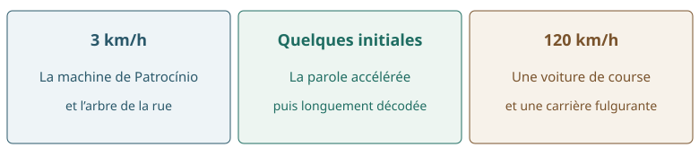

# BEL A/L — Portugais (commentaire et traduction) 2023 · Corrigé brut

*Corrigé rédigé par IA, non officiel. Signalez toute erreur.*

**Rédaction** · GPT-6.2 Astra Ultra · vitesse non renseignée

**Révision (tour 1)** · GPT-6.2 Astra Ultra · vitesse non renseignée

João do Rio, « A era do automóvel », *Vida vertiginosa* (1911). Épreuve commune de six heures. [Sujet, p. 20–21](https://www.ens-lyon.fr/sites/default/files/2023-09/Commentaire-d-un-texte-en-LVE.pdf#page=20) · [Rapport du jury, p. 2–4](https://www.ens-lyon.fr/sites/default/files/2023-11/Portugais-2023.pdf#page=2)

## Comentário em português

Como se proclama a chegada de uma era cujos primeiros heróis mal conseguiam andar? Em «A era do automóvel», João do Rio aproveita essa desproporção para fazer uma experiência com o próprio ritmo da crônica. O leitor começa por rir de duas máquinas desastradas e acaba tendo de ler, falar e até imaginar a ascensão social à velocidade que elas impõem. A graça está em que o cronista, tão hábil em acompanhar a mudança de marcha, nunca abandona inteiramente o ponto de vista de quem a estranha.

A conjunção inicial parece apanhar a cidade no meio de outra história, interrompida de súbito pela chegada do «monstro». No entanto, ao anúncio no presente segue-se a memória de um tempo em que o pavimento reagia ao intruso como um bicho que eriça o pelo. Não havia de um lado uma máquina poderosa e do outro uma cidade passiva. Ao pé das pedras e das árvores da rua da Passagem, a primeira máquina de Patrocínio perde o combate a três quilômetros por hora. A precisão do número dá a medida da distância entre o que os passageiros sentiam e o que podia ver um transeunte de guarda-chuva. O segundo carro empresta à tartaruga uma qualidade inesperada, a capacidade de fazer barulho. As perguntas sobre o futuro desses dois veículos se dirigem a leitores que já sabem a resposta, mas o breve diálogo anônimo nos faz ouvir outra vez o tempo em que andar de automóvel equivalia a uma desgraça.

Para que mudasse essa avaliação, foi preciso refazer a cidade. A evocação quase fantástica do toque de Satanás dá lugar a uma sequência em que se derrubam ruas, surgem avenidas e caem impostos. Até a alfândega entra na transfiguração. Daí a ambiguidade da passagem do «eu» que se lembra ao «nós» que vive sob o novo regime. Ser rei, soberano e por fim tirano, como o motorista na linha 26, são três maneiras cada vez menos inocentes de comandar. A enumeração que vai da moral ao amor registra a extensão dessa autoridade para além da rua.

A longa citação de Mirbeau oferece um modo possível de compreender o entusiasmo. Para ele, o impulso de deixar a própria pessoa para trás reúne o automóvel, o barco e o balanço numa mesma família de prazeres. O cronista interrompe esse movimento com um seco «Não». Interessa-lhe o ser humano produzido pela máquina, e é na boca desse homem que se vai buscar a prova. Os interlocutores do segundo diálogo trocam siglas com uma facilidade inacessível a um leitor de vinte anos antes. Contudo, para explicar ao leitor de hoje o que eles disseram em quatro falas, o cronista precisa de várias linhas de prosa por extenso. O que o automobilista poupa em sílabas, o cronista gasta para traduzir. O insólito «Iéss» chega a dar forma portuguesa ao som de uma palavra inglesa. Até o inglês sofre uma metamorfose na boca dos iniciados. É uma boa piada, numa crônica tão inventiva, declarar que a literatura é ócio e o discurso impossível.

Nos últimos parágrafos, a mesma sintaxe da abreviação passa da língua à carreira dos homens. Mal nascem e os meninos já surgem banqueiros ou ministros, como se a gasolina pudesse dispensar o intervalo entre o berço e o poder. Os cento e vinte quilômetros por hora do carro de corrida prometem acelerar até a marcha moral. Mas a palavra «desespero» insinua uma aflição no meio da lista dos que venceram na vida. O cronista anuncia como ideal universal aquilo que prova sobretudo pelo exemplo de presidentes, industriais e financistas. Ao imitar a velocidade deles, a crônica nos faz participar do entusiasmo. Ao nomear quem ocupa os carros, permite que se pergunte de quem é o ideal que parece ser de todos.

## Version française, lignes 1–23

Et soudain, voici l’ère de l’Automobile. Le monstre qui tout transforme a fait irruption, en s’ébrouant, parmi les décombres de la vieille ville. Comme dans les tours de magie et dans la nature, cette si rude éducatrice, il a tout changé, donnant des apparences nouvelles aux choses et faisant naître des aspirations nouvelles. Quand mes yeux s’ouvrirent aux rigueurs de la vie et aussi à ses plaisirs, la ville, tout en rues étroites et mal pavées, hérissait sa pierraille contre la bête de légende que l’on venait d’inventer en France. Seuls deux pauvres petits bolides avaient eu l’audace de se montrer dans les rues exiguës. L’un, le premier, celui de Patrocínio, fit à son arrivée sensation jusqu’au scandale. Les gens s’arrêtaient, le parapluie sous le bras, pétrifiés comme à la vue d’une bête venue de Mars ou d’un engin de mort instantanée. Huit jours plus tard, le journaliste et quelques amis, qui croyaient voler à trois kilomètres à l’heure, fracassaient la machine contre les arbres de la rua da Passagem. L’autre allait si lentement, bougeait si peu, qu’on aurait dit une tortue tapageuse. Il crachait tant de fumée que plusieurs dames suffoquaient à le voir passer. La presse, héraut du progrès, et l’élégance, modèle du snobisme, étaient les précurseurs de l’ère automobilique. Mais personne ne devinait cette ère. Qui aurait pu prévoir l’influence future de l’Automobile devant la machine démolie de Patrocínio ? Qui aurait imaginé des vitesses prodigieuses à voir cette carriole poussive que le comte Guerra Duval prêtait aux clubs d’enfants, jouet au même titre que les balançoires et les dociles poneys ? Personne ! Absolument personne.

— Ah ! Une automobile, cette machine qui sent mauvais ?

— Eh bien, moi, j’ai voyagé dedans.

— Malheureux !

Pour que cette ère s’établît, il avait fallu que la ville se transfigure. Et la transfiguration s’opéra comme dans les fêtes étincelantes, au rythme du tam-tam de Satan.

## Repère de lecture

