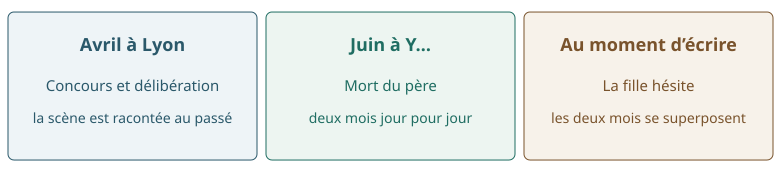

# BEL A/L — Portugais (thème Lyon) 2023 · Corrigé brut

*Corrigé rédigé par IA, non officiel. Signalez toute erreur.*

**Rédaction** · GPT-6.2 Astra Ultra · vitesse non renseignée

**Révision (tour 1)** · GPT-6.2 Astra Ultra · vitesse non renseignée

Annie Ernaux, *La Place* (1983). Thème de spécialité, quatre heures, sans dictionnaire. [Sujet, p. 16](https://www.ens-lyon.fr/sites/default/files/2023-09/Epreuve-de-specialite.pdf#page=16) · [Rapport du jury, p. 7–8](https://www.ens-lyon.fr/sites/default/files/2023-11/Portugais-2023.pdf#page=7)

## Proposta de tradução

Fiz as provas práticas do Capes, o concurso francês de ingresso na docência do ensino secundário, num colégio de Lyon, no bairro da Croix-Rousse. Um colégio novo, com plantas na área reservada à administração e aos professores, uma biblioteca de carpete cor de areia. Esperei ali que viessem me chamar para dar a aula, objeto da prova, diante do inspetor e de dois membros da banca, professores de letras com larga experiência. Uma mulher corrigia trabalhos de alunos com ar de superioridade, sem hesitar. Bastava sair-me bem na hora seguinte para poder fazer como ela pelo resto da vida. Para uma turma do penúltimo ano, alunos da área de matemática, analisei vinte e cinco linhas de O pai Goriot, de Balzac — as linhas tinham de ser numeradas. “Que aula arrastada a senhora deu a esses alunos”, repreendeu-me depois o inspetor, na sala do diretor. Estava sentado entre os dois membros da banca, um homem e uma mulher míope de sapatos cor-de-rosa. Eu, de frente para eles. Durante um quarto de hora ele misturou críticas, elogios, conselhos, e eu mal o escutava, perguntando a mim mesma se aquilo tudo queria dizer que eu tinha passado. De repente, num só movimento, os três se levantaram, com ar solene. Levantei-me também, às pressas. O inspetor me estendeu a mão. Depois olhou bem nos meus olhos e me disse “A senhora está de parabéns”. Os outros repetiram “está de parabéns” e me apertaram a mão, mas a mulher, com um sorriso.

Não parei de pensar naquela cerimônia até chegar ao ponto de ônibus, com raiva e uma espécie de vergonha. Naquela mesma noite escrevi a meus pais dizendo que agora era professora “efetiva”. Minha mãe respondeu que os dois estavam muito felizes por mim.

Meu pai morreu dois meses depois, exatamente no mesmo dia do mês. Tinha sessenta e sete anos e, com minha mãe, tocava um café que também vendia mantimentos, num bairro tranquilo perto da estação, em Y… (Seine-Maritime). Pensava em se aposentar dali a um ano. Muitas vezes, por alguns segundos, já não sei se a cena do colégio de Lyon aconteceu antes ou depois, se o abril de ventania em que me vejo à espera de um ônibus na Croix-Rousse deve vir antes ou depois do junho sufocante em que meu pai morreu.

## Repère de lecture

