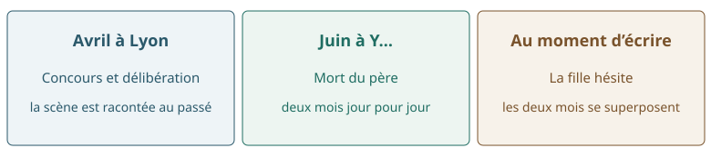

# BEL A/L — Portugais (thème Lyon) 2023 · Corrigé guidé

*Corrigé rédigé par IA, non officiel. Signalez toute erreur.*

**Rédaction** · GPT-6.2 Astra Ultra · vitesse non renseignée

**Révision (tour 1)** · GPT-6.2 Astra Ultra · vitesse non renseignée

Annie Ernaux, *La Place* (1983). Thème de spécialité, quatre heures, sans dictionnaire. [Sujet, p. 16](https://www.ens-lyon.fr/sites/default/files/2023-09/Epreuve-de-specialite.pdf#page=16) · [Rapport du jury, p. 7–8](https://www.ens-lyon.fr/sites/default/files/2023-11/Portugais-2023.pdf#page=7)

## Préparer le thème

### Entendre une épreuve publique dans un récit à la première personne

Le premier paragraphe place la candidate dans un décor qu’elle évalue avant de savoir comment elle-même sera évaluée. Garder la phrase nominale qui isole le bâtiment et, plus loin, celle qui place la narratrice face aux trois examinateurs. L’accumulation des gestes très réglés gagne à rester précise. Les chaussures roses et le sourire reviennent à une seule femme, qui siège dans le jury. Le texte ne précise pas si c’est elle qui corrigeait des copies au début.

### Rendre l’institution et le reproche

Cette proposition emploie le portugais du Brésil. Elle conserve « Capes » et en éclaire la fonction à sa première occurrence. Une « classe de première » se situe un an avant la dernière année du lycée français. « Penúltimo ano » en indique le niveau sans changer de système scolaire. Le reproche de l’inspecteur concerne la façon dont les élèves ont été entraînés à travers l’explication. Il ne dit pas que la candidate leur a donné trop de travail. Pour « titulaire », « efetiva » garde à la fois l’accès à un statut et les guillemets qui détachent le mot dans la lettre.

### Suivre les deux calendriers

Le deuxième paragraphe conserve l’ordre cérémonie, arrêt de bus, lettre. Au troisième, le décès survient exactement deux mois plus tard, et le départ à la retraite reste un projet du père. « Dali a um ano » place ce projet dans son avenir à lui. Les présents de la dernière phrase sont en revanche ceux de la fille qui écrit. Garder l’écho entre « antes ou depois » et « antes ou depois » fait entendre le vacillement de la mémoire. Ce qui se brouille dans ces quelques secondes est l’ordre intime de deux souvenirs dont les mois sont nommés.

## Proposta de tradução

Fiz as provas práticas do Capes, o concurso francês de ingresso na docência do ensino secundário, num colégio de Lyon, no bairro da Croix-Rousse. Um colégio novo, com plantas na área reservada à administração e aos professores, uma biblioteca de carpete cor de areia. Esperei ali que viessem me chamar para dar a aula, objeto da prova, diante do inspetor e de dois membros da banca, professores de letras com larga experiência. Uma mulher corrigia trabalhos de alunos com ar de superioridade, sem hesitar. Bastava sair-me bem na hora seguinte para poder fazer como ela pelo resto da vida. Para uma turma do penúltimo ano, alunos da área de matemática, analisei vinte e cinco linhas de O pai Goriot, de Balzac — as linhas tinham de ser numeradas. “Que aula arrastada a senhora deu a esses alunos”, repreendeu-me depois o inspetor, na sala do diretor. Estava sentado entre os dois membros da banca, um homem e uma mulher míope de sapatos cor-de-rosa. Eu, de frente para eles. Durante um quarto de hora ele misturou críticas, elogios, conselhos, e eu mal o escutava, perguntando a mim mesma se aquilo tudo queria dizer que eu tinha passado. De repente, num só movimento, os três se levantaram, com ar solene. Levantei-me também, às pressas. O inspetor me estendeu a mão. Depois olhou bem nos meus olhos e me disse “A senhora está de parabéns”. Os outros repetiram “está de parabéns” e me apertaram a mão, mas a mulher, com um sorriso.

Não parei de pensar naquela cerimônia até chegar ao ponto de ônibus, com raiva e uma espécie de vergonha. Naquela mesma noite escrevi a meus pais dizendo que agora era professora “efetiva”. Minha mãe respondeu que os dois estavam muito felizes por mim.

Meu pai morreu dois meses depois, exatamente no mesmo dia do mês. Tinha sessenta e sete anos e, com minha mãe, tocava um café que também vendia mantimentos, num bairro tranquilo perto da estação, em Y… (Seine-Maritime). Pensava em se aposentar dali a um ano. Muitas vezes, por alguns segundos, já não sei se a cena do colégio de Lyon aconteceu antes ou depois, se o abril de ventania em que me vejo à espera de um ônibus na Croix-Rousse deve vir antes ou depois do junho sufocante em que meu pai morreu.
