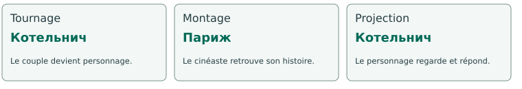

# BEL A/L — Russe (thème, Lyon) 2023 · Corrigé brut

*Corrigé rédigé par IA, non officiel. Signalez toute erreur.*

**Rédaction** · GPT-6.2 Astra Ultra · vitesse non renseignée · 26 novembre 2026

**Révision** · GPT-6.2 Astra Ultra · vitesse non renseignée · 26 novembre 2026

Emmanuel Carrère, *Yoga* (2020), « Kotelnitch ». Épreuve de spécialité de quatre heures, sans dictionnaire.

[Sujet officiel, p. 17](https://www.ens-lyon.fr/sites/default/files/2023-09/Epreuve-de-specialite.pdf#page=17) · [Rapport du jury, p. 11–14](https://www.ens-lyon.fr/sites/default/files/2023-11/Russe-2023.pdf#page=11)

L’extrait passe de la mémoire d’un tournage à une parole de Sacha. Les deux coupures entre crochets figurent sur le feuillet. La note du sujet comporte une coquille : la graphie russe correcte de « les rois mages » est [волхвы]{lang=ru}.

## Proposition de thème

::: {lang=ru}
Котельнич

Пятнадцатью годами раньше я снял документальный фильм в небольшом русском городке Котельниче. Съёмки растянулись на несколько месяцев. За это время мы с моей маленькой съёмочной группой перезнакомились со множеством людей. Интереснее всех оказались начальник местной милиции и его молодая жена: вот кому из обыкновенных людей предстояло стать героями фильма. Он, Саша, — красавец, обаятельный парень, а в придачу взяточник, алкоголик и параноик. Сегодня он каких только палок не вставит нам в колёса, а завтра уже на русский лад клянётся нам в вечной дружбе. Она, Аня, — хорошенькая мечтательница, любившая безобидно приврать. Она обожала всё французское и так дивилась нашему появлению, будто к ней явились волхвы, как она сама говорила. Они вызывали у нас любопытство, и оба были нам симпатичны. А потом случилось страшное: Аню убили. Какой-то безумец изрубил её топором вместе с восьмимесячным ребёнком. Пошли слухи, будто к этому причастен Саша. […] Вернувшись в Париж, я сел за монтаж. По ходу работы я стал замечать, как пережитое нами в Котельниче перекликается с одной мучительной историей из моей собственной жизни, с тем, что называют семейной тайной и что порой не даёт покоя нескольким поколениям. Много слёз мне это стоило […], но мне удалось хоть как-то похоронить одного умершего человека — моего деда по матери, которого никто не смог ни похоронить, ни оплакать и который превратился в призрак. Я сплёл воедино две истории — их и свою. Их семью, свою семью, наши трагедии. Закончив монтаж, я вернулся в Котельнич, чтобы показать фильм тем, кто стал его героями, и в первую очередь Саше. Я со страхом ждал его реакции. Мы вместе посмотрели привезённую мной видеокассету VHS на его телевизоре. Телевизор был такой старый, что я удивился, увидев цветное изображение. В конце Саша долго молча вглядывался в моё лицо и наконец сказал: «Хорошо. Ты приехал не просто забрать наше горе. Ты и своё привёз».

Эмманюэль Каррер, «Йога», 2020.
:::

