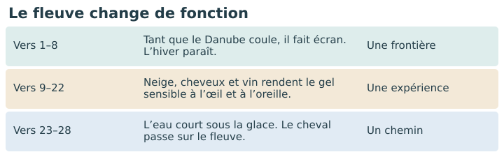

# BEL A/L — Version latine (Lyon) 2023 · Corrigé brut

*Corrigé rédigé par IA, non officiel. Signalez toute erreur.*

**Rédaction** · GPT-6.2 Astra Ultra · vitesse non renseignée

**Révision (tour 1)** · GPT-6.2 Astra Ultra · vitesse non renseignée

[Sujet officiel](https://www.ens-lyon.fr/sites/default/files/2023-09/Epreuve-de-specialite.pdf#page=5) · [Rapport du jury](https://www.ens-lyon.fr/sites/default/files/2023-11/Latin-2023.pdf#page=2) · [Archives de la session](https://www.ens-lyon.fr/formation/admission/archives-du-concours-lettres-et-sciences-humaines/concours-dentree-session-2023)

Ovide, Tristes, III, 10. Écrit de spécialité de quatre heures. Sujet, page 5. Les vingt-huit vers du feuillet « Un hiver chez les barbares », de Sauromatae cingunt à ungula pulsat equi. Les numéros employés ici repartent du premier vers de l’extrait.

## Version française

Les Sauromates m’entourent, peuple farouche, ainsi que les Besses et les Gètes. Comme ces noms sont indignes de mon talent ! Tant que l’air reste doux, pourtant, le Danube, qui coule entre eux et nous, nous protège. Ses eaux, tant qu’elles sont liquides, tiennent la guerre à distance. Mais quand le sinistre hiver a montré sa face hérissée, quand le gel a rendu la terre blanche comme le marbre, tandis que Borée et la neige interdisent d’habiter sous l’Ourse, alors on voit bien quel ciel frissonnant pèse sur ces peuples.

La neige couvre le sol. Pour que ni le soleil ni les pluies ne fassent fondre celle qui est tombée, Borée la durcit et la fait durer toujours. Aussi, avant que la première couche ait fondu, il en vient une seconde, et en bien des endroits la neige reste d’ordinaire deux ans. Quand l’Aquilon se déchaîne, telle est sa force qu’il abat au ras du sol les hautes tours et emporte les toits qu’il a arrachés.

Avec des peaux et des braies cousues, on se défend contre ces cruelles froidures. De tout le corps, seul le visage reste à découvert. Souvent, quand les cheveux bougent, on entend tinter la glace qui y pend, et la barbe blanchie étincelle sous la couche de givre qui la couvre. Sorti de sa cruche, le vin tient debout tout seul et garde la forme du vase. Ce ne sont pas des gorgées de vin pur qu’ils boivent, mais les morceaux qu’on leur tend.

À quoi bon dire comment les ruisseaux enchaînés se figent sous l’effet du froid et comment l’on doit extraire du lac une eau devenue cassante ? Le Danube lui-même, aussi large que le fleuve qui porte le papyrus, mêle ses eaux par de nombreuses bouches à la mer immense. Quand les vents durcissent ses flots bleus, il prend en glace et se glisse vers la mer, ses eaux cachées sous la glace. Là où les navires étaient passés, on va maintenant à pied, et le sabot du cheval frappe les ondes prises par le froid.

## Notes de langue et de lecture

**V. 1–4 · cingunt, quam, medio Histro**

La première note restitue me, objet de cingunt. Fera gens appose un singulier collectif aux Sauromates. Quam exclamatif intensifie le jugement formulé par non digna, avec ingenio meo à l’ablatif. Medio Histro indique que le fleuve s’interpose. Ille le reprend et suis renvoie à ses eaux.

**V. 5–8 · squalentia ora, axe tremente**

Le visage est celui de l’hiver personnifié. Protulit et facta est marquent son arrivée accomplie. Le second dum, suivi de tum patet, inscrit l’observation dans la durée du froid. Has gentes est le sujet accusatif de premi. Le feuillet donne à axe le sens de « ciel » et tremente lui est accordé.

**V. 9–14 · iactam, bima, tanta… ut**

La neige jetée à terre, iactam, reste l’objet de resoluant puis d’indurat. Ne introduit la fin négative. Prior et altera distinguent deux couches de neige. Bima fait de la neige une chose vieille de deux ans. L’intensité de la force, tanta uis, appelle les deux conséquences aequet et ferat.

**V. 15–20 · glacie pendente, nuda uina**

Pellibus et sutis… bracis désignent les moyens de se protéger. Ora désigne les visages et les cheveux sont le sujet de sonant. Glacie pendente situe le tintement. Nuda, neutre pluriel avec uina, signifie ici que le récipient ne contient plus le vin. Formam seruantia conserve pourtant son empreinte. Frusta fait entendre le changement d’état jusque dans le geste de boire.

**V. 21–24 · quid loquar, papyrifero amne**

Loquar admet une lecture délibérative au subjonctif ou future à l’indicatif. Ut, « comment » selon la note, régit les subjonctifs des deux faits racontés. Ipse, en tête du vers 23, porte sur Hister, qui n’arrive qu’au vers 25. Non angustior appelle l’ablatif de comparaison amne. La mention du papyrus désigne le Nil et prépare les bouches de son delta.

**V. 25–28 · uentis… durantibus, ierant, itur**

Dans l’ablatif absolu, les vents durcissent les flots, caeruleos latices à l’accusatif. La proposition principale retrouve le Danube au nominatif. Qua est un adverbe relatif de lieu suivi de -que. Le plus-que-parfait ierant appartient aux bateaux. Le passif impersonnel itur décrit les piétons d’à présent. Ungula, au singulier, est le sujet du dernier verbe.
