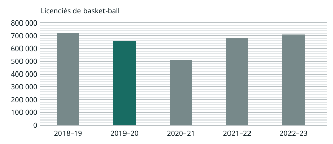
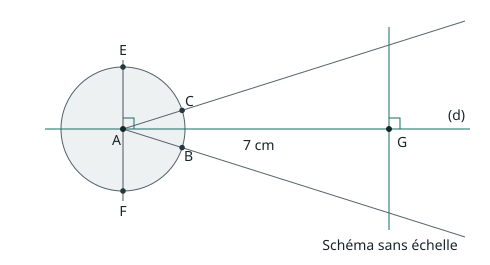

# CFG 2023 — Mathématiques — Corrigé brut

*Corrigé rédigé par IA, non officiel. Signalez toute erreur.*

## Exercice 1 — Écrire et compter

### 1. Athlètes engagés

Quatorze milliers et huit cent cinquante unités donnent **14 850 athlètes**.

### 2. Visiteurs attendus

15,1 millions = 15 000 000 + 100 000 = **15 100 000**.

### 3. Volontaires

44 500 s’écrit **quarante-quatre mille cinq cents**.

### 4. Durée des Jeux

Du 26 au 31 juillet inclus, il y a 31 − 26 + 1 = 6 jours. Du 1ᵉʳ au 11 août inclus, il y en a 11. La compétition dure **17 jours**.

## Exercice 2 — Classer les résultats

### 1. Distances au disque

Dans l’ordre croissant : **63,73 m < 63,90 m < 65,01 m < 65,72 m < 66,86 m < 68,98 m**.

### 2 a. Points au décathlon

Le classement décroissant est **9 018 > 8 726 > 8 649 > 8 611 > 8 604 > 8 435**.

### 2 b. Score de Kevin Mayer

Deuxième du classement, Kevin Mayer a **8 726 points**.

### 3. Écart à l’arrivée

2 h 44 min − 2 h 08 min = **36 min**.

## Exercice 3 — Lire un tableau

### 1. Garçons licenciés en basket-ball

En 2020, **342 734** garçons de moins de 15 ans sont licenciés en basket-ball.

### 2. Signification d’une case

**192 405** est le nombre de filles de moins de 15 ans licenciées en handball en 2020.

### 3. Total des licenciés de tennis

695 677 + 289 874 = **985 551** enfants de moins de 15 ans licenciés en tennis.

### 4. Case manquante en football

2 108 811 − 162 533 = **1 946 278**. C’est la valeur à inscrire sur la ligne « Garçons », colonne « Football ».

## Exercice 4 — Interpréter et compléter le diagramme

### 1. Saison 2021–2022

La barre atteint la ligne située une graduation sous 700 000 : **680 000 licenciés**.

### 2. Saison 2020–2021

Le sommet est à mi-chemin de 500 000 et 520 000 : **510 000 licenciés**.

### 3. Barre de la saison 2019–2020

La barre part de zéro et atteint **660 000**. La barre colorée ci-dessous complète le diagramme.

### 4. Évolution entre deux saisons

On passe de 510 000 à 710 000. L’augmentation vaut 710 000 − 510 000 = **200 000 licenciés**.

## Exercice 5 — Construire la zone de lancer

### 1. Angle au sommet A

La zone est plus étroite qu’un demi-angle droit (45°). Parmi les trois valeurs proposées, il faut entourer **35°**.

### 2. Perpendiculaire en A

Je trace la droite **(d)** qui passe par A et forme un angle droit avec (EF). Sur la construction ci-dessous, elle traverse la zone de lancer de gauche à droite.

### 3. Placer G

Je place la graduation zéro de la règle sur A et je marque **G à 7 cm**, du côté de la zone d’atterrissage.

### 4. Parallèle par G

Avec l’équerre, je trace en **G** la perpendiculaire à (d). Deux droites perpendiculaires à une même droite sont parallèles : le nouveau trait est donc parallèle à (EF).

## Exercice 6 — Le prix d’un équipement

### 1. Prix des quatre paires

4 × 11,50 € = **46 €**.

### 2. Sous-total hors T-shirt

280 € + 120 € + 49 € + 46 € = **495 €**.

### 3. Prix du T-shirt

564 € − 495 € = **69 €** pour le T-shirt.

### 4. Montant après remise

La remise est de 564 € ÷ 10 = 56,40 €. Nadège paie 564 € − 56,40 € = **507,60 €**.

### 5. Mensualité

507,60 € ÷ 4 = **126,90 €** par mensualité.

## Exercice 7 — Adapter une recette

### Liste des ingrédients

12 ÷ 4 = 3. Ainsi, 1 500 mL ÷ 3 = 500 mL de lait pour quatre gâteaux et 150 g × 3 = 450 g de miel pour douze. Voici les quantités à porter sur les deux listes.

- **Farine blanche** : 300 g pour 4 gâteaux et 900 g pour 12.
- **Lait demi-écrémé** : 500 mL et 1 500 mL.
- **Miel** : 150 g et 450 g.
- **Fruits secs** : 160 g et 480 g.
- **Huile** : 1 cuillère à soupe et 3 cuillères à soupe.
- **Levure** : 1 sachet et 3 sachets.
- **Amande en poudre** : 1 cuillère à soupe et 3 cuillères à soupe.
