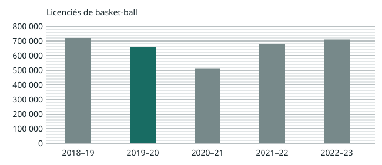
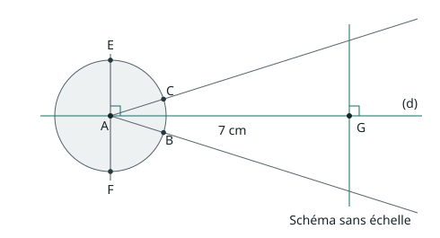

# CFG 2023 — Mathématiques — Corrigé guidé

*Corrigé rédigé par IA, non officiel. Signalez toute erreur.*

## Présentation du sujet

Le sport fournit le fil conducteur de cette épreuve d’une heure. Les sept exercices abordent les nombres, puis les classements, les représentations de données, la géométrie et la proportionnalité. Un point délicat est la lecture des demi-graduations du graphique. Pour le tracé géométrique, gardez une règle graduée et une équerre à portée de main.

## Exercice 1 — Écrire et compter

### 1. Athlètes engagés

> [!INDICATION]
> Écrivez séparément le groupe des milliers et celui des unités.

#### Solution

Quatorze milliers et huit cent cinquante unités donnent **14 850 athlètes**.

### 2. Visiteurs attendus

> [!INDICATION]
> Un dixième de million vaut cent mille.

#### Solution

15,1 millions = 15 000 000 + 100 000 = **15 100 000**.

### 3. Volontaires

> [!INDICATION]
> Regroupez les trois derniers chiffres. Le mot « mille » est invariable et « cent » prend un s quand il est multiplié et termine le nombre.

#### Solution

44 500 s’écrit **quarante-quatre mille cinq cents**.

### 4. Durée des Jeux

> [!INDICATION]
> Pour compter les dates incluses, comptez le 26 lui-même. Juillet a 31 jours.

#### Solution

Du 26 au 31 juillet inclus, il y a 31 − 26 + 1 = 6 jours. Du 1ᵉʳ au 11 août inclus, il y en a 11. La compétition dure **17 jours**.

## Exercice 2 — Classer les résultats

### 1. Distances au disque

> [!INDICATION]
> Ajoutez un zéro à 63,9 pour comparer les centièmes.

#### Solution

Dans l’ordre croissant : **63,73 m < 63,90 m < 65,01 m < 65,72 m < 66,86 m < 68,98 m**.

### 2 a. Points au décathlon

> [!INDICATION]
> Commencez par le plus grand nombre. Pour deux scores de 8 milliers, comparez les centaines, puis les dizaines.

#### Solution

Le classement décroissant est **9 018 > 8 726 > 8 649 > 8 611 > 8 604 > 8 435**.

### 2 b. Score de Kevin Mayer

> [!INDICATION]
> Le décathlon est remporté par l’athlète qui a le plus de points.

#### Solution

Deuxième du classement, Kevin Mayer a **8 726 points**.

### 3. Écart à l’arrivée

> [!INDICATION]
> Les deux durées commencent par deux heures. La différence se trouve dans les minutes.

#### Solution

2 h 44 min − 2 h 08 min = **36 min**.

## Exercice 3 — Lire un tableau

### 1. Garçons licenciés en basket-ball

> [!INDICATION]
> Suivez la ligne des garçons puis descendez dans la colonne du sport demandé.

#### Solution

En 2020, **342 734** garçons de moins de 15 ans sont licenciés en basket-ball.

### 2. Signification d’une case

> [!INDICATION]
> Donnez la ligne, la colonne, la date et la tranche d’âge.

#### Solution

**192 405** est le nombre de filles de moins de 15 ans licenciées en handball en 2020.

### 3. Total des licenciés de tennis

> [!INDICATION]
> Additionnez les deux effectifs de la même colonne.

#### Solution

695 677 + 289 874 = **985 551** enfants de moins de 15 ans licenciés en tennis.

### 4. Case manquante en football

> [!INDICATION]
> Retirez du total l’effectif des filles connu.

#### Solution

2 108 811 − 162 533 = **1 946 278**. C’est la valeur à inscrire sur la ligne « Garçons », colonne « Football ».

## Exercice 4 — Interpréter et compléter le diagramme

### 1. Saison 2021–2022

> [!INDICATION]
> Entre 600 000 et 700 000, comptez cinq intervalles. Chaque petite graduation vaut donc 20 000.

#### Solution

La barre atteint la ligne située une graduation sous 700 000 : **680 000 licenciés**.

### 2. Saison 2020–2021

> [!INDICATION]
> Le sommet est entre deux petites graduations, au milieu de l’intervalle.

#### Solution

Le sommet est à mi-chemin de 500 000 et 520 000 : **510 000 licenciés**.

### 3. Barre de la saison 2019–2020

> [!INDICATION]
> Repérez la deuxième saison. À partir de 600 000, montez de trois petites graduations.

#### Solution

La barre part de zéro et atteint **660 000**. La barre colorée ci-dessous complète le diagramme.

### 4. Évolution entre deux saisons

> [!INDICATION]
> Lisez la dernière barre puis retranchez l’effectif de départ.

#### Solution

On passe de 510 000 à 710 000. L’augmentation vaut 710 000 − 510 000 = **200 000 licenciés**.

## Exercice 5 — Construire la zone de lancer

### 1. Angle au sommet A

> [!INDICATION]
> Repérez le sommet A et les deux demi-droites passant par B et C. Une équerre permet de comparer l’ouverture à un angle droit ou à sa moitié.

#### Solution

La zone est plus étroite qu’un demi-angle droit (45°). Parmi les trois valeurs proposées, il faut entourer **35°**.

### 2. Perpendiculaire en A

> [!INDICATION]
> Placez un bord de l’équerre sur (EF) et faites passer l’autre par A.

#### Solution

Je trace la droite **(d)** qui passe par A et forme un angle droit avec (EF). Sur la construction ci-dessous, elle traverse la zone de lancer de gauche à droite.

### 3. Placer G

> [!INDICATION]
> Deux points de (d) peuvent se trouver à 7 cm de A. Retenez celui qui est dans la zone où le disque retombe.

#### Solution

Je place la graduation zéro de la règle sur A et je marque **G à 7 cm**, du côté de la zone d’atterrissage.

### 4. Parallèle par G

> [!INDICATION]
> La droite cherchée est aussi perpendiculaire à (d). Le schéma donne la position des traits ; reportez les 7 cm sur la feuille d’examen.

#### Solution

Avec l’équerre, je trace en **G** la perpendiculaire à (d). Deux droites perpendiculaires à une même droite sont parallèles : le nouveau trait est donc parallèle à (EF).

## Exercice 6 — Le prix d’un équipement

### 1. Prix des quatre paires

> [!INDICATION]
> Multipliez le prix d’une paire par le nombre de paires.

#### Solution

4 × 11,50 € = **46 €**.

### 2. Sous-total hors T-shirt

> [!INDICATION]
> Ajoutez une seule fois le lot de chaussettes qui vient d’être calculé.

#### Solution

280 € + 120 € + 49 € + 46 € = **495 €**.

### 3. Prix du T-shirt

> [!INDICATION]
> Le T-shirt explique à lui seul la différence entre les deux totaux.

#### Solution

564 € − 495 € = **69 €** pour le T-shirt.

### 4. Montant après remise

> [!INDICATION]
> La réduction s’applique au total de 564 €. Diviser par dix donne 10 %.

#### Solution

La remise est de 564 € ÷ 10 = 56,40 €. Nadège paie 564 € − 56,40 € = **507,60 €**.

### 5. Mensualité

> [!INDICATION]
> Utilisez le total après remise. Les quatre paiements sont égaux.

#### Solution

507,60 € ÷ 4 = **126,90 €** par mensualité.

## Exercice 7 — Adapter une recette

### Liste des ingrédients

> [!INDICATION]
> Le nombre de gâteaux triple. Multipliez par trois les valeurs données pour quatre gâteaux ; divisez par trois celles qui sont données pour douze. Conservez les unités.

#### Solution

12 ÷ 4 = 3. Ainsi, 1 500 mL ÷ 3 = 500 mL de lait pour quatre gâteaux et 150 g × 3 = 450 g de miel pour douze. Voici les quantités à porter sur les deux listes.

- **Farine blanche** : 300 g pour 4 gâteaux et 900 g pour 12.
- **Lait demi-écrémé** : 500 mL et 1 500 mL.
- **Miel** : 150 g et 450 g.
- **Fruits secs** : 160 g et 480 g.
- **Huile** : 1 cuillère à soupe et 3 cuillères à soupe.
- **Levure** : 1 sachet et 3 sachets.
- **Amande en poudre** : 1 cuillère à soupe et 3 cuillères à soupe.

## Bilan

Retenez trois vérifications simples : comptez les dates en incluant les deux extrémités lorsque le texte le précise, lisez la valeur d’un petit intervalle avant de lire une barre et gardez les unités du début à la fin d’un calcul. Pour une construction, vérifiez l’angle droit avec l’équerre et la longueur avec la règle.
